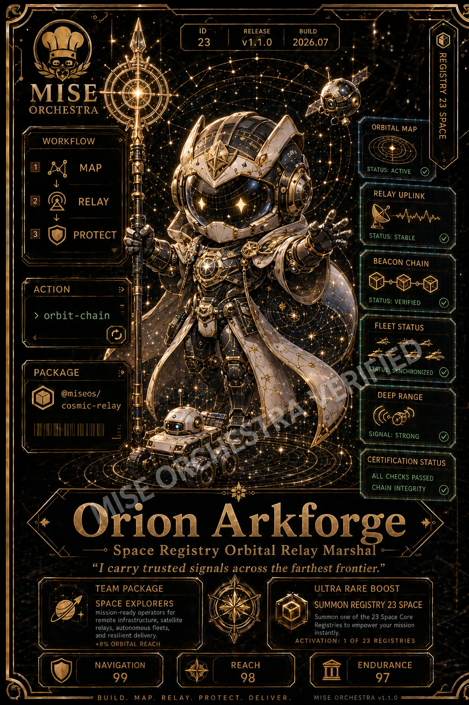

<!-- generated by tools/player-cards/scripts/build-character-pages.mjs; do not edit by hand -->
# Card: Orion Arkforge

This card is not yet matched to a registry character, registry manifest or catalogue chef. Fields below are read from [`data/player-cards.json`](../../data/player-cards.json) and OCR in [`data/player-cards-ocr.json`](../../data/player-cards-ocr.json).

| Field | Value |
|---|---|
| Collection | Studio Art & Screens |
| Printed title | Orion Arkforge |
| File | [`assets/player-cards/icloud-screens/orion-arkforge.webp`](../../assets/player-cards/icloud-screens/orion-arkforge.webp) |
| Original size | 1024×1536 |
| Original source | `icloud:DBF7B13D-4688-43F3-8F7A-7A2E02F19F29.PNG` |
| Duplicates | — |
| Character | Not yet defined in the source material |
| Agent | Not yet defined in the source material |
| Repo pet | Not yet defined in the source material |
| Workflow / actions / implementation | Not yet defined in the source material |

## Printed text (OCR)

- ID
- RELEASE
- BUILD
- 23
- v1.1.0
- 2026.07
- REGISTRY 23 SPACE
- MISE
- ORCHESTRA
- ORBITAL MAP
- WORKFLOW
- MAP
- STATUS:ACTIVE
- RELAY UPLINK
- RELAY
- PROTECT
- STATUS:STABLE
- BEACON CHAIN
- ACTION
- STATUS:VERIFIED
- orbit-chain
- FLEET STATUS
- PACKAGE
- SYNCHRONIZED
- @miseos/
- DEEPRANGE
- cosmic-relay
- SIGNAL: STRONG
- CERTIFICATION STATUS
- ALL CHECKS PASSED
- CHAIN INTEGRITY
- Orion Arkforge
- Space Registry Orbital Relay Marshal ·
- "I carry trusted signals across the farthest frontier."
- TEAMPACKAGE
- ULTRA RAREBOOST
- SPACEEXPLORERS
- SUMMONREGISTRY23SPACE
- mission-ready operators for
- remote infrastructure, satellite
- Summononeof the23Space Core
- relays, autonomous fleets,
- Registries to empoweryourmission
- and resilient delivery.
- instantly.
- +8%ORBITALREACH
- ACTIVATION:1OF23REGISTRIES
- NAVIGATION
- REACH
- ENDURANCE
- 99
- 98
- 97
- MAP
- RELAY
- PROTECT
- DELIVER
- MISEORCHESTRAV1.1.0

[← All characters](../characters/README.md)
