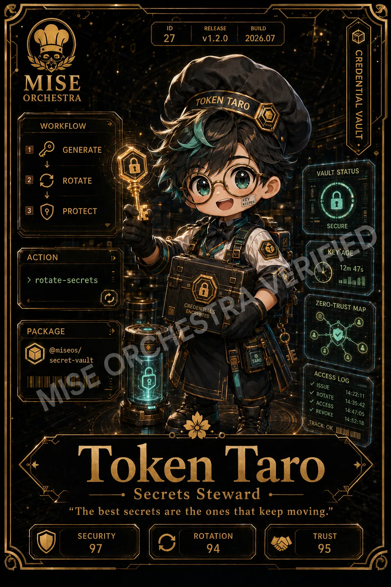

<!-- generated by tools/player-cards/scripts/build-character-pages.mjs; do not edit by hand -->
# Card: Token Taro

This card is not yet matched to a registry character, registry manifest or catalogue chef. Fields below are read from [`data/player-cards.json`](../../data/player-cards.json) and OCR in [`data/player-cards-ocr.json`](../../data/player-cards-ocr.json).

| Field | Value |
|---|---|
| Collection | Studio Art & Screens |
| Printed title | Token Taro |
| File | [`assets/player-cards/icloud-screens/token-taro.webp`](../../assets/player-cards/icloud-screens/token-taro.webp) |
| Original size | 1024×1536 |
| Original source | `icloud:A829FEB6-1923-4CCD-A9DB-CFA95806FD6A.PNG` |
| Duplicates | — |
| Character | Not yet defined in the source material |
| Agent | Not yet defined in the source material |
| Repo pet | Not yet defined in the source material |
| Workflow / actions / implementation | Not yet defined in the source material |

## Printed text (OCR)

- ID
- RELEASE
- BUILD
- 27
- v1.2.0
- 2026.07
- CREDENTIALVAULT
- MISE
- ORCHESTRA
- TOKEN TARO
- WORKFLOW
- GENERATE
- VAULTSTATUS
- ROTATE
- PROTECT
- SECURE
- KEYAGE
- ACTION
- 12m 47s
- rotate-secrets
- CREDENTIALS
- ZERO-TRUSTMAP
- ENCRVOTED
- PACKAGE
- @miseos/
- secret-vault
- ACCESS LOG
- ISSUE
- ROTATE
- 14:22:11
- ACCESS
- 14:35:42
- V REVOKE
- 14:47:05
- 14:52:18
- TRACK:OK
- Token
- Taro
- Secrets Steward
- "The best secrets are the ones that keep moving.
- SECURITY
- ROTATION
- TRUST
- 97
- 94
- 95

[← All characters](../characters/README.md)
