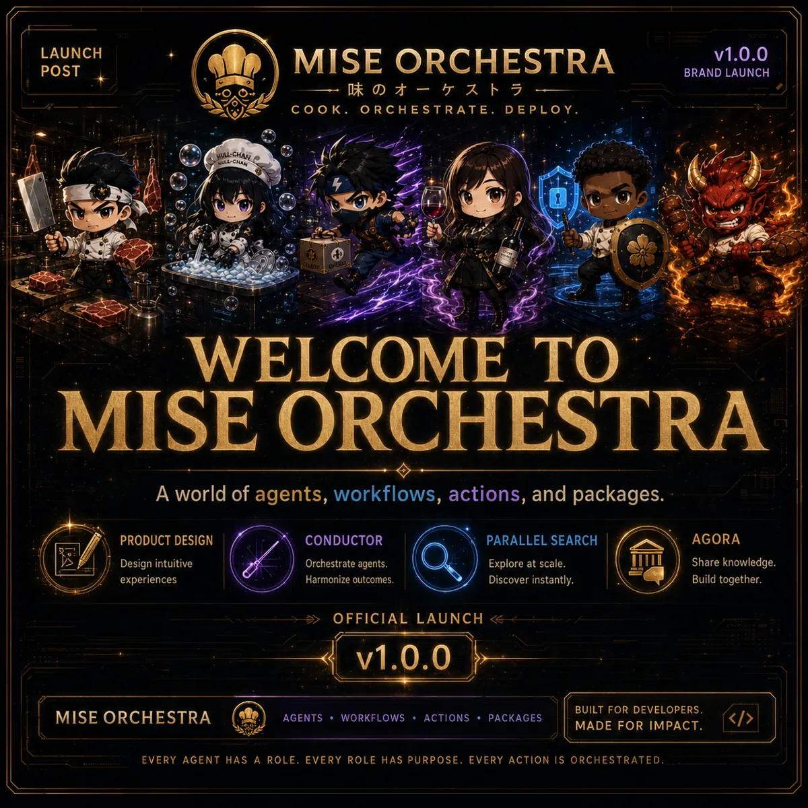

<!-- generated by tools/player-cards/scripts/build-character-pages.mjs; do not edit by hand -->
# Card: v1.0.0

This card is not yet matched to a registry character, registry manifest or catalogue chef. Fields below are read from [`data/player-cards.json`](../../data/player-cards.json) and OCR in [`data/player-cards-ocr.json`](../../data/player-cards-ocr.json).

| Field | Value |
|---|---|
| Collection | Studio Art & Screens |
| Printed title | v1.0.0 |
| File | [`assets/player-cards/icloud-screens/v1-0-0-2.webp`](../../assets/player-cards/icloud-screens/v1-0-0-2.webp) |
| Original size | 1254×1254 |
| Original source | `icloud:E649C10A-B03A-4BDE-B910-6D0389BE72F7.PNG` |
| Duplicates | — |
| Character | Not yet defined in the source material |
| Workflow / actions / implementation | Not yet defined in the source material |

## Printed text (OCR)

- LAUNCH
- MISEORCHESTRA
- v1.0.0
- POST
- BRAND LAUNCH
- 味の才一卜
- COOK.ORCHESTRATE.DEPLOY
- WELCOME TO
- MISEORCHESTRA
- Aworldofagents,workflows,actions,andpackages.
- CONDUCTOR
- PRODUCTDESIGN
- PARALLEL SEARCH
- AGORA
- Orchestrate agents.
- Design intuitive
- Explore at scale.
- Share knowledge.
- Harmonize outcomes.
- Discover instantly.
- experiences
- Build together.
- OFFICIAL LAUNCH
- v1.0.0
- MISEORCHESTRA
- BUILT FOR DEVELOPERS
- AGENTS·WORKFLOWS·ACTIONS·PACKAGES
- MADEFORIMPACT
- EVERY AGENT HAS A ROLE.EVERY ROLE HAS PURPOSE.EVERY ACTIONIS ORCHESTRATED

[← All characters](../characters/README.md)
