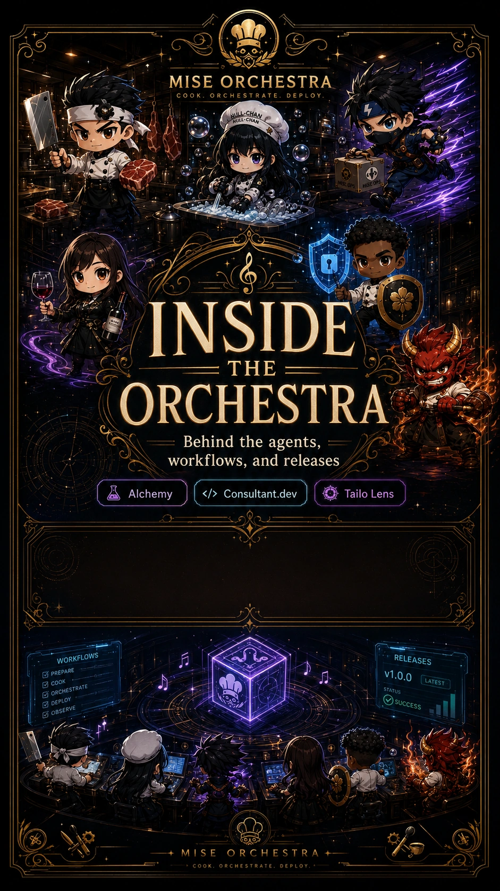

<!-- generated by tools/player-cards/scripts/build-character-pages.mjs; do not edit by hand -->
# Card: v1.0.0

This card is not yet matched to a registry character, registry manifest or catalogue chef. Fields below are read from [`data/player-cards.json`](../../data/player-cards.json) and OCR in [`data/player-cards-ocr.json`](../../data/player-cards-ocr.json).

| Field | Value |
|---|---|
| Collection | Studio Art & Screens |
| Printed title | v1.0.0 |
| File | [`assets/player-cards/icloud-screens/v1-0-0.webp`](../../assets/player-cards/icloud-screens/v1-0-0.webp) |
| Original size | 941×1672 |
| Original source | `icloud:A04E1E0C-833B-448C-9054-2CAEEB629151.PNG` |
| Duplicates | — |
| Character | Not yet defined in the source material |
| Agent | Not yet defined in the source material |
| Repo pet | Not yet defined in the source material |
| Workflow / actions / implementation | Not yet defined in the source material |

## Printed text (OCR)

- MISEORCHESTRA
- COOK.
- ORCHESTRATE.
- DEPLOY
- INSIDE
- THE
- ORCHESTRA
- Behind the agents,
- workflows, and releases
- Alchemy
- </>Consultant.dev
- Tailo Lens
- RELEASES
- WORKFLOWS
- PREPARE
- v1.0.0
- LATEST
- 日COOK
- STATUS
- ORCHESTRATE
- suCCESS
- DEPLOY
- OBSERVE
- COOK.

[← All characters](../characters/README.md)
