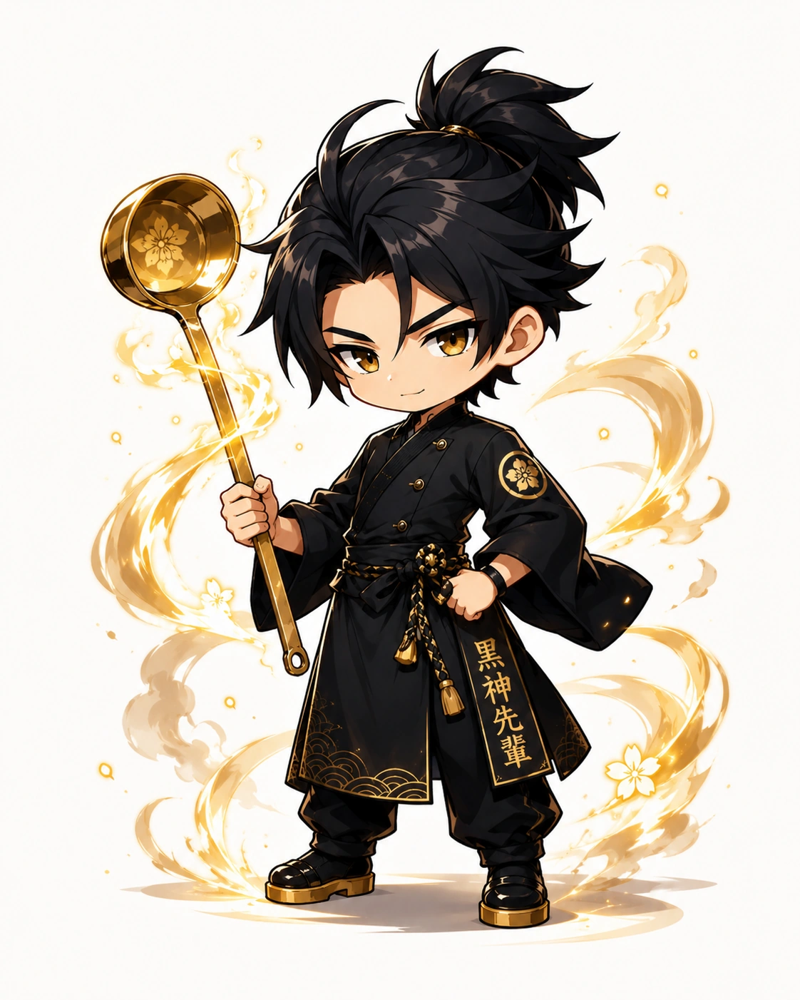

<!-- generated by tools/player-cards/scripts/build-character-pages.mjs; do not edit by hand -->
# Card: d446f048-3fbc-41b8-ada0-a36127e03f15.webp

This card is not yet matched to a registry character, registry manifest or catalogue chef. Fields below are read from [`data/player-cards.json`](../../data/player-cards.json) and OCR in [`data/player-cards-ocr.json`](../../data/player-cards-ocr.json).

| Field | Value |
|---|---|
| Collection | Long Cards |
| Printed title | Not yet defined in the source material |
| File | [`assets/player-cards/long-cards/d446f048-3fbc-41b8-ada0-a36127e03f15.webp`](../../assets/player-cards/long-cards/d446f048-3fbc-41b8-ada0-a36127e03f15.webp) |
| Original size | 1122×1402 |
| Original source | `extract:img-long-cards/Long cards /D446F048-3FBC-41B8-ADA0-A36127E03F15.PNG` |
| Duplicates | — |
| Character | Not yet defined in the source material |
| Workflow / actions / implementation | Not yet defined in the source material |

## Printed text (OCR)

- 黑神先

[← All characters](../characters/README.md)
