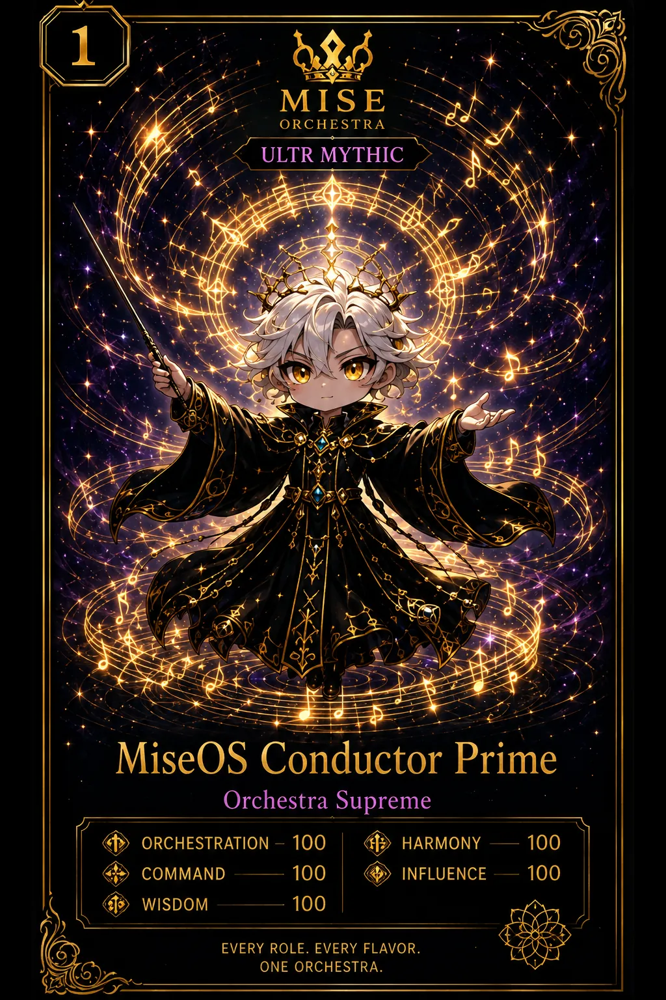

<!-- generated by tools/player-cards/scripts/build-character-pages.mjs; do not edit by hand -->
# Card: MiseOS Conductor Prime

This card is not yet matched to a registry character, registry manifest or catalogue chef. Fields below are read from [`data/player-cards.json`](../../data/player-cards.json) and OCR in [`data/player-cards-ocr.json`](../../data/player-cards-ocr.json).

| Field | Value |
|---|---|
| Collection | Long Cards |
| Printed title | MiseOS Conductor Prime |
| File | [`assets/player-cards/long-cards/miseos-conductor-prime.webp`](../../assets/player-cards/long-cards/miseos-conductor-prime.webp) |
| Original size | 1024×1536 |
| Original source | `extract:img-long-cards/Long cards /21761157-FDF5-4FD7-BB8A-82A656F1A91D.PNG` |
| Duplicates | `extract:img-long-cards/Long cards /8D5638AD-B1A8-42AA-B49A-C5710631CEE6.PNG` |
| Character | Not yet defined in the source material |
| Agent | Not yet defined in the source material |
| Repo pet | Not yet defined in the source material |
| Workflow / actions / implementation | Not yet defined in the source material |

## Printed text (OCR)

- MISE
- ORCHESTRA
- ULTR MYTHIC
- MiseOS Conductor Prime
- Orchestra Supreme
- ORCHESTRATION- 100
- HARMONY
- 100
- 100
- COMMAND
- INFLUENCE
- 100
- WISDOM
- 100
- EVERYROLE.EVERYFLAVOR.
- ONEORCHESTRA.

[← All characters](../characters/README.md)
