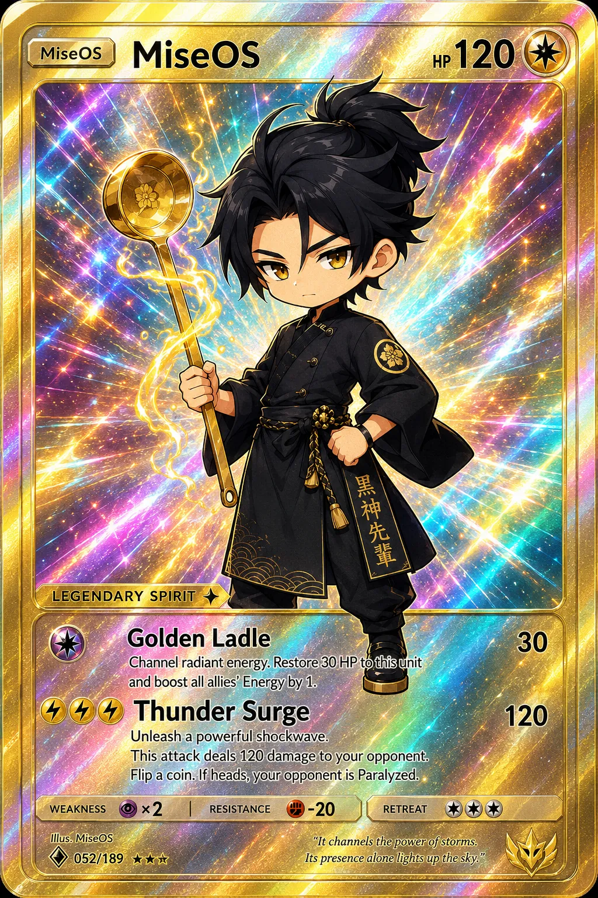

<!-- generated by tools/player-cards/scripts/build-character-pages.mjs; do not edit by hand -->
# Card: Thunder Surge

This card is not yet matched to a registry character, registry manifest or catalogue chef. Fields below are read from [`data/player-cards.json`](../../data/player-cards.json) and OCR in [`data/player-cards-ocr.json`](../../data/player-cards-ocr.json).

| Field | Value |
|---|---|
| Collection | Long Cards |
| Printed title | Thunder Surge |
| File | [`assets/player-cards/long-cards/thunder-surge.webp`](../../assets/player-cards/long-cards/thunder-surge.webp) |
| Original size | 1024×1536 |
| Original source | `extract:img-long-cards/Long cards /40790C36-50E3-4C9B-BE9D-AC0CB078E843.PNG` |
| Duplicates | — |
| Character | Not yet defined in the source material |
| Workflow / actions / implementation | Not yet defined in the source material |

## Printed text (OCR)

- MiseOs
- 1200
- Miseos
- HP
- 黑神先畵
- LEGENDARY SPIRIT
- GoldenLadle
- 30
- Channel radiant energy. Restore 30 HP to.this unit
- and boost all allies' Energy by 1.
- Thunder Surge
- 120
- Unleash a powerful shockwave.
- This attack deals 120 damage to your opponent.
- Flip a coin. If heads, your opponent is Paralyzed.
- WEAKNESS
- RESISTANCE
- -20
- RETREAT
- Illus.Miseos
- "It channels thepowerof storms.
- 052/189★★★
- Its presence alone lights upthesky."

[← All characters](../characters/README.md)
