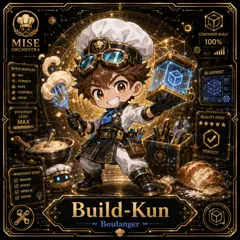
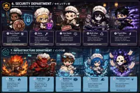
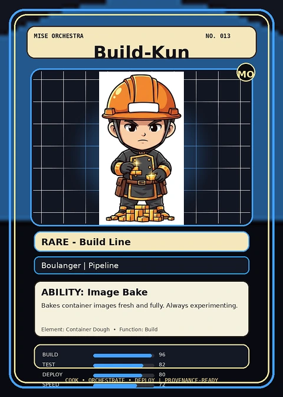

<!-- generated by tools/player-cards/scripts/build-character-pages.mjs from data/characters/build-kun.json; do not edit by hand -->
# Build-Kun

**Registry character agent** · Implementation: **Referenced in app code (no dedicated handler)** · Detail record: [`data/characters/build-kun.json`](../../data/characters/build-kun.json)

Every field below comes from a repository source (shown as `source:`). Where no source exists the page says _Not yet defined in the source material_.

## Identity

| Field | Value |
|---|---|
| Name | Build-Kun source: `data/characters.json` |
| Aliases / printed variants | Not yet defined in the source material |
| Role / title | Build source: `characters/build-kun/metadata.json` |
| Kitchen / department | Pipeline Kitchen source: `characters/build-kun/metadata.json` |
| Department mission | Build. Test. Deploy. Repeat. source: `data/imports/miseos_character_master_inventory_001_300.csv` |
| Registry rarity | Rare source: `characters/build-kun/metadata.json` |
| Level | 21 source: `data/imports/miseos_character_master_inventory_001_300.csv` |
| ID: registry_id | MISE-086 source: `characters/build-kun/metadata.json` |
| ID: character_id | miseos.character.086 source: `data/imports/miseos_character_master_inventory_001_300.csv` |
| ID: card_id | MISE-086 source: `data/imports/miseos_character_master_inventory_001_300.csv` |
| ID: codename | BUILD_KUN source: `data/imports/miseos_character_master_inventory_001_300.csv` |
| Collections | 1×1 Chefs, Character Building Theme, Mise Orchestra Trading Cards (Season 1) source: `data/player-cards.json` |
| Cards linked | 3 source: `data/player-cards.json` |

## Player cards

| Card | Collection | Printed title | Match method | Full size |
|---|---|---|---|---|
| `build-kun.webp` | 1×1 Chefs | Build-Kun | existing-index | [open](../../assets/player-cards/1by1-chefs/build-kun.webp) |
| `build-kun.webp` | Character Building Theme | 3 Build-Kun | existing-index | [open](../../assets/player-cards/character-building/build-kun.webp) |
| `build-kun.webp` | Mise Orchestra Trading Cards (Season 1) | Build-Kun | existing-index | [open](../../assets/player-cards/orchestra-trading-cards/build-kun.webp) |

## Card metadata (as printed)

| Field | Value |
|---|---|
| Printed rarity | Rare source: `data/player-cards-ocr.json` |
| Printed stars | 5 source: `data/player-cards-ocr.json` |
| Printed meters | 100% source: `data/player-cards-ocr.json` |
| Roster stats | power 75 · precision 73 · speed 70 · resilience 81 · intelligence 62 · teamwork 82 source: `data/imports/miseos_character_master_inventory_001_300.csv (roster stats, not OCR)` |
| Abilities | Image Bake source: `data/imports/mise_orchestra_cards.csv` |
| Mise Orchestra card | role: Boulanger · department: Pipeline · function: Build · rarity: Rare · tier: Build Line · element: Container Dough · ability: Image Bake · lore: Bakes container images fresh and fully. Always experimenting. source: `data/imports/mise_orchestra_cards.csv` |
| Lore | Build-Kun belongs to the Kitchen Chaos DevOps Universe, where every technical workflow becomes a coordinated brigade station. source: `data/imports/merged_roster.json` |
| Signature phrase | Not yet defined in the source material |

Full printed card text (OCR)

**`build-kun.webp`**: CONTAINER BUILD · MISE · 100% · ORCHESTRA · BUILDMODULES · 源·MIX · BLUEPRINT · ·FERMENT · ·BAKE · ·ASSEMBLE · .wow! · EFFICIENCY · LEVEL · QUALITY FIRST · MAX · ★★★★★ · PERFECT · INVENTOR'SSPIRIT · IMAGINE · INVENT · IMPROVE · INSPIRE · Build-Kun · Boulanger

**`build-kun.webp`**: 6.SECURITY DEPARTMENT /七≠↓亍↑部 · Weprotect the kitchen. Wekeep chaos out. · INVALID · AINVALIDA · INPUT · SEIRA · AINPUT · SCHEMA · ERROR · ERROR · Iron Hashi · 8Null-chan · 11KuroGuard · 10 Seira · FlashRiku · Steward · Sommelier · Boucher · Plongeur · Runner · The shield that stands · Keeper of secrets and · No mistakes allowed. · Cleans up what's not · Fastest chef in the kitchen. · between threats and · sensitive ingredients. · Validates everything · needed. Keeps the kitchen · Delivers with speed, · the kitchen. Unwavering · Nothing gets in. Nothing · with brutal precision. · light, fast, and efficient. · defender. · accuracy, and zero delays. · gets out. · GARBAGECOLLECTION · FIREWALL&ACCESSCONTROL · SECRETS MANAGEMENT · VALIDATION&COMPLIANCE · CI/CDDELIVERY · 7.INFRASTRUCTUREDEPARTMENT/17部 · We build. We scale. We keep everything running. · 12 Scale Oni · 3Build-Kun · 5Kaji · 14Streama · 5Orchestra Core · Rotisseur · Grillardin · Boulanger · Poissonier · Chef Spirit · Handles the heat and · When demand rises, · Bakes fresh images · Streams data like water. · The soul of the kitchen. · hegrows.Scalesup, · keeps the engines · from clean recipes. · Flowneverstops. · Sees everything. · burning.Power is · handles more,never · Everybuild isa new · Always in motion. · backs down. · his passion. · creation. · Coordinates all. · COMPUTE ENGINE · AUTOSCALING · CONTAINER BUILD · DATA STREAMING · ORCHESTRATIONCORE

**`build-kun.webp`**: MISE ORCHESTRA · NO.013 · Build-Kun · RARE-BuildLine · Boulanger\|Pipeline · ABILITY:ImageBake · Bakes container images fresh and fully. Always experimenting · Element:Container Dough · Function:Build · BUILD · 96 · TEST · 82 · DEPLOY · 80 · ·ORCHESTRATE·DEPLOY · COOK · LPROVENANCE-READY · SPEED

## Workflow

| Step | Value |
|---|---|
| Summary | Build-Kun performs build within the Pipeline Kitchen. source: `characters/build-kun/metadata.json` |
| Inputs | repository context, task request, policy constraints, current evidence source: `characters/build-kun/metadata.json` |
| Outputs | validated result, evidence record, handoff packet source: `characters/build-kun/metadata.json` |
| Proof gate | No merge, deployment, publication, billing action, or mint without evidence. source: `characters/build-kun/metadata.json` |

## Actions / commands

- command: `MISE BUILD` source: `data/imports/miseos_character_master_inventory_001_300.csv`

## Implementation

**Status:** Referenced in app code (no dedicated handler)

Application code that uses this entry:
- [`apps/miseos-platform/packages/miseos-repo-pet/src/characters.js:369`](../../apps/miseos-platform/packages/miseos-repo-pet/src/characters.js#L369)

Roster data / types / tests in code that list this entry (not an implementation):
- [`apps/brigade-gallery/src/data/brigade-roster.ts:139`](../../apps/brigade-gallery/src/data/brigade-roster.ts#L139)

Data files that reference it:
- [`apps/gridops-platform/data/miseos-ecosystem-135.json:4764`](../../apps/gridops-platform/data/miseos-ecosystem-135.json#L4764)
- [`apps/registry-atrium/collection-manifest.json:120`](../../apps/registry-atrium/collection-manifest.json#L120)
- [`apps/registry-atrium/metadata/erc721/013-build-kun.json:2`](../../apps/registry-atrium/metadata/erc721/013-build-kun.json#L2)
- [`apps/voxel-world/src/data/miseos-ecosystem-135.json:4764`](../../apps/voxel-world/src/data/miseos-ecosystem-135.json#L4764)
- [`tools/art-factory/input/mise_orchestra_cards.csv:14`](../../tools/art-factory/input/mise_orchestra_cards.csv#L14)
- [`tools/art-factory/input/mise_orchestra_collection_manifest.json:120`](../../tools/art-factory/input/mise_orchestra_collection_manifest.json#L120)
- [`tools/art-factory/output/manifests/krikey_animation_prompts.json:207`](../../tools/art-factory/output/manifests/krikey_animation_prompts.json#L207)
- [`tools/art-factory/output/manifests/mangaboom_comic_prompts.json:207`](../../tools/art-factory/output/manifests/mangaboom_comic_prompts.json#L207)
- [`tools/art-factory/output/merged_roster.json:1838`](../../tools/art-factory/output/merged_roster.json#L1838)

Docs that describe it (docs only, not code):
- [`characters/build-kun/README.md`](../../characters/build-kun/README.md)
- [`apps/brigade-gallery/prototype/holo-card-roster.html:76`](../../apps/brigade-gallery/prototype/holo-card-roster.html#L76)
- [`apps/brigade-gallery/prototype/registry-atrium-gallery.html:342`](../../apps/brigade-gallery/prototype/registry-atrium-gallery.html#L342)
- [`apps/developer-platform/docs/characters/CHARACTER_REGISTRY_001_300.md:11`](../../apps/developer-platform/docs/characters/CHARACTER_REGISTRY_001_300.md#L11)
- [`apps/miseos-platform/packages/miseos-repo-pet/README.md:5`](../../apps/miseos-platform/packages/miseos-repo-pet/README.md#L5)
- [`apps/miseos-platform/packages/miseos-repo-pet/docs/MASCOT_REFERENCE.md:26`](../../apps/miseos-platform/packages/miseos-repo-pet/docs/MASCOT_REFERENCE.md#L26)
- [`apps/registry-atrium/index.html:342`](../../apps/registry-atrium/index.html#L342)

implemented_in_code = a dedicated capability handler or tool directory exists; referenced_in_app_code = the entity is used by application source (e.g. repo-pet sprites, CLI) but has no dedicated handler. code_refs are files that reference this entity by name/slug/handler (grep), not a guarantee of a dedicated runtime; registry handler links point at the actual capability function.

## Where and how it helps

| Aspect | Value |
|---|---|
| Station / stage | Pipeline Kitchen source: `characters/build-kun/metadata.json` |
| Mission | Build. Test. Deploy. Repeat. source: `data/imports/miseos_character_master_inventory_001_300.csv` |
| Problem it addresses | Build-Kun performs build within the Pipeline Kitchen. source: `characters/build-kun/metadata.json` |
| Safety gate | No merge, deployment, publication, billing action, or mint without evidence. source: `characters/build-kun/metadata.json` |

## Agents and repo pets

Agents: [Build Kun](../agents/build-kun.md) source: `data/agents.json`

Repo pets: [Build-Kun](../repo-pets/build-kun.md) source: `data/repo-pets.json`

## Related characters

[Alko Commit Chef](./alko-commit-chef.md) · [Bruno Blast-Radius](./bruno-blast-radius.md) · [Lila Branchkeeper](./lila-branchkeeper.md) source: `data/imports/miseos_character_master_inventory_001_300.csv`

## Canon Bible

Mentioned in [`docs/canon/MiseOS-Canon-Bible-v1.0.pdf`](../../docs/canon/MiseOS-Canon-Bible-v1.0.pdf):

- line 643: `MISE-G2-P082 Build-Kun Mise Orchestra canonical-candidate 1E3334AB-3111- 82`

## Sources

| Field | Source |
|---|---|
| name | `data/characters.json` |
| cards | `data/player-cards.json` |
| card_text | `data/player-cards-ocr.json (OCR of the card image)` |
| card_rarity_printed | `data/player-cards-ocr.json` |
| card_stars_printed | `data/player-cards-ocr.json` |
| card_meters_printed | `data/player-cards-ocr.json` |
| ids.registry_id | `characters/build-kun/metadata.json` |
| role | `characters/build-kun/metadata.json` |
| department | `characters/build-kun/metadata.json` |
| rarity | `characters/build-kun/metadata.json` |
| workflow.summary | `characters/build-kun/metadata.json` |
| workflow.inputs | `characters/build-kun/metadata.json` |
| workflow.outputs | `characters/build-kun/metadata.json` |
| workflow.proof_gate | `characters/build-kun/metadata.json` |
| department_mission | `data/imports/miseos_character_master_inventory_001_300.csv` |
| ids.character_id | `data/imports/miseos_character_master_inventory_001_300.csv` |
| ids.card_id | `data/imports/miseos_character_master_inventory_001_300.csv` |
| ids.codename | `data/imports/miseos_character_master_inventory_001_300.csv` |
| stats | `data/imports/miseos_character_master_inventory_001_300.csv (roster stats, not OCR)` |
| level | `data/imports/miseos_character_master_inventory_001_300.csv` |
| related | `data/imports/miseos_character_master_inventory_001_300.csv` |
| lore | `data/imports/merged_roster.json` |
| orchestra_card | `data/imports/mise_orchestra_cards.csv` |
| abilities | `data/imports/mise_orchestra_cards.csv` |
| canon_bible | `docs/canon/MiseOS-Canon-Bible-v1.0.pdf (pdftotext)` |
| implementation | `git ls-files grep + repo` |
| helps.station | `characters/build-kun/metadata.json` |
| agents | `data/agents.json` |
| repo_pets | `data/repo-pets.json` |

[← All characters](./README.md)
