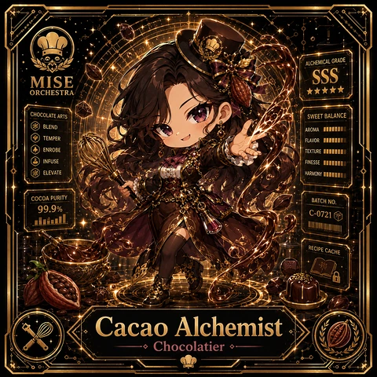

<!-- generated by tools/player-cards/scripts/build-character-pages.mjs from data/characters/cacao-alchemist.json; do not edit by hand -->
# Cacao Alchemist

**Card-defined chef (catalogue: visual reference only)** · Implementation: **Designed (not yet implemented in code)** · Detail record: [`data/characters/cacao-alchemist.json`](../../data/characters/cacao-alchemist.json)

Every field shows where its value comes from (`source:`). Repo-sourced values cite the repository or source-library file they were read from; values marked `authored: card design` were written for this card by [`enrich-characters.py`](../../tools/player-cards/scripts/enrich-characters.py), derived from the printed card text, role and kitchen theme, and are not claims about existing code.

## Identity

| Field | Value |
|---|---|
| Name | Cacao Alchemist source: `data/imports/photo-alignment.csv` |
| Aliases / printed variants | None recorded (no alternate title in the canon crosswalk or agents.json) source: `data/player-cards.json + canon crosswalk (no alternate title found)` |
| Role / title | Chocolatier source: `data/player-cards-ocr.json (subtitle printed under the name)` |
| Kitchen / department | Platform Kitchen source: `authored: card design (kitchen chosen from role/printed text, theme "plate")` |
| Department mission | Provide golden paths and stable service foundations. source: `data/imports/miseos_character_master_inventory_001_300.csv (mission of Platform Kitchen)` |
| Registry rarity | Legendary source: `authored: card design (from printed star count 5)` |
| Collections | 1×1 Chefs source: `data/player-cards.json` |
| Cards linked | 1 source: `data/player-cards.json` |
| Catalogue status | visual_reference_only source: `data/imports/photo-alignment.csv` |

## Player cards

| Card | Collection | Printed title | Match method | Full size |
|---|---|---|---|---|
| `cacao-alchemist.webp` | 1×1 Chefs | Cacao Alchemist | title | [open](../../assets/player-cards/1by1-chefs/cacao-alchemist.webp) |

## Card metadata (as printed)

| Field | Value |
|---|---|
| Printed rarity | Not printed on the card source: `data/player-cards-ocr.json (no rarity word in OCR)` |
| Printed stars | 5 source: `data/player-cards-ocr.json` |
| Printed meters | 99.9% source: `data/player-cards-ocr.json` |
| Roster stats | power 91 · precision 98 · speed 87 · resilience 79 · intelligence 81 · teamwork 86 source: `authored: card design (6-axis roster scale; baseline from stars + theme "plate")` |
| Abilities | Alchemical Grade, Chocolate Arts, Sweet Balance, Blend, Aroma, Temper source: `data/player-cards-ocr.json (printed card labels, glued OCR words segmented)` |
| Lore | Ask the brigade about Cacao Alchemist and they describe the pass under warm lights, tweezers in hand. As Platform Kitchen's Chocolatier, Cacao Alchemist finishes and presents the work: composition, garnish and a final visual check at the pass, and the rest of the kitchen plans service around that rhythm. The card calls out Alchemical Grade, Chocolate Arts, Sweet Balance: the checks Cacao Alchemist runs before calling anything ready. source: `authored: card design (derived from printed card text/role)` |
| Signature phrase | If it is not right, it goes back. source: `authored: card design (derived from printed card text/role)` |

Full printed card text (OCR)

**`cacao-alchemist.webp`**: ALCHEMICALGRADE · MISE · ORCHESTRA · ★★★★★ · CHOCOLATEARTS · SWEETBALANCE · BLEND · AROMA · TEMPER · FLAVOR · ENROBE · TEXTURE · INFUSE · FINESSE · ELEVATE · HARMON · COCOA PURITY · BATCH NO. · 99.9% · C-0721刚 · RECIPE CACHE · Cacao Alchemist · Chocolatier

## Workflow

| Step | Value |
|---|---|
| Summary | Cacao Alchemist finishes and presents the work: composition, garnish and a final visual check at the pass. source: `authored: card design (theme "plate")` |
| Inputs | cooked components, plating spec / style guide, ticket source: `authored: card design (theme "plate")` |
| Outputs | plated dish, pass photo / visual check, send-back note when something is off source: `authored: card design (theme "plate")` |
| Proof gate | Pass inspection: each plate is compared to the spec image before it leaves; mismatches go back, never out. source: `authored: card design (theme "plate")` |

## Actions / commands

- command: `mise roster run cacao-alchemist --dept platform-kitchen --solo --emit report` · status: `proposed` source: `authored: follows data/imports/master-roster-cards.csv (mise roster run command convention)`
- command: `mise cacao-alchemist plate` · reads: `cooked components` · emits: `plated dish` · status: `proposed` source: `authored: card design (theme "plate")`
- command: `mise cacao-alchemist inspect` · reads: `plating spec / style guide` · emits: `pass photo / visual check` · status: `proposed` source: `authored: card design (theme "plate")`
- command: `mise cacao-alchemist send` · reads: `ticket` · emits: `send-back note when something is off` · status: `proposed` source: `authored: card design (theme "plate")`

## Implementation

**Status:** Designed (not yet implemented in code)

- Proposed handler: `cacaoAlchemist` (not written yet)
- Proposed command: `mise roster run cacao-alchemist --dept platform-kitchen --solo --emit report`
- Contract: inputs: cooked components, plating spec / style guide, ticket → outputs: plated dish, pass photo / visual check, send-back note when something is off; refuses to emit 'ready' unless the proof gate passes

source: `git ls-files grep + repo (no code found) + authored: proposed handler spec`

implemented_in_code = a dedicated capability handler or tool directory exists; referenced_in_app_code = the entity is used by application source (e.g. repo-pet sprites, CLI) but has no dedicated handler. code_refs are files that reference this entity by name/slug/handler (grep), not a guarantee of a dedicated runtime; registry handler links point at the actual capability function.

## Where and how it helps

| Aspect | Value |
|---|---|
| Station / stage | Chocolatier source: `data/player-cards-ocr.json (subtitle printed under the name)` |
| Mission | Provide golden paths and stable service foundations. source: `data/imports/miseos_character_master_inventory_001_300.csv (mission of Platform Kitchen)` |
| Problem it addresses | Good work loses its value when the last step (UI, docs, release notes) is sloppy. source: `authored: card design (theme "plate")` |
| Safety gate | Pass inspection: each plate is compared to the spec image before it leaves; mismatches go back, never out. source: `authored: card design (theme "plate")` |

## Agents and repo pets

Agents: [UX Chef](../agents/ux-chef.md) · [DevRel](../agents/devrel.md) · [Doc Writer](../agents/doc-writer.md) source: `authored: card design (closest agents for theme "plate")`

Repo pets: [Yume](../repo-pets/yume.md) · [Mise Garde](../repo-pets/mise-garde.md) source: `authored: card design (closest repo pets for theme "plate")`

## Related characters

[Sweet Architect](./sweet-architect.md) · [Plating Poet](./plating-poet.md) · [Zen Plater](./zen-plater.md) · [Kuro Guard](./kuro-guard.md) · [Bootstrap Aiko](./bootstrap-aiko.md) · [Portal Rei](./portal-rei.md) source: `authored: card design (same theme "plate" / same department)`

## Sources

| Field | Source |
|---|---|
| name | `data/imports/photo-alignment.csv` |
| cards | `data/player-cards.json` |
| card_text | `data/player-cards-ocr.json (OCR of the card image)` |
| card_stars_printed | `data/player-cards-ocr.json` |
| card_meters_printed | `data/player-cards-ocr.json` |
| role | `data/player-cards-ocr.json (subtitle printed under the name)` |
| catalogue_status | `data/imports/photo-alignment.csv` |
| implementation | `git ls-files grep + repo (no code found) + authored: proposed handler spec` |
| helps.station | `data/player-cards-ocr.json (subtitle printed under the name)` |
| aliases | `data/player-cards.json + canon crosswalk (no alternate title found)` |
| department | `authored: card design (kitchen chosen from role/printed text, theme "plate")` |
| department_mission | `data/imports/miseos_character_master_inventory_001_300.csv (mission of Platform Kitchen)` |
| card_rarity_printed | `data/player-cards-ocr.json (no rarity word in OCR)` |
| rarity | `authored: card design (from printed star count 5)` |
| stats | `authored: card design (6-axis roster scale; baseline from stars + theme "plate")` |
| abilities | `data/player-cards-ocr.json (printed card labels, glued OCR words segmented)` |
| lore | `authored: card design (derived from printed card text/role)` |
| signature_phrase | `authored: card design (derived from printed card text/role)` |
| workflow.summary | `authored: card design (theme "plate")` |
| workflow.inputs | `authored: card design (theme "plate")` |
| workflow.outputs | `authored: card design (theme "plate")` |
| workflow.proof_gate | `authored: card design (theme "plate")` |
| actions | `authored: follows data/imports/master-roster-cards.csv (mise roster run command convention)` |
| helps.mission | `data/imports/miseos_character_master_inventory_001_300.csv (mission of Platform Kitchen)` |
| helps.problem | `authored: card design (theme "plate")` |
| helps.proof_gate | `authored: card design (theme "plate")` |
| agents | `authored: card design (closest agents for theme "plate")` |
| repo_pets | `authored: card design (closest repo pets for theme "plate")` |
| related | `authored: card design (same theme "plate" / same department)` |
| theme | `authored: card design (keyword theme used for authored fields)` |

[← All characters](./README.md)
