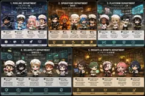
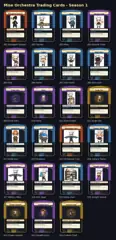

<!-- generated by tools/player-cards/scripts/build-character-pages.mjs from data/characters/canary-taster.json; do not edit by hand -->
# Canary Taster

**Registry character agent** · Implementation: **Described in docs only** · Detail record: [`data/characters/canary-taster.json`](../../data/characters/canary-taster.json)

Every field shows where its value comes from (`source:`). Repo-sourced values cite the repository or source-library file they were read from; values marked `authored: card design` were written for this card by [`enrich-characters.py`](../../tools/player-cards/scripts/enrich-characters.py), derived from the printed card text, role and kitchen theme, and are not claims about existing code.

## Identity

| Field | Value |
|---|---|
| Name | Canary Taster source: `data/characters.json` |
| Aliases / printed variants | None recorded (no alternate title in the canon crosswalk or agents.json) source: `data/player-cards.json + canon crosswalk (no alternate title found)` |
| Role / title | Pipeline Observability source: `characters/canary-taster/metadata.json` |
| Kitchen / department | Pipeline Kitchen source: `characters/canary-taster/metadata.json` |
| Department mission | Build. Test. Deploy. Repeat. source: `data/imports/miseos_character_master_inventory_001_300.csv` |
| Registry rarity | Rare source: `characters/canary-taster/metadata.json` |
| Level | 19 source: `data/imports/miseos_character_master_inventory_001_300.csv` |
| ID: registry_id | MISE-014 source: `characters/canary-taster/metadata.json` |
| ID: character_id | miseos.character.014 source: `data/imports/miseos_character_master_inventory_001_300.csv` |
| ID: card_id | MISE-014 source: `data/imports/miseos_character_master_inventory_001_300.csv` |
| ID: codename | CANARY_TASTER source: `data/imports/miseos_character_master_inventory_001_300.csv` |
| Collections | Character Building Theme, Studio Art & Screens, Mise Orchestra Trading Cards (Season 1) source: `data/player-cards.json` |
| Cards linked | 3 source: `data/player-cards.json` |
| Role category | delivery source: `data/imports/merged_roster.json` |

## Player cards

| Card | Collection | Printed title | Match method | Full size |
|---|---|---|---|---|
| `canary-taster.webp` | Character Building Theme | @Canary Taster | existing-index | [open](../../assets/player-cards/character-building/canary-taster.webp) |
| `canary-taster.webp` | Mise Orchestra Trading Cards (Season 1) | Canary Taster | existing-index | [open](../../assets/player-cards/orchestra-trading-cards/canary-taster.webp) |
| `canary-taster.webp` | Studio Art & Screens | 016 Canary Taster | existing-index | [open](../../assets/player-cards/icloud-screens/canary-taster.webp) |

## Card metadata (as printed)

| Field | Value |
|---|---|
| Printed rarity | Rare source: `data/player-cards-ocr.json` |
| Printed stars | Not printed on the card source: `data/player-cards-ocr.json (no stars in OCR)` |
| Printed meters | Not printed on the card source: `data/player-cards-ocr.json (no % meters in OCR)` |
| Roster stats | power 77 · precision 73 · speed 74 · resilience 82 · intelligence 63 · teamwork 81 source: `data/imports/miseos_character_master_inventory_001_300.csv (roster stats, not OCR)` |
| Abilities | First Bite Test source: `data/imports/mise_orchestra_cards.csv` |
| Mise Orchestra card | role: Guest Chef · department: Reliability · function: Test · rarity: Rare · tier: Release Safety · element: Canary Signal · ability: First Bite Test · lore: Tests the waters first. Ensures safe rollouts with canary releases. source: `data/imports/mise_orchestra_cards.csv` |
| Lore | Canary Taster belongs to the Kitchen Chaos DevOps Universe, where every technical workflow becomes a coordinated brigade station. source: `data/imports/merged_roster.json` |
| Signature phrase | Pipeline Observability done cleanly, safely, and in rhythm. source: `data/imports/merged_roster.json` |
| Unique trait | Specializes in pipeline observability so the Pipeline Kitchen can operate as a precise, repo-safe DevOps station. source: `data/imports/merged_roster.json` |

Full printed card text (OCR)

**`canary-taster.webp`**: 1.PIPELINEDEPARTMENT · 2.OPERATIONSDEPARTMENT · 3.PLATFORMDEPARTMENT · 连用部 · Build. Test. Deploy. Repeat. · Keep the kitchen running smoothly. · Provide the tools. Empower the chefs. · FlashRiku · Umami Code · ? Build-Kun · G Yume · @Tensho · ?Kaji · 2ScaleOni · 14Streama · 10 Seira · OKurogami Senpai · ③Mizu · ①KuroGuard · Orchestra Core · Boulanger · Pastry Chef · Expediter · Chef de Cuisine · Grliardin · Poissonier · Prep Chef · Steward · Runner · Rotisseur · Saucier · Sommelier · Chef Spirit · Bakes container images · Turms code intobeauttd · Scales upwhenthings · Defends the platform · The master crchestratar. · Handies the heat · Streamsdatalikewate · Prepares everything · Creates the perfect · Protects secrets like · artitacts Perfectionis · fresh and flufly · flowing, Chaos cart · gethot, Thebigerthe · Smooth,continuous, · Plars every move with · Powersthe compute · fne wine. Security · with unwavering · in advance. · ugedd ay yinoag paads · stop the rusht · odthsrongts · Sees everything. · her recipe. · perfectprecisicn · withblatingpassion · and always flowing · is her specialty. · protection. · connects everything. · coordinates al. · BUILD · ORCHESTRATE · CONNECT · CODE · TEST · DEPLOY · MONITOR · COMPUTE · SCALE · STREAM · PREPARE · SECURE · PROTECT · OBSERVE · RELIABILITYDEPARTMENT · 5.INSIGHTS&GROWTHDEPARTMENT · 信赖性部 · &成長部 · Observe.Measure.Improve. · Learn.Optimize.Evolve. · 6996 · 18 SLO Sage · 19Data-chan · 6CanaryTaster · 20 Insight Sensei · 2Chaos Analyst · Iron Hashi · 8Null-chan · 7MetricsMiko · 22GrowthGuru · 23CultureChef · (Guest Chef) · (Guest Chef) · (Guest Chef) · Plongeur · (Guest Chef) · (Guest Chef) · (Guest Chef) · (Guest Chef) · Boucher · (Guest Chef) · Validates everything · Finds patterns in chaos. · Cleans up what's · Tests the waters first. · Reads the numbers. · Protects the promises. · Collects and organizes · Embraces the chaos. · Always innovating. · andculture.Happy · Nurtures the team · with strict standards. · not needed. · Ensures safe rollouts · Metrics guide · Maintains SLOs and · data. Knowledge is · Turms data into · Tums incidents into · Seeks better ways · No errors on his watch. · Keeps things light. · with canary releases. · error budgets. · the secret ingredient. · understanding. · to scale. · every decision. · chefs cook best! · COLLECT · ANALYZE · LEARN · OPTIMIZE · VALIDATE · CLEANSE · MEASURE · GUARANTEE · GROW

**`canary-taster.webp`**: MISE ORCHESTRA · NO.016 · Canary Taster · MO · RARE-Release Safety · GuestChefReliability · ABILITY:FirstBiteTest · Tests the waters first. Ensures safe rollouts with canary · releases. · Element:CanarySignal·Function:Test · TEST · 96 · MEASURE · 84 · VALIDATE · 87 · ·ORCHESTRATE·DEPLOY · PROVENANCE-READY · WARN

**`canary-taster.webp`**: MiseOrchestra TradingCards-Season1 · Season1Core · tC-Plattorm Cere · 001Kurogami Senpai · 002Tensho · 003Mizu · 004UmamiCode · Kall · IronHash · Null-ch · 005Kaji · 006Yume · 007Iron Hashi · 008Null-chan · 009FlashRiku · 010Seira · 011KuroGuard · 012ScaleOni · Build-Ku · anaryTaster · 013Build-Kun · 015OrchestraCore · 014Streama · 016CanaryTaster · 018SLOSage · 017Metrics Miko · 019Data-chan · o20InsightSensei · ChaosAnalyst · 021ChaosAnalyst · 022GrowthGuru · 023CultureChef

## Workflow

| Step | Value |
|---|---|
| Summary | Canary Taster performs pipeline observability within the Pipeline Kitchen. source: `characters/canary-taster/metadata.json` |
| Inputs | repository context, task request, policy constraints, current evidence source: `characters/canary-taster/metadata.json` |
| Outputs | validated result, evidence record, handoff packet source: `characters/canary-taster/metadata.json` |
| Proof gate | No merge, deployment, publication, billing action, or mint without evidence. source: `characters/canary-taster/metadata.json` |

## Actions / commands

- command: `MISE PIPELINE OBSERVABILITY` source: `data/imports/miseos_character_master_inventory_001_300.csv`
- command: `Pipeline Observability` · mise_name: `Mise PipelineObservability` source: `data/imports/merged_roster.json`

## Implementation

**Status:** Described in docs only

Roster data / types / tests in code that list this entry (not an implementation):
- [`apps/bootstrap-registry/apps/registry-console/src/data/master-roster.generated.ts:239`](../../apps/bootstrap-registry/apps/registry-console/src/data/master-roster.generated.ts#L239)
- [`apps/brigade-gallery/src/data/master-roster.ts:237`](../../apps/brigade-gallery/src/data/master-roster.ts#L237)

Data files that reference it:
- [`apps/bootstrap-registry/registry/cards/master-roster-cards.json:191`](../../apps/bootstrap-registry/registry/cards/master-roster-cards.json#L191)
- [`apps/gridops-platform/data/miseos-ecosystem-135.json:672`](../../apps/gridops-platform/data/miseos-ecosystem-135.json#L672)
- [`apps/registry-atrium/collection-manifest.json:147`](../../apps/registry-atrium/collection-manifest.json#L147)
- [`apps/registry-atrium/metadata/erc721/016-canary-taster.json:2`](../../apps/registry-atrium/metadata/erc721/016-canary-taster.json#L2)
- [`apps/voxel-world/src/data/agents.json:415`](../../apps/voxel-world/src/data/agents.json#L415)
- [`apps/voxel-world/src/data/miseos-ecosystem-135.json:672`](../../apps/voxel-world/src/data/miseos-ecosystem-135.json#L672)
- [`tools/art-factory/input/characters.generated.json:741`](../../tools/art-factory/input/characters.generated.json#L741)
- [`tools/art-factory/input/mise_orchestra_cards.csv:17`](../../tools/art-factory/input/mise_orchestra_cards.csv#L17)
- [`tools/art-factory/input/mise_orchestra_collection_manifest.json:147`](../../tools/art-factory/input/mise_orchestra_collection_manifest.json#L147)
- [`tools/art-factory/output/manifests/krikey_animation_prompts.json:213`](../../tools/art-factory/output/manifests/krikey_animation_prompts.json#L213)

Docs that describe it (docs only, not code):
- [`characters/canary-taster/README.md`](../../characters/canary-taster/README.md)
- [`apps/brigade-gallery/prototype/holo-card-roster.html:76`](../../apps/brigade-gallery/prototype/holo-card-roster.html#L76)
- [`apps/brigade-gallery/prototype/registry-atrium-gallery.html:342`](../../apps/brigade-gallery/prototype/registry-atrium-gallery.html#L342)
- [`apps/developer-platform/docs/characters/CHARACTER_REGISTRY_001_300.md:11`](../../apps/developer-platform/docs/characters/CHARACTER_REGISTRY_001_300.md#L11)
- [`apps/registry-atrium/index.html:342`](../../apps/registry-atrium/index.html#L342)

implemented_in_code = a dedicated capability handler or tool directory exists; referenced_in_app_code = the entity is used by application source (e.g. repo-pet sprites, CLI) but has no dedicated handler. code_refs are files that reference this entity by name/slug/handler (grep), not a guarantee of a dedicated runtime; registry handler links point at the actual capability function.

## Where and how it helps

| Aspect | Value |
|---|---|
| Station / stage | Pipeline Kitchen source: `characters/canary-taster/metadata.json` |
| Mission | Build. Test. Deploy. Repeat. source: `data/imports/miseos_character_master_inventory_001_300.csv` |
| Problem it addresses | Canary Taster performs pipeline observability within the Pipeline Kitchen. source: `characters/canary-taster/metadata.json` |
| Safety gate | No merge, deployment, publication, billing action, or mint without evidence. source: `characters/canary-taster/metadata.json` |

## Agents and repo pets

Agents: [Kuro Guard](../agents/kuro-guard.md) · [Firewall](../agents/firewall.md) · [Security Auditor](../agents/security-auditor.md) source: `authored: card design (closest agents for theme "security")`

Repo pets: [Kuro Guard](../repo-pets/kuro-guard.md) · [Mise Locker](../repo-pets/mise-locker.md) source: `authored: card design (closest repo pets for theme "security")`

## Related characters

[Pipeline Sensei](./pipeline-sensei.md) · [Tensho](./tensho.md) · [Yume](./yume.md) · [Ivun Cache](./ivun-cache.md) · [Guardrail Goro](./guardrail-goro.md) · [Impact Ichi](./impact-ichi.md) source: `data/imports/miseos_character_master_inventory_001_300.csv data/imports/merged_roster.json data/imports/merged_roster.json data/imports/merged_roster.json`

## Sources

| Field | Source |
|---|---|
| name | `data/characters.json` |
| cards | `data/player-cards.json` |
| card_text | `data/player-cards-ocr.json (OCR of the card image)` |
| card_rarity_printed | `data/player-cards-ocr.json` |
| ids.registry_id | `characters/canary-taster/metadata.json` |
| role | `characters/canary-taster/metadata.json` |
| department | `characters/canary-taster/metadata.json` |
| rarity | `characters/canary-taster/metadata.json` |
| workflow.summary | `characters/canary-taster/metadata.json` |
| workflow.inputs | `characters/canary-taster/metadata.json` |
| workflow.outputs | `characters/canary-taster/metadata.json` |
| workflow.proof_gate | `characters/canary-taster/metadata.json` |
| department_mission | `data/imports/miseos_character_master_inventory_001_300.csv` |
| ids.character_id | `data/imports/miseos_character_master_inventory_001_300.csv` |
| ids.card_id | `data/imports/miseos_character_master_inventory_001_300.csv` |
| ids.codename | `data/imports/miseos_character_master_inventory_001_300.csv` |
| stats | `data/imports/miseos_character_master_inventory_001_300.csv (roster stats, not OCR)` |
| level | `data/imports/miseos_character_master_inventory_001_300.csv` |
| related | `data/imports/miseos_character_master_inventory_001_300.csv data/imports/merged_roster.json data/imports/merged_roster.json data/imports/merged_roster.json` |
| lore | `data/imports/merged_roster.json` |
| signature_phrase | `data/imports/merged_roster.json` |
| unique_trait | `data/imports/merged_roster.json` |
| role_category | `data/imports/merged_roster.json` |
| orchestra_card | `data/imports/mise_orchestra_cards.csv` |
| abilities | `data/imports/mise_orchestra_cards.csv` |
| implementation | `git ls-files grep + repo` |
| helps.station | `characters/canary-taster/metadata.json` |
| aliases | `data/player-cards.json + canon crosswalk (no alternate title found)` |
| card_stars_printed | `data/player-cards-ocr.json (no stars in OCR)` |
| card_meters_printed | `data/player-cards-ocr.json (no % meters in OCR)` |
| agents | `authored: card design (closest agents for theme "security")` |
| repo_pets | `authored: card design (closest repo pets for theme "security")` |
| theme | `authored: card design (keyword theme used for authored fields)` |

[← All characters](./README.md)
