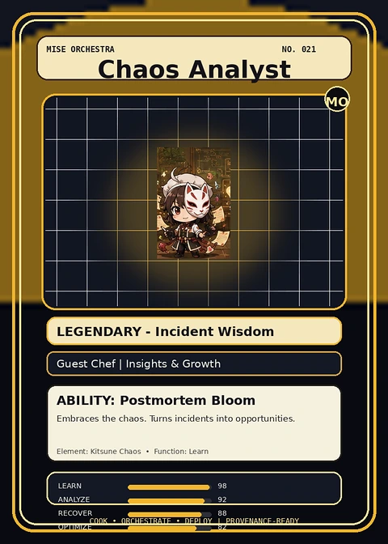

<!-- generated by tools/player-cards/scripts/build-character-pages.mjs from data/characters/chaos-analyst.json; do not edit by hand -->
# Chaos Analyst

**Registry character agent** · Implementation: **Described in docs only** · Detail record: [`data/characters/chaos-analyst.json`](../../data/characters/chaos-analyst.json)

Every field below comes from a repository source (shown as `source:`). Where no source exists the page says _Not yet defined in the source material_.

## Identity

| Field | Value |
|---|---|
| Name | Chaos Analyst source: `data/characters.json` |
| Aliases / printed variants | Not yet defined in the source material |
| Role / title | Learn source: `characters/chaos-analyst/metadata.json` |
| Kitchen / department | Data & Insight Kitchen source: `characters/chaos-analyst/metadata.json` |
| Department mission | Learn. Optimize. Evolve. source: `data/imports/miseos_character_master_inventory_001_300.csv` |
| Registry rarity | Legendary source: `characters/chaos-analyst/metadata.json` |
| Level | 23 source: `data/imports/miseos_character_master_inventory_001_300.csv` |
| ID: registry_id | MISE-090 source: `characters/chaos-analyst/metadata.json` |
| ID: character_id | miseos.character.090 source: `data/imports/miseos_character_master_inventory_001_300.csv` |
| ID: card_id | MISE-090 source: `data/imports/miseos_character_master_inventory_001_300.csv` |
| ID: codename | CHAOS_ANALYST source: `data/imports/miseos_character_master_inventory_001_300.csv` |
| Collections | Mise Orchestra Trading Cards (Season 1) source: `data/player-cards.json` |
| Cards linked | 1 source: `data/player-cards.json` |

## Player cards

| Card | Collection | Printed title | Match method | Full size |
|---|---|---|---|---|
| `chaos-analyst.webp` | Mise Orchestra Trading Cards (Season 1) | Chaos Analyst | existing-index | [open](../../assets/player-cards/orchestra-trading-cards/chaos-analyst.webp) |

## Card metadata (as printed)

| Field | Value |
|---|---|
| Printed rarity | Legendary source: `data/player-cards-ocr.json` |
| Printed stars | Not yet defined in the source material |
| Printed meters | Not yet defined in the source material |
| Roster stats | power 67 · precision 78 · speed 59 · resilience 75 · intelligence 85 · teamwork 72 source: `data/imports/miseos_character_master_inventory_001_300.csv (roster stats, not OCR)` |
| Abilities | Postmortem Bloom source: `data/imports/mise_orchestra_cards.csv` |
| Mise Orchestra card | role: Guest Chef · department: Insights & Growth · function: Learn · rarity: Legendary · tier: Incident Wisdom · element: Kitsune Chaos · ability: Postmortem Bloom · lore: Embraces the chaos. Turns incidents into opportunities. source: `data/imports/mise_orchestra_cards.csv` |
| Lore | Chaos Analyst belongs to the Kitchen Chaos DevOps Universe, where every technical workflow becomes a coordinated brigade station. source: `data/imports/merged_roster.json` |
| Signature phrase | Not yet defined in the source material |

Full printed card text (OCR)

**`chaos-analyst.webp`**: MISE ORCHESTRA · NO.021 · Chaos Analyst · LEGENDARY-IncidentWisdom · GuestChefInsights&Growth · ABILITY:PostmortemBloom · Embraces the chaos. Turns incidents into opportunities. · Element:KitsuneChaos .Function:Learn · LEARN · 98 · ANALYZE · 92 · RECOVER · 88 · ORCHESTRATE·DEPLOY · COOK · PROVENANCE-READY · OPIIMIZE · 82

## Workflow

| Step | Value |
|---|---|
| Summary | Chaos Analyst performs learn within the Data & Insight Kitchen. source: `characters/chaos-analyst/metadata.json` |
| Inputs | repository context, task request, policy constraints, current evidence source: `characters/chaos-analyst/metadata.json` |
| Outputs | validated result, evidence record, handoff packet source: `characters/chaos-analyst/metadata.json` |
| Proof gate | No merge, deployment, publication, billing action, or mint without evidence. source: `characters/chaos-analyst/metadata.json` |

## Actions / commands

- command: `MISE LEARN` source: `data/imports/miseos_character_master_inventory_001_300.csv`

## Implementation

**Status:** Described in docs only

Data files that reference it:
- [`apps/gridops-platform/data/miseos-ecosystem-135.json:4640`](../../apps/gridops-platform/data/miseos-ecosystem-135.json#L4640)
- [`apps/registry-atrium/collection-manifest.json:192`](../../apps/registry-atrium/collection-manifest.json#L192)
- [`apps/registry-atrium/metadata/erc721/021-chaos-analyst.json:2`](../../apps/registry-atrium/metadata/erc721/021-chaos-analyst.json#L2)
- [`apps/voxel-world/src/data/miseos-ecosystem-135.json:4640`](../../apps/voxel-world/src/data/miseos-ecosystem-135.json#L4640)
- [`tools/art-factory/input/mise_orchestra_cards.csv:22`](../../tools/art-factory/input/mise_orchestra_cards.csv#L22)
- [`tools/art-factory/input/mise_orchestra_collection_manifest.json:192`](../../tools/art-factory/input/mise_orchestra_collection_manifest.json#L192)
- [`tools/art-factory/output/manifests/krikey_animation_prompts.json:105`](../../tools/art-factory/output/manifests/krikey_animation_prompts.json#L105)
- [`tools/art-factory/output/manifests/mangaboom_comic_prompts.json:105`](../../tools/art-factory/output/manifests/mangaboom_comic_prompts.json#L105)
- [`tools/art-factory/output/merged_roster.json:1100`](../../tools/art-factory/output/merged_roster.json#L1100)

Docs that describe it (docs only, not code):
- [`characters/chaos-analyst/README.md`](../../characters/chaos-analyst/README.md)
- [`apps/brigade-gallery/prototype/holo-card-roster.html:76`](../../apps/brigade-gallery/prototype/holo-card-roster.html#L76)
- [`apps/brigade-gallery/prototype/registry-atrium-gallery.html:342`](../../apps/brigade-gallery/prototype/registry-atrium-gallery.html#L342)
- [`apps/developer-platform/docs/characters/CHARACTER_REGISTRY_001_300.md:27`](../../apps/developer-platform/docs/characters/CHARACTER_REGISTRY_001_300.md#L27)
- [`apps/registry-atrium/index.html:342`](../../apps/registry-atrium/index.html#L342)

implemented_in_code = a dedicated capability handler or tool directory exists; referenced_in_app_code = the entity is used by application source (e.g. repo-pet sprites, CLI) but has no dedicated handler. code_refs are files that reference this entity by name/slug/handler (grep), not a guarantee of a dedicated runtime; registry handler links point at the actual capability function.

## Where and how it helps

| Aspect | Value |
|---|---|
| Station / stage | Data & Insight Kitchen source: `characters/chaos-analyst/metadata.json` |
| Mission | Learn. Optimize. Evolve. source: `data/imports/miseos_character_master_inventory_001_300.csv` |
| Problem it addresses | Chaos Analyst performs learn within the Data & Insight Kitchen. source: `characters/chaos-analyst/metadata.json` |
| Safety gate | No merge, deployment, publication, billing action, or mint without evidence. source: `characters/chaos-analyst/metadata.json` |

## Agents and repo pets

_Not yet defined in the source material_

## Related characters

[Growth Guru](./growth-guru.md) · [Culture Chef](./culture-chef.md) · [Taxonomy Taka](./taxonomy-taka.md) source: `data/imports/miseos_character_master_inventory_001_300.csv`

## Sources

| Field | Source |
|---|---|
| name | `data/characters.json` |
| cards | `data/player-cards.json` |
| card_text | `data/player-cards-ocr.json (OCR of the card image)` |
| card_rarity_printed | `data/player-cards-ocr.json` |
| ids.registry_id | `characters/chaos-analyst/metadata.json` |
| role | `characters/chaos-analyst/metadata.json` |
| department | `characters/chaos-analyst/metadata.json` |
| rarity | `characters/chaos-analyst/metadata.json` |
| workflow.summary | `characters/chaos-analyst/metadata.json` |
| workflow.inputs | `characters/chaos-analyst/metadata.json` |
| workflow.outputs | `characters/chaos-analyst/metadata.json` |
| workflow.proof_gate | `characters/chaos-analyst/metadata.json` |
| department_mission | `data/imports/miseos_character_master_inventory_001_300.csv` |
| ids.character_id | `data/imports/miseos_character_master_inventory_001_300.csv` |
| ids.card_id | `data/imports/miseos_character_master_inventory_001_300.csv` |
| ids.codename | `data/imports/miseos_character_master_inventory_001_300.csv` |
| stats | `data/imports/miseos_character_master_inventory_001_300.csv (roster stats, not OCR)` |
| level | `data/imports/miseos_character_master_inventory_001_300.csv` |
| related | `data/imports/miseos_character_master_inventory_001_300.csv` |
| lore | `data/imports/merged_roster.json` |
| orchestra_card | `data/imports/mise_orchestra_cards.csv` |
| abilities | `data/imports/mise_orchestra_cards.csv` |
| implementation | `git ls-files grep + repo` |
| helps.station | `characters/chaos-analyst/metadata.json` |

[← All characters](./README.md)
