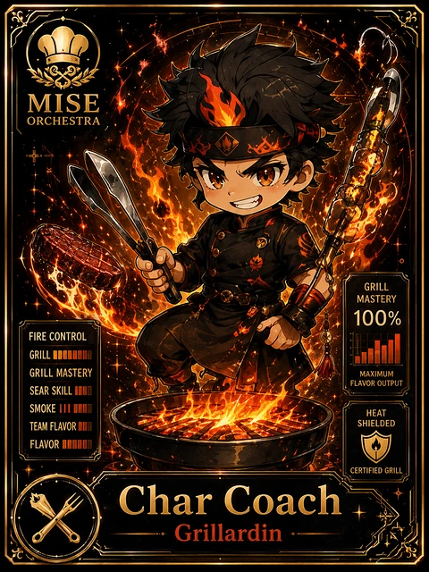

<!-- generated by tools/player-cards/scripts/build-character-pages.mjs from data/characters/char-coach.json; do not edit by hand -->
# Char Coach

**Card-defined chef (catalogue: visual reference only)** · Implementation: **Designed (not yet implemented in code)** · Detail record: [`data/characters/char-coach.json`](../../data/characters/char-coach.json)

Every field shows where its value comes from (`source:`). Repo-sourced values cite the repository or source-library file they were read from; values marked `authored: card design` were written for this card by [`enrich-characters.py`](../../tools/player-cards/scripts/enrich-characters.py), derived from the printed card text, role and kitchen theme, and are not claims about existing code.

## Identity

| Field | Value |
|---|---|
| Name | Char Coach source: `data/imports/photo-alignment.csv` |
| Aliases / printed variants | None recorded (no alternate title in the canon crosswalk or agents.json) source: `data/player-cards.json + canon crosswalk (no alternate title found)` |
| Role / title | Grillardin source: `data/player-cards-ocr.json (subtitle printed under the name)` |
| Kitchen / department | Reliability Kitchen source: `authored: card design (kitchen chosen from role/printed text, theme "heat")` |
| Department mission | Observe. Measure. Improve. source: `data/imports/miseos_character_master_inventory_001_300.csv (mission of Reliability Kitchen)` |
| Registry rarity | Common source: `authored: card design (default tier; no stars printed)` |
| Collections | Long Cards source: `data/player-cards.json` |
| Cards linked | 1 source: `data/player-cards.json` |
| Catalogue status | visual_reference_only source: `data/imports/photo-alignment.csv` |

## Player cards

| Card | Collection | Printed title | Match method | Full size |
|---|---|---|---|---|
| `char-coach.webp` | Long Cards | Char Coach | title | [open](../../assets/player-cards/long-cards/char-coach.webp) |

## Card metadata (as printed)

| Field | Value |
|---|---|
| Printed rarity | Not printed on the card source: `data/player-cards-ocr.json (no rarity word in OCR)` |
| Printed stars | Not printed on the card source: `data/player-cards-ocr.json (no stars in OCR)` |
| Printed meters | 100% source: `data/player-cards-ocr.json` |
| Roster stats | power 80 · precision 73 · speed 68 · resilience 72 · intelligence 80 · teamwork 74 source: `authored: card design (6-axis roster scale; baseline from stars + theme "heat")` |
| Abilities | Grill, Mastery, Fire Control, Grill Mastery, Maximum, Flavor Output source: `data/player-cards-ocr.json (printed card labels, glued OCR words segmented)` |
| Lore | Most of the brigade only notices Char Coach when something is missing, which is exactly the point. Char Coach runs the high-heat line: controls flame, timing and doneness so pressure never turns into burn; the image the crew uses for it is the flat-top at the peak of Friday service. The card calls out Grill, Mastery, Fire Control: the checks Char Coach runs before calling anything ready. source: `authored: card design (derived from printed card text/role)` |
| Signature phrase | Hot pan, calm hands. source: `authored: card design (derived from printed card text/role)` |

Full printed card text (OCR)

**`char-coach.webp`**: MISE · ORCHESTRA · GRILL · MASTERY · 100% · FIRECONTROL · GRILL · GRILL MASTERY · MAXIMUM · FLAVOROUTPUT · SEAR SKILL I · SMOKE III · HEAT · TEAMFLAVOR · SHIELDED · FLAVOR · CERTIFIED GRILL · Char Coach · Grillardin

## Workflow

| Step | Value |
|---|---|
| Summary | Char Coach runs the high-heat line: controls flame, timing and doneness so pressure never turns into burn. source: `authored: card design (theme "heat")` |
| Inputs | ticket with doneness target, heat / load reading, timer, protein or batch on the pass source: `authored: card design (theme "heat")` |
| Outputs | cooked-to-spec item, doneness check, heat log, escalation if the line runs hot source: `authored: card design (theme "heat")` |
| Proof gate | Doneness gate: nothing leaves the station without a probe/timer reading inside the target band; overheated runs are pulled, not served. source: `authored: card design (theme "heat")` |

## Actions / commands

- command: `mise roster run char-coach --dept reliability-kitchen --solo --emit report` · status: `proposed` source: `authored: follows data/imports/master-roster-cards.csv (mise roster run command convention)`
- command: `mise char-coach sear` · reads: `ticket with doneness target` · emits: `cooked-to-spec item` · status: `proposed` source: `authored: card design (theme "heat")`
- command: `mise char-coach probe` · reads: `heat / load reading` · emits: `doneness check` · status: `proposed` source: `authored: card design (theme "heat")`
- command: `mise char-coach cool-down` · reads: `timer` · emits: `escalation if the line runs hot` · status: `proposed` source: `authored: card design (theme "heat")`

## Implementation

**Status:** Designed (not yet implemented in code)

- Proposed handler: `charCoach` (not written yet)
- Proposed command: `mise roster run char-coach --dept reliability-kitchen --solo --emit report`
- Contract: inputs: ticket with doneness target, heat / load reading, timer, protein or batch on the pass → outputs: cooked-to-spec item, doneness check, heat log, escalation if the line runs hot; refuses to emit 'ready' unless the proof gate passes

source: `git ls-files grep + repo (no code found) + authored: proposed handler spec`

implemented_in_code = a dedicated capability handler or tool directory exists; referenced_in_app_code = the entity is used by application source (e.g. repo-pet sprites, CLI) but has no dedicated handler. code_refs are files that reference this entity by name/slug/handler (grep), not a guarantee of a dedicated runtime; registry handler links point at the actual capability function.

## Where and how it helps

| Aspect | Value |
|---|---|
| Station / stage | Grillardin source: `data/player-cards-ocr.json (subtitle printed under the name)` |
| Mission | Observe. Measure. Improve. source: `data/imports/miseos_character_master_inventory_001_300.csv (mission of Reliability Kitchen)` |
| Problem it addresses | Under load, the hottest station is where quality collapses first (outages, burnt releases). source: `authored: card design (theme "heat")` |
| Safety gate | Doneness gate: nothing leaves the station without a probe/timer reading inside the target band; overheated runs are pulled, not served. source: `authored: card design (theme "heat")` |

## Agents and repo pets

Agents: [Kaji](../agents/kaji.md) · [Scale Oni](../agents/scale-oni.md) · [Perf Chef](../agents/perf-chef.md) source: `authored: card design (closest agents for theme "heat")`

Repo pets: [Kaji](../repo-pets/kaji.md) · [Scale Oni](../repo-pets/scale-oni.md) source: `authored: card design (closest repo pets for theme "heat")`

## Related characters

[Smoke Monk](./smoke-monk.md) · [Sear Samurai](./sear-samurai.md) · [Pan Phantom](./pan-phantom.md) · [Review Ren](./review-ren.md) · [Pager Hiro](./pager-hiro.md) · [SLO Sage](./slo-sage.md) source: `authored: card design (same theme "heat" / same department)`

## Sources

| Field | Source |
|---|---|
| name | `data/imports/photo-alignment.csv` |
| cards | `data/player-cards.json` |
| card_text | `data/player-cards-ocr.json (OCR of the card image)` |
| card_meters_printed | `data/player-cards-ocr.json` |
| role | `data/player-cards-ocr.json (subtitle printed under the name)` |
| catalogue_status | `data/imports/photo-alignment.csv` |
| implementation | `git ls-files grep + repo (no code found) + authored: proposed handler spec` |
| helps.station | `data/player-cards-ocr.json (subtitle printed under the name)` |
| aliases | `data/player-cards.json + canon crosswalk (no alternate title found)` |
| department | `authored: card design (kitchen chosen from role/printed text, theme "heat")` |
| department_mission | `data/imports/miseos_character_master_inventory_001_300.csv (mission of Reliability Kitchen)` |
| card_rarity_printed | `data/player-cards-ocr.json (no rarity word in OCR)` |
| card_stars_printed | `data/player-cards-ocr.json (no stars in OCR)` |
| rarity | `authored: card design (default tier; no stars printed)` |
| stats | `authored: card design (6-axis roster scale; baseline from stars + theme "heat")` |
| abilities | `data/player-cards-ocr.json (printed card labels, glued OCR words segmented)` |
| lore | `authored: card design (derived from printed card text/role)` |
| signature_phrase | `authored: card design (derived from printed card text/role)` |
| workflow.summary | `authored: card design (theme "heat")` |
| workflow.inputs | `authored: card design (theme "heat")` |
| workflow.outputs | `authored: card design (theme "heat")` |
| workflow.proof_gate | `authored: card design (theme "heat")` |
| actions | `authored: follows data/imports/master-roster-cards.csv (mise roster run command convention)` |
| helps.mission | `data/imports/miseos_character_master_inventory_001_300.csv (mission of Reliability Kitchen)` |
| helps.problem | `authored: card design (theme "heat")` |
| helps.proof_gate | `authored: card design (theme "heat")` |
| agents | `authored: card design (closest agents for theme "heat")` |
| repo_pets | `authored: card design (closest repo pets for theme "heat")` |
| related | `authored: card design (same theme "heat" / same department)` |
| theme | `authored: card design (keyword theme used for authored fields)` |

[← All characters](./README.md)
