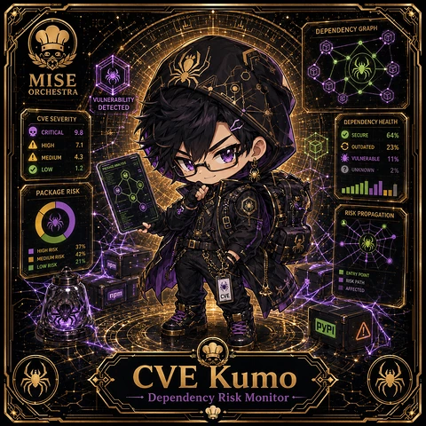

<!-- generated by tools/player-cards/scripts/build-character-pages.mjs from data/characters/cve-kumo.json; do not edit by hand -->
# CVE Kumo

**Registry character agent** · Implementation: **Described in docs only** · Detail record: [`data/characters/cve-kumo.json`](../../data/characters/cve-kumo.json)

Every field below comes from a repository source (shown as `source:`). Where no source exists the page says _Not yet defined in the source material_.

## Identity

| Field | Value |
|---|---|
| Name | CVE Kumo source: `data/characters.json` |
| Aliases / printed variants | Not yet defined in the source material |
| Role / title | Dependency Risk Monitor source: `characters/cve-kumo/metadata.json` |
| Kitchen / department | Security Kitchen source: `characters/cve-kumo/metadata.json` |
| Department mission | Guard. Audit. Comply. source: `data/imports/miseos_character_master_inventory_001_300.csv` |
| Registry rarity | Rare source: `characters/cve-kumo/metadata.json` |
| Level | 28 source: `data/imports/miseos_character_master_inventory_001_300.csv` |
| ID: registry_id | MISE-049 source: `characters/cve-kumo/metadata.json` |
| ID: character_id | miseos.character.049 source: `data/imports/miseos_character_master_inventory_001_300.csv` |
| ID: card_id | MISE-049 source: `data/imports/miseos_character_master_inventory_001_300.csv` |
| ID: codename | CVE_KUMO source: `data/imports/miseos_character_master_inventory_001_300.csv` |
| Collections | 1×1 Chefs source: `data/player-cards.json` |
| Cards linked | 1 source: `data/player-cards.json` |
| Role category | analytics source: `data/imports/merged_roster.json` |

## Player cards

| Card | Collection | Printed title | Match method | Full size |
|---|---|---|---|---|
| `cve-kumo.webp` | 1×1 Chefs | CVE Kumo | existing-index | [open](../../assets/player-cards/1by1-chefs/cve-kumo.webp) |

## Card metadata (as printed)

| Field | Value |
|---|---|
| Printed rarity | Not yet defined in the source material |
| Printed stars | Not yet defined in the source material |
| Printed meters | 11%, 2%, 21%, 23%, 37%, 42%, 64% source: `data/player-cards-ocr.json` |
| Roster stats | power 60 · precision 82 · speed 80 · resilience 84 · intelligence 64 · teamwork 78 source: `data/imports/miseos_character_master_inventory_001_300.csv (roster stats, not OCR)` |
| Abilities | Not yet defined in the source material |
| Lore | Not yet defined in the source material |
| Signature phrase | Dependency Risk Monitor done cleanly, safely, and in rhythm. source: `data/imports/merged_roster.json` |
| Unique trait | Specializes in dependency risk monitor so the Security Kitchen can operate as a precise, repo-safe DevOps station. source: `data/imports/merged_roster.json` |

Full printed card text (OCR)

**`cve-kumo.webp`**: DEPENDENCYGRAPH · MISE · ORCHESTRA · VULNERABILITY · DETECTED · CVESEVERITY · DEPENDENCYHEALTH · CRITICAL · 9.8 · SECURE · 64% · HIGH · 7.1 · OUTDATED · 23% · MEDIUM · VULNERABLE · 11% · .2 · LOW · UNKNOWN · 2% · PACKAGERISK · RISKPROPAGATION · 37% · HIGHRISK · 42% · MEDIUMRISK · 21% · npm · LOWRISK · ENTRY POINT · RISK PATH · AFFECTED · npm · CVE · PyPI · CVE Kumo · DependencyRisk Monitor

## Workflow

| Step | Value |
|---|---|
| Summary | CVE Kumo performs dependency risk monitor within the Security Kitchen. source: `characters/cve-kumo/metadata.json` |
| Inputs | repository context, task request, policy constraints, current evidence source: `characters/cve-kumo/metadata.json` |
| Outputs | validated result, evidence record, handoff packet source: `characters/cve-kumo/metadata.json` |
| Proof gate | No merge, deployment, publication, billing action, or mint without evidence. source: `characters/cve-kumo/metadata.json` |

## Actions / commands

- command: `MISE DEPENDENCY RISK MONITOR` source: `data/imports/miseos_character_master_inventory_001_300.csv`
- command: `Dependency Risk Monitor` · mise_name: `Mise DependencyRiskMonitor` source: `data/imports/merged_roster.json`

## Implementation

**Status:** Described in docs only

Roster data / types / tests in code that list this entry (not an implementation):
- [`apps/bootstrap-registry/apps/registry-console/src/data/master-roster.generated.ts:729`](../../apps/bootstrap-registry/apps/registry-console/src/data/master-roster.generated.ts#L729)
- [`apps/brigade-gallery/src/data/master-roster.ts:552`](../../apps/brigade-gallery/src/data/master-roster.ts#L552)

Data files that reference it:
- [`apps/bootstrap-registry/registry/cards/master-roster-cards.json:681`](../../apps/bootstrap-registry/registry/cards/master-roster-cards.json#L681)
- [`apps/gridops-platform/data/miseos-ecosystem-135.json:2842`](../../apps/gridops-platform/data/miseos-ecosystem-135.json#L2842)
- [`apps/voxel-world/src/data/miseos-ecosystem-135.json:2842`](../../apps/voxel-world/src/data/miseos-ecosystem-135.json#L2842)
- [`tools/art-factory/input/characters.generated.json:2771`](../../tools/art-factory/input/characters.generated.json#L2771)
- [`tools/art-factory/output/manifests/krikey_animation_prompts.json:279`](../../tools/art-factory/output/manifests/krikey_animation_prompts.json#L279)
- [`tools/art-factory/output/manifests/mangaboom_comic_prompts.json:279`](../../tools/art-factory/output/manifests/mangaboom_comic_prompts.json#L279)
- [`tools/art-factory/output/merged_roster.json:2505`](../../tools/art-factory/output/merged_roster.json#L2505)

Docs that describe it (docs only, not code):
- [`characters/cve-kumo/README.md`](../../characters/cve-kumo/README.md)
- [`apps/brigade-gallery/prototype/holo-card-roster.html:76`](../../apps/brigade-gallery/prototype/holo-card-roster.html#L76)
- [`apps/developer-platform/docs/characters/CHARACTER_REGISTRY_001_300.md:23`](../../apps/developer-platform/docs/characters/CHARACTER_REGISTRY_001_300.md#L23)

implemented_in_code = a dedicated capability handler or tool directory exists; referenced_in_app_code = the entity is used by application source (e.g. repo-pet sprites, CLI) but has no dedicated handler. code_refs are files that reference this entity by name/slug/handler (grep), not a guarantee of a dedicated runtime; registry handler links point at the actual capability function.

## Where and how it helps

| Aspect | Value |
|---|---|
| Station / stage | Security Kitchen source: `characters/cve-kumo/metadata.json` |
| Mission | Guard. Audit. Comply. source: `data/imports/miseos_character_master_inventory_001_300.csv` |
| Problem it addresses | CVE Kumo performs dependency risk monitor within the Security Kitchen. source: `characters/cve-kumo/metadata.json` |
| Safety gate | No merge, deployment, publication, billing action, or mint without evidence. source: `characters/cve-kumo/metadata.json` |

## Agents and repo pets

_Not yet defined in the source material_

## Related characters

[Container Kage](./container-kage.md) · [Seira Vaultkeeper](./seira-vaultkeeper.md) · [Policy Ronin](./policy-ronin.md) · [Token Toshi](./token-toshi.md) · [Omar Reviewer](./omar-reviewer.md) · [Schema Sora](./schema-sora.md) source: `data/imports/miseos_character_master_inventory_001_300.csv data/imports/merged_roster.json data/imports/merged_roster.json data/imports/merged_roster.json`

## Canon Bible

Mentioned in [`docs/canon/MiseOS-Canon-Bible-v1.0.pdf`](../../docs/canon/MiseOS-Canon-Bible-v1.0.pdf):

- line 663: `MISE-G2-P091 CVE Kumo Mise Orchestra canonical-candidate 1E3334AB-3111- 91`

## Sources

| Field | Source |
|---|---|
| name | `data/characters.json` |
| cards | `data/player-cards.json` |
| card_text | `data/player-cards-ocr.json (OCR of the card image)` |
| card_meters_printed | `data/player-cards-ocr.json` |
| ids.registry_id | `characters/cve-kumo/metadata.json` |
| role | `characters/cve-kumo/metadata.json` |
| department | `characters/cve-kumo/metadata.json` |
| rarity | `characters/cve-kumo/metadata.json` |
| workflow.summary | `characters/cve-kumo/metadata.json` |
| workflow.inputs | `characters/cve-kumo/metadata.json` |
| workflow.outputs | `characters/cve-kumo/metadata.json` |
| workflow.proof_gate | `characters/cve-kumo/metadata.json` |
| department_mission | `data/imports/miseos_character_master_inventory_001_300.csv` |
| ids.character_id | `data/imports/miseos_character_master_inventory_001_300.csv` |
| ids.card_id | `data/imports/miseos_character_master_inventory_001_300.csv` |
| ids.codename | `data/imports/miseos_character_master_inventory_001_300.csv` |
| stats | `data/imports/miseos_character_master_inventory_001_300.csv (roster stats, not OCR)` |
| level | `data/imports/miseos_character_master_inventory_001_300.csv` |
| related | `data/imports/miseos_character_master_inventory_001_300.csv data/imports/merged_roster.json data/imports/merged_roster.json data/imports/merged_roster.json` |
| signature_phrase | `data/imports/merged_roster.json` |
| unique_trait | `data/imports/merged_roster.json` |
| role_category | `data/imports/merged_roster.json` |
| canon_bible | `docs/canon/MiseOS-Canon-Bible-v1.0.pdf (pdftotext)` |
| implementation | `git ls-files grep + repo` |
| helps.station | `characters/cve-kumo/metadata.json` |

[← All characters](./README.md)
