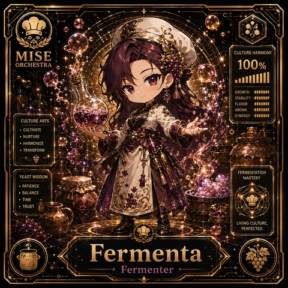

<!-- generated by tools/player-cards/scripts/build-character-pages.mjs from data/characters/fermenta.json; do not edit by hand -->
# Fermenta

**Card-defined chef (catalogue: visual reference only)** · Implementation: **Designed (not yet implemented in code)** · Detail record: [`data/characters/fermenta.json`](../../data/characters/fermenta.json)

Every field shows where its value comes from (`source:`). Repo-sourced values cite the repository or source-library file they were read from; values marked `authored: card design` were written for this card by [`enrich-characters.py`](../../tools/player-cards/scripts/enrich-characters.py), derived from the printed card text, role and kitchen theme, and are not claims about existing code.

## Identity

| Field | Value |
|---|---|
| Name | Fermenta source: `data/imports/photo-alignment.csv` |
| Aliases / printed variants | None recorded (no alternate title in the canon crosswalk or agents.json) source: `data/player-cards.json + canon crosswalk (no alternate title found)` |
| Role / title | Fermenter source: `data/player-cards-ocr.json (subtitle printed under the name)` |
| Kitchen / department | Data & Insight Kitchen source: `authored: card design (kitchen chosen from role/printed text, theme "ferment")` |
| Department mission | Learn. Optimize. Evolve. source: `data/imports/miseos_character_master_inventory_001_300.csv (mission of Data & Insight Kitchen)` |
| Registry rarity | Common source: `authored: card design (default tier; no stars printed)` |
| Collections | 1×1 Chefs source: `data/player-cards.json` |
| Cards linked | 1 source: `data/player-cards.json` |
| Catalogue status | visual_reference_only source: `data/imports/photo-alignment.csv` |

## Player cards

| Card | Collection | Printed title | Match method | Full size |
|---|---|---|---|---|
| `fermenta.webp` | 1×1 Chefs | Fermenta | title | [open](../../assets/player-cards/1by1-chefs/fermenta.webp) |

## Card metadata (as printed)

| Field | Value |
|---|---|
| Printed rarity | Not printed on the card source: `data/player-cards-ocr.json (no rarity word in OCR)` |
| Printed stars | Not printed on the card source: `data/player-cards-ocr.json (no stars in OCR)` |
| Printed meters | 100% source: `data/player-cards-ocr.json` |
| Roster stats | power 81 · precision 71 · speed 72 · resilience 75 · intelligence 79 · teamwork 65 source: `authored: card design (6-axis roster scale; baseline from stars + theme "ferment")` |
| Abilities | Culture Harmony, Growth, Stability, Flavor, Aroma, Synergy source: `data/player-cards-ocr.json (printed card labels, glued OCR words segmented)` |
| Lore | Ask the brigade about Fermenta and they describe a shelf of labelled jars that each tell a story. As Data & Insight Kitchen's Fermenter, Fermenta manages slow processes (ferments, cures, brines) by tracking time, salinity and cultures until they are proven ready, and the rest of the kitchen plans service around that rhythm. The card calls out Culture Harmony, Growth, Stability: the checks Fermenta runs before calling anything ready. source: `authored: card design (derived from printed card text/role)` |
| Signature phrase | No balance left to chance. source: `authored: card design (derived from printed card text/role)` |

Full printed card text (OCR)

**`fermenta.webp`**: MISE · CULTURE HARMONY · 100% · ORCHESTRA · GROWTH · STABILITY · FLAVOR · AROMA · SYNERGY · CULTUREARTS · ·CULTIVATE · ·NURTURE · ·HARMONIZE · TRANSFORM · FERMENTATION · YEASTWISDOM · MASTERY · ·PATIENCE · ·BALANCE · .TIME · TRUST · LIVING CULTURE, · PERFECTED. · Fermenta · Fermenter

## Workflow

| Step | Value |
|---|---|
| Summary | Fermenta manages slow processes (ferments, cures, brines) by tracking time, salinity and cultures until they are proven ready. source: `authored: card design (theme "ferment")` |
| Inputs | batch start date, salinity / pH readings, culture lineage, target profile source: `authored: card design (theme "ferment")` |
| Outputs | batch readiness verdict, culture log, shelf-life label source: `authored: card design (theme "ferment")` |
| Proof gate | Readiness gate: a batch is released only when pH/salinity readings and elapsed time both meet the recipe; lineage must be recorded. source: `authored: card design (theme "ferment")` |

## Actions / commands

- command: `mise roster run fermenta --dept data-insight-kitchen --solo --emit report` · status: `proposed` source: `authored: follows data/imports/master-roster-cards.csv (mise roster run command convention)`
- command: `mise fermenta start-batch` · reads: `batch start date` · emits: `batch readiness verdict` · status: `proposed` source: `authored: card design (theme "ferment")`
- command: `mise fermenta measure` · reads: `salinity / pH readings` · emits: `culture log` · status: `proposed` source: `authored: card design (theme "ferment")`
- command: `mise fermenta release-batch` · reads: `culture lineage` · emits: `shelf-life label` · status: `proposed` source: `authored: card design (theme "ferment")`

## Implementation

**Status:** Designed (not yet implemented in code)

- Proposed handler: `fermenta` (not written yet)
- Proposed command: `mise roster run fermenta --dept data-insight-kitchen --solo --emit report`
- Contract: inputs: batch start date, salinity / pH readings, culture lineage, target profile → outputs: batch readiness verdict, culture log, shelf-life label; refuses to emit 'ready' unless the proof gate passes

source: `git ls-files grep + repo (no code found) + authored: proposed handler spec`

implemented_in_code = a dedicated capability handler or tool directory exists; referenced_in_app_code = the entity is used by application source (e.g. repo-pet sprites, CLI) but has no dedicated handler. code_refs are files that reference this entity by name/slug/handler (grep), not a guarantee of a dedicated runtime; registry handler links point at the actual capability function.

## Where and how it helps

| Aspect | Value |
|---|---|
| Station / stage | Fermenter source: `data/player-cards-ocr.json (subtitle printed under the name)` |
| Mission | Learn. Optimize. Evolve. source: `data/imports/miseos_character_master_inventory_001_300.csv (mission of Data & Insight Kitchen)` |
| Problem it addresses | Long-running work (experiments, data jobs) gets released before it has actually finished maturing. source: `authored: card design (theme "ferment")` |
| Safety gate | Readiness gate: a batch is released only when pH/salinity readings and elapsed time both meet the recipe; lineage must be recorded. source: `authored: card design (theme "ferment")` |

## Agents and repo pets

Agents: [Database](../agents/database.md) · [Logger](../agents/logger.md) · [Observatory](../agents/observatory.md) source: `authored: card design (closest agents for theme "ferment")`

Repo pets: [Mise Apprentice](../repo-pets/mise-apprentice.md) · [Mise Lattice](../repo-pets/mise-lattice.md) source: `authored: card design (closest repo pets for theme "ferment")`

## Related characters

[Pickle Doc](./pickle-doc.md) · [Brine Baron](./brine-baron.md) · [Miso Maven](./miso-maven.md) · [Revenue Rina](./revenue-rina.md) · [Cost Kaito](./cost-kaito.md) · [Anomaly Aki](./anomaly-aki.md) source: `authored: card design (same theme "ferment" / same department)`

## Sources

| Field | Source |
|---|---|
| name | `data/imports/photo-alignment.csv` |
| cards | `data/player-cards.json` |
| card_text | `data/player-cards-ocr.json (OCR of the card image)` |
| card_meters_printed | `data/player-cards-ocr.json` |
| role | `data/player-cards-ocr.json (subtitle printed under the name)` |
| catalogue_status | `data/imports/photo-alignment.csv` |
| implementation | `git ls-files grep + repo (no code found) + authored: proposed handler spec` |
| helps.station | `data/player-cards-ocr.json (subtitle printed under the name)` |
| aliases | `data/player-cards.json + canon crosswalk (no alternate title found)` |
| department | `authored: card design (kitchen chosen from role/printed text, theme "ferment")` |
| department_mission | `data/imports/miseos_character_master_inventory_001_300.csv (mission of Data & Insight Kitchen)` |
| card_rarity_printed | `data/player-cards-ocr.json (no rarity word in OCR)` |
| card_stars_printed | `data/player-cards-ocr.json (no stars in OCR)` |
| rarity | `authored: card design (default tier; no stars printed)` |
| stats | `authored: card design (6-axis roster scale; baseline from stars + theme "ferment")` |
| abilities | `data/player-cards-ocr.json (printed card labels, glued OCR words segmented)` |
| lore | `authored: card design (derived from printed card text/role)` |
| signature_phrase | `authored: card design (derived from printed card text/role)` |
| workflow.summary | `authored: card design (theme "ferment")` |
| workflow.inputs | `authored: card design (theme "ferment")` |
| workflow.outputs | `authored: card design (theme "ferment")` |
| workflow.proof_gate | `authored: card design (theme "ferment")` |
| actions | `authored: follows data/imports/master-roster-cards.csv (mise roster run command convention)` |
| helps.mission | `data/imports/miseos_character_master_inventory_001_300.csv (mission of Data & Insight Kitchen)` |
| helps.problem | `authored: card design (theme "ferment")` |
| helps.proof_gate | `authored: card design (theme "ferment")` |
| agents | `authored: card design (closest agents for theme "ferment")` |
| repo_pets | `authored: card design (closest repo pets for theme "ferment")` |
| related | `authored: card design (same theme "ferment" / same department)` |
| theme | `authored: card design (keyword theme used for authored fields)` |

[← All characters](./README.md)
