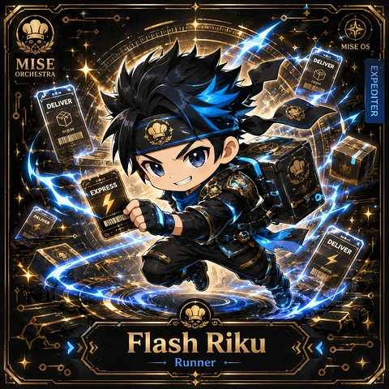
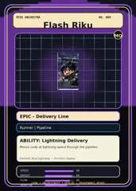

<!-- generated by tools/player-cards/scripts/build-character-pages.mjs from data/characters/flash-riku.json; do not edit by hand -->
# Flash Riku

**Registry character agent** · Implementation: **Referenced in app code (no dedicated handler)** · Detail record: [`data/characters/flash-riku.json`](../../data/characters/flash-riku.json)

Every field below comes from a repository source (shown as `source:`). Where no source exists the page says _Not yet defined in the source material_.

## Identity

| Field | Value |
|---|---|
| Name | Flash Riku source: `data/characters.json` |
| Aliases / printed variants | Not yet defined in the source material |
| Role / title | Deploy source: `characters/flash-riku/metadata.json` |
| Kitchen / department | Pipeline Kitchen source: `characters/flash-riku/metadata.json` |
| Department mission | Build. Test. Deploy. Repeat. source: `data/imports/miseos_character_master_inventory_001_300.csv` |
| Registry rarity | Epic source: `characters/flash-riku/metadata.json` |
| Level | 20 source: `data/imports/miseos_character_master_inventory_001_300.csv` |
| ID: registry_id | MISE-082 source: `characters/flash-riku/metadata.json` |
| ID: character_id | miseos.character.082 source: `data/imports/miseos_character_master_inventory_001_300.csv` |
| ID: card_id | MISE-082 source: `data/imports/miseos_character_master_inventory_001_300.csv` |
| ID: codename | FLASH_RIKU source: `data/imports/miseos_character_master_inventory_001_300.csv` |
| Collections | 1×1 Chefs, Mise Orchestra Trading Cards (Season 1) source: `data/player-cards.json` |
| Cards linked | 2 source: `data/player-cards.json` |

## Player cards

| Card | Collection | Printed title | Match method | Full size |
|---|---|---|---|---|
| `flash-riku.webp` | 1×1 Chefs | Flash Riku | existing-index | [open](../../assets/player-cards/1by1-chefs/flash-riku.webp) |
| `flash-riku.webp` | Mise Orchestra Trading Cards (Season 1) | ElashRiku | existing-index | [open](../../assets/player-cards/orchestra-trading-cards/flash-riku.webp) |

## Card metadata (as printed)

| Field | Value |
|---|---|
| Printed rarity | Epic source: `data/player-cards-ocr.json` |
| Printed stars | Not yet defined in the source material |
| Printed meters | Not yet defined in the source material |
| Roster stats | power 64 · precision 76 · speed 68 · resilience 67 · intelligence 71 · teamwork 68 source: `data/imports/miseos_character_master_inventory_001_300.csv (roster stats, not OCR)` |
| Abilities | Lightning Delivery source: `data/imports/mise_orchestra_cards.csv` |
| Mise Orchestra card | role: Runner · department: Pipeline · function: Deploy · rarity: Epic · tier: Delivery Line · element: Blue Lightning · ability: Lightning Delivery · lore: Moves code at lightning speed through the pipeline. source: `data/imports/mise_orchestra_cards.csv` |
| Lore | Flash Riku belongs to the Kitchen Chaos DevOps Universe, where every technical workflow becomes a coordinated brigade station. source: `data/imports/merged_roster.json` |
| Signature phrase | Not yet defined in the source material |

Full printed card text (OCR)

**`flash-riku.webp`**: MISEOS · MISE · DELIVER · EXPEDITER · ORCHESTRA · DELIVER · EXPRESS · DELIVER · Flash Riku · Runner

**`flash-riku.webp`**: MISEORCHESTRA · NO.009 · FlashRiku · MO · EPIC-DeliveryLine · Runner \| Pipeline · ABILITY:Lightning Delivery · Moves code at lightning speed through the pipeline. · Element: Blue Lightning Function: Deploy · SPEED · 98 · DEPLOY · 94 · FLOW · 86 · ·ORCHESTRATE·DEPLOY · COOK · PROVENANCE-READY · MONIOR

## Workflow

| Step | Value |
|---|---|
| Summary | Flash Riku performs deploy within the Pipeline Kitchen. source: `characters/flash-riku/metadata.json` |
| Inputs | repository context, task request, policy constraints, current evidence source: `characters/flash-riku/metadata.json` |
| Outputs | validated result, evidence record, handoff packet source: `characters/flash-riku/metadata.json` |
| Proof gate | No merge, deployment, publication, billing action, or mint without evidence. source: `characters/flash-riku/metadata.json` |

## Actions / commands

- command: `MISE DEPLOY` source: `data/imports/miseos_character_master_inventory_001_300.csv`

## Implementation

**Status:** Referenced in app code (no dedicated handler)

Application code that uses this entry:
- [`apps/miseos-platform/packages/miseos-repo-pet/bin/mise-roam.mjs:42`](../../apps/miseos-platform/packages/miseos-repo-pet/bin/mise-roam.mjs#L42)
- [`apps/miseos-platform/packages/miseos-repo-pet/src/characters.js:265`](../../apps/miseos-platform/packages/miseos-repo-pet/src/characters.js#L265)

Roster data / types / tests in code that list this entry (not an implementation):
- [`apps/brigade-gallery/src/data/brigade-roster.ts:255`](../../apps/brigade-gallery/src/data/brigade-roster.ts#L255)

Data files that reference it:
- [`apps/gridops-platform/data/miseos-ecosystem-135.json:920`](../../apps/gridops-platform/data/miseos-ecosystem-135.json#L920)
- [`apps/registry-atrium/collection-manifest.json:84`](../../apps/registry-atrium/collection-manifest.json#L84)
- [`apps/registry-atrium/metadata/erc721/009-flash-riku.json:2`](../../apps/registry-atrium/metadata/erc721/009-flash-riku.json#L2)
- [`apps/voxel-world/src/data/agents.json:567`](../../apps/voxel-world/src/data/agents.json#L567)
- [`apps/voxel-world/src/data/miseos-ecosystem-135.json:920`](../../apps/voxel-world/src/data/miseos-ecosystem-135.json#L920)
- [`tools/art-factory/input/mise_orchestra_cards.csv:10`](../../tools/art-factory/input/mise_orchestra_cards.csv#L10)
- [`tools/art-factory/input/mise_orchestra_collection_manifest.json:84`](../../tools/art-factory/input/mise_orchestra_collection_manifest.json#L84)
- [`tools/art-factory/output/manifests/krikey_animation_prompts.json:141`](../../tools/art-factory/output/manifests/krikey_animation_prompts.json#L141)
- [`tools/art-factory/output/manifests/mangaboom_comic_prompts.json:141`](../../tools/art-factory/output/manifests/mangaboom_comic_prompts.json#L141)
- [`tools/art-factory/output/merged_roster.json:1280`](../../tools/art-factory/output/merged_roster.json#L1280)

Docs that describe it (docs only, not code):
- [`characters/flash-riku/README.md`](../../characters/flash-riku/README.md)
- [`apps/brigade-gallery/prototype/holo-card-roster.html:76`](../../apps/brigade-gallery/prototype/holo-card-roster.html#L76)
- [`apps/brigade-gallery/prototype/registry-atrium-gallery.html:342`](../../apps/brigade-gallery/prototype/registry-atrium-gallery.html#L342)
- [`apps/developer-platform/docs/characters/CHARACTER_REGISTRY_001_300.md:11`](../../apps/developer-platform/docs/characters/CHARACTER_REGISTRY_001_300.md#L11)
- [`apps/miseos-platform/packages/miseos-repo-pet/README.md:64`](../../apps/miseos-platform/packages/miseos-repo-pet/README.md#L64)
- [`apps/miseos-platform/packages/miseos-repo-pet/docs/MASCOT_REFERENCE.md:22`](../../apps/miseos-platform/packages/miseos-repo-pet/docs/MASCOT_REFERENCE.md#L22)
- [`apps/registry-atrium/index.html:342`](../../apps/registry-atrium/index.html#L342)

implemented_in_code = a dedicated capability handler or tool directory exists; referenced_in_app_code = the entity is used by application source (e.g. repo-pet sprites, CLI) but has no dedicated handler. code_refs are files that reference this entity by name/slug/handler (grep), not a guarantee of a dedicated runtime; registry handler links point at the actual capability function.

## Where and how it helps

| Aspect | Value |
|---|---|
| Station / stage | Pipeline Kitchen source: `characters/flash-riku/metadata.json` |
| Mission | Build. Test. Deploy. Repeat. source: `data/imports/miseos_character_master_inventory_001_300.csv` |
| Problem it addresses | Flash Riku performs deploy within the Pipeline Kitchen. source: `characters/flash-riku/metadata.json` |
| Safety gate | No merge, deployment, publication, billing action, or mint without evidence. source: `characters/flash-riku/metadata.json` |

## Agents and repo pets

Agents: [Flash Riku](../agents/flash-riku.md) source: `data/agents.json`

Repo pets: [Flash Riku](../repo-pets/flash-riku.md) source: `data/repo-pets.json`

## Related characters

[Build-Kun](./build-kun.md) · [Alko Commit Chef](./alko-commit-chef.md) · [Bruno Blast-Radius](./bruno-blast-radius.md) source: `data/imports/miseos_character_master_inventory_001_300.csv`

## Canon Bible

Mentioned in [`docs/canon/MiseOS-Canon-Bible-v1.0.pdf`](../../docs/canon/MiseOS-Canon-Bible-v1.0.pdf):

- line 467: `MISE-G2-P001 Flash Riku Mise Orchestra canonical-candidate 1E3334AB-3111- 1`

## Sources

| Field | Source |
|---|---|
| name | `data/characters.json` |
| cards | `data/player-cards.json` |
| card_text | `data/player-cards-ocr.json (OCR of the card image)` |
| card_rarity_printed | `data/player-cards-ocr.json` |
| ids.registry_id | `characters/flash-riku/metadata.json` |
| role | `characters/flash-riku/metadata.json` |
| department | `characters/flash-riku/metadata.json` |
| rarity | `characters/flash-riku/metadata.json` |
| workflow.summary | `characters/flash-riku/metadata.json` |
| workflow.inputs | `characters/flash-riku/metadata.json` |
| workflow.outputs | `characters/flash-riku/metadata.json` |
| workflow.proof_gate | `characters/flash-riku/metadata.json` |
| department_mission | `data/imports/miseos_character_master_inventory_001_300.csv` |
| ids.character_id | `data/imports/miseos_character_master_inventory_001_300.csv` |
| ids.card_id | `data/imports/miseos_character_master_inventory_001_300.csv` |
| ids.codename | `data/imports/miseos_character_master_inventory_001_300.csv` |
| stats | `data/imports/miseos_character_master_inventory_001_300.csv (roster stats, not OCR)` |
| level | `data/imports/miseos_character_master_inventory_001_300.csv` |
| related | `data/imports/miseos_character_master_inventory_001_300.csv` |
| lore | `data/imports/merged_roster.json` |
| orchestra_card | `data/imports/mise_orchestra_cards.csv` |
| abilities | `data/imports/mise_orchestra_cards.csv` |
| canon_bible | `docs/canon/MiseOS-Canon-Bible-v1.0.pdf (pdftotext)` |
| implementation | `git ls-files grep + repo` |
| helps.station | `characters/flash-riku/metadata.json` |
| agents | `data/agents.json` |
| repo_pets | `data/repo-pets.json` |

[← All characters](./README.md)
