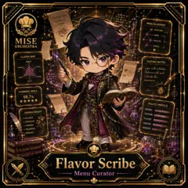

<!-- generated by tools/player-cards/scripts/build-character-pages.mjs from data/characters/flavor-scribe.json; do not edit by hand -->
# Flavor Scribe

**Registry character agent** · Implementation: **Described in docs only** · Detail record: [`data/characters/flavor-scribe.json`](../../data/characters/flavor-scribe.json)

Every field shows where its value comes from (`source:`). Repo-sourced values cite the repository or source-library file they were read from; values marked `authored: card design` were written for this card by [`enrich-characters.py`](../../tools/player-cards/scripts/enrich-characters.py), derived from the printed card text, role and kitchen theme, and are not claims about existing code.

## Identity

| Field | Value |
|---|---|
| Name | Flavor Scribe source: `data/characters.json` |
| Aliases / printed variants | None recorded (no alternate title in the canon crosswalk or agents.json) source: `data/player-cards.json + canon crosswalk (no alternate title found)` |
| Role / title | Menu Curator source: `characters/flavor-scribe/metadata.json` |
| Kitchen / department | Operations Kitchen source: `characters/flavor-scribe/metadata.json` |
| Department mission | Keep the kitchen running smoothly. source: `data/imports/miseos_character_master_inventory_001_300.csv` |
| Registry rarity | Epic source: `characters/flavor-scribe/metadata.json` |
| Level | 18 source: `data/imports/miseos_character_master_inventory_001_300.csv` |
| ID: registry_id | MISE-101 source: `characters/flavor-scribe/metadata.json` |
| ID: character_id | miseos.character.101 source: `data/imports/miseos_character_master_inventory_001_300.csv` |
| ID: card_id | MISE-101 source: `data/imports/miseos_character_master_inventory_001_300.csv` |
| ID: codename | FLAVOR_SCRIBE source: `data/imports/miseos_character_master_inventory_001_300.csv` |
| Collections | 1×1 Chefs source: `data/player-cards.json` |
| Cards linked | 1 source: `data/player-cards.json` |

## Player cards

| Card | Collection | Printed title | Match method | Full size |
|---|---|---|---|---|
| `flavor-scribe.webp` | 1×1 Chefs | Flavor Scribe | existing-index | [open](../../assets/player-cards/1by1-chefs/flavor-scribe.webp) |

## Card metadata (as printed)

| Field | Value |
|---|---|
| Printed rarity | Not printed on the card source: `data/player-cards-ocr.json (no rarity word in OCR)` |
| Printed stars | 5 source: `data/player-cards-ocr.json` |
| Printed meters | 98.7% source: `data/player-cards-ocr.json` |
| Roster stats | power 70 · precision 72 · speed 64 · resilience 74 · intelligence 74 · teamwork 81 source: `data/imports/miseos_character_master_inventory_001_300.csv (roster stats, not OCR)` |
| Abilities | Signature Dish, Echoes Of, Menu Blueprint, Umami, Appetizer, Main source: `data/player-cards-ocr.json (printed card labels, glued OCR words segmented)` |
| Lore | Picture the back burner where the stockpots never go cold: that is where Flavor Scribe is happiest. As Operations Kitchen's Menu Curator, Flavor Scribe builds the base flavours other stations depend on: reductions, stocks and mother sauces that must taste the same every time. The card calls out Signature Dish, Echoes Of, Menu Blueprint: the checks Flavor Scribe runs before calling anything ready. source: `authored: card design (derived from printed card text/role)` |
| Signature phrase | Taste twice, ship once. source: `authored: card design (derived from printed card text/role)` |

Full printed card text (OCR)

**`flavor-scribe.webp`**: SIGNATURE DISH · ECHOES OF · MENU BLUEPRINT · UMAMI · APPETIZER · MAIN · MISE · -PALETTE · ORCHESTRA · FINALE · FLAVOR MAP · SWEET · TASTING NOTES · BITTER · UMAMI · Layer with intention. · Elwate the · ACID · BITTER · SALTY · experience · HARMONY INDEX · 98.7% · ★★★★★ · PALATEPROFILE · AROMA · PAIRING INSIGHT · TEXTURE · ·BALANCE · FLAVOR · ·CONTRAST · FINESSE · ·SYNERGY · MEMORY · ·SEQUENCE · MEMORY · L'ART CULINAIRE · FLAVORALCHEMY · THEORYOFTASTE · Flavor Scribe · Menu Curator

## Workflow

| Step | Value |
|---|---|
| Summary | Flavor Scribe performs menu curator within the Operations Kitchen. source: `characters/flavor-scribe/metadata.json` |
| Inputs | repository context, task request, policy constraints, current evidence source: `characters/flavor-scribe/metadata.json` |
| Outputs | validated result, evidence record, handoff packet source: `characters/flavor-scribe/metadata.json` |
| Proof gate | No merge, deployment, publication, billing action, or mint without evidence. source: `characters/flavor-scribe/metadata.json` |

## Actions / commands

- command: `MISE MENU CURATOR` source: `data/imports/miseos_character_master_inventory_001_300.csv`

## Implementation

**Status:** Described in docs only

Data files that reference it:
- [`apps/gridops-platform/data/miseos-ecosystem-135.json:6066`](../../apps/gridops-platform/data/miseos-ecosystem-135.json#L6066)
- [`apps/voxel-world/src/data/miseos-ecosystem-135.json:6066`](../../apps/voxel-world/src/data/miseos-ecosystem-135.json#L6066)

Docs that describe it (docs only, not code):
- [`characters/flavor-scribe/README.md`](../../characters/flavor-scribe/README.md)
- [`apps/developer-platform/docs/characters/CHARACTER_REGISTRY_001_300.md:31`](../../apps/developer-platform/docs/characters/CHARACTER_REGISTRY_001_300.md#L31)

implemented_in_code = a dedicated capability handler or tool directory exists; referenced_in_app_code = the entity is used by application source (e.g. repo-pet sprites, CLI) but has no dedicated handler. code_refs are files that reference this entity by name/slug/handler (grep), not a guarantee of a dedicated runtime; registry handler links point at the actual capability function.

## Where and how it helps

| Aspect | Value |
|---|---|
| Station / stage | Operations Kitchen source: `characters/flavor-scribe/metadata.json` |
| Mission | Keep the kitchen running smoothly. source: `data/imports/miseos_character_master_inventory_001_300.csv` |
| Problem it addresses | Flavor Scribe performs menu curator within the Operations Kitchen. source: `characters/flavor-scribe/metadata.json` |
| Safety gate | No merge, deployment, publication, billing action, or mint without evidence. source: `characters/flavor-scribe/metadata.json` |

## Agents and repo pets

Agents: [Umami Code](../agents/umami-code.md) · [API Gateway](../agents/api-gateway.md) · [Architect](../agents/architect.md) source: `authored: card design (closest agents for theme "sauce")`

Repo pets: [Umami Code](../repo-pets/umami-code.md) · [Mise Sauce](../repo-pets/mise-sauce.md) source: `authored: card design (closest repo pets for theme "sauce")`

## Related characters

[Prep Pulse](./prep-pulse.md) · [Queue Quartz](./queue-quartz.md) · [Harvest Hex](./harvest-hex.md) source: `data/imports/miseos_character_master_inventory_001_300.csv`

## Sources

| Field | Source |
|---|---|
| name | `data/characters.json` |
| cards | `data/player-cards.json` |
| card_text | `data/player-cards-ocr.json (OCR of the card image)` |
| card_stars_printed | `data/player-cards-ocr.json` |
| card_meters_printed | `data/player-cards-ocr.json` |
| ids.registry_id | `characters/flavor-scribe/metadata.json` |
| role | `characters/flavor-scribe/metadata.json` |
| department | `characters/flavor-scribe/metadata.json` |
| rarity | `characters/flavor-scribe/metadata.json` |
| workflow.summary | `characters/flavor-scribe/metadata.json` |
| workflow.inputs | `characters/flavor-scribe/metadata.json` |
| workflow.outputs | `characters/flavor-scribe/metadata.json` |
| workflow.proof_gate | `characters/flavor-scribe/metadata.json` |
| department_mission | `data/imports/miseos_character_master_inventory_001_300.csv` |
| ids.character_id | `data/imports/miseos_character_master_inventory_001_300.csv` |
| ids.card_id | `data/imports/miseos_character_master_inventory_001_300.csv` |
| ids.codename | `data/imports/miseos_character_master_inventory_001_300.csv` |
| stats | `data/imports/miseos_character_master_inventory_001_300.csv (roster stats, not OCR)` |
| level | `data/imports/miseos_character_master_inventory_001_300.csv` |
| related | `data/imports/miseos_character_master_inventory_001_300.csv` |
| implementation | `git ls-files grep + repo` |
| helps.station | `characters/flavor-scribe/metadata.json` |
| aliases | `data/player-cards.json + canon crosswalk (no alternate title found)` |
| card_rarity_printed | `data/player-cards-ocr.json (no rarity word in OCR)` |
| abilities | `data/player-cards-ocr.json (printed card labels, glued OCR words segmented)` |
| lore | `authored: card design (derived from printed card text/role)` |
| signature_phrase | `authored: card design (derived from printed card text/role)` |
| agents | `authored: card design (closest agents for theme "sauce")` |
| repo_pets | `authored: card design (closest repo pets for theme "sauce")` |
| theme | `authored: card design (keyword theme used for authored fields)` |

[← All characters](./README.md)
