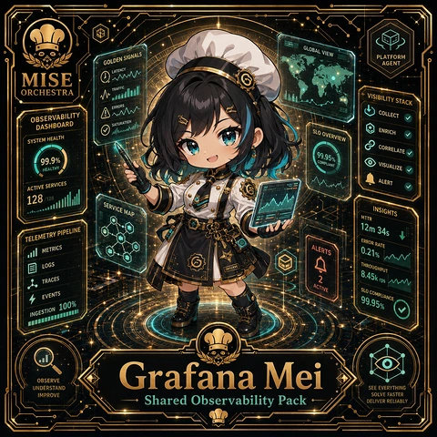

<!-- generated by tools/player-cards/scripts/build-character-pages.mjs from data/characters/grafana-mei.json; do not edit by hand -->
# Grafana Mei

**Registry character agent** · Implementation: **Described in docs only** · Detail record: [`data/characters/grafana-mei.json`](../../data/characters/grafana-mei.json)

Every field shows where its value comes from (`source:`). Repo-sourced values cite the repository or source-library file they were read from; values marked `authored: card design` were written for this card by [`enrich-characters.py`](../../tools/player-cards/scripts/enrich-characters.py), derived from the printed card text, role and kitchen theme, and are not claims about existing code.

## Identity

| Field | Value |
|---|---|
| Name | Grafana Mei source: `data/characters.json` |
| Aliases / printed variants | None recorded (no alternate title in the canon crosswalk or agents.json) source: `data/player-cards.json + canon crosswalk (no alternate title found)` |
| Role / title | Observability Dashboard Templates source: `characters/grafana-mei/metadata.json` |
| Kitchen / department | Platform Kitchen source: `characters/grafana-mei/metadata.json` |
| Department mission | Provide golden paths and stable service foundations. source: `data/imports/miseos_character_master_inventory_001_300.csv` |
| Registry rarity | Common source: `characters/grafana-mei/metadata.json` |
| Level | 17 source: `data/imports/miseos_character_master_inventory_001_300.csv` |
| ID: registry_id | MISE-024 source: `characters/grafana-mei/metadata.json` |
| ID: character_id | miseos.character.023 source: `data/imports/miseos_character_master_inventory_001_300.csv` |
| ID: card_id | MISE-023 source: `data/imports/miseos_character_master_inventory_001_300.csv` |
| ID: codename | GRAFANA_MEI source: `data/imports/miseos_character_master_inventory_001_300.csv` |
| Collections | 1×1 Chefs source: `data/player-cards.json` |
| Cards linked | 1 source: `data/player-cards.json` |
| Role category | automation source: `data/imports/merged_roster.json` |

## Player cards

| Card | Collection | Printed title | Match method | Full size |
|---|---|---|---|---|
| `grafana-mei.webp` | 1×1 Chefs | Grafana Mei | existing-index | [open](../../assets/player-cards/1by1-chefs/grafana-mei.webp) |

## Card metadata (as printed)

| Field | Value |
|---|---|
| Printed rarity | Not printed on the card source: `data/player-cards-ocr.json (no rarity word in OCR)` |
| Printed stars | Not printed on the card source: `data/player-cards-ocr.json (no stars in OCR)` |
| Printed meters | 99.9% source: `data/player-cards-ocr.json` |
| Roster stats | power 75 · precision 77 · speed 68 · resilience 72 · intelligence 67 · teamwork 66 source: `data/imports/miseos_character_master_inventory_001_300.csv (roster stats, not OCR)` |
| Abilities | Globalview, Platform, Golden Signals, Agent, Latency, Traffic source: `data/player-cards-ocr.json (printed card labels, glued OCR words segmented)` |
| Lore | Ask the brigade about Grafana Mei and they describe a clipboard of tally marks that becomes a chart by morning. As Platform Kitchen's specialist for observability dashboard templates, Grafana Mei reads the numbers behind service (covers, waste, timings) and turns them into the next improvement, and the rest of the kitchen plans service around that rhythm. The card calls out Globalview, Platform, Golden Signals: the checks Grafana Mei runs before calling anything ready. source: `authored: card design (derived from printed card text/role)` |
| Signature phrase | Shared Observability Pack done cleanly, safely, and in rhythm. source: `data/imports/merged_roster.json` |
| Unique trait | Specializes in shared observability pack so the Platform Kitchen can operate as a precise, repo-safe DevOps station. source: `data/imports/merged_roster.json` |

Full printed card text (OCR)

**`grafana-mei.webp`**: GLOBALVIEW · PLATFORM · GOLDEN SIGNALS · AGENT · LATENCY · MISE · ORCHESTRA · TRAFFIC · VISIBILITYSTACK · ERRORS · COLLECT · OBSERVABILITY · DASHBOARD · SATURATION · SLOOVERVIEW · ENRICH · SYSTEM HEALTH · CORRELATE · 99.95% · 99.9% · VISUALIZE · HEALTHY · ALERT · ACTIVE SERVICES · 128 · 128 · SERVICE MAP · INSIGHTS · MTTR · 12m 34s · TELEMETRYPIPELINE · ERROR RATE · ALERTS · METRICS · 0.21% · LOGS · THROUGHPUT · 8.45k rps · TRACES · ACTIVE · SLO COMPLIANCE · EVENTS · 99.95% · INGESTION 100% · Grafana Mei · OBSERVE · UNDERSTAND · SEE EVERYTHING · IMPROVE · Shared Observability Pack · SOLVE FASTER · DELIVERRELIABLY

## Workflow

| Step | Value |
|---|---|
| Summary | Grafana Mei performs observability dashboard templates within the Platform Kitchen. source: `characters/grafana-mei/metadata.json` |
| Inputs | repository context, task request, policy constraints, current evidence source: `characters/grafana-mei/metadata.json` |
| Outputs | validated result, evidence record, handoff packet source: `characters/grafana-mei/metadata.json` |
| Proof gate | No merge, deployment, publication, billing action, or mint without evidence. source: `characters/grafana-mei/metadata.json` |

## Actions / commands

- command: `MISE SHARED OBSERVABILITY PACK` source: `data/imports/miseos_character_master_inventory_001_300.csv`
- command: `Shared Observability Pack` · mise_name: `Mise SharedObservabilityPack` source: `data/imports/merged_roster.json`

## Implementation

**Status:** Described in docs only

Roster data / types / tests in code that list this entry (not an implementation):
- [`apps/bootstrap-registry/apps/registry-console/src/data/master-roster.generated.ts:365`](../../apps/bootstrap-registry/apps/registry-console/src/data/master-roster.generated.ts#L365)
- [`apps/brigade-gallery/src/data/master-roster.ts:318`](../../apps/brigade-gallery/src/data/master-roster.ts#L318)

Data files that reference it:
- [`apps/bootstrap-registry/registry/cards/master-roster-cards.json:317`](../../apps/bootstrap-registry/registry/cards/master-roster-cards.json#L317)
- [`apps/gridops-platform/data/miseos-ecosystem-135.json:1230`](../../apps/gridops-platform/data/miseos-ecosystem-135.json#L1230)
- [`apps/voxel-world/src/data/miseos-ecosystem-135.json:1230`](../../apps/voxel-world/src/data/miseos-ecosystem-135.json#L1230)
- [`tools/art-factory/input/characters.generated.json:452`](../../tools/art-factory/input/characters.generated.json#L452)
- [`tools/art-factory/output/manifests/krikey_animation_prompts.json:423`](../../tools/art-factory/output/manifests/krikey_animation_prompts.json#L423)
- [`tools/art-factory/output/manifests/mangaboom_comic_prompts.json:423`](../../tools/art-factory/output/manifests/mangaboom_comic_prompts.json#L423)
- [`tools/art-factory/output/merged_roster.json:349`](../../tools/art-factory/output/merged_roster.json#L349)

Docs that describe it (docs only, not code):
- [`characters/grafana-mei/README.md`](../../characters/grafana-mei/README.md)
- [`apps/brigade-gallery/prototype/holo-card-roster.html:76`](../../apps/brigade-gallery/prototype/holo-card-roster.html#L76)
- [`apps/developer-platform/docs/characters/CHARACTER_REGISTRY_001_300.md:15`](../../apps/developer-platform/docs/characters/CHARACTER_REGISTRY_001_300.md#L15)

implemented_in_code = a dedicated capability handler or tool directory exists; referenced_in_app_code = the entity is used by application source (e.g. repo-pet sprites, CLI) but has no dedicated handler. code_refs are files that reference this entity by name/slug/handler (grep), not a guarantee of a dedicated runtime; registry handler links point at the actual capability function.

## Where and how it helps

| Aspect | Value |
|---|---|
| Station / stage | Platform Kitchen source: `characters/grafana-mei/metadata.json` |
| Mission | Provide golden paths and stable service foundations. source: `data/imports/miseos_character_master_inventory_001_300.csv` |
| Problem it addresses | Grafana Mei performs observability dashboard templates within the Platform Kitchen. source: `characters/grafana-mei/metadata.json` |
| Safety gate | No merge, deployment, publication, billing action, or mint without evidence. source: `characters/grafana-mei/metadata.json` |

## Agents and repo pets

Agents: [Observatory](../agents/observatory.md) · [Prometheus](../agents/prometheus.md) · [Risk Oracle](../agents/risk-oracle.md) source: `authored: card design (closest agents for theme "data")`

Repo pets: [Flag Fox](../repo-pets/flag-fox.md) · [Mise Lattice](../repo-pets/mise-lattice.md) source: `authored: card design (closest repo pets for theme "data")`

## Related characters

[Umami Code](./umami-code.md) · [Queue Mizu](./queue-mizu.md) · [Streama](./streama.md) · [Policy Kenji](./policy-kenji.md) · [Iron Hashi](./iron-hashi.md) · [OnCall Naomi](./oncall-naomi.md) source: `data/imports/miseos_character_master_inventory_001_300.csv data/imports/merged_roster.json data/imports/merged_roster.json data/imports/merged_roster.json`

## Canon Bible

Mentioned in [`docs/canon/MiseOS-Canon-Bible-v1.0.pdf`](../../docs/canon/MiseOS-Canon-Bible-v1.0.pdf):

- line 627: `MISE-G2-P074 Grafana Mei Mise Orchestra canonical-candidate 1E3334AB-3111- 74`

## Sources

| Field | Source |
|---|---|
| name | `data/characters.json` |
| cards | `data/player-cards.json` |
| card_text | `data/player-cards-ocr.json (OCR of the card image)` |
| card_meters_printed | `data/player-cards-ocr.json` |
| ids.registry_id | `characters/grafana-mei/metadata.json` |
| role | `characters/grafana-mei/metadata.json` |
| department | `characters/grafana-mei/metadata.json` |
| rarity | `characters/grafana-mei/metadata.json` |
| workflow.summary | `characters/grafana-mei/metadata.json` |
| workflow.inputs | `characters/grafana-mei/metadata.json` |
| workflow.outputs | `characters/grafana-mei/metadata.json` |
| workflow.proof_gate | `characters/grafana-mei/metadata.json` |
| department_mission | `data/imports/miseos_character_master_inventory_001_300.csv` |
| ids.character_id | `data/imports/miseos_character_master_inventory_001_300.csv` |
| ids.card_id | `data/imports/miseos_character_master_inventory_001_300.csv` |
| ids.codename | `data/imports/miseos_character_master_inventory_001_300.csv` |
| stats | `data/imports/miseos_character_master_inventory_001_300.csv (roster stats, not OCR)` |
| level | `data/imports/miseos_character_master_inventory_001_300.csv` |
| related | `data/imports/miseos_character_master_inventory_001_300.csv data/imports/merged_roster.json data/imports/merged_roster.json data/imports/merged_roster.json` |
| signature_phrase | `data/imports/merged_roster.json` |
| unique_trait | `data/imports/merged_roster.json` |
| role_category | `data/imports/merged_roster.json` |
| canon_bible | `docs/canon/MiseOS-Canon-Bible-v1.0.pdf (pdftotext)` |
| implementation | `git ls-files grep + repo` |
| helps.station | `characters/grafana-mei/metadata.json` |
| aliases | `data/player-cards.json + canon crosswalk (no alternate title found)` |
| card_rarity_printed | `data/player-cards-ocr.json (no rarity word in OCR)` |
| card_stars_printed | `data/player-cards-ocr.json (no stars in OCR)` |
| abilities | `data/player-cards-ocr.json (printed card labels, glued OCR words segmented)` |
| lore | `authored: card design (derived from printed card text/role)` |
| agents | `authored: card design (closest agents for theme "data")` |
| repo_pets | `authored: card design (closest repo pets for theme "data")` |
| theme | `authored: card design (keyword theme used for authored fields)` |

[← All characters](./README.md)
