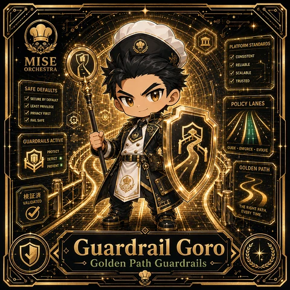

<!-- generated by tools/player-cards/scripts/build-character-pages.mjs from data/characters/guardrail-goro.json; do not edit by hand -->
# Guardrail Goro

**Registry character agent** · Implementation: **Described in docs only** · Detail record: [`data/characters/guardrail-goro.json`](../../data/characters/guardrail-goro.json)

Every field shows where its value comes from (`source:`). Repo-sourced values cite the repository or source-library file they were read from; values marked `authored: card design` were written for this card by [`enrich-characters.py`](../../tools/player-cards/scripts/enrich-characters.py), derived from the printed card text, role and kitchen theme, and are not claims about existing code.

## Identity

| Field | Value |
|---|---|
| Name | Guardrail Goro source: `data/characters.json` |
| Aliases / printed variants | None recorded (no alternate title in the canon crosswalk or agents.json) source: `data/player-cards.json + canon crosswalk (no alternate title found)` |
| Role / title | Golden Path Guardrails source: `characters/guardrail-goro/metadata.json` |
| Kitchen / department | Platform Kitchen source: `characters/guardrail-goro/metadata.json` |
| Department mission | Provide golden paths and stable service foundations. source: `data/imports/miseos_character_master_inventory_001_300.csv` |
| Registry rarity | Common source: `characters/guardrail-goro/metadata.json` |
| Level | 23 source: `data/imports/miseos_character_master_inventory_001_300.csv` |
| ID: registry_id | MISE-029 source: `characters/guardrail-goro/metadata.json` |
| ID: character_id | miseos.character.029 source: `data/imports/miseos_character_master_inventory_001_300.csv` |
| ID: card_id | MISE-029 source: `data/imports/miseos_character_master_inventory_001_300.csv` |
| ID: codename | GUARDRAIL_GORO source: `data/imports/miseos_character_master_inventory_001_300.csv` |
| Collections | 1×1 Chefs source: `data/player-cards.json` |
| Cards linked | 1 source: `data/player-cards.json` |
| Role category | automation source: `data/imports/merged_roster.json` |

## Player cards

| Card | Collection | Printed title | Match method | Full size |
|---|---|---|---|---|
| `guardrail-goro.webp` | 1×1 Chefs | Guardrail Goro | existing-index | [open](../../assets/player-cards/1by1-chefs/guardrail-goro.webp) |

## Card metadata (as printed)

| Field | Value |
|---|---|
| Printed rarity | Not printed on the card source: `data/player-cards-ocr.json (no rarity word in OCR)` |
| Printed stars | Not printed on the card source: `data/player-cards-ocr.json (no stars in OCR)` |
| Printed meters | Not printed on the card source: `data/player-cards-ocr.json (no % meters in OCR)` |
| Roster stats | power 73 · precision 73 · speed 59 · resilience 68 · intelligence 59 · teamwork 79 source: `data/imports/miseos_character_master_inventory_001_300.csv (roster stats, not OCR)` |
| Abilities | Platform Standards, Consistent, Reliable, Scalable, Trusted, Safe Defaults source: `data/player-cards-ocr.json (printed card labels, glued OCR words segmented)` |
| Lore | Picture the locked dry store and the keyring that never leaves the belt: that is where Guardrail Goro is happiest. As Platform Kitchen's specialist for golden path guardrails, Guardrail Goro guards the perimeter of the kitchen: access, secrets and policy, with an audit trail for every exception. The card calls out Platform Standards, Consistent, Reliable: the checks Guardrail Goro runs before calling anything ready. source: `authored: card design (derived from printed card text/role)` |
| Signature phrase | Golden Path Guardrails done cleanly, safely, and in rhythm. source: `data/imports/merged_roster.json` |
| Unique trait | Specializes in golden path guardrails so the Platform Kitchen can operate as a precise, repo-safe DevOps station. source: `data/imports/merged_roster.json` |

Full printed card text (OCR)

**`guardrail-goro.webp`**: PLATFORMSTANDARDS · MISE · CONSISTENT · RELIABLE · ORCHESTRA · SCALABLE · TRUSTED · SAFEDEFAULTS · SECURE BYDEFAULT · LEASTPRIVILEGE · POLICY LANES · PRIVACY FIRST · FAILSAFE · GUARDRAILSACTIVE · GUIDE·ENFORCE·EVOLVE · PROTECT · DETECT · PREVENTO · GOLDEN PATH · 证济 · VALIDATED · THE RIGHT PATH. · EVERY TIME. · Guardrail Goro · Golden Path Guardrails

## Workflow

| Step | Value |
|---|---|
| Summary | Guardrail Goro performs golden path guardrails within the Platform Kitchen. source: `characters/guardrail-goro/metadata.json` |
| Inputs | repository context, task request, policy constraints, current evidence source: `characters/guardrail-goro/metadata.json` |
| Outputs | validated result, evidence record, handoff packet source: `characters/guardrail-goro/metadata.json` |
| Proof gate | No merge, deployment, publication, billing action, or mint without evidence. source: `characters/guardrail-goro/metadata.json` |

## Actions / commands

- command: `MISE GOLDEN PATH GUARDRAILS` source: `data/imports/miseos_character_master_inventory_001_300.csv`
- command: `Golden Path Guardrails` · mise_name: `Mise GoldenPathGuardrails` source: `data/imports/merged_roster.json`

## Implementation

**Status:** Described in docs only

Roster data / types / tests in code that list this entry (not an implementation):
- [`apps/bootstrap-registry/apps/registry-console/src/data/master-roster.generated.ts:449`](../../apps/bootstrap-registry/apps/registry-console/src/data/master-roster.generated.ts#L449)
- [`apps/brigade-gallery/src/data/master-roster.ts:372`](../../apps/brigade-gallery/src/data/master-roster.ts#L372)

Data files that reference it:
- [`apps/bootstrap-registry/registry/cards/master-roster-cards.json:401`](../../apps/bootstrap-registry/registry/cards/master-roster-cards.json#L401)
- [`apps/gridops-platform/data/miseos-ecosystem-135.json:1602`](../../apps/gridops-platform/data/miseos-ecosystem-135.json#L1602)
- [`apps/voxel-world/src/data/miseos-ecosystem-135.json:1602`](../../apps/voxel-world/src/data/miseos-ecosystem-135.json#L1602)
- [`tools/art-factory/input/characters.generated.json:800`](../../tools/art-factory/input/characters.generated.json#L800)
- [`tools/art-factory/output/manifests/krikey_animation_prompts.json:429`](../../tools/art-factory/output/manifests/krikey_animation_prompts.json#L429)
- [`tools/art-factory/output/manifests/mangaboom_comic_prompts.json:429`](../../tools/art-factory/output/manifests/mangaboom_comic_prompts.json#L429)
- [`tools/art-factory/output/merged_roster.json:1448`](../../tools/art-factory/output/merged_roster.json#L1448)

Docs that describe it (docs only, not code):
- [`characters/guardrail-goro/README.md`](../../characters/guardrail-goro/README.md)
- [`apps/brigade-gallery/prototype/holo-card-roster.html:76`](../../apps/brigade-gallery/prototype/holo-card-roster.html#L76)
- [`apps/developer-platform/docs/characters/CHARACTER_REGISTRY_001_300.md:15`](../../apps/developer-platform/docs/characters/CHARACTER_REGISTRY_001_300.md#L15)

implemented_in_code = a dedicated capability handler or tool directory exists; referenced_in_app_code = the entity is used by application source (e.g. repo-pet sprites, CLI) but has no dedicated handler. code_refs are files that reference this entity by name/slug/handler (grep), not a guarantee of a dedicated runtime; registry handler links point at the actual capability function.

## Where and how it helps

| Aspect | Value |
|---|---|
| Station / stage | Platform Kitchen source: `characters/guardrail-goro/metadata.json` |
| Mission | Provide golden paths and stable service foundations. source: `data/imports/miseos_character_master_inventory_001_300.csv` |
| Problem it addresses | Guardrail Goro performs golden path guardrails within the Platform Kitchen. source: `characters/guardrail-goro/metadata.json` |
| Safety gate | No merge, deployment, publication, billing action, or mint without evidence. source: `characters/guardrail-goro/metadata.json` |

## Agents and repo pets

Agents: [Kuro Guard](../agents/kuro-guard.md) · [Firewall](../agents/firewall.md) · [Security Auditor](../agents/security-auditor.md) source: `authored: card design (closest agents for theme "security")`

Repo pets: [Kuro Guard](../repo-pets/kuro-guard.md) · [Mise Locker](../repo-pets/mise-locker.md) source: `authored: card design (closest repo pets for theme "security")`

## Related characters

[Platform Sensei](./platform-sensei.md) · [Seira](./seira.md) · [Kuro Guard](./kuro-guard.md) · [Portal Rei](./portal-rei.md) · [Canary Taster](./canary-taster.md) · [Impact Ichi](./impact-ichi.md) source: `data/imports/miseos_character_master_inventory_001_300.csv data/imports/merged_roster.json data/imports/merged_roster.json data/imports/merged_roster.json`

## Canon Bible

Mentioned in [`docs/canon/MiseOS-Canon-Bible-v1.0.pdf`](../../docs/canon/MiseOS-Canon-Bible-v1.0.pdf):

- line 611: `MISE-G2-P066 Guardrail Goro Mise Orchestra canonical-candidate 1E3334AB-3111- 66`

## Sources

| Field | Source |
|---|---|
| name | `data/characters.json` |
| cards | `data/player-cards.json` |
| card_text | `data/player-cards-ocr.json (OCR of the card image)` |
| ids.registry_id | `characters/guardrail-goro/metadata.json` |
| role | `characters/guardrail-goro/metadata.json` |
| department | `characters/guardrail-goro/metadata.json` |
| rarity | `characters/guardrail-goro/metadata.json` |
| workflow.summary | `characters/guardrail-goro/metadata.json` |
| workflow.inputs | `characters/guardrail-goro/metadata.json` |
| workflow.outputs | `characters/guardrail-goro/metadata.json` |
| workflow.proof_gate | `characters/guardrail-goro/metadata.json` |
| department_mission | `data/imports/miseos_character_master_inventory_001_300.csv` |
| ids.character_id | `data/imports/miseos_character_master_inventory_001_300.csv` |
| ids.card_id | `data/imports/miseos_character_master_inventory_001_300.csv` |
| ids.codename | `data/imports/miseos_character_master_inventory_001_300.csv` |
| stats | `data/imports/miseos_character_master_inventory_001_300.csv (roster stats, not OCR)` |
| level | `data/imports/miseos_character_master_inventory_001_300.csv` |
| related | `data/imports/miseos_character_master_inventory_001_300.csv data/imports/merged_roster.json data/imports/merged_roster.json data/imports/merged_roster.json` |
| signature_phrase | `data/imports/merged_roster.json` |
| unique_trait | `data/imports/merged_roster.json` |
| role_category | `data/imports/merged_roster.json` |
| canon_bible | `docs/canon/MiseOS-Canon-Bible-v1.0.pdf (pdftotext)` |
| implementation | `git ls-files grep + repo` |
| helps.station | `characters/guardrail-goro/metadata.json` |
| aliases | `data/player-cards.json + canon crosswalk (no alternate title found)` |
| card_rarity_printed | `data/player-cards-ocr.json (no rarity word in OCR)` |
| card_stars_printed | `data/player-cards-ocr.json (no stars in OCR)` |
| card_meters_printed | `data/player-cards-ocr.json (no % meters in OCR)` |
| abilities | `data/player-cards-ocr.json (printed card labels, glued OCR words segmented)` |
| lore | `authored: card design (derived from printed card text/role)` |
| agents | `authored: card design (closest agents for theme "security")` |
| repo_pets | `authored: card design (closest repo pets for theme "security")` |
| theme | `authored: card design (keyword theme used for authored fields)` |

[← All characters](./README.md)
