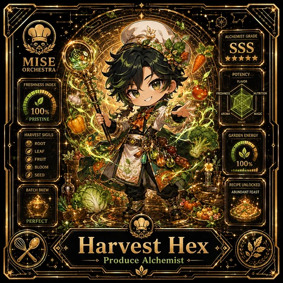

<!-- generated by tools/player-cards/scripts/build-character-pages.mjs from data/characters/harvest-hex.json; do not edit by hand -->
# Harvest Hex

**Registry character agent** · Implementation: **Described in docs only** · Detail record: [`data/characters/harvest-hex.json`](../../data/characters/harvest-hex.json)

Every field below comes from a repository source (shown as `source:`). Where no source exists the page says _Not yet defined in the source material_.

## Identity

| Field | Value |
|---|---|
| Name | Harvest Hex source: `data/characters.json` |
| Aliases / printed variants | Not yet defined in the source material |
| Role / title | Produce Alchemist source: `characters/harvest-hex/metadata.json` |
| Kitchen / department | Operations Kitchen source: `characters/harvest-hex/metadata.json` |
| Department mission | Keep the kitchen running smoothly. source: `data/imports/miseos_character_master_inventory_001_300.csv` |
| Registry rarity | Legendary source: `characters/harvest-hex/metadata.json` |
| Level | 25 source: `data/imports/miseos_character_master_inventory_001_300.csv` |
| ID: registry_id | MISE-104 source: `characters/harvest-hex/metadata.json` |
| ID: character_id | miseos.character.104 source: `data/imports/miseos_character_master_inventory_001_300.csv` |
| ID: card_id | MISE-104 source: `data/imports/miseos_character_master_inventory_001_300.csv` |
| ID: codename | HARVEST_HEX source: `data/imports/miseos_character_master_inventory_001_300.csv` |
| Collections | 1×1 Chefs source: `data/player-cards.json` |
| Cards linked | 1 source: `data/player-cards.json` |

## Player cards

| Card | Collection | Printed title | Match method | Full size |
|---|---|---|---|---|
| `harvest-hex.webp` | 1×1 Chefs | Harvest Hex | existing-index | [open](../../assets/player-cards/1by1-chefs/harvest-hex.webp) |

## Card metadata (as printed)

| Field | Value |
|---|---|
| Printed rarity | Not yet defined in the source material |
| Printed stars | 5 source: `data/player-cards-ocr.json` |
| Printed meters | 100% source: `data/player-cards-ocr.json` |
| Roster stats | power 87 · precision 81 · speed 57 · resilience 71 · intelligence 68 · teamwork 88 source: `data/imports/miseos_character_master_inventory_001_300.csv (roster stats, not OCR)` |
| Abilities | Not yet defined in the source material |
| Lore | Not yet defined in the source material |
| Signature phrase | Not yet defined in the source material |

Full printed card text (OCR)

**`harvest-hex.webp`**: ALCHEMISTGRADE · SSS · MISE · ★★★★★ · ORCHESTRA · POTENCY · FLAVOR · FRESHNESSINDEX · FRESHNESS · NUTRITION · 100% · AROMA · MAGIC · PRISTINE · HARVEST SIGILS · GARDENENERGY · ROOT · LEAF · FRUIT · 100% · BLOOM · SEED · RECIPEUNLOCKED · BATCHBREW · ABUNDANTFEAST · PERFECT · Harvest ·  Hex · Produce Alchemist →

## Workflow

| Step | Value |
|---|---|
| Summary | Harvest Hex performs produce alchemist within the Operations Kitchen. source: `characters/harvest-hex/metadata.json` |
| Inputs | repository context, task request, policy constraints, current evidence source: `characters/harvest-hex/metadata.json` |
| Outputs | validated result, evidence record, handoff packet source: `characters/harvest-hex/metadata.json` |
| Proof gate | No merge, deployment, publication, billing action, or mint without evidence. source: `characters/harvest-hex/metadata.json` |

## Actions / commands

- command: `MISE PRODUCE ALCHEMIST` source: `data/imports/miseos_character_master_inventory_001_300.csv`

## Implementation

**Status:** Described in docs only

Data files that reference it:
- [`apps/gridops-platform/data/miseos-ecosystem-135.json:6252`](../../apps/gridops-platform/data/miseos-ecosystem-135.json#L6252)
- [`apps/voxel-world/src/data/miseos-ecosystem-135.json:6252`](../../apps/voxel-world/src/data/miseos-ecosystem-135.json#L6252)

Docs that describe it (docs only, not code):
- [`characters/harvest-hex/README.md`](../../characters/harvest-hex/README.md)
- [`apps/developer-platform/docs/characters/CHARACTER_REGISTRY_001_300.md:31`](../../apps/developer-platform/docs/characters/CHARACTER_REGISTRY_001_300.md#L31)

implemented_in_code = a dedicated capability handler or tool directory exists; referenced_in_app_code = the entity is used by application source (e.g. repo-pet sprites, CLI) but has no dedicated handler. code_refs are files that reference this entity by name/slug/handler (grep), not a guarantee of a dedicated runtime; registry handler links point at the actual capability function.

## Where and how it helps

| Aspect | Value |
|---|---|
| Station / stage | Operations Kitchen source: `characters/harvest-hex/metadata.json` |
| Mission | Keep the kitchen running smoothly. source: `data/imports/miseos_character_master_inventory_001_300.csv` |
| Problem it addresses | Harvest Hex performs produce alchemist within the Operations Kitchen. source: `characters/harvest-hex/metadata.json` |
| Safety gate | No merge, deployment, publication, billing action, or mint without evidence. source: `characters/harvest-hex/metadata.json` |

## Agents and repo pets

_Not yet defined in the source material_

## Related characters

[Garnish Ghost](./garnish-ghost.md) · [Pantry Paladin](./pantry-paladin.md) · [Ticket Tactician](./ticket-tactician.md) source: `data/imports/miseos_character_master_inventory_001_300.csv`

## Canon Bible

Mentioned in [`docs/canon/MiseOS-Canon-Bible-v1.0.pdf`](../../docs/canon/MiseOS-Canon-Bible-v1.0.pdf):

- line 647: `MISE-G2-P084 Harvest Hex Mise Orchestra canonical-candidate 1E3334AB-3111- 84`

## Sources

| Field | Source |
|---|---|
| name | `data/characters.json` |
| cards | `data/player-cards.json` |
| card_text | `data/player-cards-ocr.json (OCR of the card image)` |
| card_stars_printed | `data/player-cards-ocr.json` |
| card_meters_printed | `data/player-cards-ocr.json` |
| ids.registry_id | `characters/harvest-hex/metadata.json` |
| role | `characters/harvest-hex/metadata.json` |
| department | `characters/harvest-hex/metadata.json` |
| rarity | `characters/harvest-hex/metadata.json` |
| workflow.summary | `characters/harvest-hex/metadata.json` |
| workflow.inputs | `characters/harvest-hex/metadata.json` |
| workflow.outputs | `characters/harvest-hex/metadata.json` |
| workflow.proof_gate | `characters/harvest-hex/metadata.json` |
| department_mission | `data/imports/miseos_character_master_inventory_001_300.csv` |
| ids.character_id | `data/imports/miseos_character_master_inventory_001_300.csv` |
| ids.card_id | `data/imports/miseos_character_master_inventory_001_300.csv` |
| ids.codename | `data/imports/miseos_character_master_inventory_001_300.csv` |
| stats | `data/imports/miseos_character_master_inventory_001_300.csv (roster stats, not OCR)` |
| level | `data/imports/miseos_character_master_inventory_001_300.csv` |
| related | `data/imports/miseos_character_master_inventory_001_300.csv` |
| canon_bible | `docs/canon/MiseOS-Canon-Bible-v1.0.pdf (pdftotext)` |
| implementation | `git ls-files grep + repo` |
| helps.station | `characters/harvest-hex/metadata.json` |

[← All characters](./README.md)
