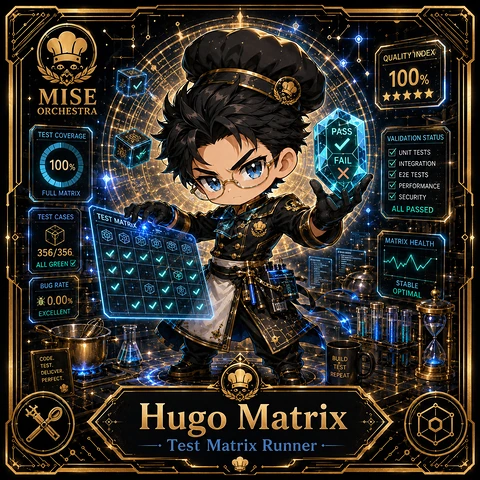

<!-- generated by tools/player-cards/scripts/build-character-pages.mjs from data/characters/hugo-matrix.json; do not edit by hand -->
# Hugo Matrix

**Registry character agent** · Implementation: **Described in docs only** · Detail record: [`data/characters/hugo-matrix.json`](../../data/characters/hugo-matrix.json)

Every field shows where its value comes from (`source:`). Repo-sourced values cite the repository or source-library file they were read from; values marked `authored: card design` were written for this card by [`enrich-characters.py`](../../tools/player-cards/scripts/enrich-characters.py), derived from the printed card text, role and kitchen theme, and are not claims about existing code.

## Identity

| Field | Value |
|---|---|
| Name | Hugo Matrix source: `data/characters.json` |
| Aliases / printed variants | None recorded (no alternate title in the canon crosswalk or agents.json) source: `data/player-cards.json + canon crosswalk (no alternate title found)` |
| Role / title | Test Matrix Runner source: `characters/hugo-matrix/metadata.json` |
| Kitchen / department | Pipeline Kitchen source: `characters/hugo-matrix/metadata.json` |
| Department mission | Build. Test. Deploy. Repeat. source: `data/imports/miseos_character_master_inventory_001_300.csv` |
| Registry rarity | Common source: `characters/hugo-matrix/metadata.json` |
| Level | 17 source: `data/imports/miseos_character_master_inventory_001_300.csv` |
| ID: registry_id | MISE-005 source: `characters/hugo-matrix/metadata.json` |
| ID: character_id | miseos.character.005 source: `data/imports/miseos_character_master_inventory_001_300.csv` |
| ID: card_id | MISE-005 source: `data/imports/miseos_character_master_inventory_001_300.csv` |
| ID: codename | HUGO_MATRIX source: `data/imports/miseos_character_master_inventory_001_300.csv` |
| ID: master_roster_id | MR-005 source: `data/imports/master-roster-cards.csv` |
| Collections | 1×1 Chefs source: `data/player-cards.json` |
| Cards linked | 1 source: `data/player-cards.json` |
| Role category | delivery source: `data/imports/merged_roster.json` |

## Player cards

| Card | Collection | Printed title | Match method | Full size |
|---|---|---|---|---|
| `hugo-matrix.webp` | 1×1 Chefs | Hugo Matrix | existing-index | [open](../../assets/player-cards/1by1-chefs/hugo-matrix.webp) |

## Card metadata (as printed)

| Field | Value |
|---|---|
| Printed rarity | Not printed on the card source: `data/player-cards-ocr.json (no rarity word in OCR)` |
| Printed stars | 5 source: `data/player-cards-ocr.json` |
| Printed meters | 100% source: `data/player-cards-ocr.json` |
| Roster stats | power 57 · precision 61 · speed 68 · resilience 81 · intelligence 76 · teamwork 78 source: `data/imports/miseos_character_master_inventory_001_300.csv (roster stats, not OCR)` |
| Abilities | Quality'Index, Pass, Test Coverage, Validation Status, Unit Tests, Fail source: `data/player-cards-ocr.json (printed card labels, glued OCR words segmented)` |
| Lore | Picture a spoon in every pot: that is where Hugo Matrix is happiest. As Pipeline Kitchen's Test Matrix Runner, Hugo Matrix tastes and tests before anything is served: reviews, checks and canaries against the spec. The card calls out Quality'Index, Pass, Test Coverage: the checks Hugo Matrix runs before calling anything ready. source: `authored: card design (derived from printed card text/role)` |
| Signature phrase | Test Matrix Runner done cleanly, safely, and in rhythm. source: `data/imports/merged_roster.json` |
| Unique trait | Specializes in test matrix runner so the Pipeline Kitchen can operate as a precise, repo-safe DevOps station. source: `data/imports/merged_roster.json` |

Full printed card text (OCR)

**`hugo-matrix.webp`**: QUALITY'INDEX · 100% · MISE · ★★★★★ · ORCHESTRA · PASS · TESTCOVERAGE · VALIDATIONSTATUS · UNIT TESTS · 100% · FAIL · INTEGRATION · E2ETESTS · PERFORMANCE · FULLMATRIX · SECURITY · ALLPASSED · TESTCASES · TESTMATRIX · MATRIXHEALTH · 356/356 · ALL GREEN · STABLE · BUG RATE · OPTIMAL · 0.00% · EXCELLENT · CODE. · BUILD · TEST. · TEST · DELICVER. · REPEAT · PERFECT. · Hugo Matrix · Test Matrix Runner

## Workflow

| Step | Value |
|---|---|
| Summary | Hugo Matrix performs test matrix runner within the Pipeline Kitchen. source: `characters/hugo-matrix/metadata.json` |
| Inputs | repository context, task request, policy constraints, current evidence source: `characters/hugo-matrix/metadata.json` |
| Outputs | validated result, evidence record, handoff packet source: `characters/hugo-matrix/metadata.json` |
| Proof gate | No merge, deployment, publication, billing action, or mint without evidence. source: `characters/hugo-matrix/metadata.json` |

## Actions / commands

- command: `MISE TEST MATRIX RUNNER` source: `data/imports/miseos_character_master_inventory_001_300.csv`
- command: `Test Matrix Runner` · mise_name: `Mise TestMatrixRunner` source: `data/imports/merged_roster.json`
- command: `mise roster run hugo --dept pipeline-masters --solo --emit report` · roster_id: `MR-005` source: `data/imports/master-roster-cards.csv`

## Implementation

**Status:** Described in docs only

Data files that reference it:
- [`apps/gridops-platform/data/miseos-ecosystem-135.json:114`](../../apps/gridops-platform/data/miseos-ecosystem-135.json#L114)
- [`apps/voxel-world/src/data/agents.json:73`](../../apps/voxel-world/src/data/agents.json#L73)
- [`apps/voxel-world/src/data/miseos-ecosystem-135.json:114`](../../apps/voxel-world/src/data/miseos-ecosystem-135.json#L114)
- [`tools/art-factory/input/characters.generated.json:219`](../../tools/art-factory/input/characters.generated.json#L219)
- [`tools/art-factory/output/manifests/krikey_animation_prompts.json:393`](../../tools/art-factory/output/manifests/krikey_animation_prompts.json#L393)
- [`tools/art-factory/output/manifests/mangaboom_comic_prompts.json:393`](../../tools/art-factory/output/manifests/mangaboom_comic_prompts.json#L393)
- [`tools/art-factory/output/merged_roster.json:419`](../../tools/art-factory/output/merged_roster.json#L419)
- [`tools/gcp-lazy-minting/MANIFEST.json:70`](../../tools/gcp-lazy-minting/MANIFEST.json#L70)
- [`tools/gcp-lazy-minting/examples/generated-sidecars/005-hugo-matrix.json:44`](../../tools/gcp-lazy-minting/examples/generated-sidecars/005-hugo-matrix.json#L44)

Docs that describe it (docs only, not code):
- [`characters/hugo-matrix/README.md`](../../characters/hugo-matrix/README.md)
- [`apps/brigade-gallery/prototype/holo-card-roster.html:76`](../../apps/brigade-gallery/prototype/holo-card-roster.html#L76)
- [`apps/developer-platform/docs/characters/CHARACTER_REGISTRY_001_300.md:11`](../../apps/developer-platform/docs/characters/CHARACTER_REGISTRY_001_300.md#L11)

implemented_in_code = a dedicated capability handler or tool directory exists; referenced_in_app_code = the entity is used by application source (e.g. repo-pet sprites, CLI) but has no dedicated handler. code_refs are files that reference this entity by name/slug/handler (grep), not a guarantee of a dedicated runtime; registry handler links point at the actual capability function.

## Where and how it helps

| Aspect | Value |
|---|---|
| Station / stage | Pipeline Kitchen source: `characters/hugo-matrix/metadata.json` |
| Mission | Build. Test. Deploy. Repeat. source: `data/imports/miseos_character_master_inventory_001_300.csv` |
| Problem it addresses | Hugo Matrix performs test matrix runner within the Pipeline Kitchen. source: `characters/hugo-matrix/metadata.json` |
| Safety gate | No merge, deployment, publication, billing action, or mint without evidence. source: `characters/hugo-matrix/metadata.json` |

## Agents and repo pets

Agents: [Reviewer](../agents/reviewer.md) · [Tester](../agents/tester.md) · [Quality Guard](../agents/quality-guard.md) source: `authored: card design (closest agents for theme "quality")`

Repo pets: [Mise Garde](../repo-pets/mise-garde.md) · [Mise Brigadier](../repo-pets/mise-brigadier.md) source: `authored: card design (closest repo pets for theme "quality")`

## Related characters

[Seira Scan](./seira-scan.md) · [Yume Builder](./yume-builder.md) · [Iron Hashi](./iron-hashi.md) · [Omar Reviewer](./omar-reviewer.md) · [Runtime Riku](./runtime-riku.md) · [Canary Judge](./canary-judge.md) source: `data/imports/miseos_character_master_inventory_001_300.csv data/imports/merged_roster.json data/imports/merged_roster.json data/imports/merged_roster.json`

## Canon Bible

Mentioned in [`docs/canon/MiseOS-Canon-Bible-v1.0.pdf`](../../docs/canon/MiseOS-Canon-Bible-v1.0.pdf):

- line 487: `MISE-G2-P013 Hugo Matrix Mise Orchestra canonical-candidate 1E3334AB-3111- 13`

## Sources

| Field | Source |
|---|---|
| name | `data/characters.json` |
| cards | `data/player-cards.json` |
| card_text | `data/player-cards-ocr.json (OCR of the card image)` |
| card_stars_printed | `data/player-cards-ocr.json` |
| card_meters_printed | `data/player-cards-ocr.json` |
| ids.registry_id | `characters/hugo-matrix/metadata.json` |
| role | `characters/hugo-matrix/metadata.json` |
| department | `characters/hugo-matrix/metadata.json` |
| rarity | `characters/hugo-matrix/metadata.json` |
| workflow.summary | `characters/hugo-matrix/metadata.json` |
| workflow.inputs | `characters/hugo-matrix/metadata.json` |
| workflow.outputs | `characters/hugo-matrix/metadata.json` |
| workflow.proof_gate | `characters/hugo-matrix/metadata.json` |
| department_mission | `data/imports/miseos_character_master_inventory_001_300.csv` |
| ids.character_id | `data/imports/miseos_character_master_inventory_001_300.csv` |
| ids.card_id | `data/imports/miseos_character_master_inventory_001_300.csv` |
| ids.codename | `data/imports/miseos_character_master_inventory_001_300.csv` |
| stats | `data/imports/miseos_character_master_inventory_001_300.csv (roster stats, not OCR)` |
| level | `data/imports/miseos_character_master_inventory_001_300.csv` |
| related | `data/imports/miseos_character_master_inventory_001_300.csv data/imports/merged_roster.json data/imports/merged_roster.json data/imports/merged_roster.json` |
| signature_phrase | `data/imports/merged_roster.json` |
| unique_trait | `data/imports/merged_roster.json` |
| role_category | `data/imports/merged_roster.json` |
| ids.master_roster_id | `data/imports/master-roster-cards.csv` |
| canon_bible | `docs/canon/MiseOS-Canon-Bible-v1.0.pdf (pdftotext)` |
| implementation | `git ls-files grep + repo` |
| helps.station | `characters/hugo-matrix/metadata.json` |
| aliases | `data/player-cards.json + canon crosswalk (no alternate title found)` |
| card_rarity_printed | `data/player-cards-ocr.json (no rarity word in OCR)` |
| abilities | `data/player-cards-ocr.json (printed card labels, glued OCR words segmented)` |
| lore | `authored: card design (derived from printed card text/role)` |
| agents | `authored: card design (closest agents for theme "quality")` |
| repo_pets | `authored: card design (closest repo pets for theme "quality")` |
| theme | `authored: card design (keyword theme used for authored fields)` |

[← All characters](./README.md)
