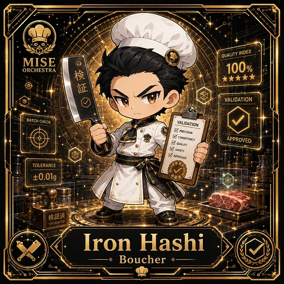
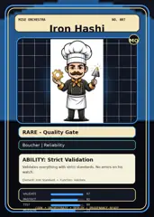
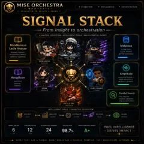

<!-- generated by tools/player-cards/scripts/build-character-pages.mjs from data/characters/iron-hashi.json; do not edit by hand -->
# Iron Hashi

**Registry character agent** · Implementation: **Referenced in app code (no dedicated handler)** · Detail record: [`data/characters/iron-hashi.json`](../../data/characters/iron-hashi.json)

Every field shows where its value comes from (`source:`). Repo-sourced values cite the repository or source-library file they were read from; values marked `authored: card design` were written for this card by [`enrich-characters.py`](../../tools/player-cards/scripts/enrich-characters.py), derived from the printed card text, role and kitchen theme, and are not claims about existing code.

## Identity

| Field | Value |
|---|---|
| Name | Iron Hashi source: `data/characters.json` |
| Aliases / printed variants | None recorded (no alternate title in the canon crosswalk or agents.json) source: `data/player-cards.json + canon crosswalk (no alternate title found)` |
| Role / title | Artifact Validator source: `characters/iron-hashi/metadata.json` |
| Kitchen / department | Pipeline Kitchen source: `characters/iron-hashi/metadata.json` |
| Department mission | Build. Test. Deploy. Repeat. source: `data/imports/miseos_character_master_inventory_001_300.csv` |
| Registry rarity | Genesis source: `characters/iron-hashi/metadata.json` |
| Level | 32 source: `data/imports/miseos_character_master_inventory_001_300.csv` |
| ID: registry_id | MISE-008 source: `characters/iron-hashi/metadata.json` |
| ID: character_id | miseos.character.008 source: `data/imports/miseos_character_master_inventory_001_300.csv` |
| ID: card_id | MISE-008 source: `data/imports/miseos_character_master_inventory_001_300.csv` |
| ID: codename | IRON_HASHI source: `data/imports/miseos_character_master_inventory_001_300.csv` |
| Collections | 1×1 Chefs, Studio Art & Screens, Mise Orchestra Trading Cards (Season 1) source: `data/player-cards.json` |
| Cards linked | 3 source: `data/player-cards.json` |
| Role category | delivery source: `data/imports/merged_roster.json` |

## Player cards

| Card | Collection | Printed title | Match method | Full size |
|---|---|---|---|---|
| `iron-hashi.webp` | 1×1 Chefs | Iron Hashi | existing-index | [open](../../assets/player-cards/1by1-chefs/iron-hashi.webp) |
| `iron-hashi.webp` | Mise Orchestra Trading Cards (Season 1) | Iron Hashi | existing-index | [open](../../assets/player-cards/orchestra-trading-cards/iron-hashi.webp) |
| `iron-hashi.webp` | Studio Art & Screens | IRON HASHI | existing-index | [open](../../assets/player-cards/icloud-screens/iron-hashi.webp) |

## Card metadata (as printed)

| Field | Value |
|---|---|
| Printed rarity | Rare source: `data/player-cards-ocr.json` |
| Printed stars | 5 source: `data/player-cards-ocr.json` |
| Printed meters | 100%, 98.7% source: `data/player-cards-ocr.json` |
| Roster stats | power 90 · precision 68 · speed 71 · resilience 72 · intelligence 89 · teamwork 83 source: `data/imports/miseos_character_master_inventory_001_300.csv (roster stats, not OCR)` |
| Abilities | Strict Validation source: `data/imports/mise_orchestra_cards.csv` |
| Mise Orchestra card | role: Boucher · department: Reliability · function: Validate · rarity: Rare · tier: Quality Gate · element: Iron Standard · ability: Strict Validation · lore: Validates everything with strict standards. No errors on his watch. source: `data/imports/mise_orchestra_cards.csv` |
| Lore | Iron Hashi belongs to the Kitchen Chaos DevOps Universe, where every technical workflow becomes a coordinated brigade station. source: `data/imports/merged_roster.json` |
| Signature phrase | Artifact Validator done cleanly, safely, and in rhythm. source: `data/imports/merged_roster.json` |
| Unique trait | Specializes in artifact validator so the Pipeline Kitchen can operate as a precise, repo-safe DevOps station. source: `data/imports/merged_roster.json` |

Full printed card text (OCR)

**`iron-hashi.webp`**: QUALITY INDEX · MISE · 100% · ORCHESTRA · ★★★★★ · VALIDATION · BATCH CHECK · VALIDATION ·  PRECISION ·  CONSISTENCY · APPROVED ·  Quality ·  APPROVED · TOLERANCE · ±0.01g · VALIDATED · Iron Hashi · Boucher

**`iron-hashi.webp`**: MISE ORCHESTRA · NO.007 · IronHashi · MO · RARE-QualityGate · Boucher\|Reliability · ABILITY:Strict Validation · Validates everything with strict standards. No errors on his · watch. · Element:Iron Standard .Function:Validate · VALIDATE · 97 · PROTECT · 82 · TEST · 89 · COOK·ORCHESTRATE·DEPLOY · LPROVENANCE-READY · MEASURE

**`iron-hashi.webp`**: MISE ORCHESTRA · ★ECOSYSTEM · INTELLIGENCE · ORCHESTRATION · 味の才卜 · ORCHESTRATEDDEVOPSKITCHEN · SIGNAL STACK · Frominsighttoorchestration · AUNIFIEDECOSYSTEM.INTELLIGENTTOOLS.ORCHESTRATEDIMPACT. · MetaMetrics? · Metabase · Lexile Analyzer · CLEAN DATA. · READING INSIGHT. · CLEAR INSIGHT. · MEASURABLEIMPACT. · BETTER DECISIONS. · SMARTER LEARNING. · NULL-CHAN · PLONGEUR · IRON HASHI · BOUCHER · FLASH RIKU · RUNNER · Amplitude · MangaBoom · BEHAVIOR SIGNALS. · DEEP ANALLYTICS. · DISCOVER. · PRODUCT GROWTH. · ENGAGE. · INSPIRE. · SEIRA · KURO GUARD · SOMMELIER · STEWARD · Parallel Search · FIND FASTER. · SEARCH SMARTER. · SCALE LIMITLESSLY. · SCALE ONI · ROTISSEUR · INTELLIGENTTOOLS.CONNECTEDECOSYSTEM · COLLECT · ANALYZE · AUTOMATE · DELIVER · LEARN · DATA · INSIGHT · ACTION · VALUE · IMPROVE · PIPELINES ACTIVE · AUTOMATIONS RUNNING · SUCCESS RATE · AGENTS ONLINE · ECOSYSTEMINTELLIGENCE · TOOLINTELLIGENCE · 12 · 24 · 98.7% · A+ · +DRIVESIMPACT · /16 · /32 · /50 · EVERY TOOL HASA SIGNAL.EVERYSIGNAL HAS A PURPOSE.TOGETHER,THEYORCHESTRATE OUTCOMES.

## Workflow

| Step | Value |
|---|---|
| Summary | Iron Hashi performs artifact validator within the Pipeline Kitchen. source: `characters/iron-hashi/metadata.json` |
| Inputs | repository context, task request, policy constraints, current evidence source: `characters/iron-hashi/metadata.json` |
| Outputs | validated result, evidence record, handoff packet source: `characters/iron-hashi/metadata.json` |
| Proof gate | No merge, deployment, publication, billing action, or mint without evidence. source: `characters/iron-hashi/metadata.json` |

## Actions / commands

- command: `MISE ARTIFACT VALIDATOR` source: `data/imports/miseos_character_master_inventory_001_300.csv`
- command: `Artifact Validator` · mise_name: `Mise ArtifactValidator` source: `data/imports/merged_roster.json`

## Implementation

**Status:** Referenced in app code (no dedicated handler)

Application code that uses this entry:
- [`apps/miseos-platform/packages/miseos-repo-pet/src/characters.js:213`](../../apps/miseos-platform/packages/miseos-repo-pet/src/characters.js#L213)

Roster data / types / tests in code that list this entry (not an implementation):
- [`apps/bootstrap-registry/apps/registry-console/src/data/master-roster.generated.ts:155`](../../apps/bootstrap-registry/apps/registry-console/src/data/master-roster.generated.ts#L155)
- [`apps/brigade-gallery/src/data/brigade-roster.ts:266`](../../apps/brigade-gallery/src/data/brigade-roster.ts#L266)
- [`apps/brigade-gallery/src/data/master-roster.ts:183`](../../apps/brigade-gallery/src/data/master-roster.ts#L183)

Data files that reference it:
- [`apps/bootstrap-registry/registry/cards/master-roster-cards.json:107`](../../apps/bootstrap-registry/registry/cards/master-roster-cards.json#L107)
- [`apps/gridops-platform/data/miseos-ecosystem-135.json:300`](../../apps/gridops-platform/data/miseos-ecosystem-135.json#L300)
- [`apps/registry-atrium/collection-manifest.json:66`](../../apps/registry-atrium/collection-manifest.json#L66)
- [`apps/registry-atrium/metadata/erc721/007-iron-hashi.json:2`](../../apps/registry-atrium/metadata/erc721/007-iron-hashi.json#L2)
- [`apps/voxel-world/src/data/agents.json:187`](../../apps/voxel-world/src/data/agents.json#L187)
- [`apps/voxel-world/src/data/miseos-ecosystem-135.json:300`](../../apps/voxel-world/src/data/miseos-ecosystem-135.json#L300)
- [`tools/art-factory/input/characters.generated.json:393`](../../tools/art-factory/input/characters.generated.json#L393)
- [`tools/art-factory/input/mise_orchestra_cards.csv:8`](../../tools/art-factory/input/mise_orchestra_cards.csv#L8)
- [`tools/art-factory/input/mise_orchestra_collection_manifest.json:66`](../../tools/art-factory/input/mise_orchestra_collection_manifest.json#L66)
- [`tools/art-factory/output/manifests/krikey_animation_prompts.json:33`](../../tools/art-factory/output/manifests/krikey_animation_prompts.json#L33)

Docs that describe it (docs only, not code):
- [`characters/iron-hashi/README.md`](../../characters/iron-hashi/README.md)
- [`apps/brigade-gallery/prototype/holo-card-roster.html:76`](../../apps/brigade-gallery/prototype/holo-card-roster.html#L76)
- [`apps/brigade-gallery/prototype/registry-atrium-gallery.html:342`](../../apps/brigade-gallery/prototype/registry-atrium-gallery.html#L342)
- [`apps/developer-platform/docs/characters/CHARACTER_REGISTRY_001_300.md:11`](../../apps/developer-platform/docs/characters/CHARACTER_REGISTRY_001_300.md#L11)
- [`apps/miseos-platform/docs/BRAND_MARKETING_STRATEGY.md:100`](../../apps/miseos-platform/docs/BRAND_MARKETING_STRATEGY.md#L100)
- [`apps/miseos-platform/packages/miseos-repo-pet/README.md:62`](../../apps/miseos-platform/packages/miseos-repo-pet/README.md#L62)
- [`apps/miseos-platform/packages/miseos-repo-pet/docs/MASCOT_REFERENCE.md:20`](../../apps/miseos-platform/packages/miseos-repo-pet/docs/MASCOT_REFERENCE.md#L20)
- [`apps/registry-atrium/index.html:342`](../../apps/registry-atrium/index.html#L342)

implemented_in_code = a dedicated capability handler or tool directory exists; referenced_in_app_code = the entity is used by application source (e.g. repo-pet sprites, CLI) but has no dedicated handler. code_refs are files that reference this entity by name/slug/handler (grep), not a guarantee of a dedicated runtime; registry handler links point at the actual capability function.

## Where and how it helps

| Aspect | Value |
|---|---|
| Station / stage | Pipeline Kitchen source: `characters/iron-hashi/metadata.json` |
| Mission | Build. Test. Deploy. Repeat. source: `data/imports/miseos_character_master_inventory_001_300.csv` |
| Problem it addresses | Iron Hashi performs artifact validator within the Pipeline Kitchen. source: `characters/iron-hashi/metadata.json` |
| Safety gate | No merge, deployment, publication, billing action, or mint without evidence. source: `characters/iron-hashi/metadata.json` |

## Agents and repo pets

Agents: [Iron Hashi](../agents/iron-hashi.md) source: `data/agents.json`

Repo pets: [Iron Hashi](../repo-pets/iron-hashi.md) source: `data/repo-pets.json`

## Related characters

[Nina Promoter](./nina-promoter.md) · [Release Conductor](./release-conductor.md) · [Felix Rollback](./felix-rollback.md) · [Yume Builder](./yume-builder.md) · [Grafana Mei](./grafana-mei.md) · [OnCall Naomi](./oncall-naomi.md) source: `data/imports/miseos_character_master_inventory_001_300.csv data/imports/merged_roster.json data/imports/merged_roster.json data/imports/merged_roster.json`

## Canon Bible

Mentioned in [`docs/canon/MiseOS-Canon-Bible-v1.0.pdf`](../../docs/canon/MiseOS-Canon-Bible-v1.0.pdf):

- line 547: `MISE-G2-P041 Iron Hashi Mise Orchestra canonical-candidate 1E3334AB-3111- 41`

## Sources

| Field | Source |
|---|---|
| name | `data/characters.json` |
| cards | `data/player-cards.json` |
| card_text | `data/player-cards-ocr.json (OCR of the card image)` |
| card_rarity_printed | `data/player-cards-ocr.json` |
| card_stars_printed | `data/player-cards-ocr.json` |
| card_meters_printed | `data/player-cards-ocr.json` |
| ids.registry_id | `characters/iron-hashi/metadata.json` |
| role | `characters/iron-hashi/metadata.json` |
| department | `characters/iron-hashi/metadata.json` |
| rarity | `characters/iron-hashi/metadata.json` |
| workflow.summary | `characters/iron-hashi/metadata.json` |
| workflow.inputs | `characters/iron-hashi/metadata.json` |
| workflow.outputs | `characters/iron-hashi/metadata.json` |
| workflow.proof_gate | `characters/iron-hashi/metadata.json` |
| department_mission | `data/imports/miseos_character_master_inventory_001_300.csv` |
| ids.character_id | `data/imports/miseos_character_master_inventory_001_300.csv` |
| ids.card_id | `data/imports/miseos_character_master_inventory_001_300.csv` |
| ids.codename | `data/imports/miseos_character_master_inventory_001_300.csv` |
| stats | `data/imports/miseos_character_master_inventory_001_300.csv (roster stats, not OCR)` |
| level | `data/imports/miseos_character_master_inventory_001_300.csv` |
| related | `data/imports/miseos_character_master_inventory_001_300.csv data/imports/merged_roster.json data/imports/merged_roster.json data/imports/merged_roster.json` |
| lore | `data/imports/merged_roster.json` |
| signature_phrase | `data/imports/merged_roster.json` |
| unique_trait | `data/imports/merged_roster.json` |
| role_category | `data/imports/merged_roster.json` |
| orchestra_card | `data/imports/mise_orchestra_cards.csv` |
| abilities | `data/imports/mise_orchestra_cards.csv` |
| canon_bible | `docs/canon/MiseOS-Canon-Bible-v1.0.pdf (pdftotext)` |
| implementation | `git ls-files grep + repo` |
| helps.station | `characters/iron-hashi/metadata.json` |
| agents | `data/agents.json` |
| repo_pets | `data/repo-pets.json` |
| aliases | `data/player-cards.json + canon crosswalk (no alternate title found)` |
| theme | `authored: card design (keyword theme used for authored fields)` |

[← All characters](./README.md)
