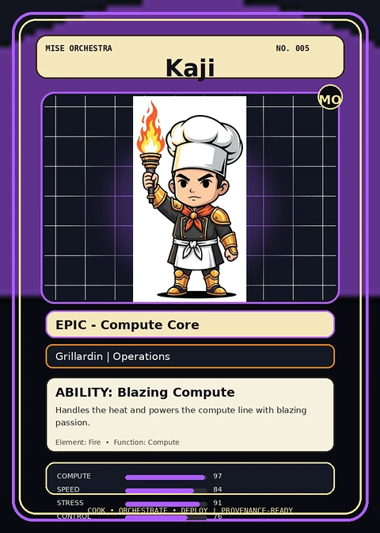

<!-- generated by tools/player-cards/scripts/build-character-pages.mjs from data/characters/kaji.json; do not edit by hand -->
# Kaji

**Registry character agent** · Implementation: **Referenced in app code (no dedicated handler)** · Detail record: [`data/characters/kaji.json`](../../data/characters/kaji.json)

Every field shows where its value comes from (`source:`). Repo-sourced values cite the repository or source-library file they were read from; values marked `authored: card design` were written for this card by [`enrich-characters.py`](../../tools/player-cards/scripts/enrich-characters.py), derived from the printed card text, role and kitchen theme, and are not claims about existing code.

## Identity

| Field | Value |
|---|---|
| Name | Kaji source: `data/characters.json` |
| Aliases / printed variants | None recorded (no alternate title in the canon crosswalk or agents.json) source: `data/player-cards.json + canon crosswalk (no alternate title found)` |
| Role / title | Compute source: `characters/kaji/metadata.json` |
| Kitchen / department | Operations Kitchen source: `characters/kaji/metadata.json` |
| Department mission | Keep the kitchen running smoothly. source: `data/imports/miseos_character_master_inventory_001_300.csv` |
| Registry rarity | Epic source: `characters/kaji/metadata.json` |
| Level | 26 source: `data/imports/miseos_character_master_inventory_001_300.csv` |
| ID: registry_id | MISE-079 source: `characters/kaji/metadata.json` |
| ID: character_id | miseos.character.079 source: `data/imports/miseos_character_master_inventory_001_300.csv` |
| ID: card_id | MISE-079 source: `data/imports/miseos_character_master_inventory_001_300.csv` |
| ID: codename | KAJI source: `data/imports/miseos_character_master_inventory_001_300.csv` |
| Collections | 1×1 Chefs, Cartoon Chefs, Studio Art & Screens, Mise Orchestra Trading Cards (Season 1) source: `data/player-cards.json` |
| Cards linked | 4 source: `data/player-cards.json` |

## Player cards

| Card | Collection | Printed title | Match method | Full size |
|---|---|---|---|---|
| `kaji.webp` | 1×1 Chefs | Kaji | existing-index | [open](../../assets/player-cards/1by1-chefs/kaji.webp) |
| `kaji.webp` | Cartoon Chefs | KAJI | existing-index | [open](../../assets/player-cards/cartoon-chefs/kaji.webp) |
| `kaji.webp` | Mise Orchestra Trading Cards (Season 1) | Kaji | existing-index | [open](../../assets/player-cards/orchestra-trading-cards/kaji.webp) |
| `kaji.webp` | Studio Art & Screens | KAJI | existing-index | [open](../../assets/player-cards/icloud-screens/kaji.webp) |

## Card metadata (as printed)

| Field | Value |
|---|---|
| Printed rarity | Epic source: `data/player-cards-ocr.json` |
| Printed stars | Not printed on the card source: `data/player-cards-ocr.json (no stars in OCR)` |
| Printed meters | Not printed on the card source: `data/player-cards-ocr.json (no % meters in OCR)` |
| Roster stats | power 71 · precision 81 · speed 82 · resilience 68 · intelligence 66 · teamwork 76 source: `data/imports/miseos_character_master_inventory_001_300.csv (roster stats, not OCR)` |
| Abilities | Blazing Compute source: `data/imports/mise_orchestra_cards.csv` |
| Mise Orchestra card | role: Grillardin · department: Operations · function: Compute · rarity: Epic · tier: Compute Core · element: Fire · ability: Blazing Compute · lore: Handles the heat and powers the compute line with blazing passion. source: `data/imports/mise_orchestra_cards.csv` |
| Lore | Kaji belongs to the Kitchen Chaos DevOps Universe, where every technical workflow becomes a coordinated brigade station. source: `data/imports/merged_roster.json` |
| Signature phrase | Kurogami Senpai: checked, not assumed. source: `authored: card design (derived from printed card text/role)` |

Full printed card text (OCR)

**`kaji.webp`**: COMPUTE HEAT · ENGIANGINE · CTERP · 1210rc · Kaji · Grillardin

**`kaji.webp`**: KAJI

**`kaji.webp`**: MISEORCHESTRA · NO.005 · Kaji · MO · EPIC-ComputeCore · Grillardin\|Operations · ABILITY:BlazingCompute · Handles the heat and powers the compute line with blazing · passion. · Element:Fire.Function:Compute · COMPUTE · 97 · SPEED · 84 · STRESS · 91 · ORCHESTRATE·DEPLOY · COOK · PROVENANCE-READY · CONIIROL

**`kaji.webp`**: MISEORCHESTRA · SET B - COMIC BOOK INTRO · Cook.Orchestrate.Deploy. · TENSHO · MIZU · CELESTIALSTRATEGIST · FLOWENGINEER · UMAMICODE · KUROGAMISENPAI · KAJI · DATAALCHEMIST · MASTERORCHESTRATOR · KITCHEN TECH · 01 · EVERYAGENTHASAROLE.EVERYROLEHASPURPOSE

## Workflow

| Step | Value |
|---|---|
| Summary | Kaji performs compute within the Operations Kitchen. source: `characters/kaji/metadata.json` |
| Inputs | repository context, task request, policy constraints, current evidence source: `characters/kaji/metadata.json` |
| Outputs | validated result, evidence record, handoff packet source: `characters/kaji/metadata.json` |
| Proof gate | No merge, deployment, publication, billing action, or mint without evidence. source: `characters/kaji/metadata.json` |

## Actions / commands

- command: `MISE COMPUTE` source: `data/imports/miseos_character_master_inventory_001_300.csv`

## Implementation

**Status:** Referenced in app code (no dedicated handler)

Application code that uses this entry:
- [`apps/miseos-platform/packages/miseos-repo-pet/src/characters.js:161`](../../apps/miseos-platform/packages/miseos-repo-pet/src/characters.js#L161)

Roster data / types / tests in code that list this entry (not an implementation):
- [`apps/brigade-gallery/src/data/brigade-roster.ts:167`](../../apps/brigade-gallery/src/data/brigade-roster.ts#L167)

Data files that reference it:
- [`apps/gridops-platform/data/miseos-ecosystem-135.json:4701`](../../apps/gridops-platform/data/miseos-ecosystem-135.json#L4701)
- [`apps/registry-atrium/collection-manifest.json:48`](../../apps/registry-atrium/collection-manifest.json#L48)
- [`apps/registry-atrium/metadata/erc721/005-kaji.json:2`](../../apps/registry-atrium/metadata/erc721/005-kaji.json#L2)
- [`apps/voxel-world/src/data/miseos-ecosystem-135.json:4701`](../../apps/voxel-world/src/data/miseos-ecosystem-135.json#L4701)
- [`tools/art-factory/input/mise_orchestra_cards.csv:6`](../../tools/art-factory/input/mise_orchestra_cards.csv#L6)
- [`tools/art-factory/input/mise_orchestra_collection_manifest.json:48`](../../tools/art-factory/input/mise_orchestra_collection_manifest.json#L48)
- [`tools/art-factory/output/manifests/krikey_animation_prompts.json:135`](../../tools/art-factory/output/manifests/krikey_animation_prompts.json#L135)
- [`tools/art-factory/output/manifests/mangaboom_comic_prompts.json:135`](../../tools/art-factory/output/manifests/mangaboom_comic_prompts.json#L135)
- [`tools/art-factory/output/merged_roster.json:1250`](../../tools/art-factory/output/merged_roster.json#L1250)

Docs that describe it (docs only, not code):
- [`characters/kaji/README.md`](../../characters/kaji/README.md)
- [`apps/brigade-gallery/prototype/holo-card-roster.html:76`](../../apps/brigade-gallery/prototype/holo-card-roster.html#L76)
- [`apps/brigade-gallery/prototype/registry-atrium-gallery.html:342`](../../apps/brigade-gallery/prototype/registry-atrium-gallery.html#L342)
- [`apps/developer-platform/docs/characters/CHARACTER_REGISTRY_001_300.md:31`](../../apps/developer-platform/docs/characters/CHARACTER_REGISTRY_001_300.md#L31)
- [`apps/miseos-platform/packages/miseos-repo-pet/README.md:60`](../../apps/miseos-platform/packages/miseos-repo-pet/README.md#L60)
- [`apps/miseos-platform/packages/miseos-repo-pet/docs/MASCOT_REFERENCE.md:18`](../../apps/miseos-platform/packages/miseos-repo-pet/docs/MASCOT_REFERENCE.md#L18)
- [`apps/registry-atrium/index.html:342`](../../apps/registry-atrium/index.html#L342)

implemented_in_code = a dedicated capability handler or tool directory exists; referenced_in_app_code = the entity is used by application source (e.g. repo-pet sprites, CLI) but has no dedicated handler. code_refs are files that reference this entity by name/slug/handler (grep), not a guarantee of a dedicated runtime; registry handler links point at the actual capability function.

## Where and how it helps

| Aspect | Value |
|---|---|
| Station / stage | Operations Kitchen source: `characters/kaji/metadata.json` |
| Mission | Keep the kitchen running smoothly. source: `data/imports/miseos_character_master_inventory_001_300.csv` |
| Problem it addresses | Kaji performs compute within the Operations Kitchen. source: `characters/kaji/metadata.json` |
| Safety gate | No merge, deployment, publication, billing action, or mint without evidence. source: `characters/kaji/metadata.json` |

## Agents and repo pets

Agents: [Kaji](../agents/kaji.md) source: `data/agents.json`

Repo pets: [Kaji](../repo-pets/kaji.md) source: `data/repo-pets.json`

## Related characters

[Scale Oni](./scale-oni.md) · [Velvet Vesper](./velvet-vesper.md) · [Flavor Forager](./flavor-forager.md) source: `data/imports/miseos_character_master_inventory_001_300.csv`

## Canon Bible

Mentioned in [`docs/canon/MiseOS-Canon-Bible-v1.0.pdf`](../../docs/canon/MiseOS-Canon-Bible-v1.0.pdf):

- line 539: `MISE-G2-P037 Kaji Mise Orchestra canonical-candidate 1E3334AB-3111- 37`

## Sources

| Field | Source |
|---|---|
| name | `data/characters.json` |
| cards | `data/player-cards.json` |
| card_text | `data/player-cards-ocr.json (OCR of the card image)` |
| card_rarity_printed | `data/player-cards-ocr.json` |
| ids.registry_id | `characters/kaji/metadata.json` |
| role | `characters/kaji/metadata.json` |
| department | `characters/kaji/metadata.json` |
| rarity | `characters/kaji/metadata.json` |
| workflow.summary | `characters/kaji/metadata.json` |
| workflow.inputs | `characters/kaji/metadata.json` |
| workflow.outputs | `characters/kaji/metadata.json` |
| workflow.proof_gate | `characters/kaji/metadata.json` |
| department_mission | `data/imports/miseos_character_master_inventory_001_300.csv` |
| ids.character_id | `data/imports/miseos_character_master_inventory_001_300.csv` |
| ids.card_id | `data/imports/miseos_character_master_inventory_001_300.csv` |
| ids.codename | `data/imports/miseos_character_master_inventory_001_300.csv` |
| stats | `data/imports/miseos_character_master_inventory_001_300.csv (roster stats, not OCR)` |
| level | `data/imports/miseos_character_master_inventory_001_300.csv` |
| related | `data/imports/miseos_character_master_inventory_001_300.csv` |
| lore | `data/imports/merged_roster.json` |
| orchestra_card | `data/imports/mise_orchestra_cards.csv` |
| abilities | `data/imports/mise_orchestra_cards.csv` |
| canon_bible | `docs/canon/MiseOS-Canon-Bible-v1.0.pdf (pdftotext)` |
| implementation | `git ls-files grep + repo` |
| helps.station | `characters/kaji/metadata.json` |
| agents | `data/agents.json` |
| repo_pets | `data/repo-pets.json` |
| aliases | `data/player-cards.json + canon crosswalk (no alternate title found)` |
| card_stars_printed | `data/player-cards-ocr.json (no stars in OCR)` |
| card_meters_printed | `data/player-cards-ocr.json (no % meters in OCR)` |
| signature_phrase | `authored: card design (derived from printed card text/role)` |
| theme | `authored: card design (keyword theme used for authored fields)` |

[← All characters](./README.md)
