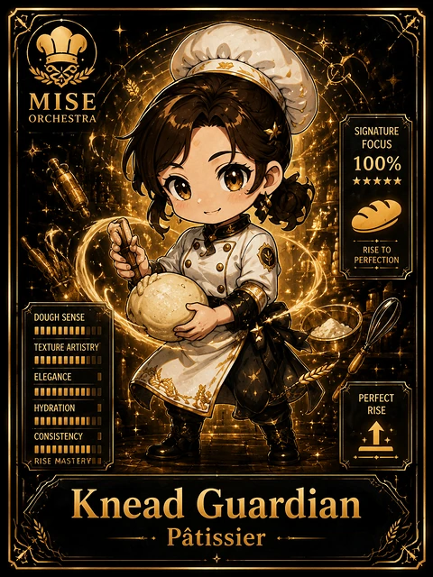

<!-- generated by tools/player-cards/scripts/build-character-pages.mjs from data/characters/knead-guardian.json; do not edit by hand -->
# Knead Guardian

**Card-defined chef (catalogue: visual reference only)** · Implementation: **Designed (not yet implemented in code)** · Detail record: [`data/characters/knead-guardian.json`](../../data/characters/knead-guardian.json)

Every field shows where its value comes from (`source:`). Repo-sourced values cite the repository or source-library file they were read from; values marked `authored: card design` were written for this card by [`enrich-characters.py`](../../tools/player-cards/scripts/enrich-characters.py), derived from the printed card text, role and kitchen theme, and are not claims about existing code.

## Identity

| Field | Value |
|---|---|
| Name | Knead Guardian source: `data/imports/photo-alignment.csv` |
| Aliases / printed variants | None recorded (no alternate title in the canon crosswalk or agents.json) source: `data/player-cards.json + canon crosswalk (no alternate title found)` |
| Role / title | Patissier source: `data/player-cards-ocr.json (subtitle printed under the name)` |
| Kitchen / department | Pipeline Kitchen source: `authored: card design (kitchen chosen from role/printed text, theme "bread")` |
| Department mission | Build. Test. Deploy. Repeat. source: `data/imports/miseos_character_master_inventory_001_300.csv (mission of Pipeline Kitchen)` |
| Registry rarity | Legendary source: `authored: card design (from printed star count 5)` |
| Collections | Long Cards source: `data/player-cards.json` |
| Cards linked | 1 source: `data/player-cards.json` |
| Catalogue status | visual_reference_only source: `data/imports/photo-alignment.csv` |

## Player cards

| Card | Collection | Printed title | Match method | Full size |
|---|---|---|---|---|
| `knead-guardian.webp` | Long Cards | Knead Guardian | title | [open](../../assets/player-cards/long-cards/knead-guardian.webp) |

## Card metadata (as printed)

| Field | Value |
|---|---|
| Printed rarity | Not printed on the card source: `data/player-cards-ocr.json (no rarity word in OCR)` |
| Printed stars | 5 source: `data/player-cards-ocr.json` |
| Printed meters | 100% source: `data/player-cards-ocr.json` |
| Roster stats | power 85 · precision 80 · speed 80 · resilience 99 · intelligence 85 · teamwork 87 source: `authored: card design (6-axis roster scale; baseline from stars + theme "bread")` |
| Abilities | Signature, Focus, Rise To, Perfection, Doughsense, Texture Artistry source: `data/player-cards-ocr.json (printed card labels, glued OCR words segmented)` |
| Lore | Picture the oven light at 4 a.m.: that is where Knead Guardian is happiest. As Pipeline Kitchen's Patissier, Knead Guardian runs the bake: mixing, proofing and baking on a fixed schedule so the line always has fresh builds. The card calls out Signature, Focus, Rise To: the checks Knead Guardian runs before calling anything ready. source: `authored: card design (derived from printed card text/role)` |
| Signature phrase | Proof before bake. source: `authored: card design (derived from printed card text/role)` |

Full printed card text (OCR)

**`knead-guardian.webp`**: MISE · ORCHESTRA · SIGNATURE · FOCUS · 100% · ★★★★★ · RISE TO · PERFECTION · DOUGHSENSE · TEXTUREARTISTRY · ELEGANCE · PERFECT · HYDRATION · RISE · CONSISTENCY · RISE MASTERYI · Knead Guardian · Patissier

## Workflow

| Step | Value |
|---|---|
| Summary | Knead Guardian runs the bake: mixing, proofing and baking on a fixed schedule so the line always has fresh builds. source: `authored: card design (theme "bread")` |
| Inputs | dough / build recipe, proof timer, oven schedule source: `authored: card design (theme "bread")` |
| Outputs | baked batch, bake log, reject count source: `authored: card design (theme "bread")` |
| Proof gate | Proof gate: a batch goes in the oven only when proofing is complete; underproofed batches are held. source: `authored: card design (theme "bread")` |

## Actions / commands

- command: `mise roster run knead-guardian --dept pipeline-kitchen --solo --emit report` · status: `proposed` source: `authored: follows data/imports/master-roster-cards.csv (mise roster run command convention)`
- command: `mise knead-guardian mix` · reads: `dough / build recipe` · emits: `baked batch` · status: `proposed` source: `authored: card design (theme "bread")`
- command: `mise knead-guardian proof` · reads: `proof timer` · emits: `bake log` · status: `proposed` source: `authored: card design (theme "bread")`
- command: `mise knead-guardian bake` · reads: `oven schedule` · emits: `reject count` · status: `proposed` source: `authored: card design (theme "bread")`

## Implementation

**Status:** Designed (not yet implemented in code)

- Proposed handler: `kneadGuardian` (not written yet)
- Proposed command: `mise roster run knead-guardian --dept pipeline-kitchen --solo --emit report`
- Contract: inputs: dough / build recipe, proof timer, oven schedule → outputs: baked batch, bake log, reject count; refuses to emit 'ready' unless the proof gate passes

source: `git ls-files grep + repo (no code found) + authored: proposed handler spec`

implemented_in_code = a dedicated capability handler or tool directory exists; referenced_in_app_code = the entity is used by application source (e.g. repo-pet sprites, CLI) but has no dedicated handler. code_refs are files that reference this entity by name/slug/handler (grep), not a guarantee of a dedicated runtime; registry handler links point at the actual capability function.

## Where and how it helps

| Aspect | Value |
|---|---|
| Station / stage | Patissier source: `data/player-cards-ocr.json (subtitle printed under the name)` |
| Mission | Build. Test. Deploy. Repeat. source: `data/imports/miseos_character_master_inventory_001_300.csv (mission of Pipeline Kitchen)` |
| Problem it addresses | Rushed builds come out half-baked. source: `authored: card design (theme "bread")` |
| Safety gate | Proof gate: a batch goes in the oven only when proofing is complete; underproofed batches are held. source: `authored: card design (theme "bread")` |

## Agents and repo pets

Agents: [Build Kun](../agents/build-kun.md) · [Pipeline](../agents/pipeline.md) · [Automator](../agents/automator.md) source: `authored: card design (closest agents for theme "bread")`

Repo pets: [Build-Kun](../repo-pets/build-kun.md) · [Yume](../repo-pets/yume.md) source: `authored: card design (closest repo pets for theme "bread")`

## Related characters

[Felix Rollback](./felix-rollback.md) · [Bruno Blast Radius](./bruno-blast-radius.md) · [Alko Commit Chef](./alko-commit-chef.md) source: `authored: card design (same theme "bread" / same department)`

## Sources

| Field | Source |
|---|---|
| name | `data/imports/photo-alignment.csv` |
| cards | `data/player-cards.json` |
| card_text | `data/player-cards-ocr.json (OCR of the card image)` |
| card_stars_printed | `data/player-cards-ocr.json` |
| card_meters_printed | `data/player-cards-ocr.json` |
| role | `data/player-cards-ocr.json (subtitle printed under the name)` |
| catalogue_status | `data/imports/photo-alignment.csv` |
| implementation | `git ls-files grep + repo (no code found) + authored: proposed handler spec` |
| helps.station | `data/player-cards-ocr.json (subtitle printed under the name)` |
| aliases | `data/player-cards.json + canon crosswalk (no alternate title found)` |
| department | `authored: card design (kitchen chosen from role/printed text, theme "bread")` |
| department_mission | `data/imports/miseos_character_master_inventory_001_300.csv (mission of Pipeline Kitchen)` |
| card_rarity_printed | `data/player-cards-ocr.json (no rarity word in OCR)` |
| rarity | `authored: card design (from printed star count 5)` |
| stats | `authored: card design (6-axis roster scale; baseline from stars + theme "bread")` |
| abilities | `data/player-cards-ocr.json (printed card labels, glued OCR words segmented)` |
| lore | `authored: card design (derived from printed card text/role)` |
| signature_phrase | `authored: card design (derived from printed card text/role)` |
| workflow.summary | `authored: card design (theme "bread")` |
| workflow.inputs | `authored: card design (theme "bread")` |
| workflow.outputs | `authored: card design (theme "bread")` |
| workflow.proof_gate | `authored: card design (theme "bread")` |
| actions | `authored: follows data/imports/master-roster-cards.csv (mise roster run command convention)` |
| helps.mission | `data/imports/miseos_character_master_inventory_001_300.csv (mission of Pipeline Kitchen)` |
| helps.problem | `authored: card design (theme "bread")` |
| helps.proof_gate | `authored: card design (theme "bread")` |
| agents | `authored: card design (closest agents for theme "bread")` |
| repo_pets | `authored: card design (closest repo pets for theme "bread")` |
| related | `authored: card design (same theme "bread" / same department)` |
| theme | `authored: card design (keyword theme used for authored fields)` |

[← All characters](./README.md)
