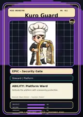
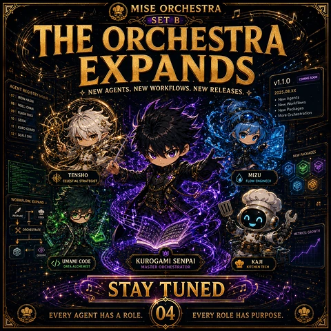
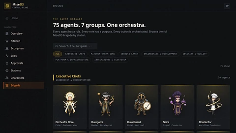

<!-- generated by tools/player-cards/scripts/build-character-pages.mjs from data/characters/kuro-guard.json; do not edit by hand -->
# Kuro Guard

**Registry character agent** · Implementation: **Referenced in app code (no dedicated handler)** · Detail record: [`data/characters/kuro-guard.json`](../../data/characters/kuro-guard.json)

Every field shows where its value comes from (`source:`). Repo-sourced values cite the repository or source-library file they were read from; values marked `authored: card design` were written for this card by [`enrich-characters.py`](../../tools/player-cards/scripts/enrich-characters.py), derived from the printed card text, role and kitchen theme, and are not claims about existing code.

## Identity

| Field | Value |
|---|---|
| Name | Kuro Guard source: `data/characters.json` |
| Aliases / printed variants | None recorded (no alternate title in the canon crosswalk or agents.json) source: `data/player-cards.json + canon crosswalk (no alternate title found)` |
| Role / title | Protect source: `characters/kuro-guard/metadata.json` |
| Kitchen / department | Platform Kitchen source: `characters/kuro-guard/metadata.json` |
| Department mission | Provide golden paths and stable service foundations. source: `data/imports/miseos_character_master_inventory_001_300.csv` |
| Registry rarity | Epic source: `characters/kuro-guard/metadata.json` |
| Level | 24 source: `data/imports/miseos_character_master_inventory_001_300.csv` |
| ID: registry_id | MISE-084 source: `characters/kuro-guard/metadata.json` |
| ID: character_id | miseos.character.084 source: `data/imports/miseos_character_master_inventory_001_300.csv` |
| ID: card_id | MISE-084 source: `data/imports/miseos_character_master_inventory_001_300.csv` |
| ID: codename | KURO_GUARD source: `data/imports/miseos_character_master_inventory_001_300.csv` |
| Collections | 1×1 Chefs, Studio Art & Screens, Mise Orchestra Trading Cards (Season 1) source: `data/player-cards.json` |
| Cards linked | 4 source: `data/player-cards.json` |

## Player cards

| Card | Collection | Printed title | Match method | Full size |
|---|---|---|---|---|
| `kuro-guard.webp` | 1×1 Chefs | Kuro Guard | existing-index | [open](../../assets/player-cards/1by1-chefs/kuro-guard.webp) |
| `kuro-guard.webp` | Mise Orchestra Trading Cards (Season 1) | Kuro Guard | existing-index | [open](../../assets/player-cards/orchestra-trading-cards/kuro-guard.webp) |
| `kuro-guard.webp` | Studio Art & Screens | KURO GUARD | existing-index | [open](../../assets/player-cards/icloud-screens/kuro-guard.webp) |
| `kuro-guard-2.webp` | Studio Art & Screens | Kuro Guard | existing-index | [open](../../assets/player-cards/icloud-screens/kuro-guard-2.webp) |

## Card metadata (as printed)

| Field | Value |
|---|---|
| Printed rarity | Epic source: `data/player-cards-ocr.json` |
| Printed stars | Not printed on the card source: `data/player-cards-ocr.json (no stars in OCR)` |
| Printed meters | 100% source: `data/player-cards-ocr.json` |
| Roster stats | power 82 · precision 79 · speed 78 · resilience 78 · intelligence 67 · teamwork 88 source: `data/imports/miseos_character_master_inventory_001_300.csv (roster stats, not OCR)` |
| Abilities | Platform Ward source: `data/imports/mise_orchestra_cards.csv` |
| Mise Orchestra card | role: Steward · department: Platform · function: Protect · rarity: Epic · tier: Security Gate · element: Black Shield · ability: Platform Ward · lore: Defends the platform with unwavering protection. source: `data/imports/mise_orchestra_cards.csv` |
| Lore | Kuro Guard belongs to the Kitchen Chaos DevOps Universe, where every technical workflow becomes a coordinated brigade station. source: `data/imports/merged_roster.json` |
| Signature phrase | No tensho left to chance. source: `authored: card design (derived from printed card text/role)` |

Full printed card text (OCR)

**`kuro-guard.webp`**: MISE · ORCHESTRA · GUARDIAN · OFFLAVOR · KITCHEN DEFENSE · PROTECT · PROTOCOL · PRESERVE · ACTIVE · PERFECT · KITCHEN · INTEGRITY · 100% · Kuro Guard · Steward

**`kuro-guard.webp`**: MISE ORCHESTRA · NO.011 · KuroGuard · MO · EPIC-SecurityGate · Steward\|Platform · ABILITY:Platform Ward · Defends the platform with unwavering protection. · Element: Black Shield :Function: Protect · PROTECT · 98 · SECURE · 93 · OBSERVE · 80 · ORCHESTRATE·DEPLOY · COOK · PROVENANCE-READY · VALIDATE

**`kuro-guard.webp`**: MISEORCHESTRA · SET B · THE ORCHESTRA · EXPANDS · v1.1.0 · AGENTREGISTRY(V1.0.0) · 2025.08.xX · 07 · IRON HASHI · •New Agents · 80 · NULL-CHAN · ·NewWorkflows · 09 · FLASH RIKU · ·New Packages · 10 SEIRA · MoreOrchestration · 11元 · KURO GUARD · 12SCALEONI · NEWPACKAGES · TENSHO · MIZU · CELESTIALSTRATEGIST · FLOWENGINEER · WORKFLOW:EXPAND · PREPARE · COOK · ORCHESTRATE · METRICS:GROWTH · UMAMICODE · KUROGAMISENPAI · KAJI · DATAALCHEMIST · MASTERORCHESTRATOR · KITCHENTECH · STAY TUNED · 04 · EVERYAGENTHASAROLE · EVERYROLEHASPURPOSE

**`kuro-guard-2.webp`**: Miseos · BRIGADE · CONTROL PLANE · OP · Home · THE AGENT BRIGADE · 75agents.7groups.Oneorchestra. · NAVIGATION · Overview · Everyagenthasa role.Everyrole has a purpose.Everyaction is orchestrated.Browsethefull · Miseosbrigadebystation. · Kitchen · Q Search the brigade. · Ecosystem · ALL · EXECUTIVE CHEFS · KITCHEN OPERATIONS · ENGINEERING &DEVELOPMENT · SERVICE LAYER · Jobs · SECURITY&QUALITY · PLATFORM& INFRASTRUCTURE · INTEGRATIONSECOSYSTEM · Approvals · 75 shown · Stations · ExecutiveChefs · Characters · 10 agents · LEADERSHIP &ORCHESTRATION · Brigade · Kurogami · KuroGuard · Seira · OrchestraCore · Conductor · Master Strategist · Chief Orchestrator · Signal Conductor · Chief Sentinel · Workflow Conductor

## Workflow

| Step | Value |
|---|---|
| Summary | Kuro Guard performs protect within the Platform Kitchen. source: `characters/kuro-guard/metadata.json` |
| Inputs | repository context, task request, policy constraints, current evidence source: `characters/kuro-guard/metadata.json` |
| Outputs | validated result, evidence record, handoff packet source: `characters/kuro-guard/metadata.json` |
| Proof gate | No merge, deployment, publication, billing action, or mint without evidence. source: `characters/kuro-guard/metadata.json` |

## Actions / commands

- command: `MISE PROTECT` source: `data/imports/miseos_character_master_inventory_001_300.csv`

## Implementation

**Status:** Referenced in app code (no dedicated handler)

Application code that uses this entry:
- [`apps/miseos-platform/packages/miseos-repo-pet/src/characters.js:317`](../../apps/miseos-platform/packages/miseos-repo-pet/src/characters.js#L317)

Roster data / types / tests in code that list this entry (not an implementation):
- [`apps/brigade-gallery/src/data/brigade-roster.ts:46`](../../apps/brigade-gallery/src/data/brigade-roster.ts#L46)

Data files that reference it:
- [`apps/gridops-platform/data/miseos-ecosystem-135.json:1788`](../../apps/gridops-platform/data/miseos-ecosystem-135.json#L1788)
- [`apps/registry-atrium/collection-manifest.json:102`](../../apps/registry-atrium/collection-manifest.json#L102)
- [`apps/registry-atrium/metadata/erc721/011-kuro-guard.json:2`](../../apps/registry-atrium/metadata/erc721/011-kuro-guard.json#L2)
- [`apps/voxel-world/src/data/miseos-ecosystem-135.json:1788`](../../apps/voxel-world/src/data/miseos-ecosystem-135.json#L1788)
- [`tools/art-factory/input/mise_orchestra_cards.csv:12`](../../tools/art-factory/input/mise_orchestra_cards.csv#L12)
- [`tools/art-factory/input/mise_orchestra_collection_manifest.json:102`](../../tools/art-factory/input/mise_orchestra_collection_manifest.json#L102)
- [`tools/art-factory/output/manifests/krikey_animation_prompts.json:153`](../../tools/art-factory/output/manifests/krikey_animation_prompts.json#L153)
- [`tools/art-factory/output/manifests/mangaboom_comic_prompts.json:153`](../../tools/art-factory/output/manifests/mangaboom_comic_prompts.json#L153)
- [`tools/art-factory/output/merged_roster.json:1378`](../../tools/art-factory/output/merged_roster.json#L1378)

Docs that describe it (docs only, not code):
- [`characters/kuro-guard/README.md`](../../characters/kuro-guard/README.md)
- [`apps/brigade-gallery/prototype/holo-card-roster.html:76`](../../apps/brigade-gallery/prototype/holo-card-roster.html#L76)
- [`apps/brigade-gallery/prototype/registry-atrium-gallery.html:342`](../../apps/brigade-gallery/prototype/registry-atrium-gallery.html#L342)
- [`apps/developer-platform/docs/characters/CHARACTER_REGISTRY_001_300.md:15`](../../apps/developer-platform/docs/characters/CHARACTER_REGISTRY_001_300.md#L15)
- [`apps/miseos-platform/packages/miseos-repo-pet/README.md:66`](../../apps/miseos-platform/packages/miseos-repo-pet/README.md#L66)
- [`apps/miseos-platform/packages/miseos-repo-pet/docs/MASCOT_REFERENCE.md:24`](../../apps/miseos-platform/packages/miseos-repo-pet/docs/MASCOT_REFERENCE.md#L24)
- [`apps/registry-atrium/index.html:342`](../../apps/registry-atrium/index.html#L342)

implemented_in_code = a dedicated capability handler or tool directory exists; referenced_in_app_code = the entity is used by application source (e.g. repo-pet sprites, CLI) but has no dedicated handler. code_refs are files that reference this entity by name/slug/handler (grep), not a guarantee of a dedicated runtime; registry handler links point at the actual capability function.

## Where and how it helps

| Aspect | Value |
|---|---|
| Station / stage | Platform Kitchen source: `characters/kuro-guard/metadata.json` |
| Mission | Provide golden paths and stable service foundations. source: `data/imports/miseos_character_master_inventory_001_300.csv` |
| Problem it addresses | Kuro Guard performs protect within the Platform Kitchen. source: `characters/kuro-guard/metadata.json` |
| Safety gate | No merge, deployment, publication, billing action, or mint without evidence. source: `characters/kuro-guard/metadata.json` |

## Agents and repo pets

Agents: [Kuro Guard](../agents/kuro-guard.md) source: `data/agents.json`

Repo pets: [Kuro Guard](../repo-pets/kuro-guard.md) source: `data/repo-pets.json`

## Related characters

[Orchestra Core](./orchestra-core.md) · [Template Tanaka](./template-tanaka.md) · [Bootstrap Aiko](./bootstrap-aiko.md) source: `data/imports/miseos_character_master_inventory_001_300.csv`

## Canon Bible

Mentioned in [`docs/canon/MiseOS-Canon-Bible-v1.0.pdf`](../../docs/canon/MiseOS-Canon-Bible-v1.0.pdf):

- line 659: `MISE-G2-P090 Kuro Guard Mise Orchestra canonical-candidate 1E3334AB-3111- 90`

## Sources

| Field | Source |
|---|---|
| name | `data/characters.json` |
| cards | `data/player-cards.json` |
| card_text | `data/player-cards-ocr.json (OCR of the card image)` |
| card_rarity_printed | `data/player-cards-ocr.json` |
| card_meters_printed | `data/player-cards-ocr.json` |
| ids.registry_id | `characters/kuro-guard/metadata.json` |
| role | `characters/kuro-guard/metadata.json` |
| department | `characters/kuro-guard/metadata.json` |
| rarity | `characters/kuro-guard/metadata.json` |
| workflow.summary | `characters/kuro-guard/metadata.json` |
| workflow.inputs | `characters/kuro-guard/metadata.json` |
| workflow.outputs | `characters/kuro-guard/metadata.json` |
| workflow.proof_gate | `characters/kuro-guard/metadata.json` |
| department_mission | `data/imports/miseos_character_master_inventory_001_300.csv` |
| ids.character_id | `data/imports/miseos_character_master_inventory_001_300.csv` |
| ids.card_id | `data/imports/miseos_character_master_inventory_001_300.csv` |
| ids.codename | `data/imports/miseos_character_master_inventory_001_300.csv` |
| stats | `data/imports/miseos_character_master_inventory_001_300.csv (roster stats, not OCR)` |
| level | `data/imports/miseos_character_master_inventory_001_300.csv` |
| related | `data/imports/miseos_character_master_inventory_001_300.csv` |
| lore | `data/imports/merged_roster.json` |
| orchestra_card | `data/imports/mise_orchestra_cards.csv` |
| abilities | `data/imports/mise_orchestra_cards.csv` |
| canon_bible | `docs/canon/MiseOS-Canon-Bible-v1.0.pdf (pdftotext)` |
| implementation | `git ls-files grep + repo` |
| helps.station | `characters/kuro-guard/metadata.json` |
| agents | `data/agents.json` |
| repo_pets | `data/repo-pets.json` |
| aliases | `data/player-cards.json + canon crosswalk (no alternate title found)` |
| card_stars_printed | `data/player-cards-ocr.json (no stars in OCR)` |
| signature_phrase | `authored: card design (derived from printed card text/role)` |
| theme | `authored: card design (keyword theme used for authored fields)` |

[← All characters](./README.md)
