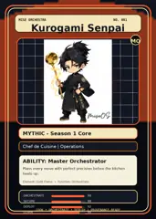
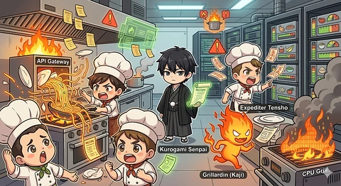

<!-- generated by tools/player-cards/scripts/build-character-pages.mjs from data/characters/kurogami-senpai.json; do not edit by hand -->
# Kurogami Senpai

**Registry character agent** · Implementation: **Referenced in app code (no dedicated handler)** · Detail record: [`data/characters/kurogami-senpai.json`](../../data/characters/kurogami-senpai.json)

Every field below comes from a repository source (shown as `source:`). Where no source exists the page says _Not yet defined in the source material_.

## Identity

| Field | Value |
|---|---|
| Name | Kurogami Senpai source: `data/characters.json` |
| Aliases / printed variants | Not yet defined in the source material |
| Role / title | Orchestrate source: `characters/kurogami-senpai/metadata.json` |
| Kitchen / department | Operations Kitchen source: `characters/kurogami-senpai/metadata.json` |
| Department mission | Keep the kitchen running smoothly. source: `data/imports/miseos_character_master_inventory_001_300.csv` |
| Registry rarity | Mythic source: `characters/kurogami-senpai/metadata.json` |
| Level | 32 source: `data/imports/miseos_character_master_inventory_001_300.csv` |
| ID: registry_id | MISE-076 source: `characters/kurogami-senpai/metadata.json` |
| ID: character_id | miseos.character.076 source: `data/imports/miseos_character_master_inventory_001_300.csv` |
| ID: card_id | MISE-076 source: `data/imports/miseos_character_master_inventory_001_300.csv` |
| ID: codename | KUROGAMI_SENPAI source: `data/imports/miseos_character_master_inventory_001_300.csv` |
| Collections | 1×1 Chefs, Studio Art & Screens, Mise Orchestra Trading Cards (Season 1) source: `data/player-cards.json` |
| Cards linked | 3 source: `data/player-cards.json` |

## Player cards

| Card | Collection | Printed title | Match method | Full size |
|---|---|---|---|---|
| `kurogami-senpai.webp` | 1×1 Chefs | Kurogami Senpai | existing-index | [open](../../assets/player-cards/1by1-chefs/kurogami-senpai.webp) |
| `kurogami-senpai.webp` | Mise Orchestra Trading Cards (Season 1) | Kurogami Senpai | existing-index | [open](../../assets/player-cards/orchestra-trading-cards/kurogami-senpai.webp) |
| `kurogami-senpai.webp` | Studio Art & Screens | Kurogami Senpai | existing-index | [open](../../assets/player-cards/icloud-screens/kurogami-senpai.webp) |

## Card metadata (as printed)

| Field | Value |
|---|---|
| Printed rarity | Mythic source: `data/player-cards-ocr.json` |
| Printed stars | Not yet defined in the source material |
| Printed meters | Not yet defined in the source material |
| Roster stats | power 74 · precision 91 · speed 67 · resilience 92 · intelligence 85 · teamwork 75 source: `data/imports/miseos_character_master_inventory_001_300.csv (roster stats, not OCR)` |
| Abilities | Master Orchestrator source: `data/imports/mise_orchestra_cards.csv` |
| Mise Orchestra card | role: Chef de Cuisine · department: Operations · function: Orchestrate · rarity: Mythic · tier: Season 1 Core · element: Gold Flame · ability: Master Orchestrator · lore: Plans every move with perfect precision before the kitchen heats up. source: `data/imports/mise_orchestra_cards.csv` |
| Lore | Kurogami Senpai belongs to the Kitchen Chaos DevOps Universe, where every technical workflow becomes a coordinated brigade station. source: `data/imports/merged_roster.json` |
| Signature phrase | Not yet defined in the source material |

Full printed card text (OCR)

**`kurogami-senpai.webp`**: Kurogami Senpai · Chef de Cuisine

**`kurogami-senpai.webp`**: MISE ORCHESTRA · NO.001 · KurogamiSenpai · MO · 50im · MYTHIC-Season1Core · Chef de Cuisine\|Operations · ABILITY:MasterOrchestrator · Plans every move withperfectprecision before thekitchen · heats up. · Element:GoldFlame·Function:Orchestrate · ORCHESTRATE · 98 · SECURE · 88 · DEPLOY · 92 · ORCHESTRATE·DEPLOY · COOK · PROVENANCE-READY · LEARN · 84

**`kurogami-senpai.webp`**: APIGateway · Expediter Tensho · Kurogami Senpai · 011103 · 01011 · Grillardin (Kaji) · CPUGrill

## Workflow

| Step | Value |
|---|---|
| Summary | Kurogami Senpai performs orchestrate within the Operations Kitchen. source: `characters/kurogami-senpai/metadata.json` |
| Inputs | repository context, task request, policy constraints, current evidence source: `characters/kurogami-senpai/metadata.json` |
| Outputs | validated result, evidence record, handoff packet source: `characters/kurogami-senpai/metadata.json` |
| Proof gate | No merge, deployment, publication, billing action, or mint without evidence. source: `characters/kurogami-senpai/metadata.json` |

## Actions / commands

- command: `MISE ORCHESTRATE` source: `data/imports/miseos_character_master_inventory_001_300.csv`

## Implementation

**Status:** Referenced in app code (no dedicated handler)

Application code that uses this entry:
- [`apps/miseos-platform/packages/miseos-repo-pet/bin/mise-roam.mjs:42`](../../apps/miseos-platform/packages/miseos-repo-pet/bin/mise-roam.mjs#L42)
- [`apps/miseos-platform/packages/miseos-repo-pet/examples/demo-roam.mjs:3`](../../apps/miseos-platform/packages/miseos-repo-pet/examples/demo-roam.mjs#L3)
- [`apps/miseos-platform/packages/miseos-repo-pet/src/characters.js:57`](../../apps/miseos-platform/packages/miseos-repo-pet/src/characters.js#L57)
- [`tools/repo-pet/examples/demo-roam.mjs:5`](../../tools/repo-pet/examples/demo-roam.mjs#L5)
- [`tools/repo-pet/src/characters.js:5`](../../tools/repo-pet/src/characters.js#L5)

Roster data / types / tests in code that list this entry (not an implementation):
- [`apps/brigade-gallery/src/data/master-roster.ts:85`](../../apps/brigade-gallery/src/data/master-roster.ts#L85)
- [`apps/brigade-gallery/src/types/master-roster.ts:66`](../../apps/brigade-gallery/src/types/master-roster.ts#L66)
- [`apps/miseos-platform/packages/miseos-repo-pet/test/smoke.mjs:5`](../../apps/miseos-platform/packages/miseos-repo-pet/test/smoke.mjs#L5)
- [`tools/repo-pet/test/smoke.mjs:5`](../../tools/repo-pet/test/smoke.mjs#L5)

Data files that reference it:
- [`apps/gridops-platform/data/miseos-ecosystem-135.json:4663`](../../apps/gridops-platform/data/miseos-ecosystem-135.json#L4663)
- [`apps/miseos-platform/packages/miseos-repo-pet/package.json:13`](../../apps/miseos-platform/packages/miseos-repo-pet/package.json#L13)
- [`apps/registry-atrium/collection-manifest.json:12`](../../apps/registry-atrium/collection-manifest.json#L12)
- [`apps/registry-atrium/metadata/erc721/001-kurogami-senpai.json:2`](../../apps/registry-atrium/metadata/erc721/001-kurogami-senpai.json#L2)
- [`apps/voxel-world/src/data/miseos-ecosystem-135.json:4663`](../../apps/voxel-world/src/data/miseos-ecosystem-135.json#L4663)
- [`tools/art-factory/input/mise_orchestra_cards.csv:2`](../../tools/art-factory/input/mise_orchestra_cards.csv#L2)
- [`tools/art-factory/input/mise_orchestra_collection_manifest.json:12`](../../tools/art-factory/input/mise_orchestra_collection_manifest.json#L12)
- [`tools/art-factory/output/manifests/krikey_animation_prompts.json:21`](../../tools/art-factory/output/manifests/krikey_animation_prompts.json#L21)
- [`tools/art-factory/output/manifests/mangaboom_comic_prompts.json:21`](../../tools/art-factory/output/manifests/mangaboom_comic_prompts.json#L21)
- [`tools/art-factory/output/merged_roster.json:209`](../../tools/art-factory/output/merged_roster.json#L209)

Docs that describe it (docs only, not code):
- [`characters/kurogami-senpai/README.md`](../../characters/kurogami-senpai/README.md)
- [`apps/brigade-gallery/prototype/holo-card-roster.html:76`](../../apps/brigade-gallery/prototype/holo-card-roster.html#L76)
- [`apps/brigade-gallery/prototype/registry-atrium-gallery.html:342`](../../apps/brigade-gallery/prototype/registry-atrium-gallery.html#L342)
- [`apps/developer-platform/docs/characters/CHARACTER_REGISTRY_001_300.md:31`](../../apps/developer-platform/docs/characters/CHARACTER_REGISTRY_001_300.md#L31)
- [`apps/miseos-platform/packages/miseos-repo-pet/README.md:5`](../../apps/miseos-platform/packages/miseos-repo-pet/README.md#L5)
- [`apps/miseos-platform/packages/miseos-repo-pet/docs/MASCOT_REFERENCE.md:14`](../../apps/miseos-platform/packages/miseos-repo-pet/docs/MASCOT_REFERENCE.md#L14)
- [`apps/registry-atrium/index.html:342`](../../apps/registry-atrium/index.html#L342)
- [`tools/repo-pet/README.md:104`](../../tools/repo-pet/README.md#L104)
- [`tools/repo-pet/docs/MASCOT_REFERENCE.md:9`](../../tools/repo-pet/docs/MASCOT_REFERENCE.md#L9)

implemented_in_code = a dedicated capability handler or tool directory exists; referenced_in_app_code = the entity is used by application source (e.g. repo-pet sprites, CLI) but has no dedicated handler. code_refs are files that reference this entity by name/slug/handler (grep), not a guarantee of a dedicated runtime; registry handler links point at the actual capability function.

## Where and how it helps

| Aspect | Value |
|---|---|
| Station / stage | Operations Kitchen source: `characters/kurogami-senpai/metadata.json` |
| Mission | Keep the kitchen running smoothly. source: `data/imports/miseos_character_master_inventory_001_300.csv` |
| Problem it addresses | Kurogami Senpai performs orchestrate within the Operations Kitchen. source: `characters/kurogami-senpai/metadata.json` |
| Safety gate | No merge, deployment, publication, billing action, or mint without evidence. source: `characters/kurogami-senpai/metadata.json` |

## Agents and repo pets

Agents: [Kurogami](../agents/kurogami.md) source: `data/agents.json`

Repo pets: [Kurogami Senpai](../repo-pets/kurogami-senpai.md) source: `data/repo-pets.json`

## Related characters

[Mizu](./mizu.md) · [Kaji](./kaji.md) · [Scale Oni](./scale-oni.md) source: `data/imports/miseos_character_master_inventory_001_300.csv`

## Sources

| Field | Source |
|---|---|
| name | `data/characters.json` |
| cards | `data/player-cards.json` |
| card_text | `data/player-cards-ocr.json (OCR of the card image)` |
| card_rarity_printed | `data/player-cards-ocr.json` |
| ids.registry_id | `characters/kurogami-senpai/metadata.json` |
| role | `characters/kurogami-senpai/metadata.json` |
| department | `characters/kurogami-senpai/metadata.json` |
| rarity | `characters/kurogami-senpai/metadata.json` |
| workflow.summary | `characters/kurogami-senpai/metadata.json` |
| workflow.inputs | `characters/kurogami-senpai/metadata.json` |
| workflow.outputs | `characters/kurogami-senpai/metadata.json` |
| workflow.proof_gate | `characters/kurogami-senpai/metadata.json` |
| department_mission | `data/imports/miseos_character_master_inventory_001_300.csv` |
| ids.character_id | `data/imports/miseos_character_master_inventory_001_300.csv` |
| ids.card_id | `data/imports/miseos_character_master_inventory_001_300.csv` |
| ids.codename | `data/imports/miseos_character_master_inventory_001_300.csv` |
| stats | `data/imports/miseos_character_master_inventory_001_300.csv (roster stats, not OCR)` |
| level | `data/imports/miseos_character_master_inventory_001_300.csv` |
| related | `data/imports/miseos_character_master_inventory_001_300.csv` |
| lore | `data/imports/merged_roster.json` |
| orchestra_card | `data/imports/mise_orchestra_cards.csv` |
| abilities | `data/imports/mise_orchestra_cards.csv` |
| implementation | `git ls-files grep + repo` |
| helps.station | `characters/kurogami-senpai/metadata.json` |
| agents | `data/agents.json` |
| repo_pets | `data/repo-pets.json` |

[← All characters](./README.md)
