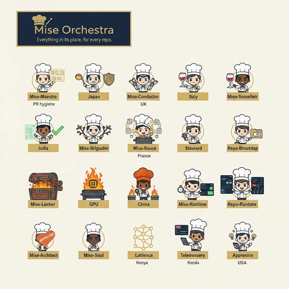
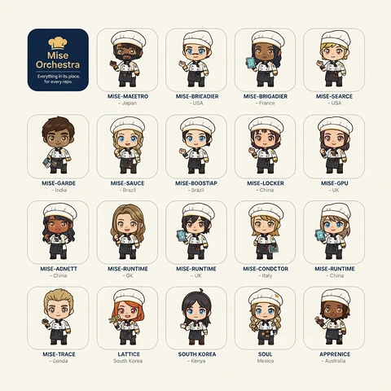

<!-- generated by tools/player-cards/scripts/build-character-pages.mjs from data/characters/lattice.json; do not edit by hand -->
# Lattice

**Registry character agent** · Implementation: **Referenced in app code (no dedicated handler)** · Detail record: [`data/characters/lattice.json`](../../data/characters/lattice.json)

Every field below comes from a repository source (shown as `source:`). Where no source exists the page says _Not yet defined in the source material_.

## Identity

| Field | Value |
|---|---|
| Name | Lattice source: `data/characters.json` |
| Aliases / printed variants | Not yet defined in the source material |
| Role / title | Trace Correlator source: `characters/lattice/metadata.json` |
| Kitchen / department | Data & Insight Kitchen source: `characters/lattice/metadata.json` |
| Department mission | Learn. Optimize. Evolve. source: `data/imports/miseos_character_master_inventory_001_300.csv` |
| Registry rarity | Genesis source: `characters/lattice/metadata.json` |
| Level | 28 source: `data/imports/miseos_character_master_inventory_001_300.csv` |
| ID: registry_id | MISE-063 source: `characters/lattice/metadata.json` |
| ID: character_id | miseos.character.063 source: `data/imports/miseos_character_master_inventory_001_300.csv` |
| ID: card_id | MISE-063 source: `data/imports/miseos_character_master_inventory_001_300.csv` |
| ID: codename | LATTICE source: `data/imports/miseos_character_master_inventory_001_300.csv` |
| Collections | Character Building Theme source: `data/player-cards.json` |
| Cards linked | 2 source: `data/player-cards.json` |
| Role category | automation source: `data/imports/merged_roster.json` |

## Player cards

| Card | Collection | Printed title | Match method | Full size |
|---|---|---|---|---|
| `lattice.webp` | Character Building Theme | Lattience | existing-index | [open](../../assets/player-cards/character-building/lattice.webp) |
| `lattice-2.webp` | Character Building Theme | LATTICE | existing-index | [open](../../assets/player-cards/character-building/lattice-2.webp) |

## Card metadata (as printed)

| Field | Value |
|---|---|
| Printed rarity | Not yet defined in the source material |
| Printed stars | Not yet defined in the source material |
| Printed meters | Not yet defined in the source material |
| Roster stats | power 74 · precision 92 · speed 58 · resilience 74 · intelligence 67 · teamwork 83 source: `data/imports/miseos_character_master_inventory_001_300.csv (roster stats, not OCR)` |
| Abilities | Not yet defined in the source material |
| Lore | Not yet defined in the source material |
| Signature phrase | Trace Correlator done cleanly, safely, and in rhythm. source: `data/imports/merged_roster.json` |
| Unique trait | Specializes in trace correlator so the Data & Insight Kitchen can operate as a precise, repo-safe DevOps station. source: `data/imports/merged_roster.json` |

Full printed card text (OCR)

**`lattice.webp`**: MiseOrchestra · Everythinginitsplace,foreveryrepo. · Mise-Maestro · Mise-Conductor · Italy · Japan · Mise-Somelleir · PRhygiene · UK · Mise-Brigiadier · Mise-Sauce · India · Steward · Repo-Brooestap · France · GPU · China · Mise-Runtime · Mise-Locker · Repo-Runtime · Mise-Soul · Lattience · Mise-Architect · Telemescery · Apprenice · Kenya · Kerela · USA

**`lattice-2.webp`**: Mise · Orchestra · Everything in its place, · foreveryrepo. · MISE-MAEETRO · MISE-BRIEADIER · MISE-BRIGADIER · MISE-SEARCE · -USA · -France · -Japan · -USA · MISE-GARDE · MISE-SAUCE · MISE-BOOSTIAP · MISE-LOCKER · MISE-GPU · -India · Brazil · Brazil · -China · -UK · MISE-RUNTIME · MISE-AONETT · MISE-RUNTIME · MISE-CONDCTOR · MISE-RUNTIME · -China · -GK · - Italy · -UK · -China · MISE-TRACE · LATTICE · SOUTHKOREA · SOUL · APPRENICE · -Kenya · Genda · SouthKorea · Mexico · -Australia

## Workflow

| Step | Value |
|---|---|
| Summary | Lattice performs trace correlator within the Data & Insight Kitchen. source: `characters/lattice/metadata.json` |
| Inputs | repository context, task request, policy constraints, current evidence source: `characters/lattice/metadata.json` |
| Outputs | validated result, evidence record, handoff packet source: `characters/lattice/metadata.json` |
| Proof gate | No merge, deployment, publication, billing action, or mint without evidence. source: `characters/lattice/metadata.json` |

## Actions / commands

- command: `MISE TRACE CORRELATOR` source: `data/imports/miseos_character_master_inventory_001_300.csv`
- command: `Trace Correlator` · mise_name: `Mise TraceCorrelator` source: `data/imports/merged_roster.json`

## Implementation

**Status:** Referenced in app code (no dedicated handler)

Application code that uses this entry:
- [`tools/repo-pet/src/characters.js:95`](../../tools/repo-pet/src/characters.js#L95)

Roster data / types / tests in code that list this entry (not an implementation):
- [`apps/4d-playground/src/data/assets.ts:7`](../../apps/4d-playground/src/data/assets.ts#L7)
- [`apps/bootstrap-registry/apps/registry-console/src/data/master-roster.generated.ts:925`](../../apps/bootstrap-registry/apps/registry-console/src/data/master-roster.generated.ts#L925)
- [`apps/brigade-gallery/src/data/master-roster.ts:678`](../../apps/brigade-gallery/src/data/master-roster.ts#L678)

Data files that reference it:
- [`apps/bootstrap-registry/registry/cards/master-roster-cards.json:877`](../../apps/bootstrap-registry/registry/cards/master-roster-cards.json#L877)
- [`apps/gridops-platform/data/miseos-ecosystem-135.json:3771`](../../apps/gridops-platform/data/miseos-ecosystem-135.json#L3771)
- [`apps/voxel-world/src/data/miseos-ecosystem-135.json:3771`](../../apps/voxel-world/src/data/miseos-ecosystem-135.json#L3771)
- [`tools/art-factory/input/characters.generated.json:3583`](../../tools/art-factory/input/characters.generated.json#L3583)
- [`tools/art-factory/output/manifests/krikey_animation_prompts.json:9`](../../tools/art-factory/output/manifests/krikey_animation_prompts.json#L9)
- [`tools/art-factory/output/manifests/mangaboom_comic_prompts.json:9`](../../tools/art-factory/output/manifests/mangaboom_comic_prompts.json#L9)
- [`tools/art-factory/output/merged_roster.json:73`](../../tools/art-factory/output/merged_roster.json#L73)

Docs that describe it (docs only, not code):
- [`characters/lattice/README.md`](../../characters/lattice/README.md)
- [`apps/4d-playground/README.md:64`](../../apps/4d-playground/README.md#L64)
- [`apps/brigade-gallery/prototype/holo-card-roster.html:76`](../../apps/brigade-gallery/prototype/holo-card-roster.html#L76)
- [`apps/developer-platform/docs/characters/CHARACTER_REGISTRY_001_300.md:27`](../../apps/developer-platform/docs/characters/CHARACTER_REGISTRY_001_300.md#L27)
- [`apps/miseos-platform/README_3D_CHARACTER_CAROUSEL.md:167`](../../apps/miseos-platform/README_3D_CHARACTER_CAROUSEL.md#L167)
- [`apps/miseos-platform/characters.html:1`](../../apps/miseos-platform/characters.html#L1)
- [`tools/repo-pet/README.md:124`](../../tools/repo-pet/README.md#L124)
- [`tools/repo-pet/docs/MASCOT_REFERENCE.md:18`](../../tools/repo-pet/docs/MASCOT_REFERENCE.md#L18)

implemented_in_code = a dedicated capability handler or tool directory exists; referenced_in_app_code = the entity is used by application source (e.g. repo-pet sprites, CLI) but has no dedicated handler. code_refs are files that reference this entity by name/slug/handler (grep), not a guarantee of a dedicated runtime; registry handler links point at the actual capability function.

## Where and how it helps

| Aspect | Value |
|---|---|
| Station / stage | Data & Insight Kitchen source: `characters/lattice/metadata.json` |
| Mission | Learn. Optimize. Evolve. source: `data/imports/miseos_character_master_inventory_001_300.csv` |
| Problem it addresses | Lattice performs trace correlator within the Data & Insight Kitchen. source: `characters/lattice/metadata.json` |
| Safety gate | No merge, deployment, publication, billing action, or mint without evidence. source: `characters/lattice/metadata.json` |

## Agents and repo pets

_Not yet defined in the source material_

## Related characters

[Repo Ranger](./repo-ranger.md) · [DORA Daichi](./dora-daichi.md) · [Flag Fox](./flag-fox.md) · [Lake Haru](./lake-haru.md) · [Lila Branchkeeper](./lila-branchkeeper.md) · [Terra Forge](./terra-forge.md) source: `data/imports/miseos_character_master_inventory_001_300.csv data/imports/merged_roster.json data/imports/merged_roster.json data/imports/merged_roster.json`

## Sources

| Field | Source |
|---|---|
| name | `data/characters.json` |
| cards | `data/player-cards.json` |
| card_text | `data/player-cards-ocr.json (OCR of the card image)` |
| ids.registry_id | `characters/lattice/metadata.json` |
| role | `characters/lattice/metadata.json` |
| department | `characters/lattice/metadata.json` |
| rarity | `characters/lattice/metadata.json` |
| workflow.summary | `characters/lattice/metadata.json` |
| workflow.inputs | `characters/lattice/metadata.json` |
| workflow.outputs | `characters/lattice/metadata.json` |
| workflow.proof_gate | `characters/lattice/metadata.json` |
| department_mission | `data/imports/miseos_character_master_inventory_001_300.csv` |
| ids.character_id | `data/imports/miseos_character_master_inventory_001_300.csv` |
| ids.card_id | `data/imports/miseos_character_master_inventory_001_300.csv` |
| ids.codename | `data/imports/miseos_character_master_inventory_001_300.csv` |
| stats | `data/imports/miseos_character_master_inventory_001_300.csv (roster stats, not OCR)` |
| level | `data/imports/miseos_character_master_inventory_001_300.csv` |
| related | `data/imports/miseos_character_master_inventory_001_300.csv data/imports/merged_roster.json data/imports/merged_roster.json data/imports/merged_roster.json` |
| signature_phrase | `data/imports/merged_roster.json` |
| unique_trait | `data/imports/merged_roster.json` |
| role_category | `data/imports/merged_roster.json` |
| implementation | `git ls-files grep + repo` |
| helps.station | `characters/lattice/metadata.json` |

[← All characters](./README.md)
