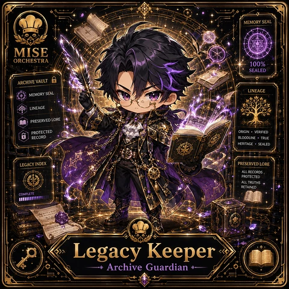

<!-- generated by tools/player-cards/scripts/build-character-pages.mjs from data/characters/legacy-keeper.json; do not edit by hand -->
# Legacy Keeper

**Card-defined chef (catalogue: visual reference only)** · Implementation: **Designed (not yet implemented in code)** · Detail record: [`data/characters/legacy-keeper.json`](../../data/characters/legacy-keeper.json)

Every field shows where its value comes from (`source:`). Repo-sourced values cite the repository or source-library file they were read from; values marked `authored: card design` were written for this card by [`enrich-characters.py`](../../tools/player-cards/scripts/enrich-characters.py), derived from the printed card text, role and kitchen theme, and are not claims about existing code.

## Identity

| Field | Value |
|---|---|
| Name | Legacy Keeper source: `data/imports/photo-alignment.csv` |
| Aliases / printed variants | Legacy source: `card titles / OCR in data/player-cards-ocr.json` |
| Role / title | Keeper source: `data/player-cards-ocr.json (subtitle printed under the name)` |
| Kitchen / department | Security Kitchen source: `docs/source-library/icloud/Catalogue/All images/Mise/MiseOS Bible/MiseOS-Canon-Bible-v1.0-package.zip/miseos_canon_bible_v1_0/registry/asset-registry.csv → data/characters/seira-vaultkeeper.json` |
| Department mission | Guard. Audit. Comply. source: `data/imports/miseos_character_master_inventory_001_300.csv (mission of Security Kitchen)` |
| Registry rarity | Genesis source: `docs/source-library/icloud/Catalogue/All images/Mise/MiseOS Bible/MiseOS-Canon-Bible-v1.0-package.zip/miseos_canon_bible_v1_0/registry/asset-registry.csv → data/characters/seira-vaultkeeper.json` |
| Collections | 1×1 Chefs source: `data/player-cards.json` |
| Cards linked | 1 source: `data/player-cards.json` |
| Catalogue status | visual_reference_only source: `data/imports/photo-alignment.csv` |

## Player cards

| Card | Collection | Printed title | Match method | Full size |
|---|---|---|---|---|
| `legacy.webp` | 1×1 Chefs | Legacy | title | [open](../../assets/player-cards/1by1-chefs/legacy.webp) |

## Card metadata (as printed)

| Field | Value |
|---|---|
| Printed rarity | Not printed on the card source: `data/player-cards-ocr.json (no rarity word in OCR)` |
| Printed stars | Not printed on the card source: `data/player-cards-ocr.json (no stars in OCR)` |
| Printed meters | 100% source: `data/player-cards-ocr.json` |
| Roster stats | power 81 · precision 71 · speed 74 · resilience 80 · intelligence 77 · teamwork 81 source: `authored: card design (6-axis roster scale; baseline from stars + theme "security")` |
| Abilities | Memory Seal, Sealed, Archive Vault, Lineage, Preserved Lore, Protected source: `data/player-cards-ocr.json (printed card labels, glued OCR words segmented)` |
| Lore | Picture the locked dry store and the keyring that never leaves the belt: that is where Legacy Keeper is happiest. As Security Kitchen's Keeper, Legacy Keeper guards the perimeter of the kitchen: access, secrets and policy, with an audit trail for every exception. The card calls out Memory Seal, Sealed, Archive Vault: the checks Legacy Keeper runs before calling anything ready. In the canon crosswalk this card is a provisional match for Seira Vaultkeeper. source: `authored: card design (derived from printed card text/role)` |
| Signature phrase | Bloodline·True, then everything else. source: `authored: card design (derived from printed card text/role)` |

Full printed card text (OCR)

**`legacy.webp`**: MEMORY SEAL · MISE · ORCHESTRA · 100% · SEALED · ARCHIVEVAULT · LINEAGE · MEMORYSEAL · LINEAGE · PRESERVEDLORE · PROTECTED · ORIGIN·VERIFIED · RECORD · BLOODLINE·TRUE · HERITAGE·SEALED · LEGACYINDEX · PRESERVEDLORE · ALLRECORDS · PROTECTED · ALL TRUTHS · RETAINED · COMPLETE · Legacy · Keeper · Archive Guardian

## Workflow

| Step | Value |
|---|---|
| Summary | Legacy Keeper guards the perimeter of the kitchen: access, secrets and policy, with an audit trail for every exception. source: `authored: card design (theme "security")` |
| Inputs | access requests, policy set, scan findings, secret inventory source: `authored: card design (theme "security")` |
| Outputs | allow / deny decision, audit record, remediation ticket source: `authored: card design (theme "security")` |
| Proof gate | Policy gate: no access or release without a policy match and a recorded approver. source: `authored: card design (theme "security")` |

## Actions / commands

- command: `mise roster run legacy-keeper --dept security-kitchen --solo --emit report` · status: `proposed` source: `authored: follows data/imports/master-roster-cards.csv (mise roster run command convention)`
- command: `mise legacy-keeper scan` · reads: `access requests` · emits: `allow / deny decision` · status: `proposed` source: `authored: card design (theme "security")`
- command: `mise legacy-keeper enforce` · reads: `policy set` · emits: `audit record` · status: `proposed` source: `authored: card design (theme "security")`
- command: `mise legacy-keeper audit` · reads: `scan findings` · emits: `remediation ticket` · status: `proposed` source: `authored: card design (theme "security")`

## Implementation

**Status:** Designed (not yet implemented in code)

- Proposed handler: `legacyKeeper` (not written yet)
- Proposed command: `mise roster run legacy-keeper --dept security-kitchen --solo --emit report`
- Contract: inputs: access requests, policy set, scan findings, secret inventory → outputs: allow / deny decision, audit record, remediation ticket; refuses to emit 'ready' unless the proof gate passes

source: `git ls-files grep + repo (no code found) + authored: proposed handler spec`

implemented_in_code = a dedicated capability handler or tool directory exists; referenced_in_app_code = the entity is used by application source (e.g. repo-pet sprites, CLI) but has no dedicated handler. code_refs are files that reference this entity by name/slug/handler (grep), not a guarantee of a dedicated runtime; registry handler links point at the actual capability function.

## Where and how it helps

| Aspect | Value |
|---|---|
| Station / stage | Keeper source: `data/player-cards-ocr.json (subtitle printed under the name)` |
| Mission | Guard. Audit. Comply. source: `data/imports/miseos_character_master_inventory_001_300.csv (mission of Security Kitchen)` |
| Problem it addresses | Unchecked access and leaked secrets turn one mistake into an incident. source: `authored: card design (theme "security")` |
| Safety gate | Policy gate: no access or release without a policy match and a recorded approver. source: `authored: card design (theme "security")` |

## Agents and repo pets

Agents: [Kuro Guard](../agents/kuro-guard.md) · [Firewall](../agents/firewall.md) · [Security Auditor](../agents/security-auditor.md) source: `authored: card design (closest agents for theme "security")`

Repo pets: [Kuro Guard](../repo-pets/kuro-guard.md) · [Mise Locker](../repo-pets/mise-locker.md) source: `authored: card design (closest repo pets for theme "security")`

## Related characters

[Seira Vaultkeeper](./seira-vaultkeeper.md) · [Shift Sentinel](./shift-sentinel.md) · [Policy Ronin](./policy-ronin.md) · [Token Toshi](./token-toshi.md) · [Threat Taro](./threat-taro.md) source: `docs/source-library/icloud/Catalogue/All images/Mise/MiseOS Bible/MiseOS-Canon-Bible-v1.0-package.zip/miseos_canon_bible_v1_0/registry/asset-registry.csv (canon counterpart) + authored: card design (same theme "security" / same department)`

## Sources

| Field | Source |
|---|---|
| name | `data/imports/photo-alignment.csv` |
| aliases | `card titles / OCR in data/player-cards-ocr.json` |
| cards | `data/player-cards.json` |
| card_text | `data/player-cards-ocr.json (OCR of the card image)` |
| card_meters_printed | `data/player-cards-ocr.json` |
| role | `data/player-cards-ocr.json (subtitle printed under the name)` |
| catalogue_status | `data/imports/photo-alignment.csv` |
| implementation | `git ls-files grep + repo (no code found) + authored: proposed handler spec` |
| helps.station | `data/player-cards-ocr.json (subtitle printed under the name)` |
| department | `docs/source-library/icloud/Catalogue/All images/Mise/MiseOS Bible/MiseOS-Canon-Bible-v1.0-package.zip/miseos_canon_bible_v1_0/registry/asset-registry.csv → data/characters/seira-vaultkeeper.json` |
| department_mission | `data/imports/miseos_character_master_inventory_001_300.csv (mission of Security Kitchen)` |
| card_rarity_printed | `data/player-cards-ocr.json (no rarity word in OCR)` |
| card_stars_printed | `data/player-cards-ocr.json (no stars in OCR)` |
| rarity | `docs/source-library/icloud/Catalogue/All images/Mise/MiseOS Bible/MiseOS-Canon-Bible-v1.0-package.zip/miseos_canon_bible_v1_0/registry/asset-registry.csv → data/characters/seira-vaultkeeper.json` |
| stats | `authored: card design (6-axis roster scale; baseline from stars + theme "security")` |
| abilities | `data/player-cards-ocr.json (printed card labels, glued OCR words segmented)` |
| lore | `authored: card design (derived from printed card text/role)` |
| signature_phrase | `authored: card design (derived from printed card text/role)` |
| workflow.summary | `authored: card design (theme "security")` |
| workflow.inputs | `authored: card design (theme "security")` |
| workflow.outputs | `authored: card design (theme "security")` |
| workflow.proof_gate | `authored: card design (theme "security")` |
| actions | `authored: follows data/imports/master-roster-cards.csv (mise roster run command convention)` |
| helps.mission | `data/imports/miseos_character_master_inventory_001_300.csv (mission of Security Kitchen)` |
| helps.problem | `authored: card design (theme "security")` |
| helps.proof_gate | `authored: card design (theme "security")` |
| agents | `authored: card design (closest agents for theme "security")` |
| repo_pets | `authored: card design (closest repo pets for theme "security")` |
| related | `docs/source-library/icloud/Catalogue/All images/Mise/MiseOS Bible/MiseOS-Canon-Bible-v1.0-package.zip/miseos_canon_bible_v1_0/registry/asset-registry.csv (canon counterpart) + authored: card design (same theme "security" / same department)` |
| theme | `authored: card design (keyword theme used for authored fields)` |

[← All characters](./README.md)
