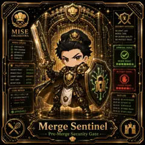

<!-- generated by tools/player-cards/scripts/build-character-pages.mjs from data/characters/merge-sentinel.json; do not edit by hand -->
# Merge Sentinel

**Registry character agent** · Implementation: **Described in docs only** · Detail record: [`data/characters/merge-sentinel.json`](../../data/characters/merge-sentinel.json)

Every field shows where its value comes from (`source:`). Repo-sourced values cite the repository or source-library file they were read from; values marked `authored: card design` were written for this card by [`enrich-characters.py`](../../tools/player-cards/scripts/enrich-characters.py), derived from the printed card text, role and kitchen theme, and are not claims about existing code.

## Identity

| Field | Value |
|---|---|
| Name | Merge Sentinel source: `data/characters.json` |
| Aliases / printed variants | None recorded (no alternate title in the canon crosswalk or agents.json) source: `data/player-cards.json + canon crosswalk (no alternate title found)` |
| Role / title | Pre-Merge Security Gate source: `characters/merge-sentinel/metadata.json` |
| Kitchen / department | Security Kitchen source: `characters/merge-sentinel/metadata.json` |
| Department mission | Guard. Audit. Comply. source: `data/imports/miseos_character_master_inventory_001_300.csv` |
| Registry rarity | Rare source: `characters/merge-sentinel/metadata.json` |
| Level | 22 source: `data/imports/miseos_character_master_inventory_001_300.csv` |
| ID: registry_id | MISE-053 source: `characters/merge-sentinel/metadata.json` |
| ID: character_id | miseos.character.053 source: `data/imports/miseos_character_master_inventory_001_300.csv` |
| ID: card_id | MISE-053 source: `data/imports/miseos_character_master_inventory_001_300.csv` |
| ID: codename | MERGE_SENTINEL source: `data/imports/miseos_character_master_inventory_001_300.csv` |
| Collections | 1×1 Chefs source: `data/player-cards.json` |
| Cards linked | 1 source: `data/player-cards.json` |
| Role category | security source: `data/imports/merged_roster.json` |

## Player cards

| Card | Collection | Printed title | Match method | Full size |
|---|---|---|---|---|
| `merge-sentinel.webp` | 1×1 Chefs | Merge Sentinel | existing-index | [open](../../assets/player-cards/1by1-chefs/merge-sentinel.webp) |

## Card metadata (as printed)

| Field | Value |
|---|---|
| Printed rarity | Not printed on the card source: `data/player-cards-ocr.json (no rarity word in OCR)` |
| Printed stars | Not printed on the card source: `data/player-cards-ocr.json (no stars in OCR)` |
| Printed meters | Not printed on the card source: `data/player-cards-ocr.json (no % meters in OCR)` |
| Roster stats | power 63 · precision 63 · speed 78 · resilience 85 · intelligence 61 · teamwork 78 source: `data/imports/miseos_character_master_inventory_001_300.csv (roster stats, not OCR)` |
| Abilities | Security Kitchen, Wedon'Tjust, Merge Code, Diff Check, We Defend Quality, We Protecttrust source: `data/player-cards-ocr.json (printed card labels, glued OCR words segmented)` |
| Lore | Most of the brigade only notices Merge Sentinel when something is missing, which is exactly the point. Merge Sentinel guards the perimeter of the kitchen: access, secrets and policy, with an audit trail for every exception; the image the crew uses for it is the locked dry store and the keyring that never leaves the belt. The card calls out Security Kitchen, Wedon'Tjust, Merge Code: the checks Merge Sentinel runs before calling anything ready. source: `authored: card design (derived from printed card text/role)` |
| Signature phrase | Pre-Merge Security Gate done cleanly, safely, and in rhythm. source: `data/imports/merged_roster.json` |
| Unique trait | Specializes in pre-merge security gate so the Security Kitchen can operate as a precise, repo-safe DevOps station. source: `data/imports/merged_roster.json` |

Full printed card text (OCR)

**`merge-sentinel.webp`**: SECURITYKITCHEN · MISE · WEDON'TJUST · MERGE CODE. · ORCHESTRA · DIFF CHECK · WEDEFENDQUALITY · WE PROTECTTRUST. · MERGECHECKS · CODE QUALITY · APPROVALSIGNAL · TEST COVERAGE · SECURITY SCAN · DEPENDENCY · CONFLICTS · MERGE READY · POLICY STATUS · SECURITY POLICY · ENFORCED · BLOCKED SIGNAL · BRANCH POLICY · ENFORCED · COMMITSIGNING · REQUIRED · SAST/DAST · ACTIVE · SECRET SCAN · ACTIVE · ISSUESFOUND · CODE REVIEW · @Q -102,7 +102,7@Q · GATE LOG · if(validate(input)) · 10:42:19CHECKSPASSED · return false; · 18:42:20 POLICYOK · return true; · 18:42:21 REVIEWOK · 10:42:22MERGEREADY · REVIEW STATUS · APPROVED) · 18:42:23 GATEOPEN · Merge Sentinel · Pre-Merge Security Gate

## Workflow

| Step | Value |
|---|---|
| Summary | Merge Sentinel performs pre-merge security gate within the Security Kitchen. source: `characters/merge-sentinel/metadata.json` |
| Inputs | repository context, task request, policy constraints, current evidence source: `characters/merge-sentinel/metadata.json` |
| Outputs | validated result, evidence record, handoff packet source: `characters/merge-sentinel/metadata.json` |
| Proof gate | No merge, deployment, publication, billing action, or mint without evidence. source: `characters/merge-sentinel/metadata.json` |

## Actions / commands

- command: `MISE PRE MERGE SECURITY GATE` source: `data/imports/miseos_character_master_inventory_001_300.csv`
- command: `Pre-Merge Security Gate` · mise_name: `Mise PreMergeSecurityGate` source: `data/imports/merged_roster.json`

## Implementation

**Status:** Described in docs only

Roster data / types / tests in code that list this entry (not an implementation):
- [`apps/bootstrap-registry/apps/registry-console/src/data/master-roster.generated.ts:785`](../../apps/bootstrap-registry/apps/registry-console/src/data/master-roster.generated.ts#L785)
- [`apps/brigade-gallery/src/data/master-roster.ts:588`](../../apps/brigade-gallery/src/data/master-roster.ts#L588)

Data files that reference it:
- [`apps/bootstrap-registry/registry/cards/master-roster-cards.json:737`](../../apps/bootstrap-registry/registry/cards/master-roster-cards.json#L737)
- [`apps/gridops-platform/data/miseos-ecosystem-135.json:3090`](../../apps/gridops-platform/data/miseos-ecosystem-135.json#L3090)
- [`apps/voxel-world/src/data/miseos-ecosystem-135.json:3090`](../../apps/voxel-world/src/data/miseos-ecosystem-135.json#L3090)
- [`tools/art-factory/input/characters.generated.json:3003`](../../tools/art-factory/input/characters.generated.json#L3003)
- [`tools/art-factory/output/manifests/krikey_animation_prompts.json:297`](../../tools/art-factory/output/manifests/krikey_animation_prompts.json#L297)
- [`tools/art-factory/output/manifests/mangaboom_comic_prompts.json:297`](../../tools/art-factory/output/manifests/mangaboom_comic_prompts.json#L297)
- [`tools/art-factory/output/merged_roster.json:1005`](../../tools/art-factory/output/merged_roster.json#L1005)

Docs that describe it (docs only, not code):
- [`characters/merge-sentinel/README.md`](../../characters/merge-sentinel/README.md)
- [`apps/brigade-gallery/prototype/holo-card-roster.html:76`](../../apps/brigade-gallery/prototype/holo-card-roster.html#L76)
- [`apps/developer-platform/docs/characters/CHARACTER_REGISTRY_001_300.md:23`](../../apps/developer-platform/docs/characters/CHARACTER_REGISTRY_001_300.md#L23)

implemented_in_code = a dedicated capability handler or tool directory exists; referenced_in_app_code = the entity is used by application source (e.g. repo-pet sprites, CLI) but has no dedicated handler. code_refs are files that reference this entity by name/slug/handler (grep), not a guarantee of a dedicated runtime; registry handler links point at the actual capability function.

## Where and how it helps

| Aspect | Value |
|---|---|
| Station / stage | Security Kitchen source: `characters/merge-sentinel/metadata.json` |
| Mission | Guard. Audit. Comply. source: `data/imports/miseos_character_master_inventory_001_300.csv` |
| Problem it addresses | Merge Sentinel performs pre-merge security gate within the Security Kitchen. source: `characters/merge-sentinel/metadata.json` |
| Safety gate | No merge, deployment, publication, billing action, or mint without evidence. source: `characters/merge-sentinel/metadata.json` |

## Agents and repo pets

Agents: [Kuro Guard](../agents/kuro-guard.md) · [Firewall](../agents/firewall.md) · [Security Auditor](../agents/security-auditor.md) source: `authored: card design (closest agents for theme "security")`

Repo pets: [Kuro Guard](../repo-pets/kuro-guard.md) · [Mise Locker](../repo-pets/mise-locker.md) source: `authored: card design (closest repo pets for theme "security")`

## Related characters

[Watchtower Yoru](./watchtower-yoru.md) · [Auditor Emi](./auditor-emi.md) · [Incident Kitsune](./incident-kitsune.md) · [Policy Ronin](./policy-ronin.md) · [Iron Hashi](./iron-hashi.md) · [Grafana Mei](./grafana-mei.md) source: `data/imports/miseos_character_master_inventory_001_300.csv data/imports/merged_roster.json data/imports/merged_roster.json data/imports/merged_roster.json`

## Canon Bible

Mentioned in [`docs/canon/MiseOS-Canon-Bible-v1.0.pdf`](../../docs/canon/MiseOS-Canon-Bible-v1.0.pdf):

- line 475: `MISE-G2-P010 Merge Sentinel Mise Orchestra canonical-candidate 1E3334AB-3111- 10`

## Sources

| Field | Source |
|---|---|
| name | `data/characters.json` |
| cards | `data/player-cards.json` |
| card_text | `data/player-cards-ocr.json (OCR of the card image)` |
| ids.registry_id | `characters/merge-sentinel/metadata.json` |
| role | `characters/merge-sentinel/metadata.json` |
| department | `characters/merge-sentinel/metadata.json` |
| rarity | `characters/merge-sentinel/metadata.json` |
| workflow.summary | `characters/merge-sentinel/metadata.json` |
| workflow.inputs | `characters/merge-sentinel/metadata.json` |
| workflow.outputs | `characters/merge-sentinel/metadata.json` |
| workflow.proof_gate | `characters/merge-sentinel/metadata.json` |
| department_mission | `data/imports/miseos_character_master_inventory_001_300.csv` |
| ids.character_id | `data/imports/miseos_character_master_inventory_001_300.csv` |
| ids.card_id | `data/imports/miseos_character_master_inventory_001_300.csv` |
| ids.codename | `data/imports/miseos_character_master_inventory_001_300.csv` |
| stats | `data/imports/miseos_character_master_inventory_001_300.csv (roster stats, not OCR)` |
| level | `data/imports/miseos_character_master_inventory_001_300.csv` |
| related | `data/imports/miseos_character_master_inventory_001_300.csv data/imports/merged_roster.json data/imports/merged_roster.json data/imports/merged_roster.json` |
| signature_phrase | `data/imports/merged_roster.json` |
| unique_trait | `data/imports/merged_roster.json` |
| role_category | `data/imports/merged_roster.json` |
| canon_bible | `docs/canon/MiseOS-Canon-Bible-v1.0.pdf (pdftotext)` |
| implementation | `git ls-files grep + repo` |
| helps.station | `characters/merge-sentinel/metadata.json` |
| aliases | `data/player-cards.json + canon crosswalk (no alternate title found)` |
| card_rarity_printed | `data/player-cards-ocr.json (no rarity word in OCR)` |
| card_stars_printed | `data/player-cards-ocr.json (no stars in OCR)` |
| card_meters_printed | `data/player-cards-ocr.json (no % meters in OCR)` |
| abilities | `data/player-cards-ocr.json (printed card labels, glued OCR words segmented)` |
| lore | `authored: card design (derived from printed card text/role)` |
| agents | `authored: card design (closest agents for theme "security")` |
| repo_pets | `authored: card design (closest repo pets for theme "security")` |
| theme | `authored: card design (keyword theme used for authored fields)` |

[← All characters](./README.md)
