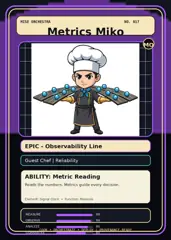

<!-- generated by tools/player-cards/scripts/build-character-pages.mjs from data/characters/metrics-miko.json; do not edit by hand -->
# Metrics Miko

**Registry character agent** · Implementation: **Described in docs only** · Detail record: [`data/characters/metrics-miko.json`](../../data/characters/metrics-miko.json)

Every field below comes from a repository source (shown as `source:`). Where no source exists the page says _Not yet defined in the source material_.

## Identity

| Field | Value |
|---|---|
| Name | Metrics Miko source: `data/characters.json` |
| Aliases / printed variants | Not yet defined in the source material |
| Role / title | SLO Dashboards source: `characters/metrics-miko/metadata.json` |
| Kitchen / department | Reliability Kitchen source: `characters/metrics-miko/metadata.json` |
| Department mission | Observe. Measure. Improve. source: `data/imports/miseos_character_master_inventory_001_300.csv` |
| Registry rarity | Genesis source: `characters/metrics-miko/metadata.json` |
| Level | 28 source: `data/imports/miseos_character_master_inventory_001_300.csv` |
| ID: registry_id | MISE-041 source: `characters/metrics-miko/metadata.json` |
| ID: character_id | miseos.character.041 source: `data/imports/miseos_character_master_inventory_001_300.csv` |
| ID: card_id | MISE-041 source: `data/imports/miseos_character_master_inventory_001_300.csv` |
| ID: codename | METRICS_MIKO source: `data/imports/miseos_character_master_inventory_001_300.csv` |
| Collections | Mise Orchestra Trading Cards (Season 1) source: `data/player-cards.json` |
| Cards linked | 1 source: `data/player-cards.json` |
| Role category | reliability source: `data/imports/merged_roster.json` |

## Player cards

| Card | Collection | Printed title | Match method | Full size |
|---|---|---|---|---|
| `metrics-miko.webp` | Mise Orchestra Trading Cards (Season 1) | Metrics Miko | existing-index | [open](../../assets/player-cards/orchestra-trading-cards/metrics-miko.webp) |

## Card metadata (as printed)

| Field | Value |
|---|---|
| Printed rarity | Epic source: `data/player-cards-ocr.json` |
| Printed stars | Not yet defined in the source material |
| Printed meters | Not yet defined in the source material |
| Roster stats | power 67 · precision 82 · speed 61 · resilience 72 · intelligence 90 · teamwork 87 source: `data/imports/miseos_character_master_inventory_001_300.csv (roster stats, not OCR)` |
| Abilities | Metric Reading source: `data/imports/mise_orchestra_cards.csv` |
| Mise Orchestra card | role: Guest Chef · department: Reliability · function: Measure · rarity: Epic · tier: Observability Line · element: Signal Clock · ability: Metric Reading · lore: Reads the numbers. Metrics guide every decision. source: `data/imports/mise_orchestra_cards.csv` |
| Lore | Metrics Miko belongs to the Kitchen Chaos DevOps Universe, where every technical workflow becomes a coordinated brigade station. source: `data/imports/merged_roster.json` |
| Signature phrase | SLO Dashboards done cleanly, safely, and in rhythm. source: `data/imports/merged_roster.json` |
| Unique trait | Specializes in slo dashboards so the Reliability Kitchen can operate as a precise, repo-safe DevOps station. source: `data/imports/merged_roster.json` |

Full printed card text (OCR)

**`metrics-miko.webp`**: MISEORCHESTRA · NO.017 · MetricsMiko · MO · EPiC-ObservabilityLine · GuestChefReliability · ABILITY:Metric Reading · Reads the numbers.Metrics guide every decision. · Element:Signal Clock ·Function:Measure · MEASURE · 98 · OBSERVE · 94 · ANALYZE · 86 · ORCHESTRATE· · DEPLOY · COOK · PROVENANCE-READY · GUARANIEE · 810

## Workflow

| Step | Value |
|---|---|
| Summary | Metrics Miko performs slo dashboards within the Reliability Kitchen. source: `characters/metrics-miko/metadata.json` |
| Inputs | repository context, task request, policy constraints, current evidence source: `characters/metrics-miko/metadata.json` |
| Outputs | validated result, evidence record, handoff packet source: `characters/metrics-miko/metadata.json` |
| Proof gate | No merge, deployment, publication, billing action, or mint without evidence. source: `characters/metrics-miko/metadata.json` |

## Actions / commands

- command: `MISE SLO DASHBOARDS` source: `data/imports/miseos_character_master_inventory_001_300.csv`
- command: `SLO Dashboards` · mise_name: `Mise SloDashboards` source: `data/imports/merged_roster.json`

## Implementation

**Status:** Described in docs only

Roster data / types / tests in code that list this entry (not an implementation):
- [`apps/bootstrap-registry/apps/registry-console/src/data/master-roster.generated.ts:617`](../../apps/bootstrap-registry/apps/registry-console/src/data/master-roster.generated.ts#L617)
- [`apps/brigade-gallery/src/data/master-roster.ts:480`](../../apps/brigade-gallery/src/data/master-roster.ts#L480)

Data files that reference it:
- [`apps/bootstrap-registry/registry/cards/master-roster-cards.json:569`](../../apps/bootstrap-registry/registry/cards/master-roster-cards.json#L569)
- [`apps/gridops-platform/data/miseos-ecosystem-135.json:2346`](../../apps/gridops-platform/data/miseos-ecosystem-135.json#L2346)
- [`apps/registry-atrium/collection-manifest.json:156`](../../apps/registry-atrium/collection-manifest.json#L156)
- [`apps/registry-atrium/metadata/erc721/017-metrics-miko.json:2`](../../apps/registry-atrium/metadata/erc721/017-metrics-miko.json#L2)
- [`apps/voxel-world/src/data/miseos-ecosystem-135.json:2346`](../../apps/voxel-world/src/data/miseos-ecosystem-135.json#L2346)
- [`tools/art-factory/input/characters.generated.json:627`](../../tools/art-factory/input/characters.generated.json#L627)
- [`tools/art-factory/input/mise_orchestra_cards.csv:18`](../../tools/art-factory/input/mise_orchestra_cards.csv#L18)
- [`tools/art-factory/input/mise_orchestra_collection_manifest.json:156`](../../tools/art-factory/input/mise_orchestra_collection_manifest.json#L156)
- [`tools/art-factory/output/manifests/krikey_animation_prompts.json:81`](../../tools/art-factory/output/manifests/krikey_animation_prompts.json#L81)
- [`tools/art-factory/output/manifests/mangaboom_comic_prompts.json:81`](../../tools/art-factory/output/manifests/mangaboom_comic_prompts.json#L81)

Docs that describe it (docs only, not code):
- [`characters/metrics-miko/README.md`](../../characters/metrics-miko/README.md)
- [`apps/brigade-gallery/prototype/holo-card-roster.html:76`](../../apps/brigade-gallery/prototype/holo-card-roster.html#L76)
- [`apps/brigade-gallery/prototype/registry-atrium-gallery.html:342`](../../apps/brigade-gallery/prototype/registry-atrium-gallery.html#L342)
- [`apps/developer-platform/docs/characters/CHARACTER_REGISTRY_001_300.md:19`](../../apps/developer-platform/docs/characters/CHARACTER_REGISTRY_001_300.md#L19)
- [`apps/registry-atrium/index.html:342`](../../apps/registry-atrium/index.html#L342)

implemented_in_code = a dedicated capability handler or tool directory exists; referenced_in_app_code = the entity is used by application source (e.g. repo-pet sprites, CLI) but has no dedicated handler. code_refs are files that reference this entity by name/slug/handler (grep), not a guarantee of a dedicated runtime; registry handler links point at the actual capability function.

## Where and how it helps

| Aspect | Value |
|---|---|
| Station / stage | Reliability Kitchen source: `characters/metrics-miko/metadata.json` |
| Mission | Observe. Measure. Improve. source: `data/imports/miseos_character_master_inventory_001_300.csv` |
| Problem it addresses | Metrics Miko performs slo dashboards within the Reliability Kitchen. source: `characters/metrics-miko/metadata.json` |
| Safety gate | No merge, deployment, publication, billing action, or mint without evidence. source: `characters/metrics-miko/metadata.json` |

## Related characters

[Forecast Fuji](./forecast-fuji.md) · [Resilience Ryu](./resilience-ryu.md) · [Impact Ichi](./impact-ichi.md) · [Backlog Benji](./backlog-benji.md) · [Felix Rollback](./felix-rollback.md) · [Streama](./streama.md) source: `data/imports/miseos_character_master_inventory_001_300.csv data/imports/merged_roster.json data/imports/merged_roster.json data/imports/merged_roster.json`

## Sources

| Field | Source |
|---|---|
| name | `data/characters.json` |
| cards | `data/player-cards.json` |
| card_text | `data/player-cards-ocr.json (OCR of the card image)` |
| card_rarity_printed | `data/player-cards-ocr.json` |
| ids.registry_id | `characters/metrics-miko/metadata.json` |
| role | `characters/metrics-miko/metadata.json` |
| department | `characters/metrics-miko/metadata.json` |
| rarity | `characters/metrics-miko/metadata.json` |
| workflow.summary | `characters/metrics-miko/metadata.json` |
| workflow.inputs | `characters/metrics-miko/metadata.json` |
| workflow.outputs | `characters/metrics-miko/metadata.json` |
| workflow.proof_gate | `characters/metrics-miko/metadata.json` |
| department_mission | `data/imports/miseos_character_master_inventory_001_300.csv` |
| ids.character_id | `data/imports/miseos_character_master_inventory_001_300.csv` |
| ids.card_id | `data/imports/miseos_character_master_inventory_001_300.csv` |
| ids.codename | `data/imports/miseos_character_master_inventory_001_300.csv` |
| stats | `data/imports/miseos_character_master_inventory_001_300.csv (roster stats, not OCR)` |
| level | `data/imports/miseos_character_master_inventory_001_300.csv` |
| related | `data/imports/miseos_character_master_inventory_001_300.csv data/imports/merged_roster.json data/imports/merged_roster.json data/imports/merged_roster.json` |
| lore | `data/imports/merged_roster.json` |
| signature_phrase | `data/imports/merged_roster.json` |
| unique_trait | `data/imports/merged_roster.json` |
| role_category | `data/imports/merged_roster.json` |
| orchestra_card | `data/imports/mise_orchestra_cards.csv` |
| abilities | `data/imports/mise_orchestra_cards.csv` |
| implementation | `git ls-files grep + repo` |
| helps.station | `characters/metrics-miko/metadata.json` |

[← All characters](./README.md)
