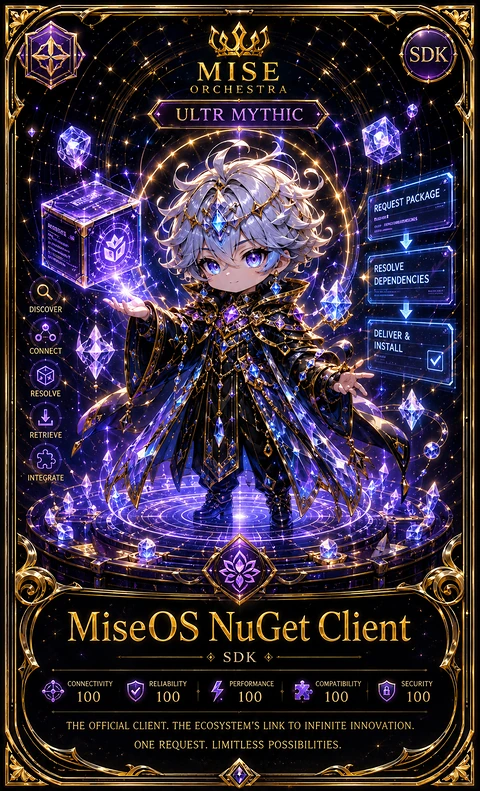

<!-- generated by tools/player-cards/scripts/build-character-pages.mjs from data/characters/miseos-nuget-client.json; do not edit by hand -->
# MiseOS NuGet Client

**Registry manifest (product / tool)** · Implementation: **Implemented in code** · Detail record: [`data/characters/miseos-nuget-client.json`](../../data/characters/miseos-nuget-client.json)

Every field shows where its value comes from (`source:`). Repo-sourced values cite the repository or source-library file they were read from; values marked `authored: card design` were written for this card by [`enrich-characters.py`](../../tools/player-cards/scripts/enrich-characters.py), derived from the printed card text, role and kitchen theme, and are not claims about existing code.

## Identity

| Field | Value |
|---|---|
| Name | MiseOS NuGet Client source: `apps/registry-platform/registry/manifests/miseos.nuget-client.manifest.json` |
| Aliases / printed variants | MiseOSNuGetClient source: `card titles / OCR in data/player-cards-ocr.json` |
| Role / title | SDK source: `apps/registry-platform/registry/manifests/miseos.nuget-client.manifest.json (type)` |
| Kitchen / department | Platform Kitchen source: `authored: card design (kitchen chosen from role/printed text, theme "platform")` |
| Department mission | Provide golden paths and stable service foundations. source: `data/imports/miseos_character_master_inventory_001_300.csv (mission of Platform Kitchen)` |
| Registry rarity | Mythic source: `data/player-cards-ocr.json (printed rarity)` |
| ID: registry_id | miseos.nuget-client source: `apps/registry-platform/registry/manifests/miseos.nuget-client.manifest.json` |
| Collections | Long Cards source: `data/player-cards.json` |
| Cards linked | 1 source: `data/player-cards.json` |

## Player cards

| Card | Collection | Printed title | Match method | Full size |
|---|---|---|---|---|
| `miseosnugetclient.webp` | Long Cards | MiseOSNuGetClient | title | [open](../../assets/player-cards/long-cards/miseosnugetclient.webp) |

## Card metadata (as printed)

| Field | Value |
|---|---|
| Printed rarity | Mythic source: `data/player-cards-ocr.json` |
| Printed stars | Not printed on the card source: `data/player-cards-ocr.json (no stars in OCR)` |
| Printed meters | Not printed on the card source: `data/player-cards-ocr.json (no % meters in OCR)` |
| Roster stats | power 67 · precision 75 · speed 81 · resilience 73 · intelligence 81 · teamwork 75 source: `authored: card design (6-axis roster scale; baseline from stars + theme "platform")` |
| Abilities | Request Package, Resolve, Dependencies, Discover, Deliver, Install source: `data/player-cards-ocr.json (printed card labels, glued OCR words segmented)` |
| Lore | Most of the brigade only notices MiseOS NuGet Client when something is missing, which is exactly the point. MiseOS NuGet Client provides a shared platform building block other kitchens install and build on; the image the crew uses for it is the stainless steel shelving every station is bolted to. The card calls out Request Package, Resolve, Dependencies: the checks MiseOS NuGet Client runs before calling anything ready. source: `authored: card design (derived from printed card text/role)` |
| Signature phrase | No request package left to chance. source: `authored: card design (derived from printed card text/role)` |

Full printed card text (OCR)

**`miseosnugetclient.webp`**: SDK · MISE · ORCHESTRA · ULTR MYTHIC · REQUESTPACKAGE · RESOLVE · DEPENDENCIES · DISCOVER · DELIVER & · INSTALL · CONNECT · RESOLVE · RETRIEVE · INTEGRATE · MiseOS NuGet Client · SDK · CONNECTIVITY · RELIABILITY · PERFORMANCE · COMPATIBILITY · SECURITY · 100 · 100 · 100 · 100 · 100 · THEOFFICIALCLIENT.THEECOSYSTEM'SLINKTOINFINITEINNOVATION · ONEREQUEST.LIMITLESSPOSSIBILITIES

## Workflow

| Step | Value |
|---|---|
| Summary | Executable baseline capability for MiseOS NuGet Client. source: `apps/registry-platform/registry/manifests/miseos.nuget-client.manifest.json (capability.description)` |
| Inputs | consumer repository, manifest / configuration, version pin source: `authored: card design (theme "platform")` |
| Outputs | installed capability, version record, compatibility report source: `authored: card design (theme "platform")` |
| Proof gate | Golden-path gate: consumers install only pinned, signed versions that pass the registry schema. source: `authored: card design (theme "platform")` |

## Actions / commands

- operation: `nugetClient` · handler: `nugetClient` source: `apps/registry-platform/registry/manifests/miseos.nuget-client.manifest.json`

## Implementation

**Status:** Implemented in code

- Capability handler `nugetClient`: [`apps/registry-platform/packages/core/src/handlers.ts:18`](../../apps/registry-platform/packages/core/src/handlers.ts#L18) (implemented in code)
- Runtime: engine `node` ≥ 20.11.0, handler `nugetClient` source: `apps/registry-platform/registry/manifests/miseos.nuget-client.manifest.json`
- Permissions: network=`deny_by_default`, filesystem=`workspace_scoped`, process=`internal_allowlist` source: `apps/registry-platform/registry/manifests/miseos.nuget-client.manifest.json`
- Distribution channels: npm, container, marketplace source: `apps/registry-platform/registry/manifests/miseos.nuget-client.manifest.json`
- Marketplace: category `sdk`, published `false` source: `apps/registry-platform/registry/manifests/miseos.nuget-client.manifest.json`

Application code that uses this entry:
- [`apps/gridops-platform/packages/registry-platform/packages/core/src/handlers.ts:18`](../../apps/gridops-platform/packages/registry-platform/packages/core/src/handlers.ts#L18)
- [`apps/registry-platform/packages/core/src/handlers.ts:18`](../../apps/registry-platform/packages/core/src/handlers.ts#L18)
- [`tools/devops-foundry/vendor/miseos-registry-core/packages/core/src/handlers.ts:18`](../../tools/devops-foundry/vendor/miseos-registry-core/packages/core/src/handlers.ts#L18)

Roster data / types / tests in code that list this entry (not an implementation):
- [`apps/gridops-platform/packages/registry-platform/packages/core/test/core.test.ts:7`](../../apps/gridops-platform/packages/registry-platform/packages/core/test/core.test.ts#L7)
- [`apps/registry-platform/packages/core/test/core.test.ts:6`](../../apps/registry-platform/packages/core/test/core.test.ts#L6)
- [`tools/devops-foundry/vendor/miseos-registry-core/packages/core/test/core.test.ts:7`](../../tools/devops-foundry/vendor/miseos-registry-core/packages/core/test/core.test.ts#L7)

Data files that reference it:
- [`apps/bootstrap-registry/.miseos/sentinel/release-sentinel-report.json:333`](../../apps/bootstrap-registry/.miseos/sentinel/release-sentinel-report.json#L333)
- [`apps/bootstrap-registry/analytics/registry-metrics.json:304`](../../apps/bootstrap-registry/analytics/registry-metrics.json#L304)
- [`apps/bootstrap-registry/analytics/risk-matrix.csv:12`](../../apps/bootstrap-registry/analytics/risk-matrix.csv#L12)
- [`apps/bootstrap-registry/apps/registry-console/src/generated/analytics.json:304`](../../apps/bootstrap-registry/apps/registry-console/src/generated/analytics.json#L304)
- [`apps/bootstrap-registry/apps/registry-console/src/generated/index.json:82`](../../apps/bootstrap-registry/apps/registry-console/src/generated/index.json#L82)
- [`apps/bootstrap-registry/apps/registry-console/src/generated/manifests/miseos.nuget-client.json:4`](../../apps/bootstrap-registry/apps/registry-console/src/generated/manifests/miseos.nuget-client.json#L4)
- [`apps/bootstrap-registry/registry/index.json:82`](../../apps/bootstrap-registry/registry/index.json#L82)
- [`apps/bootstrap-registry/registry/manifests/miseos.nuget-client.json:4`](../../apps/bootstrap-registry/registry/manifests/miseos.nuget-client.json#L4)
- [`apps/bootstrap-registry/registry/snapshots/current.json:244`](../../apps/bootstrap-registry/registry/snapshots/current.json#L244)
- [`apps/bootstrap-registry/reports/registry-analytics.json:304`](../../apps/bootstrap-registry/reports/registry-analytics.json#L304)

Docs that describe it (docs only, not code):
- [`apps/bootstrap-registry/docs/registry-dashboard.md:63`](../../apps/bootstrap-registry/docs/registry-dashboard.md#L63)
- [`apps/bootstrap-registry/reports/registry-analytics.md:43`](../../apps/bootstrap-registry/reports/registry-analytics.md#L43)
- [`apps/gridops-platform/packages/registry-platform/docs/REGISTRY-CAPABILITIES.md:13`](../../apps/gridops-platform/packages/registry-platform/docs/REGISTRY-CAPABILITIES.md#L13)
- [`apps/miseos-platform/REGISTRY_CARD_GALLERY.md:78`](../../apps/miseos-platform/REGISTRY_CARD_GALLERY.md#L78)
- [`apps/miseos-platform/cards/registry/nuget-client.md:1`](../../apps/miseos-platform/cards/registry/nuget-client.md#L1)
- [`apps/miseos-platform/output/manifests/REGISTRY_CATALOG.md:27`](../../apps/miseos-platform/output/manifests/REGISTRY_CATALOG.md#L27)
- [`apps/registry-platform/docs/REGISTRY-CAPABILITIES.md:13`](../../apps/registry-platform/docs/REGISTRY-CAPABILITIES.md#L13)
- [`tools/devops-foundry/catalog/HARVEST_REPORT.md:86`](../../tools/devops-foundry/catalog/HARVEST_REPORT.md#L86)
- [`tools/devops-foundry/catalog/RECOMMENDED_TOOL_CATALOG.md:17`](../../tools/devops-foundry/catalog/RECOMMENDED_TOOL_CATALOG.md#L17)
- [`tools/devops-foundry/site/index.html:1`](../../tools/devops-foundry/site/index.html#L1)

implemented_in_code = a dedicated capability handler or tool directory exists; referenced_in_app_code = the entity is used by application source (e.g. repo-pet sprites, CLI) but has no dedicated handler. code_refs are files that reference this entity by name/slug/handler (grep), not a guarantee of a dedicated runtime; registry handler links point at the actual capability function.

## Where and how it helps

| Aspect | Value |
|---|---|
| Station / stage | Registry (sdk) source: `apps/registry-platform/registry/manifests/miseos.nuget-client.manifest.json (marketplace.category)` |
| Mission | Provide golden paths and stable service foundations. source: `data/imports/miseos_character_master_inventory_001_300.csv (mission of Platform Kitchen)` |
| Problem it addresses | Executable baseline capability for MiseOS NuGet Client. source: `apps/registry-platform/registry/manifests/miseos.nuget-client.manifest.json (capability.description)` |
| Safety gate | Golden-path gate: consumers install only pinned, signed versions that pass the registry schema. source: `authored: card design (theme "platform")` |

## Agents and repo pets

Agents: [Architect](../agents/architect.md) · [Terraformer](../agents/terraformer.md) · [Docker](../agents/docker.md) source: `authored: card design (closest agents for theme "platform")`

Repo pets: [Mise Bootstrap](../repo-pets/mise-bootstrap.md) · [Mise Brigadier](../repo-pets/mise-brigadier.md) source: `authored: card design (closest repo pets for theme "platform")`

## Related characters

[MiseOS Ruby Steward](./miseos-ruby-steward.md) · [MiseOS Runner](./miseos-runner.md) · [MiseOS CLI](./miseos-cli.md) · [Streama](./streama.md) · [Runtime Riku](./runtime-riku.md) · [Portal Rei](./portal-rei.md) source: `authored: card design (same theme "platform" / same department)`

## Sources

| Field | Source |
|---|---|
| name | `apps/registry-platform/registry/manifests/miseos.nuget-client.manifest.json` |
| registry_catalog | `data/imports/miseos-registry-catalog.csv` |
| catalog_item | `data/imports/miseos-individual-catalog-items.json` |
| aliases | `card titles / OCR in data/player-cards-ocr.json` |
| cards | `data/player-cards.json` |
| card_text | `data/player-cards-ocr.json (OCR of the card image)` |
| card_rarity_printed | `data/player-cards-ocr.json` |
| ids.registry_id | `apps/registry-platform/registry/manifests/miseos.nuget-client.manifest.json` |
| role | `apps/registry-platform/registry/manifests/miseos.nuget-client.manifest.json (type)` |
| workflow.summary | `apps/registry-platform/registry/manifests/miseos.nuget-client.manifest.json (capability.description)` |
| runtime | `apps/registry-platform/registry/manifests/miseos.nuget-client.manifest.json` |
| permissions | `apps/registry-platform/registry/manifests/miseos.nuget-client.manifest.json` |
| distribution | `apps/registry-platform/registry/manifests/miseos.nuget-client.manifest.json` |
| marketplace | `apps/registry-platform/registry/manifests/miseos.nuget-client.manifest.json` |
| compatibility | `apps/registry-platform/registry/manifests/miseos.nuget-client.manifest.json` |
| pricing | `apps/registry-platform/registry/manifests/miseos.nuget-client.manifest.json` |
| implementation | `git ls-files grep + apps/registry-platform/packages/core/src/handlers.ts` |
| helps.station | `apps/registry-platform/registry/manifests/miseos.nuget-client.manifest.json (marketplace.category)` |
| department | `authored: card design (kitchen chosen from role/printed text, theme "platform")` |
| department_mission | `data/imports/miseos_character_master_inventory_001_300.csv (mission of Platform Kitchen)` |
| card_stars_printed | `data/player-cards-ocr.json (no stars in OCR)` |
| card_meters_printed | `data/player-cards-ocr.json (no % meters in OCR)` |
| rarity | `data/player-cards-ocr.json (printed rarity)` |
| stats | `authored: card design (6-axis roster scale; baseline from stars + theme "platform")` |
| abilities | `data/player-cards-ocr.json (printed card labels, glued OCR words segmented)` |
| lore | `authored: card design (derived from printed card text/role)` |
| signature_phrase | `authored: card design (derived from printed card text/role)` |
| workflow.inputs | `authored: card design (theme "platform")` |
| workflow.outputs | `authored: card design (theme "platform")` |
| workflow.proof_gate | `authored: card design (theme "platform")` |
| helps.mission | `data/imports/miseos_character_master_inventory_001_300.csv (mission of Platform Kitchen)` |
| helps.proof_gate | `authored: card design (theme "platform")` |
| agents | `authored: card design (closest agents for theme "platform")` |
| repo_pets | `authored: card design (closest repo pets for theme "platform")` |
| related | `authored: card design (same theme "platform" / same department)` |
| theme | `authored: card design (keyword theme used for authored fields)` |

[← All characters](./README.md)
