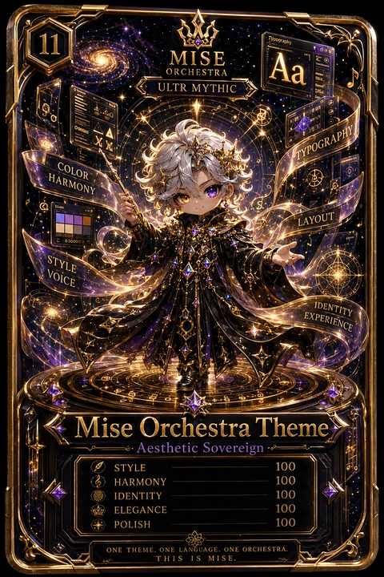
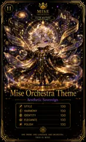

<!-- generated by tools/player-cards/scripts/build-character-pages.mjs from data/characters/miseos-orchestra-theme.json; do not edit by hand -->
# Mise Orchestra Theme

**Registry manifest (product / tool)** · Implementation: **Implemented in code** · Detail record: [`data/characters/miseos-orchestra-theme.json`](../../data/characters/miseos-orchestra-theme.json)

Every field below comes from a repository source (shown as `source:`). Where no source exists the page says _Not yet defined in the source material_.

## Identity

| Field | Value |
|---|---|
| Name | Mise Orchestra Theme source: `apps/registry-platform/registry/manifests/miseos.orchestra-theme.manifest.json` |
| Aliases / printed variants | Not yet defined in the source material |
| Role / title | Theme source: `apps/registry-platform/registry/manifests/miseos.orchestra-theme.manifest.json (type)` |
| Kitchen / department | Not yet defined in the source material |
| Department mission | Not yet defined in the source material |
| Registry rarity | Not yet defined in the source material |
| ID: registry_id | miseos.orchestra-theme source: `apps/registry-platform/registry/manifests/miseos.orchestra-theme.manifest.json` |
| Collections | Long Cards source: `data/player-cards.json` |
| Cards linked | 2 source: `data/player-cards.json` |

## Player cards

| Card | Collection | Printed title | Match method | Full size |
|---|---|---|---|---|
| `mise-orchestra-theme.webp` | Long Cards | Mise Orchestra Theme | title | [open](../../assets/player-cards/long-cards/mise-orchestra-theme.webp) |
| `mise-orchestra-theme-2.webp` | Long Cards | Mise Orchestra Theme | title | [open](../../assets/player-cards/long-cards/mise-orchestra-theme-2.webp) |

## Card metadata (as printed)

| Field | Value |
|---|---|
| Printed rarity | Mythic source: `data/player-cards-ocr.json` |
| Printed stars | Not yet defined in the source material |
| Printed meters | Not yet defined in the source material |
| Roster stats | Not yet defined in the source material |
| Abilities | Not yet defined in the source material |
| Lore | Not yet defined in the source material |
| Signature phrase | Not yet defined in the source material |

Full printed card text (OCR)

**`mise-orchestra-theme.webp`**: 11 · Aa · MISE · ORCHESTRA · ULTR MYTHIC · TYPOGRAPHY · COLOR · HARMONY · LAYOUT · 上：8000011 · STYLE · VOICE · IDENTITY · EXPERIENCE · Mise Orchestra Theme · .Aesthetic Sovereign · STYLE · 100 · HARMONY · 100 · IDENTITY · 100 · ELEGANCE · 100 · POLISH · 100 · ONE THEME.ONE LANGUAGE.ONE ORCHESTRA. · THISIS MISE

**`mise-orchestra-theme-2.webp`**: 11 · MISE · Aa · ORCHESTRA · ULTR MYTHIC · TYPOGRAPHY · COLOR · HARMONY · LAYOUT · STYLE · VOICE · IDENTITY · EXPERIENCE · Mise Orchestra · Theme · Aesthetic Sovereign · STYLE · 100 · HARMONY · 100 · IDENTITY · 100 · ELEGANCE · 100 · POLISH · 100 · ONETHEME.ONE LANGUAGE.ONE ORCHESTRA · THISISMISE.

## Workflow

| Step | Value |
|---|---|
| Summary | Executable baseline capability for Mise Orchestra Theme. source: `apps/registry-platform/registry/manifests/miseos.orchestra-theme.manifest.json (capability.description)` |
| Inputs | Not yet defined in the source material |
| Outputs | Not yet defined in the source material |
| Proof gate | Not yet defined in the source material |

## Actions / commands

- operation: `orchestraTheme` · handler: `orchestraTheme` source: `apps/registry-platform/registry/manifests/miseos.orchestra-theme.manifest.json`

## Implementation

**Status:** Implemented in code

- Capability handler `orchestraTheme`: [`apps/registry-platform/packages/core/src/handlers.ts:54`](../../apps/registry-platform/packages/core/src/handlers.ts#L54) (implemented in code)
- Runtime: engine `node` ≥ 20.11.0, handler `orchestraTheme` source: `apps/registry-platform/registry/manifests/miseos.orchestra-theme.manifest.json`
- Permissions: network=`deny_by_default`, filesystem=`workspace_scoped`, process=`internal_allowlist` source: `apps/registry-platform/registry/manifests/miseos.orchestra-theme.manifest.json`
- Distribution channels: marketplace, registry source: `apps/registry-platform/registry/manifests/miseos.orchestra-theme.manifest.json`
- Marketplace: category `theme`, published `false` source: `apps/registry-platform/registry/manifests/miseos.orchestra-theme.manifest.json`

Application code that uses this entry:
- [`apps/gridops-platform/packages/registry-platform/packages/core/src/handlers.ts:54`](../../apps/gridops-platform/packages/registry-platform/packages/core/src/handlers.ts#L54)
- [`apps/registry-platform/packages/core/src/handlers.ts:54`](../../apps/registry-platform/packages/core/src/handlers.ts#L54)
- [`tools/devops-foundry/vendor/miseos-registry-core/packages/core/src/handlers.ts:54`](../../tools/devops-foundry/vendor/miseos-registry-core/packages/core/src/handlers.ts#L54)

Data files that reference it:
- [`apps/gridops-platform/data/miseos-ecosystem-135.json:7376`](../../apps/gridops-platform/data/miseos-ecosystem-135.json#L7376)
- [`apps/gridops-platform/packages/registry-platform/registry/manifests/miseos.orchestra-theme.manifest.json:5`](../../apps/gridops-platform/packages/registry-platform/registry/manifests/miseos.orchestra-theme.manifest.json#L5)
- [`apps/gridops-platform/packages/registry-platform/registry/registry-catalog.manifest.json:1064`](../../apps/gridops-platform/packages/registry-platform/registry/registry-catalog.manifest.json#L1064)
- [`apps/miseos-platform/config/3d-card-showcase.json:80`](../../apps/miseos-platform/config/3d-card-showcase.json#L80)
- [`apps/miseos-platform/output/manifests/registry_catalog_manifest.json:45`](../../apps/miseos-platform/output/manifests/registry_catalog_manifest.json#L45)
- [`apps/miseos-platform/registry/registry-catalog.manifest.json:144`](../../apps/miseos-platform/registry/registry-catalog.manifest.json#L144)
- [`apps/registry-platform/registry/manifests/miseos.orchestra-theme.manifest.json:5`](../../apps/registry-platform/registry/manifests/miseos.orchestra-theme.manifest.json#L5)
- [`apps/registry-platform/registry/registry-catalog.manifest.json:1064`](../../apps/registry-platform/registry/registry-catalog.manifest.json#L1064)
- [`apps/voxel-world/src/data/miseos-ecosystem-135.json:7376`](../../apps/voxel-world/src/data/miseos-ecosystem-135.json#L7376)
- [`tools/devops-foundry/catalog/devops-assets.csv:103`](../../tools/devops-foundry/catalog/devops-assets.csv#L103)

Docs that describe it (docs only, not code):
- [`apps/gridops-platform/packages/registry-platform/docs/REGISTRY-CAPABILITIES.md:27`](../../apps/gridops-platform/packages/registry-platform/docs/REGISTRY-CAPABILITIES.md#L27)
- [`apps/miseos-platform/REGISTRY_CARD_GALLERY.md:31`](../../apps/miseos-platform/REGISTRY_CARD_GALLERY.md#L31)
- [`apps/miseos-platform/cards/registry/conductor-prime.md:3`](../../apps/miseos-platform/cards/registry/conductor-prime.md#L3)
- [`apps/miseos-platform/docs/3D_CHARACTER_COLLECTIBLE_CAROUSEL.md:76`](../../apps/miseos-platform/docs/3D_CHARACTER_COLLECTIBLE_CAROUSEL.md#L76)
- [`apps/miseos-platform/output/manifests/REGISTRY_CATALOG.md:41`](../../apps/miseos-platform/output/manifests/REGISTRY_CATALOG.md#L41)
- [`apps/registry-platform/docs/REGISTRY-CAPABILITIES.md:27`](../../apps/registry-platform/docs/REGISTRY-CAPABILITIES.md#L27)
- [`tools/devops-foundry/catalog/HARVEST_REPORT.md:87`](../../tools/devops-foundry/catalog/HARVEST_REPORT.md#L87)
- [`tools/devops-foundry/catalog/RECOMMENDED_TOOL_CATALOG.md:31`](../../tools/devops-foundry/catalog/RECOMMENDED_TOOL_CATALOG.md#L31)
- [`tools/devops-foundry/site/index.html:1`](../../tools/devops-foundry/site/index.html#L1)
- [`tools/devops-foundry/vendor/miseos-registry-core/docs/REGISTRY-CAPABILITIES.md:27`](../../tools/devops-foundry/vendor/miseos-registry-core/docs/REGISTRY-CAPABILITIES.md#L27)

implemented_in_code = a dedicated capability handler or tool directory exists; referenced_in_app_code = the entity is used by application source (e.g. repo-pet sprites, CLI) but has no dedicated handler. code_refs are files that reference this entity by name/slug/handler (grep), not a guarantee of a dedicated runtime; registry handler links point at the actual capability function.

## Where and how it helps

| Aspect | Value |
|---|---|
| Station / stage | Registry (theme) source: `apps/registry-platform/registry/manifests/miseos.orchestra-theme.manifest.json (marketplace.category)` |
| Mission | Not yet defined in the source material |
| Problem it addresses | Executable baseline capability for Mise Orchestra Theme. source: `apps/registry-platform/registry/manifests/miseos.orchestra-theme.manifest.json (capability.description)` |
| Safety gate | Not yet defined in the source material |

## Agents and repo pets

_Not yet defined in the source material_

## Related characters

_Not yet defined in the source material_

## Sources

| Field | Source |
|---|---|
| name | `apps/registry-platform/registry/manifests/miseos.orchestra-theme.manifest.json` |
| catalog_item | `data/imports/miseos-individual-catalog-items.json` |
| cards | `data/player-cards.json` |
| card_text | `data/player-cards-ocr.json (OCR of the card image)` |
| card_rarity_printed | `data/player-cards-ocr.json` |
| ids.registry_id | `apps/registry-platform/registry/manifests/miseos.orchestra-theme.manifest.json` |
| role | `apps/registry-platform/registry/manifests/miseos.orchestra-theme.manifest.json (type)` |
| workflow.summary | `apps/registry-platform/registry/manifests/miseos.orchestra-theme.manifest.json (capability.description)` |
| runtime | `apps/registry-platform/registry/manifests/miseos.orchestra-theme.manifest.json` |
| permissions | `apps/registry-platform/registry/manifests/miseos.orchestra-theme.manifest.json` |
| distribution | `apps/registry-platform/registry/manifests/miseos.orchestra-theme.manifest.json` |
| marketplace | `apps/registry-platform/registry/manifests/miseos.orchestra-theme.manifest.json` |
| compatibility | `apps/registry-platform/registry/manifests/miseos.orchestra-theme.manifest.json` |
| pricing | `apps/registry-platform/registry/manifests/miseos.orchestra-theme.manifest.json` |
| implementation | `git ls-files grep + apps/registry-platform/packages/core/src/handlers.ts` |
| helps.station | `apps/registry-platform/registry/manifests/miseos.orchestra-theme.manifest.json (marketplace.category)` |

[← All characters](./README.md)
