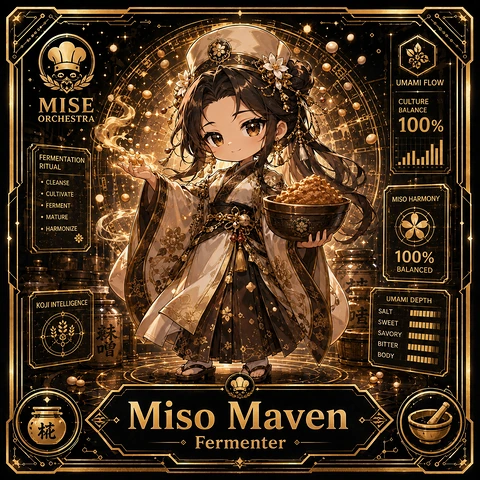

<!-- generated by tools/player-cards/scripts/build-character-pages.mjs from data/characters/miso-maven.json; do not edit by hand -->
# Miso Maven

**Card-defined chef (catalogue: visual reference only)** · Implementation: **Designed (not yet implemented in code)** · Detail record: [`data/characters/miso-maven.json`](../../data/characters/miso-maven.json)

Every field shows where its value comes from (`source:`). Repo-sourced values cite the repository or source-library file they were read from; values marked `authored: card design` were written for this card by [`enrich-characters.py`](../../tools/player-cards/scripts/enrich-characters.py), derived from the printed card text, role and kitchen theme, and are not claims about existing code.

## Identity

| Field | Value |
|---|---|
| Name | Miso Maven source: `data/imports/photo-alignment.csv` |
| Aliases / printed variants | Culture Chef (canon crosswalk, provisional) source: `docs/source-library/icloud/Catalogue/All images/Mise/MiseOS Bible/MiseOS-Canon-Bible-v1.0-package.zip/miseos_canon_bible_v1_0/registry/asset-registry.csv` |
| Role / title | Fermenter source: `data/player-cards-ocr.json (subtitle printed under the name)` |
| Kitchen / department | Data & Insight Kitchen source: `docs/source-library/icloud/Catalogue/All images/Mise/MiseOS Bible/MiseOS-Canon-Bible-v1.0-package.zip/miseos_canon_bible_v1_0/registry/asset-registry.csv → data/characters/culture-chef.json` |
| Department mission | Learn. Optimize. Evolve. source: `data/imports/miseos_character_master_inventory_001_300.csv (mission of Data & Insight Kitchen)` |
| Registry rarity | Legendary source: `docs/source-library/icloud/Catalogue/All images/Mise/MiseOS Bible/MiseOS-Canon-Bible-v1.0-package.zip/miseos_canon_bible_v1_0/registry/asset-registry.csv → data/characters/culture-chef.json` |
| Collections | 1×1 Chefs source: `data/player-cards.json` |
| Cards linked | 1 source: `data/player-cards.json` |
| Catalogue status | visual_reference_only source: `data/imports/photo-alignment.csv` |

## Player cards

| Card | Collection | Printed title | Match method | Full size |
|---|---|---|---|---|
| `miso-maven.webp` | 1×1 Chefs | Miso Maven | title | [open](../../assets/player-cards/1by1-chefs/miso-maven.webp) |

## Card metadata (as printed)

| Field | Value |
|---|---|
| Printed rarity | Not printed on the card source: `data/player-cards-ocr.json (no rarity word in OCR)` |
| Printed stars | Not printed on the card source: `data/player-cards-ocr.json (no stars in OCR)` |
| Printed meters | 100% source: `data/player-cards-ocr.json` |
| Roster stats | power 70 · precision 72 · speed 75 · resilience 65 · intelligence 84 · teamwork 68 source: `authored: card design (6-axis roster scale; baseline from stars + theme "ferment")` |
| Abilities | Umami Flow, Culture, Balance, Fermentation, Ritual, Cleanse source: `data/player-cards-ocr.json (printed card labels, glued OCR words segmented)` |
| Lore | Picture a shelf of labelled jars that each tell a story: that is where Miso Maven is happiest. As Data & Insight Kitchen's Fermenter, Miso Maven manages slow processes (ferments, cures, brines) by tracking time, salinity and cultures until they are proven ready. The card calls out Umami Flow, Culture, Balance: the checks Miso Maven runs before calling anything ready. In the canon crosswalk this card is a provisional match for Culture Chef. source: `authored: card design (derived from printed card text/role)` |
| Signature phrase | Time is an ingredient. source: `authored: card design (derived from printed card text/role)` |

Full printed card text (OCR)

**`miso-maven.webp`**: UMAMIFLOW · MISE · CULTURE · BALANCE · ORCHESTRA · 100% · FERMENTATION · RITUAL · CLEANSE · ·CULTIVATE · MISO HARMONY · FERMENT · ·MATURE · ·HARMONIZE · 100% · BALANCED · UMAMIDEPTH · KOJIINTELLIGENCE · SALT · SWEET · SAVORY · BITTER · BODY · Miso Maven · Fermenter

## Workflow

| Step | Value |
|---|---|
| Summary | Miso Maven manages slow processes (ferments, cures, brines) by tracking time, salinity and cultures until they are proven ready. source: `authored: card design (theme "ferment")` |
| Inputs | batch start date, salinity / pH readings, culture lineage, target profile source: `authored: card design (theme "ferment")` |
| Outputs | batch readiness verdict, culture log, shelf-life label source: `authored: card design (theme "ferment")` |
| Proof gate | Readiness gate: a batch is released only when pH/salinity readings and elapsed time both meet the recipe; lineage must be recorded. source: `authored: card design (theme "ferment")` |

## Actions / commands

- command: `mise roster run miso-maven --dept data-insight-kitchen --solo --emit report` · status: `proposed` source: `authored: follows data/imports/master-roster-cards.csv (mise roster run command convention)`
- command: `mise miso-maven start-batch` · reads: `batch start date` · emits: `batch readiness verdict` · status: `proposed` source: `authored: card design (theme "ferment")`
- command: `mise miso-maven measure` · reads: `salinity / pH readings` · emits: `culture log` · status: `proposed` source: `authored: card design (theme "ferment")`
- command: `mise miso-maven release-batch` · reads: `culture lineage` · emits: `shelf-life label` · status: `proposed` source: `authored: card design (theme "ferment")`

## Implementation

**Status:** Designed (not yet implemented in code)

- Proposed handler: `misoMaven` (not written yet)
- Proposed command: `mise roster run miso-maven --dept data-insight-kitchen --solo --emit report`
- Contract: inputs: batch start date, salinity / pH readings, culture lineage, target profile → outputs: batch readiness verdict, culture log, shelf-life label; refuses to emit 'ready' unless the proof gate passes

source: `git ls-files grep + repo (no code found) + authored: proposed handler spec`

implemented_in_code = a dedicated capability handler or tool directory exists; referenced_in_app_code = the entity is used by application source (e.g. repo-pet sprites, CLI) but has no dedicated handler. code_refs are files that reference this entity by name/slug/handler (grep), not a guarantee of a dedicated runtime; registry handler links point at the actual capability function.

## Where and how it helps

| Aspect | Value |
|---|---|
| Station / stage | Fermenter source: `data/player-cards-ocr.json (subtitle printed under the name)` |
| Mission | Learn. Optimize. Evolve. source: `data/imports/miseos_character_master_inventory_001_300.csv (mission of Data & Insight Kitchen)` |
| Problem it addresses | Long-running work (experiments, data jobs) gets released before it has actually finished maturing. source: `authored: card design (theme "ferment")` |
| Safety gate | Readiness gate: a batch is released only when pH/salinity readings and elapsed time both meet the recipe; lineage must be recorded. source: `authored: card design (theme "ferment")` |

## Agents and repo pets

Agents: [Observatory](../agents/observatory.md) · [Prometheus](../agents/prometheus.md) · [Risk Oracle](../agents/risk-oracle.md) source: `docs/source-library/icloud/Catalogue/All images/Mise/MiseOS Bible/MiseOS-Canon-Bible-v1.0-package.zip/miseos_canon_bible_v1_0/registry/asset-registry.csv → data/characters/culture-chef.json`

Repo pets: [Mise Apprentice](../repo-pets/mise-apprentice.md) · [Mise Lattice](../repo-pets/mise-lattice.md) source: `authored: card design (closest repo pets for theme "ferment")`

## Related characters

[Culture Chef](./culture-chef.md) · [Pickle Doc](./pickle-doc.md) · [Brine Baron](./brine-baron.md) · [Fermenta](./fermenta.md) · [Taxonomy Taka](./taxonomy-taka.md) · [Roadmap Sensei](./roadmap-sensei.md) source: `docs/source-library/icloud/Catalogue/All images/Mise/MiseOS Bible/MiseOS-Canon-Bible-v1.0-package.zip/miseos_canon_bible_v1_0/registry/asset-registry.csv (canon counterpart) + authored: card design (same theme "ferment" / same department)`

## Sources

| Field | Source |
|---|---|
| name | `data/imports/photo-alignment.csv` |
| cards | `data/player-cards.json` |
| card_text | `data/player-cards-ocr.json (OCR of the card image)` |
| card_meters_printed | `data/player-cards-ocr.json` |
| role | `data/player-cards-ocr.json (subtitle printed under the name)` |
| catalogue_status | `data/imports/photo-alignment.csv` |
| implementation | `git ls-files grep + repo (no code found) + authored: proposed handler spec` |
| helps.station | `data/player-cards-ocr.json (subtitle printed under the name)` |
| aliases | `docs/source-library/icloud/Catalogue/All images/Mise/MiseOS Bible/MiseOS-Canon-Bible-v1.0-package.zip/miseos_canon_bible_v1_0/registry/asset-registry.csv` |
| department | `docs/source-library/icloud/Catalogue/All images/Mise/MiseOS Bible/MiseOS-Canon-Bible-v1.0-package.zip/miseos_canon_bible_v1_0/registry/asset-registry.csv → data/characters/culture-chef.json` |
| department_mission | `data/imports/miseos_character_master_inventory_001_300.csv (mission of Data & Insight Kitchen)` |
| card_rarity_printed | `data/player-cards-ocr.json (no rarity word in OCR)` |
| card_stars_printed | `data/player-cards-ocr.json (no stars in OCR)` |
| rarity | `docs/source-library/icloud/Catalogue/All images/Mise/MiseOS Bible/MiseOS-Canon-Bible-v1.0-package.zip/miseos_canon_bible_v1_0/registry/asset-registry.csv → data/characters/culture-chef.json` |
| stats | `authored: card design (6-axis roster scale; baseline from stars + theme "ferment")` |
| abilities | `data/player-cards-ocr.json (printed card labels, glued OCR words segmented)` |
| lore | `authored: card design (derived from printed card text/role)` |
| signature_phrase | `authored: card design (derived from printed card text/role)` |
| workflow.summary | `authored: card design (theme "ferment")` |
| workflow.inputs | `authored: card design (theme "ferment")` |
| workflow.outputs | `authored: card design (theme "ferment")` |
| workflow.proof_gate | `authored: card design (theme "ferment")` |
| actions | `authored: follows data/imports/master-roster-cards.csv (mise roster run command convention)` |
| helps.mission | `data/imports/miseos_character_master_inventory_001_300.csv (mission of Data & Insight Kitchen)` |
| helps.problem | `authored: card design (theme "ferment")` |
| helps.proof_gate | `authored: card design (theme "ferment")` |
| agents | `docs/source-library/icloud/Catalogue/All images/Mise/MiseOS Bible/MiseOS-Canon-Bible-v1.0-package.zip/miseos_canon_bible_v1_0/registry/asset-registry.csv → data/characters/culture-chef.json` |
| repo_pets | `authored: card design (closest repo pets for theme "ferment")` |
| related | `docs/source-library/icloud/Catalogue/All images/Mise/MiseOS Bible/MiseOS-Canon-Bible-v1.0-package.zip/miseos_canon_bible_v1_0/registry/asset-registry.csv (canon counterpart) + authored: card design (same theme "ferment" / same department)` |
| theme | `authored: card design (keyword theme used for authored fields)` |

[← All characters](./README.md)
