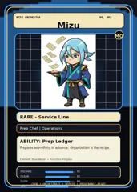

<!-- generated by tools/player-cards/scripts/build-character-pages.mjs from data/characters/mizu.json; do not edit by hand -->
# Mizu

**Registry character agent** · Implementation: **Referenced in app code (no dedicated handler)** · Detail record: [`data/characters/mizu.json`](../../data/characters/mizu.json)

Every field below comes from a repository source (shown as `source:`). Where no source exists the page says _Not yet defined in the source material_.

## Identity

| Field | Value |
|---|---|
| Name | Mizu source: `data/characters.json` |
| Aliases / printed variants | Not yet defined in the source material |
| Role / title | Prepare source: `characters/mizu/metadata.json` |
| Kitchen / department | Operations Kitchen source: `characters/mizu/metadata.json` |
| Department mission | Keep the kitchen running smoothly. source: `data/imports/miseos_character_master_inventory_001_300.csv` |
| Registry rarity | Rare source: `characters/mizu/metadata.json` |
| Level | 22 source: `data/imports/miseos_character_master_inventory_001_300.csv` |
| ID: registry_id | MISE-078 source: `characters/mizu/metadata.json` |
| ID: character_id | miseos.character.078 source: `data/imports/miseos_character_master_inventory_001_300.csv` |
| ID: card_id | MISE-078 source: `data/imports/miseos_character_master_inventory_001_300.csv` |
| ID: codename | MIZU source: `data/imports/miseos_character_master_inventory_001_300.csv` |
| Collections | 1×1 Chefs, Character Building Theme, Mise Orchestra Trading Cards (Season 1) source: `data/player-cards.json` |
| Cards linked | 3 source: `data/player-cards.json` |

## Player cards

| Card | Collection | Printed title | Match method | Full size |
|---|---|---|---|---|
| `mizu.webp` | 1×1 Chefs | Mizu | existing-index | [open](../../assets/player-cards/1by1-chefs/mizu.webp) |
| `prepare.webp` | Character Building Theme | PREPARE | existing-index | [open](../../assets/player-cards/character-building/prepare.webp) |
| `mizu.webp` | Mise Orchestra Trading Cards (Season 1) | Mizu | existing-index | [open](../../assets/player-cards/orchestra-trading-cards/mizu.webp) |

## Card metadata (as printed)

| Field | Value |
|---|---|
| Printed rarity | Rare source: `data/player-cards-ocr.json` |
| Printed stars | Not yet defined in the source material |
| Printed meters | Not yet defined in the source material |
| Roster stats | power 71 · precision 86 · speed 81 · resilience 73 · intelligence 84 · teamwork 67 source: `data/imports/miseos_character_master_inventory_001_300.csv (roster stats, not OCR)` |
| Abilities | Prep Ledger source: `data/imports/mise_orchestra_cards.csv` |
| Mise Orchestra card | role: Prep Chef · department: Operations · function: Prepare · rarity: Rare · tier: Service Line · element: Blue Water · ability: Prep Ledger · lore: Prepares everything in advance. Organization is the recipe. source: `data/imports/mise_orchestra_cards.csv` |
| Lore | Mizu belongs to the Kitchen Chaos DevOps Universe, where every technical workflow becomes a coordinated brigade station. source: `data/imports/merged_roster.json` |
| Signature phrase | Not yet defined in the source material |

Full printed card text (OCR)

**`mizu.webp`**: MISE · ORCHESTRA · MISE.OS · PREPMODULE · STATUS · READY · PREPSEQUENCE · WASH · CHOP · MEASURE · ALIGN · PLATE · SYNC · Mizu · Prep Chef

**`prepare.webp`**: COOK · COOK · ORCHERTATE · COOK · SCALE · PREPARE · DEPLOY

**`mizu.webp`**: MISE ORCHESTRA · NO.003 · Mizu · MO · RARE-ServiceLine · Prep Chef\|Operations · ABILITY:PrepLedger · Prepares everything in advance.Organization is the recipe · Element:BlueWater.Function:Prepare · PREPARE · 95 · CLEAN · 82 · FLOW · 84 · COOK·ORCHESTRATE·DEPLOY · LPROVENANCE-READY · LES

## Workflow

| Step | Value |
|---|---|
| Summary | Mizu performs prepare within the Operations Kitchen. source: `characters/mizu/metadata.json` |
| Inputs | repository context, task request, policy constraints, current evidence source: `characters/mizu/metadata.json` |
| Outputs | validated result, evidence record, handoff packet source: `characters/mizu/metadata.json` |
| Proof gate | No merge, deployment, publication, billing action, or mint without evidence. source: `characters/mizu/metadata.json` |

## Actions / commands

- command: `MISE PREPARE` source: `data/imports/miseos_character_master_inventory_001_300.csv`

## Implementation

**Status:** Referenced in app code (no dedicated handler)

Application code that uses this entry:
- [`apps/developer-platform/packages/shimeji-brigade/tools/generate-reference-frames.mjs:14`](../../apps/developer-platform/packages/shimeji-brigade/tools/generate-reference-frames.mjs#L14)
- [`apps/miseos-platform/apps/shimeji-brigade/src/registry.js:4`](../../apps/miseos-platform/apps/shimeji-brigade/src/registry.js#L4)
- [`apps/miseos-platform/packages/miseos-repo-pet/src/characters.js:109`](../../apps/miseos-platform/packages/miseos-repo-pet/src/characters.js#L109)

Roster data / types / tests in code that list this entry (not an implementation):
- [`apps/bootstrap-registry/apps/registry-console/src/data/master-roster.generated.ts:393`](../../apps/bootstrap-registry/apps/registry-console/src/data/master-roster.generated.ts#L393)
- [`apps/brigade-gallery/src/data/brigade-roster.ts:178`](../../apps/brigade-gallery/src/data/brigade-roster.ts#L178)
- [`apps/brigade-gallery/src/data/master-roster.ts:336`](../../apps/brigade-gallery/src/data/master-roster.ts#L336)

Data files that reference it:
- [`apps/bootstrap-registry/registry/cards/master-roster-cards.json:345`](../../apps/bootstrap-registry/registry/cards/master-roster-cards.json#L345)
- [`apps/developer-platform/packages/shimeji-brigade/assets/sprites/mizu/manifest.json:3`](../../apps/developer-platform/packages/shimeji-brigade/assets/sprites/mizu/manifest.json#L3)
- [`apps/developer-platform/packages/shimeji-brigade/src/character-registry.json:6`](../../apps/developer-platform/packages/shimeji-brigade/src/character-registry.json#L6)
- [`apps/developer-platform/projects/shimeji-brigade-v9/assets/sprites/mizu/manifest.json:2`](../../apps/developer-platform/projects/shimeji-brigade-v9/assets/sprites/mizu/manifest.json#L2)
- [`apps/developer-platform/projects/shimeji-brigade-v9/src/character-registry.json:4`](../../apps/developer-platform/projects/shimeji-brigade-v9/src/character-registry.json#L4)
- [`apps/gridops-platform/data/miseos-ecosystem-135.json:1354`](../../apps/gridops-platform/data/miseos-ecosystem-135.json#L1354)
- [`apps/registry-atrium/collection-manifest.json:30`](../../apps/registry-atrium/collection-manifest.json#L30)
- [`apps/registry-atrium/metadata/erc721/003-mizu.json:2`](../../apps/registry-atrium/metadata/erc721/003-mizu.json#L2)
- [`apps/voxel-world/src/data/miseos-ecosystem-135.json:1354`](../../apps/voxel-world/src/data/miseos-ecosystem-135.json#L1354)
- [`tools/art-factory/input/characters.generated.json:568`](../../tools/art-factory/input/characters.generated.json#L568)

Docs that describe it (docs only, not code):
- [`characters/mizu/README.md`](../../characters/mizu/README.md)
- [`apps/brigade-gallery/prototype/holo-card-roster.html:76`](../../apps/brigade-gallery/prototype/holo-card-roster.html#L76)
- [`apps/brigade-gallery/prototype/registry-atrium-gallery.html:342`](../../apps/brigade-gallery/prototype/registry-atrium-gallery.html#L342)
- [`apps/developer-platform/docs/SHIMEJI_BRIGADE_RELEASE.md:8`](../../apps/developer-platform/docs/SHIMEJI_BRIGADE_RELEASE.md#L8)
- [`apps/developer-platform/docs/characters/CHARACTER_REGISTRY_001_300.md:15`](../../apps/developer-platform/docs/characters/CHARACTER_REGISTRY_001_300.md#L15)
- [`apps/developer-platform/packages/shimeji-brigade/README.md:45`](../../apps/developer-platform/packages/shimeji-brigade/README.md#L45)
- [`apps/developer-platform/packages/shimeji-brigade/brand/BRAND_GUIDE.md:57`](../../apps/developer-platform/packages/shimeji-brigade/brand/BRAND_GUIDE.md#L57)
- [`apps/developer-platform/packages/shimeji-brigade/docs/REFERENCE_STATUS.md:5`](../../apps/developer-platform/packages/shimeji-brigade/docs/REFERENCE_STATUS.md#L5)
- [`apps/developer-platform/packages/shimeji-brigade/studio/index.html:23`](../../apps/developer-platform/packages/shimeji-brigade/studio/index.html#L23)
- [`apps/developer-platform/projects/shimeji-brigade-v9/README.md:17`](../../apps/developer-platform/projects/shimeji-brigade-v9/README.md#L17)
- [`apps/developer-platform/projects/shimeji-brigade-v9/assets/source/mizu/README.md:1`](../../apps/developer-platform/projects/shimeji-brigade-v9/assets/source/mizu/README.md#L1)

implemented_in_code = a dedicated capability handler or tool directory exists; referenced_in_app_code = the entity is used by application source (e.g. repo-pet sprites, CLI) but has no dedicated handler. code_refs are files that reference this entity by name/slug/handler (grep), not a guarantee of a dedicated runtime; registry handler links point at the actual capability function.

## Where and how it helps

| Aspect | Value |
|---|---|
| Station / stage | Operations Kitchen source: `characters/mizu/metadata.json` |
| Mission | Keep the kitchen running smoothly. source: `data/imports/miseos_character_master_inventory_001_300.csv` |
| Problem it addresses | Mizu performs prepare within the Operations Kitchen. source: `characters/mizu/metadata.json` |
| Safety gate | No merge, deployment, publication, billing action, or mint without evidence. source: `characters/mizu/metadata.json` |

## Agents and repo pets

Agents: [Mizu](../agents/mizu.md) source: `data/agents.json`

Repo pets: [Mizu](../repo-pets/mizu.md) source: `data/repo-pets.json`

## Related characters

[Kaji](./kaji.md) · [Scale Oni](./scale-oni.md) · [Velvet Vesper](./velvet-vesper.md) source: `data/imports/miseos_character_master_inventory_001_300.csv`

## Canon Bible

Mentioned in [`docs/canon/MiseOS-Canon-Bible-v1.0.pdf`](../../docs/canon/MiseOS-Canon-Bible-v1.0.pdf):

- line 491: `MISE-G2-P014 Mizu Mise Orchestra canonical-candidate 1E3334AB-3111- 14`

## Sources

| Field | Source |
|---|---|
| name | `data/characters.json` |
| cards | `data/player-cards.json` |
| card_text | `data/player-cards-ocr.json (OCR of the card image)` |
| card_rarity_printed | `data/player-cards-ocr.json` |
| ids.registry_id | `characters/mizu/metadata.json` |
| role | `characters/mizu/metadata.json` |
| department | `characters/mizu/metadata.json` |
| rarity | `characters/mizu/metadata.json` |
| workflow.summary | `characters/mizu/metadata.json` |
| workflow.inputs | `characters/mizu/metadata.json` |
| workflow.outputs | `characters/mizu/metadata.json` |
| workflow.proof_gate | `characters/mizu/metadata.json` |
| department_mission | `data/imports/miseos_character_master_inventory_001_300.csv` |
| ids.character_id | `data/imports/miseos_character_master_inventory_001_300.csv` |
| ids.card_id | `data/imports/miseos_character_master_inventory_001_300.csv` |
| ids.codename | `data/imports/miseos_character_master_inventory_001_300.csv` |
| stats | `data/imports/miseos_character_master_inventory_001_300.csv (roster stats, not OCR)` |
| level | `data/imports/miseos_character_master_inventory_001_300.csv` |
| related | `data/imports/miseos_character_master_inventory_001_300.csv` |
| lore | `data/imports/merged_roster.json` |
| orchestra_card | `data/imports/mise_orchestra_cards.csv` |
| abilities | `data/imports/mise_orchestra_cards.csv` |
| canon_bible | `docs/canon/MiseOS-Canon-Bible-v1.0.pdf (pdftotext)` |
| implementation | `git ls-files grep + repo` |
| helps.station | `characters/mizu/metadata.json` |
| agents | `data/agents.json` |
| repo_pets | `data/repo-pets.json` |

[← All characters](./README.md)
