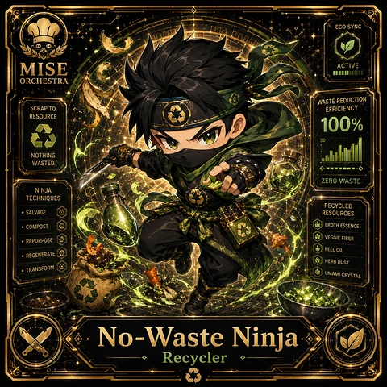

<!-- generated by tools/player-cards/scripts/build-character-pages.mjs from data/characters/no-waste-ninja.json; do not edit by hand -->
# No-Waste Ninja

**Card-defined chef (catalogue: visual reference only)** · Implementation: **Designed (not yet implemented in code)** · Detail record: [`data/characters/no-waste-ninja.json`](../../data/characters/no-waste-ninja.json)

Every field shows where its value comes from (`source:`). Repo-sourced values cite the repository or source-library file they were read from; values marked `authored: card design` were written for this card by [`enrich-characters.py`](../../tools/player-cards/scripts/enrich-characters.py), derived from the printed card text, role and kitchen theme, and are not claims about existing code.

## Identity

| Field | Value |
|---|---|
| Name | No-Waste Ninja source: `data/imports/photo-alignment.csv` |
| Aliases / printed variants | Culture Chef (canon crosswalk, provisional) source: `docs/source-library/icloud/Catalogue/All images/Mise/MiseOS Bible/MiseOS-Canon-Bible-v1.0-package.zip/miseos_canon_bible_v1_0/registry/asset-registry.csv` |
| Role / title | Recycler source: `data/player-cards-ocr.json (subtitle printed under the name)` |
| Kitchen / department | Data & Insight Kitchen source: `docs/source-library/icloud/Catalogue/All images/Mise/MiseOS Bible/MiseOS-Canon-Bible-v1.0-package.zip/miseos_canon_bible_v1_0/registry/asset-registry.csv → data/characters/culture-chef.json` |
| Department mission | Learn. Optimize. Evolve. source: `data/imports/miseos_character_master_inventory_001_300.csv (mission of Data & Insight Kitchen)` |
| Registry rarity | Legendary source: `docs/source-library/icloud/Catalogue/All images/Mise/MiseOS Bible/MiseOS-Canon-Bible-v1.0-package.zip/miseos_canon_bible_v1_0/registry/asset-registry.csv → data/characters/culture-chef.json` |
| Collections | 1×1 Chefs source: `data/player-cards.json` |
| Cards linked | 1 source: `data/player-cards.json` |
| Catalogue status | visual_reference_only source: `data/imports/photo-alignment.csv` |

## Player cards

| Card | Collection | Printed title | Match method | Full size |
|---|---|---|---|---|
| `no-waste-ninja.webp` | 1×1 Chefs | No-Waste Ninja | title | [open](../../assets/player-cards/1by1-chefs/no-waste-ninja.webp) |

## Card metadata (as printed)

| Field | Value |
|---|---|
| Printed rarity | Not printed on the card source: `data/player-cards-ocr.json (no rarity word in OCR)` |
| Printed stars | Not printed on the card source: `data/player-cards-ocr.json (no stars in OCR)` |
| Printed meters | 100% source: `data/player-cards-ocr.json` |
| Roster stats | power 65 · precision 73 · speed 68 · resilience 82 · intelligence 78 · teamwork 70 source: `authored: card design (6-axis roster scale; baseline from stars + theme "clean")` |
| Abilities | Eco Sync, Waste Reduction, Scrap To, Efficiency, Resource, Nothing source: `data/player-cards-ocr.json (printed card labels, glued OCR words segmented)` |
| Lore | Ask the brigade about No-Waste Ninja and they describe a steel counter wiped until it reflects the ceiling lights. As Data & Insight Kitchen's Recycler, No-Waste Ninja keeps the kitchen clean and the waste stream honest: sanitising surfaces, logging waste and closing contamination risks, and the rest of the kitchen plans service around that rhythm. The card calls out Eco Sync, Waste Reduction, Scrap To: the checks No-Waste Ninja runs before calling anything ready. In the canon crosswalk this card is a provisional match for Culture Chef. source: `authored: card design (derived from printed card text/role)` |
| Signature phrase | Nothing wasted, nothing hidden. source: `authored: card design (derived from printed card text/role)` |

Full printed card text (OCR)

**`no-waste-ninja.webp`**: ECO SYNC · MISE · ACTIVE · ORCHESTRA · WASTE REDUCTION · SCRAP TO · EFFICIENCY · RESOURCE · 100% · NOTHING · WASTED · ZERO WASTE · NINJA · TECHNIQUES · RECYCLED · ·SALVAGE · RESOURCES · ·COMPOST · BROTHESSENCE · VEGGIE FIBER · ·REPURPOSE · PEEL OIL · ·REGENERATE · HERBDUST · ·TRANSFORM · UMAMI CRYSTAL · No-Waste ·  Ninja · Recycler

## Workflow

| Step | Value |
|---|---|
| Summary | No-Waste Ninja keeps the kitchen clean and the waste stream honest: sanitising surfaces, logging waste and closing contamination risks. source: `authored: card design (theme "clean")` |
| Inputs | station checklist, waste log, sanitiser concentration readings, incident reports source: `authored: card design (theme "clean")` |
| Outputs | sanitation sign-off, waste report, contamination alert source: `authored: card design (theme "clean")` |
| Proof gate | Sanitation sign-off: a station reopens only after its checklist is complete and readings are in range; any contamination opens an incident. source: `authored: card design (theme "clean")` |

## Actions / commands

- command: `mise roster run no-waste-ninja --dept data-insight-kitchen --solo --emit report` · status: `proposed` source: `authored: follows data/imports/master-roster-cards.csv (mise roster run command convention)`
- command: `mise no-waste-ninja sanitize` · reads: `station checklist` · emits: `sanitation sign-off` · status: `proposed` source: `authored: card design (theme "clean")`
- command: `mise no-waste-ninja audit-waste` · reads: `waste log` · emits: `waste report` · status: `proposed` source: `authored: card design (theme "clean")`
- command: `mise no-waste-ninja sign-off` · reads: `sanitiser concentration readings` · emits: `contamination alert` · status: `proposed` source: `authored: card design (theme "clean")`

## Implementation

**Status:** Designed (not yet implemented in code)

- Proposed handler: `noWasteNinja` (not written yet)
- Proposed command: `mise roster run no-waste-ninja --dept data-insight-kitchen --solo --emit report`
- Contract: inputs: station checklist, waste log, sanitiser concentration readings, incident reports → outputs: sanitation sign-off, waste report, contamination alert; refuses to emit 'ready' unless the proof gate passes

source: `git ls-files grep + repo (no code found) + authored: proposed handler spec`

implemented_in_code = a dedicated capability handler or tool directory exists; referenced_in_app_code = the entity is used by application source (e.g. repo-pet sprites, CLI) but has no dedicated handler. code_refs are files that reference this entity by name/slug/handler (grep), not a guarantee of a dedicated runtime; registry handler links point at the actual capability function.

## Where and how it helps

| Aspect | Value |
|---|---|
| Station / stage | Recycler source: `data/player-cards-ocr.json (subtitle printed under the name)` |
| Mission | Learn. Optimize. Evolve. source: `data/imports/miseos_character_master_inventory_001_300.csv (mission of Data & Insight Kitchen)` |
| Problem it addresses | Residue (stale secrets, dead code, waste) quietly contaminates everything it touches. source: `authored: card design (theme "clean")` |
| Safety gate | Sanitation sign-off: a station reopens only after its checklist is complete and readings are in range; any contamination opens an incident. source: `authored: card design (theme "clean")` |

## Agents and repo pets

Agents: [Observatory](../agents/observatory.md) · [Prometheus](../agents/prometheus.md) · [Risk Oracle](../agents/risk-oracle.md) source: `docs/source-library/icloud/Catalogue/All images/Mise/MiseOS Bible/MiseOS-Canon-Bible-v1.0-package.zip/miseos_canon_bible_v1_0/registry/asset-registry.csv → data/characters/culture-chef.json`

Repo pets: [Mise Locker](../repo-pets/mise-locker.md) · [Kuro Guard](../repo-pets/kuro-guard.md) source: `authored: card design (closest repo pets for theme "clean")`

## Related characters

[Culture Chef](./culture-chef.md) · [Sanitation Star](./sanitation-star.md) · [Byte](./byte.md) · [Leaderboard Leo](./leaderboard-leo.md) · [Growth Guru](./growth-guru.md) · [Taxonomy Taka](./taxonomy-taka.md) source: `docs/source-library/icloud/Catalogue/All images/Mise/MiseOS Bible/MiseOS-Canon-Bible-v1.0-package.zip/miseos_canon_bible_v1_0/registry/asset-registry.csv (canon counterpart) + authored: card design (same theme "clean" / same department)`

## Sources

| Field | Source |
|---|---|
| name | `data/imports/photo-alignment.csv` |
| cards | `data/player-cards.json` |
| card_text | `data/player-cards-ocr.json (OCR of the card image)` |
| card_meters_printed | `data/player-cards-ocr.json` |
| role | `data/player-cards-ocr.json (subtitle printed under the name)` |
| catalogue_status | `data/imports/photo-alignment.csv` |
| implementation | `git ls-files grep + repo (no code found) + authored: proposed handler spec` |
| helps.station | `data/player-cards-ocr.json (subtitle printed under the name)` |
| aliases | `docs/source-library/icloud/Catalogue/All images/Mise/MiseOS Bible/MiseOS-Canon-Bible-v1.0-package.zip/miseos_canon_bible_v1_0/registry/asset-registry.csv` |
| department | `docs/source-library/icloud/Catalogue/All images/Mise/MiseOS Bible/MiseOS-Canon-Bible-v1.0-package.zip/miseos_canon_bible_v1_0/registry/asset-registry.csv → data/characters/culture-chef.json` |
| department_mission | `data/imports/miseos_character_master_inventory_001_300.csv (mission of Data & Insight Kitchen)` |
| card_rarity_printed | `data/player-cards-ocr.json (no rarity word in OCR)` |
| card_stars_printed | `data/player-cards-ocr.json (no stars in OCR)` |
| rarity | `docs/source-library/icloud/Catalogue/All images/Mise/MiseOS Bible/MiseOS-Canon-Bible-v1.0-package.zip/miseos_canon_bible_v1_0/registry/asset-registry.csv → data/characters/culture-chef.json` |
| stats | `authored: card design (6-axis roster scale; baseline from stars + theme "clean")` |
| abilities | `data/player-cards-ocr.json (printed card labels, glued OCR words segmented)` |
| lore | `authored: card design (derived from printed card text/role)` |
| signature_phrase | `authored: card design (derived from printed card text/role)` |
| workflow.summary | `authored: card design (theme "clean")` |
| workflow.inputs | `authored: card design (theme "clean")` |
| workflow.outputs | `authored: card design (theme "clean")` |
| workflow.proof_gate | `authored: card design (theme "clean")` |
| actions | `authored: follows data/imports/master-roster-cards.csv (mise roster run command convention)` |
| helps.mission | `data/imports/miseos_character_master_inventory_001_300.csv (mission of Data & Insight Kitchen)` |
| helps.problem | `authored: card design (theme "clean")` |
| helps.proof_gate | `authored: card design (theme "clean")` |
| agents | `docs/source-library/icloud/Catalogue/All images/Mise/MiseOS Bible/MiseOS-Canon-Bible-v1.0-package.zip/miseos_canon_bible_v1_0/registry/asset-registry.csv → data/characters/culture-chef.json` |
| repo_pets | `authored: card design (closest repo pets for theme "clean")` |
| related | `docs/source-library/icloud/Catalogue/All images/Mise/MiseOS Bible/MiseOS-Canon-Bible-v1.0-package.zip/miseos_canon_bible_v1_0/registry/asset-registry.csv (canon counterpart) + authored: card design (same theme "clean" / same department)` |
| theme | `authored: card design (keyword theme used for authored fields)` |

[← All characters](./README.md)
