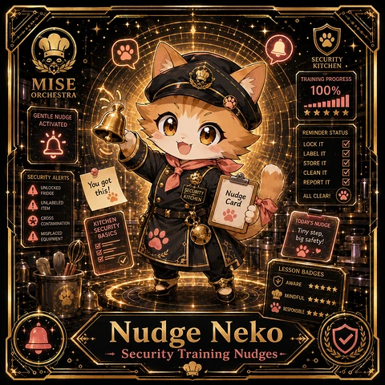
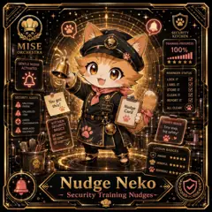

<!-- generated by tools/player-cards/scripts/build-character-pages.mjs from data/characters/nudge-neko.json; do not edit by hand -->
# Nudge Neko

**Registry character agent** · Implementation: **Described in docs only** · Detail record: [`data/characters/nudge-neko.json`](../../data/characters/nudge-neko.json)

Every field below comes from a repository source (shown as `source:`). Where no source exists the page says _Not yet defined in the source material_.

## Identity

| Field | Value |
|---|---|
| Name | Nudge Neko source: `data/characters.json` |
| Aliases / printed variants | Not yet defined in the source material |
| Role / title | Security Training Nudges source: `characters/nudge-neko/metadata.json` |
| Kitchen / department | Security Kitchen source: `characters/nudge-neko/metadata.json` |
| Department mission | Guard. Audit. Comply. source: `data/imports/miseos_character_master_inventory_001_300.csv` |
| Registry rarity | Rare source: `characters/nudge-neko/metadata.json` |
| Level | 27 source: `data/imports/miseos_character_master_inventory_001_300.csv` |
| ID: registry_id | MISE-058 source: `characters/nudge-neko/metadata.json` |
| ID: character_id | miseos.character.058 source: `data/imports/miseos_character_master_inventory_001_300.csv` |
| ID: card_id | MISE-058 source: `data/imports/miseos_character_master_inventory_001_300.csv` |
| ID: codename | NUDGE_NEKO source: `data/imports/miseos_character_master_inventory_001_300.csv` |
| Collections | 1×1 Chefs, Registry Catalogue Pages source: `data/player-cards.json` |
| Cards linked | 2 source: `data/player-cards.json` |
| Role category | security source: `data/imports/merged_roster.json` |

## Player cards

| Card | Collection | Printed title | Match method | Full size |
|---|---|---|---|---|
| `nudge-neko.webp` | 1×1 Chefs | Nudge Neko | existing-index | [open](../../assets/player-cards/1by1-chefs/nudge-neko.webp) |
| `nudge-neko.webp` | Registry Catalogue Pages | Nudge Neko | existing-index | [open](../../assets/player-cards/registry-pages/nudge-neko.webp) |

## Card metadata (as printed)

| Field | Value |
|---|---|
| Printed rarity | Not yet defined in the source material |
| Printed stars | 5 source: `data/player-cards-ocr.json` |
| Printed meters | 100% source: `data/player-cards-ocr.json` |
| Roster stats | power 65 · precision 84 · speed 73 · resilience 65 · intelligence 64 · teamwork 74 source: `data/imports/miseos_character_master_inventory_001_300.csv (roster stats, not OCR)` |
| Abilities | Not yet defined in the source material |
| Lore | Not yet defined in the source material |
| Signature phrase | Security Training Nudges done cleanly, safely, and in rhythm. source: `data/imports/merged_roster.json` |
| Unique trait | Specializes in security training nudges so the Security Kitchen can operate as a precise, repo-safe DevOps station. source: `data/imports/merged_roster.json` |

Full printed card text (OCR)

**`nudge-neko.webp`**: SECURITY · KITCHEN · MISE · TRAININGPROGRESS · 100% · ORCHESTRA · GENTLE NUDGE · ACTIVATED · REMINDERSTATUS · LOCK IT · LABELIT · STORE IT · CLEAN IT · SECURITYALERTS · REPORTIT · You got · UNLOCKED · SECURITY · this! · Nudge · FRIDGE · KITCHEN · ALL CLEAR! · UNLABELED · Card · ITEM · CROSS · TODAY'S NUDGE · CONTAMINATION · KITCHEN · SECURITY · Tiny step, · MISPLACED · BASICS · EQUIPMENT · big safety! · LESSONBADGES · AWARE · ★★★★★ · MINDFUL ★★★★★ · RESPONSIBLE · Nudge Neko · Security Training Nudges

**`nudge-neko.webp`**: SECURITY · KITCHEN · MISE · TRAININGPROGRESS · 100% · ORCHESTRA · GENTLE NUDGE · ACTIVATED · REMINDERSTATUS · LOCK IT · LABELIT · STORE IT · CLEAN IT · SECURITY ALERTS · REPORTIT · You got · UNLOCKED · SECURITY · this! · FRIDGE · Nudge · KITCHEN · ALL CLEAR! · UNLABELED · Card · ITEM · CROSS · TODAY'S NUDGE · CONTAMINATION · KITCHEN · SECURITY · Tiny step, · MISPLACED · BASICS · EQUIPMENT · big safety! · LESSONBADGES · AWARE · ★★★★★ · MINDFUL★★★★★ · RESPONSIBLE · Nudge Neko · Security Training Nudges*

## Workflow

| Step | Value |
|---|---|
| Summary | Nudge Neko performs security training nudges within the Security Kitchen. source: `characters/nudge-neko/metadata.json` |
| Inputs | repository context, task request, policy constraints, current evidence source: `characters/nudge-neko/metadata.json` |
| Outputs | validated result, evidence record, handoff packet source: `characters/nudge-neko/metadata.json` |
| Proof gate | No merge, deployment, publication, billing action, or mint without evidence. source: `characters/nudge-neko/metadata.json` |

## Actions / commands

- command: `MISE SECURITY TRAINING NUDGES` source: `data/imports/miseos_character_master_inventory_001_300.csv`
- command: `Security Training Nudges` · mise_name: `Mise SecurityTrainingNudges` source: `data/imports/merged_roster.json`

## Implementation

**Status:** Described in docs only

Roster data / types / tests in code that list this entry (not an implementation):
- [`apps/bootstrap-registry/apps/registry-console/src/data/master-roster.generated.ts:855`](../../apps/bootstrap-registry/apps/registry-console/src/data/master-roster.generated.ts#L855)
- [`apps/brigade-gallery/src/data/master-roster.ts:633`](../../apps/brigade-gallery/src/data/master-roster.ts#L633)

Data files that reference it:
- [`apps/bootstrap-registry/registry/cards/master-roster-cards.json:807`](../../apps/bootstrap-registry/registry/cards/master-roster-cards.json#L807)
- [`apps/gridops-platform/data/miseos-ecosystem-135.json:3400`](../../apps/gridops-platform/data/miseos-ecosystem-135.json#L3400)
- [`apps/voxel-world/src/data/miseos-ecosystem-135.json:3400`](../../apps/voxel-world/src/data/miseos-ecosystem-135.json#L3400)
- [`tools/art-factory/input/characters.generated.json:3293`](../../tools/art-factory/input/characters.generated.json#L3293)
- [`tools/art-factory/output/manifests/krikey_animation_prompts.json:303`](../../tools/art-factory/output/manifests/krikey_animation_prompts.json#L303)
- [`tools/art-factory/output/manifests/mangaboom_comic_prompts.json:303`](../../tools/art-factory/output/manifests/mangaboom_comic_prompts.json#L303)
- [`tools/art-factory/output/merged_roster.json:2614`](../../tools/art-factory/output/merged_roster.json#L2614)

Docs that describe it (docs only, not code):
- [`characters/nudge-neko/README.md`](../../characters/nudge-neko/README.md)
- [`apps/brigade-gallery/prototype/holo-card-roster.html:76`](../../apps/brigade-gallery/prototype/holo-card-roster.html#L76)
- [`apps/developer-platform/docs/characters/CHARACTER_REGISTRY_001_300.md:23`](../../apps/developer-platform/docs/characters/CHARACTER_REGISTRY_001_300.md#L23)

implemented_in_code = a dedicated capability handler or tool directory exists; referenced_in_app_code = the entity is used by application source (e.g. repo-pet sprites, CLI) but has no dedicated handler. code_refs are files that reference this entity by name/slug/handler (grep), not a guarantee of a dedicated runtime; registry handler links point at the actual capability function.

## Where and how it helps

| Aspect | Value |
|---|---|
| Station / stage | Security Kitchen source: `characters/nudge-neko/metadata.json` |
| Mission | Guard. Audit. Comply. source: `data/imports/miseos_character_master_inventory_001_300.csv` |
| Problem it addresses | Nudge Neko performs security training nudges within the Security Kitchen. source: `characters/nudge-neko/metadata.json` |
| Safety gate | No merge, deployment, publication, billing action, or mint without evidence. source: `characters/nudge-neko/metadata.json` |

## Agents and repo pets

Repo pets: [Nudge Neko](../repo-pets/nudge-neko.md) source: `data/repo-pets.json`

## Related characters

[Scorecard Shin](./scorecard-shin.md) · [Red Oni](./red-oni.md) · [Threat Taro](./threat-taro.md) · [Evidence Scribe](./evidence-scribe.md) · [Ivun Cache](./ivun-cache.md) · [Portal Rei](./portal-rei.md) source: `data/imports/miseos_character_master_inventory_001_300.csv data/imports/merged_roster.json data/imports/merged_roster.json data/imports/merged_roster.json`

## Canon Bible

Mentioned in [`docs/canon/MiseOS-Canon-Bible-v1.0.pdf`](../../docs/canon/MiseOS-Canon-Bible-v1.0.pdf):

- line 599: `MISE-G2-P063 Nudge Neko Mise Orchestra canonical-candidate 1E3334AB-3111- 63`

## Sources

| Field | Source |
|---|---|
| name | `data/characters.json` |
| cards | `data/player-cards.json` |
| card_text | `data/player-cards-ocr.json (OCR of the card image)` |
| card_stars_printed | `data/player-cards-ocr.json` |
| card_meters_printed | `data/player-cards-ocr.json` |
| ids.registry_id | `characters/nudge-neko/metadata.json` |
| role | `characters/nudge-neko/metadata.json` |
| department | `characters/nudge-neko/metadata.json` |
| rarity | `characters/nudge-neko/metadata.json` |
| workflow.summary | `characters/nudge-neko/metadata.json` |
| workflow.inputs | `characters/nudge-neko/metadata.json` |
| workflow.outputs | `characters/nudge-neko/metadata.json` |
| workflow.proof_gate | `characters/nudge-neko/metadata.json` |
| department_mission | `data/imports/miseos_character_master_inventory_001_300.csv` |
| ids.character_id | `data/imports/miseos_character_master_inventory_001_300.csv` |
| ids.card_id | `data/imports/miseos_character_master_inventory_001_300.csv` |
| ids.codename | `data/imports/miseos_character_master_inventory_001_300.csv` |
| stats | `data/imports/miseos_character_master_inventory_001_300.csv (roster stats, not OCR)` |
| level | `data/imports/miseos_character_master_inventory_001_300.csv` |
| related | `data/imports/miseos_character_master_inventory_001_300.csv data/imports/merged_roster.json data/imports/merged_roster.json data/imports/merged_roster.json` |
| signature_phrase | `data/imports/merged_roster.json` |
| unique_trait | `data/imports/merged_roster.json` |
| role_category | `data/imports/merged_roster.json` |
| canon_bible | `docs/canon/MiseOS-Canon-Bible-v1.0.pdf (pdftotext)` |
| implementation | `git ls-files grep + repo` |
| helps.station | `characters/nudge-neko/metadata.json` |
| repo_pets | `data/repo-pets.json` |

[← All characters](./README.md)
