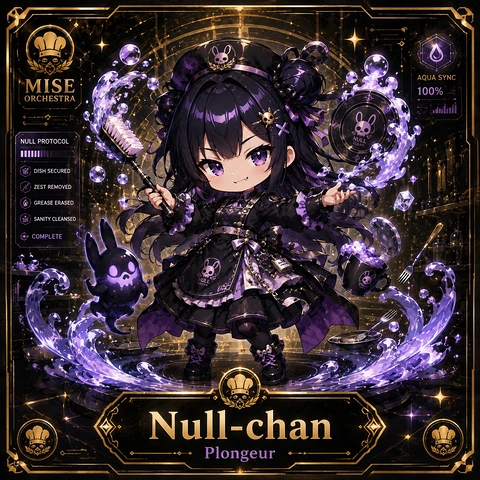
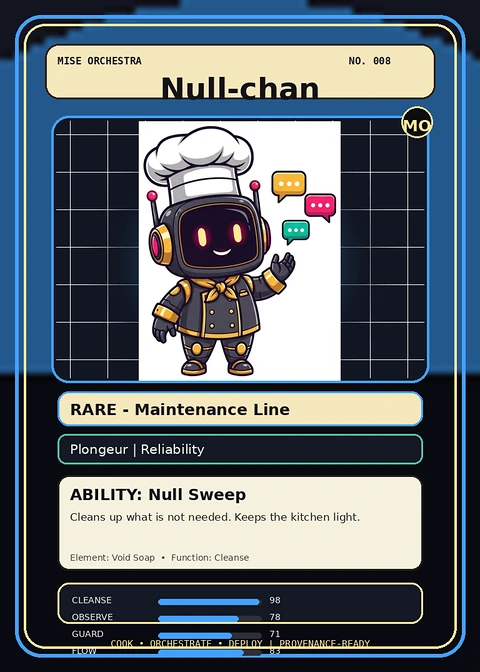
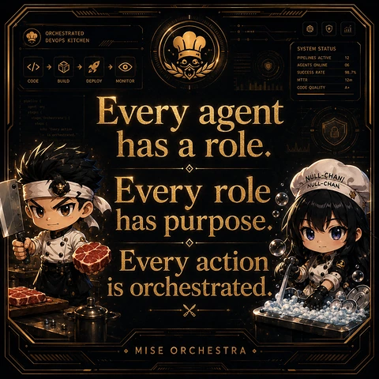

<!-- generated by tools/player-cards/scripts/build-character-pages.mjs from data/characters/null-chan.json; do not edit by hand -->
# Null-chan

**Registry character agent** · Implementation: **Referenced in app code (no dedicated handler)** · Detail record: [`data/characters/null-chan.json`](../../data/characters/null-chan.json)

Every field shows where its value comes from (`source:`). Repo-sourced values cite the repository or source-library file they were read from; values marked `authored: card design` were written for this card by [`enrich-characters.py`](../../tools/player-cards/scripts/enrich-characters.py), derived from the printed card text, role and kitchen theme, and are not claims about existing code.

## Identity

| Field | Value |
|---|---|
| Name | Null-chan source: `data/characters.json` |
| Aliases / printed variants | Null Chan source: `data/agents.json` |
| Role / title | Cleanse source: `characters/null-chan/metadata.json` |
| Kitchen / department | Reliability Kitchen source: `characters/null-chan/metadata.json` |
| Department mission | Observe. Measure. Improve. source: `data/imports/miseos_character_master_inventory_001_300.csv` |
| Registry rarity | Rare source: `characters/null-chan/metadata.json` |
| Level | 19 source: `data/imports/miseos_character_master_inventory_001_300.csv` |
| ID: registry_id | MISE-081 source: `characters/null-chan/metadata.json` |
| ID: character_id | miseos.character.081 source: `data/imports/miseos_character_master_inventory_001_300.csv` |
| ID: card_id | MISE-081 source: `data/imports/miseos_character_master_inventory_001_300.csv` |
| ID: codename | NULL_CHAN source: `data/imports/miseos_character_master_inventory_001_300.csv` |
| Collections | 1×1 Chefs, Studio Art & Screens, Mise Orchestra Trading Cards (Season 1) source: `data/player-cards.json` |
| Cards linked | 3 source: `data/player-cards.json` |

## Player cards

| Card | Collection | Printed title | Match method | Full size |
|---|---|---|---|---|
| `null-chan.webp` | 1×1 Chefs | Null-chan | existing-index | [open](../../assets/player-cards/1by1-chefs/null-chan.webp) |
| `null-chan.webp` | Mise Orchestra Trading Cards (Season 1) | Nul-chan | existing-index | [open](../../assets/player-cards/orchestra-trading-cards/null-chan.webp) |
| `null-chan.webp` | Studio Art & Screens | NULL-CHANL | existing-index | [open](../../assets/player-cards/icloud-screens/null-chan.webp) |

## Card metadata (as printed)

| Field | Value |
|---|---|
| Printed rarity | Rare source: `data/player-cards-ocr.json` |
| Printed stars | Not printed on the card source: `data/player-cards-ocr.json (no stars in OCR)` |
| Printed meters | 100%, 98.7% source: `data/player-cards-ocr.json` |
| Roster stats | power 60 · precision 77 · speed 62 · resilience 66 · intelligence 70 · teamwork 70 source: `data/imports/miseos_character_master_inventory_001_300.csv (roster stats, not OCR)` |
| Abilities | Null Sweep source: `data/imports/mise_orchestra_cards.csv` |
| Mise Orchestra card | role: Plongeur · department: Reliability · function: Cleanse · rarity: Rare · tier: Maintenance Line · element: Void Soap · ability: Null Sweep · lore: Cleans up what is not needed. Keeps the kitchen light. source: `data/imports/mise_orchestra_cards.csv` |
| Lore | Null-chan belongs to the Kitchen Chaos DevOps Universe, where every technical workflow becomes a coordinated brigade station. source: `data/imports/merged_roster.json` |
| Signature phrase | Every Action, then everything else. source: `authored: card design (derived from printed card text/role)` |

Full printed card text (OCR)

**`null-chan.webp`**: AQUASYNC · MISE · 100% · ORCHESTRA · NULLPROTOCOL · NULL · DISHSECURED · ZESTREMOVED · GREASEERASED · SANITYCLEANSED · COMPLETE · Null-chan · Plongeur

**`null-chan.webp`**: MISEORCHESTRA · NO.008 · Null-chan · MO · .. · RARE-MaintenanceLine · Plongeur\|Reliability · ABILITY: NullSweep · Cleans up what is not needed.Keeps the kitchen light. · Element:VoidSoap.Function:Cleanse · CLEANSE · 98 · OBSERVE · 78 · GUARD · 71 · COOK·ORCHESTRATE·DEPLOY · LPROVENANCE-READY · FLOW

**`null-chan.webp`**: ORCHESTRATED · DEVOPS KITCHEN · SYSTEMSTATUS · PIPELINES ACTIVE · 12 · AGENTS ONLINE · 06 · SUCCESS RATE · 98.7% · MTTR · CODE · BUILD · DEPLOY · MONITOR · 12m · CODE QUALITY · A+ · Every agent · pipelin · agent · stages · stage('orchestrate') · steps · has a role. · is orchestrated. · Every role · NULL-CHANL · NULL-CHAN · has purpose. · Every action · is orchestrated · MISEORCHESTRA

## Workflow

| Step | Value |
|---|---|
| Summary | Null-chan performs cleanse within the Reliability Kitchen. source: `characters/null-chan/metadata.json` |
| Inputs | repository context, task request, policy constraints, current evidence source: `characters/null-chan/metadata.json` |
| Outputs | validated result, evidence record, handoff packet source: `characters/null-chan/metadata.json` |
| Proof gate | No merge, deployment, publication, billing action, or mint without evidence. source: `characters/null-chan/metadata.json` |

## Actions / commands

- command: `MISE CLEANSE` source: `data/imports/miseos_character_master_inventory_001_300.csv`

## Implementation

**Status:** Referenced in app code (no dedicated handler)

Application code that uses this entry:
- [`apps/miseos-platform/packages/miseos-repo-pet/src/characters.js:239`](../../apps/miseos-platform/packages/miseos-repo-pet/src/characters.js#L239)

Roster data / types / tests in code that list this entry (not an implementation):
- [`apps/brigade-gallery/src/data/brigade-roster.ts:282`](../../apps/brigade-gallery/src/data/brigade-roster.ts#L282)

Data files that reference it:
- [`apps/gridops-platform/data/miseos-ecosystem-135.json:2656`](../../apps/gridops-platform/data/miseos-ecosystem-135.json#L2656)
- [`apps/registry-atrium/collection-manifest.json:75`](../../apps/registry-atrium/collection-manifest.json#L75)
- [`apps/registry-atrium/metadata/erc721/008-null-chan.json:2`](../../apps/registry-atrium/metadata/erc721/008-null-chan.json#L2)
- [`apps/voxel-world/src/data/miseos-ecosystem-135.json:2656`](../../apps/voxel-world/src/data/miseos-ecosystem-135.json#L2656)
- [`tools/art-factory/input/mise_orchestra_cards.csv:9`](../../tools/art-factory/input/mise_orchestra_cards.csv#L9)
- [`tools/art-factory/input/mise_orchestra_collection_manifest.json:75`](../../tools/art-factory/input/mise_orchestra_collection_manifest.json#L75)
- [`tools/art-factory/output/manifests/krikey_animation_prompts.json:261`](../../tools/art-factory/output/manifests/krikey_animation_prompts.json#L261)
- [`tools/art-factory/output/manifests/mangaboom_comic_prompts.json:261`](../../tools/art-factory/output/manifests/mangaboom_comic_prompts.json#L261)
- [`tools/art-factory/output/merged_roster.json:2339`](../../tools/art-factory/output/merged_roster.json#L2339)

Docs that describe it (docs only, not code):
- [`characters/null-chan/README.md`](../../characters/null-chan/README.md)
- [`apps/brigade-gallery/prototype/holo-card-roster.html:76`](../../apps/brigade-gallery/prototype/holo-card-roster.html#L76)
- [`apps/brigade-gallery/prototype/registry-atrium-gallery.html:342`](../../apps/brigade-gallery/prototype/registry-atrium-gallery.html#L342)
- [`apps/developer-platform/docs/characters/CHARACTER_REGISTRY_001_300.md:19`](../../apps/developer-platform/docs/characters/CHARACTER_REGISTRY_001_300.md#L19)
- [`apps/miseos-platform/packages/miseos-repo-pet/README.md:63`](../../apps/miseos-platform/packages/miseos-repo-pet/README.md#L63)
- [`apps/miseos-platform/packages/miseos-repo-pet/docs/MASCOT_REFERENCE.md:21`](../../apps/miseos-platform/packages/miseos-repo-pet/docs/MASCOT_REFERENCE.md#L21)
- [`apps/registry-atrium/index.html:342`](../../apps/registry-atrium/index.html#L342)

implemented_in_code = a dedicated capability handler or tool directory exists; referenced_in_app_code = the entity is used by application source (e.g. repo-pet sprites, CLI) but has no dedicated handler. code_refs are files that reference this entity by name/slug/handler (grep), not a guarantee of a dedicated runtime; registry handler links point at the actual capability function.

## Where and how it helps

| Aspect | Value |
|---|---|
| Station / stage | Reliability Kitchen source: `characters/null-chan/metadata.json` |
| Mission | Observe. Measure. Improve. source: `data/imports/miseos_character_master_inventory_001_300.csv` |
| Problem it addresses | Null-chan performs cleanse within the Reliability Kitchen. source: `characters/null-chan/metadata.json` |
| Safety gate | No merge, deployment, publication, billing action, or mint without evidence. source: `characters/null-chan/metadata.json` |

## Agents and repo pets

Agents: [Null Chan](../agents/null-chan.md) source: `data/agents.json`

Repo pets: [Null-chan](../repo-pets/null-chan.md) source: `data/repo-pets.json`

## Related characters

[SLO Sage](./slo-sage.md) · [Trace Sensei](./trace-sensei.md) · [Chaos Kaito](./chaos-kaito.md) source: `data/imports/miseos_character_master_inventory_001_300.csv`

## Sources

| Field | Source |
|---|---|
| name | `data/characters.json` |
| cards | `data/player-cards.json` |
| card_text | `data/player-cards-ocr.json (OCR of the card image)` |
| card_rarity_printed | `data/player-cards-ocr.json` |
| card_meters_printed | `data/player-cards-ocr.json` |
| ids.registry_id | `characters/null-chan/metadata.json` |
| role | `characters/null-chan/metadata.json` |
| department | `characters/null-chan/metadata.json` |
| rarity | `characters/null-chan/metadata.json` |
| workflow.summary | `characters/null-chan/metadata.json` |
| workflow.inputs | `characters/null-chan/metadata.json` |
| workflow.outputs | `characters/null-chan/metadata.json` |
| workflow.proof_gate | `characters/null-chan/metadata.json` |
| department_mission | `data/imports/miseos_character_master_inventory_001_300.csv` |
| ids.character_id | `data/imports/miseos_character_master_inventory_001_300.csv` |
| ids.card_id | `data/imports/miseos_character_master_inventory_001_300.csv` |
| ids.codename | `data/imports/miseos_character_master_inventory_001_300.csv` |
| stats | `data/imports/miseos_character_master_inventory_001_300.csv (roster stats, not OCR)` |
| level | `data/imports/miseos_character_master_inventory_001_300.csv` |
| related | `data/imports/miseos_character_master_inventory_001_300.csv` |
| lore | `data/imports/merged_roster.json` |
| orchestra_card | `data/imports/mise_orchestra_cards.csv` |
| abilities | `data/imports/mise_orchestra_cards.csv` |
| implementation | `git ls-files grep + repo` |
| helps.station | `characters/null-chan/metadata.json` |
| agents | `data/agents.json` |
| repo_pets | `data/repo-pets.json` |
| aliases | `data/agents.json` |
| card_stars_printed | `data/player-cards-ocr.json (no stars in OCR)` |
| signature_phrase | `authored: card design (derived from printed card text/role)` |
| theme | `authored: card design (keyword theme used for authored fields)` |

[← All characters](./README.md)
