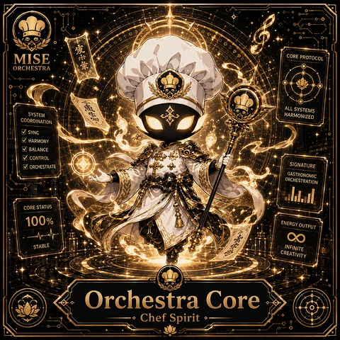
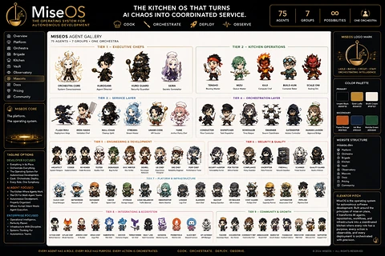
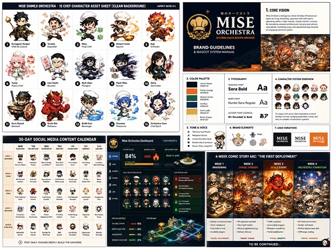
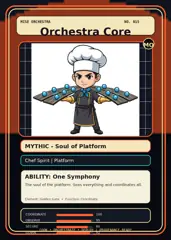

<!-- generated by tools/player-cards/scripts/build-character-pages.mjs from data/characters/orchestra-core.json; do not edit by hand -->
# Orchestra Core

**Registry character agent** · Implementation: **Referenced in app code (no dedicated handler)** · Detail record: [`data/characters/orchestra-core.json`](../../data/characters/orchestra-core.json)

Every field shows where its value comes from (`source:`). Repo-sourced values cite the repository or source-library file they were read from; values marked `authored: card design` were written for this card by [`enrich-characters.py`](../../tools/player-cards/scripts/enrich-characters.py), derived from the printed card text, role and kitchen theme, and are not claims about existing code.

## Identity

| Field | Value |
|---|---|
| Name | Orchestra Core source: `data/characters.json` |
| Aliases / printed variants | aCore source: `card titles / OCR in data/player-cards-ocr.json` |
| Role / title | Coordinate source: `characters/orchestra-core/metadata.json` |
| Kitchen / department | Platform Kitchen source: `characters/orchestra-core/metadata.json` |
| Department mission | Provide golden paths and stable service foundations. source: `data/imports/miseos_character_master_inventory_001_300.csv` |
| Registry rarity | Mythic source: `characters/orchestra-core/metadata.json` |
| Level | 36 source: `data/imports/miseos_character_master_inventory_001_300.csv` |
| ID: registry_id | MISE-087 source: `characters/orchestra-core/metadata.json` |
| ID: character_id | miseos.character.087 source: `data/imports/miseos_character_master_inventory_001_300.csv` |
| ID: card_id | MISE-087 source: `data/imports/miseos_character_master_inventory_001_300.csv` |
| ID: codename | ORCHESTRA_CORE source: `data/imports/miseos_character_master_inventory_001_300.csv` |
| Collections | 1×1 Chefs, Character Building Theme, Mise Orchestra Trading Cards (Season 1) source: `data/player-cards.json` |
| Cards linked | 4 source: `data/player-cards.json` |

## Player cards

| Card | Collection | Printed title | Match method | Full size |
|---|---|---|---|---|
| `acore.webp` | 1×1 Chefs | aCore | title | [open](../../assets/player-cards/1by1-chefs/acore.webp) |
| `orchestra-core.webp` | Character Building Theme | ORCHESTRA CORE | existing-index | [open](../../assets/player-cards/character-building/orchestra-core.webp) |
| `orchestra-core-2.webp` | Character Building Theme | Orchestra Core | existing-index | [open](../../assets/player-cards/character-building/orchestra-core-2.webp) |
| `orchestra-core.webp` | Mise Orchestra Trading Cards (Season 1) | Orchestra_Core | existing-index | [open](../../assets/player-cards/orchestra-trading-cards/orchestra-core.webp) |

## Card metadata (as printed)

| Field | Value |
|---|---|
| Printed rarity | Mythic source: `data/player-cards-ocr.json` |
| Printed stars | Not printed on the card source: `data/player-cards-ocr.json (no stars in OCR)` |
| Printed meters | 100%, 68%, 81%, 84% source: `data/player-cards-ocr.json` |
| Roster stats | power 73 · precision 92 · speed 75 · resilience 79 · intelligence 76 · teamwork 90 source: `data/imports/miseos_character_master_inventory_001_300.csv (roster stats, not OCR)` |
| Abilities | One Symphony source: `data/imports/mise_orchestra_cards.csv` |
| Mise Orchestra card | role: Chef Spirit · department: Platform · function: Coordinate · rarity: Mythic · tier: Soul of Platform · element: Golden Gate · ability: One Symphony · lore: The soul of the platform. Sees everything and coordinates all. source: `data/imports/mise_orchestra_cards.csv` |
| Lore | Orchestra Core belongs to the Kitchen Chaos DevOps Universe, where every technical workflow becomes a coordinated brigade station. source: `data/imports/merged_roster.json` |
| Signature phrase | No srott left to chance. source: `authored: card design (derived from printed card text/role)` |

Full printed card text (OCR)

**`acore.webp`**: MISE · COREPROTOCOL · ORCHESTRA · ALL SYSTEMS · SYSTEM · HARMONIZED · COORDINATION ·  SYNC ·  HARMONY · BALANCE ·  CONTROL · SIGNATURE · ORCHESTRATE · GASTRONOMIC · ORCHESTRATION · CORE STATUS · 100% · ENERGYOUTPUT · STABLE · INFINITE · CREATIVITY · Orchestra · Core · Chef Spirit

**`orchestra-core.webp`**: MiseOS · THEKITCHENOSTHATTURNS · 75 · AICHAOSINTOCOORDINATEDSERVICE. · AGENTS · THE OPERATING SYSTEM FOR · GROUPS · POSSIBILITIES · ONE ORCHESTRA · COOK · ORCHESTRATE · DEPLOY · AUTONOMOUS DEVELOPMENT · OBSERVE · Overview · MISEOS AGENT GALLERY · MISEOS LOGO MARK · Platform · 75 AGENTS · 7 GROUPS - ONE ORCHESTRA · TIER1-EXECUTIVECHEFS · Orchestra · TIER2-KITCHENOPERATIONS · Brigade · Kitchen · Vault · LADLE·BATONCIRCUIT·STAFF · Observatory · ORCHESTRATINGINTELLIGENCE · Mascots · Docs · MIZU · KAJI · BUILD-KUN · SCALEONI · ORCHESTRA CORE · KUROGAMI · KURO GUARD · SEIRA · COLOR PALETTE · Routing Matter · Oueue Master · Compute Chef · Container Beker · Agent Director · Security Guardian · Secrets Sommelier · Saling Ow · Pricing · PRIMARY · Community · TIER3-SERVICELAYER · TIER4-ORCHESTRATIONLAYER · Black · srott · wOOEF10 · D4AF37 · MISEOSCORE · SECONDARY · The platform. · The operating system. · Irk Sfue · ES7822 · Matche Green · FLASH RIKU · IRON HASHI · NULL-CHAN · CONDUCTOR · DISPATCHER · GATEKEEPER · HUMAN LIAISON · 8182A41 · STREAMA · UMAMICODE · SWARMER · TUME · A2E684E · ds drureo · Stream Master · AP1 Saucer · Swarm Coord · Access Control · FlowConductor · Aoprevr Bridpe · TIER5-ENGINEERING&DEVELOPMENT · SECURITY&QUALITY · TIER6 · WEBSITESTRUCTURE · miseos.dev · Platform · TAGLINEOPTIONS ·  Orchestra · DEVELOPERFOCUSED · 曲Brigade · 白Kitchen · +Eve · verything InItsPlace · QUALJITY GUARD · DOC WRITER · Orchestrate Everything · ARCHITECT · CODER · REVIEWER · TESTER · DESUGGER · DEVREL · SRE CHEF · PERFCHEF · PENTESTER · ENCRYPTOR · FREWAL · UXCHEF · @Vault · Qualty Chef · Dox Sorbe · Polky Guwdian · Teet Scarre · Code Rlevieaer · SugHunte · WherabinyHurter · GuainyEroce · The Operating System For · Mascots · Cook, Orchestrate.Deploy · PLATORIM&INFRASTRUCTURE · • Every Role, One Symphony. · Pricing · AIAGENT FOCUSED · The OS For Muti-Agent Teams · ELEVATORPITCH · DATABASE · LOAD BALANCER · CBSERVATOR · NETWORKER · BACKUP · CAPACITY · Properly Organized. · Nietnodk Chef · Speed Chuf · Log Onuf · Alent Ouf · FeOp Ouf · mtien Chef · Ppeine Chet · Ciouf wegler · rege Seeper · Tieik Balascer · Metie Wther · RANtet · Capeily Raw · MiseOS is the operating system · Bachip Guedian ·  Where Human Intent Meets · for autonomous software · Agent Execution. · principles of mise en place, · development, Bollt around the · TIER8-INTEGRATIONS&ECOSYSTEM · TIER9 · COMMUNITY&GROWTH · ENTERPRISEFOCUSED · it transforms Al agents, · repositofres, workflows, and · Perfectly Placed. · infrastructure into a coordinated · kitchen where every role has a · : Systems Thinking For · purpose, every action is · Autonomous Teams. · ARGO CHEF · SACX BOT · API GATEWAY · observable, and every · GITHUDCHEF · DOCXE · DATADOG · Argo Pier · Meistik · AnManuger · ring Unk · DiowrdCemet · deployment is orchestrated · with precision. · EVERYAGENT HASAROLE.EVERYROLEHASPURPOSE.EVERYACTION ISORCHESTRATED. · ORCHESTRATE. · COOK. · DEPLOY,OBSERVE. · @ 2024 MISEOS - ALL RIGHTS RESERVED

**`orchestra-core-2.webp`**: MISESHIMEJIORCHESTRA·15CHEFCHARACTERASSETSHEET(CLEANBACKGROUND) · ASPECT RATIO4:3 · 1.COREVISION · 味の才 · MISE · Mise Orchestra reimagines critical DevOps infrastructure · Suads joapeypsuederSuegeaqtegsesale · oeratingwinhighelocly.chaoticitchnune · quesmatigod · woushsaeutububetusue · onal logs become · ORCHESTRA · KITCHEN CHAOS DEVOPS UNIVERSE · Kurogami Senpai · Mizu · Tenshe · Umami Code · Chef de Cuisine · Prep Chef · Kaji · xpediter · Saucier · Grillardin · BRANDGUIDELINES · &MASCOTSYSTEMMANUAL · 2.COLORPALETTE · 3. TYPOGRAPHY · 4. CHARACTER SYSTEM OVERVIEW · Null-chan · Yume · Iron Hashi · Flash Riku · Seira · 10 · Umami Black · HEADING FONT · Pastry Chef · Plongeur · Runner · mmelier · WOEOF10 · Aa · Flame Orange · Sora Bold · WE97822 · Matcha Green · R2E684E · BODY FONT · Nunito Sans Regular · Aa · Ink Blue · 1B2A41 · SD4AF37 · Gold Ladle · ACCENT FONT (COMICS) · 15 unique chefspirits. Each represents actitical · M+ Rounded e Bold · Broth Cream · Dsfuctionbingingnyhmot · WF6F1E7 · story to complex intrastructure systems. · Kuro Guard · Scale Oni · Bulld-Kun · Streama · 12 · Boulanger · Orchestra Core · Rotisseur · Poissonier · Chef Spirit · 5.TONE&VOICE · 6. BRAND ELEMENTS · 7, LOGO VARIATIONS · ical but Playlul · MISE · MISE · 3O-DAYSOCIALMEDIACONTENTCALENDAR · veStyie · MISE · Mise Orchestra Dashboard · LAEKTOENOIS · ORCHESTRA · ORCHESTRA · ORCHESTRA · MON · TUE · WED · FRI · SAT · LORE OROR · SUN · OMOS CONeC · SISTEKEPAN · AIUS JX0GONE · SISTIE SARUS · INCODIT LEVEL · DEROMENT OS · 84% · READYTOSERVE · HIGH · WEEX1 · 4-WEEKCOMICSTORYARC:“THEFIRSTDEPLOYMENT" · ARASIENG · Cuchen · WEEK1 · WEEK2 · WEEK3 · Urhene Opets · t a Xthen? · Goes Dosn · WEEK4 · AWAKENING · CHAOS SPREADS · SCALEEVENT · ORCHESTRAFORMATION · DHEF ORCESTRASTATU · WEEX2 · UNE INCOEXT FEEO · CVCObrokon · Fix The · DeleeyLoup · KitcenPol · WEEX3 · SCALE · Eohes · LooET · Landh · Pou · Starts · WEEX · AOSTR · Peflec · FralBots · Indet · Drployrert Dia · Wote · XITCHEN METRICS · SYSTEN HAP · APIgateway overload ·  Fieingrstation · · Autoscaling triggers · Chets intro · DCSRA DEAS · · System self-heals · - Missing ingredients bug · 68% · - Perfect deployment dish · • Delivery failures · DenOgTp · he! · Odengt · QUBLE BUFRER · • Partial stabilitation · Seenes · Simletion · THEME:CHAOS · THEME:BEGINNINGS · THEME:GROWTH · METAORK SAUCERON · 81% · THEME:HARMONY · POST DAILY.ENGAGE DEEPLY,BUILD THEUNIVERSE. · TOBECONTINUED..

**`orchestra-core.webp`**: MISE ORCHESTRA · NO.015 · OrchestraCore · MO · MYTHIC-Soul ofPlatform · Chef Spirit\|Platform · ABILITY:OneSymphony · The soul of the platform. Sees everything and coordinates all · Element:GoldenGate.Function:Coordinate · COORDINATE · 100 · OBSERVE · 95 · SECURE · 86 · ORCHESTRATE·DEPLOY · COOK · PROVENANCE-READY · LEARN

## Workflow

| Step | Value |
|---|---|
| Summary | Orchestra Core performs coordinate within the Platform Kitchen. source: `characters/orchestra-core/metadata.json` |
| Inputs | repository context, task request, policy constraints, current evidence source: `characters/orchestra-core/metadata.json` |
| Outputs | validated result, evidence record, handoff packet source: `characters/orchestra-core/metadata.json` |
| Proof gate | No merge, deployment, publication, billing action, or mint without evidence. source: `characters/orchestra-core/metadata.json` |

## Actions / commands

- command: `MISE COORDINATE` source: `data/imports/miseos_character_master_inventory_001_300.csv`

## Implementation

**Status:** Referenced in app code (no dedicated handler)

Application code that uses this entry:
- [`apps/brigade-gallery/src/components/MasterRosterGallery.tsx:94`](../../apps/brigade-gallery/src/components/MasterRosterGallery.tsx#L94)
- [`apps/miseos-platform/packages/miseos-repo-pet/bin/mise-roam.mjs:11`](../../apps/miseos-platform/packages/miseos-repo-pet/bin/mise-roam.mjs#L11)
- [`apps/miseos-platform/packages/miseos-repo-pet/src/characters.js:47`](../../apps/miseos-platform/packages/miseos-repo-pet/src/characters.js#L47)
- [`apps/miseos-platform/packages/miseos-repo-pet/src/repo-roamer.js:43`](../../apps/miseos-platform/packages/miseos-repo-pet/src/repo-roamer.js#L43)
- [`tools/repo-pet/bin/mise-roam.mjs:10`](../../tools/repo-pet/bin/mise-roam.mjs#L10)
- [`tools/repo-pet/src/characters.js:145`](../../tools/repo-pet/src/characters.js#L145)
- [`tools/repo-pet/src/repo-roamer.js:87`](../../tools/repo-pet/src/repo-roamer.js#L87)

Roster data / types / tests in code that list this entry (not an implementation):
- [`apps/brigade-gallery/src/data/brigade-roster.ts:24`](../../apps/brigade-gallery/src/data/brigade-roster.ts#L24)
- [`apps/brigade-gallery/src/data/master-roster.ts:79`](../../apps/brigade-gallery/src/data/master-roster.ts#L79)
- [`apps/brigade-gallery/src/types/master-roster.ts:66`](../../apps/brigade-gallery/src/types/master-roster.ts#L66)
- [`apps/miseos-platform/packages/miseos-repo-pet/test/smoke.mjs:10`](../../apps/miseos-platform/packages/miseos-repo-pet/test/smoke.mjs#L10)
- [`tools/repo-pet/test/smoke.mjs:6`](../../tools/repo-pet/test/smoke.mjs#L6)

Data files that reference it:
- [`apps/gridops-platform/data/miseos-ecosystem-135.json:1850`](../../apps/gridops-platform/data/miseos-ecosystem-135.json#L1850)
- [`apps/miseos-platform/packages/miseos-repo-pet/package.json:11`](../../apps/miseos-platform/packages/miseos-repo-pet/package.json#L11)
- [`apps/registry-atrium/collection-manifest.json:138`](../../apps/registry-atrium/collection-manifest.json#L138)
- [`apps/registry-atrium/metadata/erc721/015-orchestra-core.json:2`](../../apps/registry-atrium/metadata/erc721/015-orchestra-core.json#L2)
- [`apps/voxel-world/src/data/miseos-ecosystem-135.json:1850`](../../apps/voxel-world/src/data/miseos-ecosystem-135.json#L1850)
- [`tools/art-factory/input/mise_orchestra_cards.csv:16`](../../tools/art-factory/input/mise_orchestra_cards.csv#L16)
- [`tools/art-factory/input/mise_orchestra_collection_manifest.json:138`](../../tools/art-factory/input/mise_orchestra_collection_manifest.json#L138)
- [`tools/art-factory/output/manifests/krikey_animation_prompts.json:57`](../../tools/art-factory/output/manifests/krikey_animation_prompts.json#L57)
- [`tools/art-factory/output/manifests/mangaboom_comic_prompts.json:57`](../../tools/art-factory/output/manifests/mangaboom_comic_prompts.json#L57)
- [`tools/art-factory/output/merged_roster.json:582`](../../tools/art-factory/output/merged_roster.json#L582)

Docs that describe it (docs only, not code):
- [`characters/orchestra-core/README.md`](../../characters/orchestra-core/README.md)
- [`apps/brigade-gallery/prototype/holo-card-roster.html:76`](../../apps/brigade-gallery/prototype/holo-card-roster.html#L76)
- [`apps/brigade-gallery/prototype/registry-atrium-gallery.html:342`](../../apps/brigade-gallery/prototype/registry-atrium-gallery.html#L342)
- [`apps/developer-platform/docs/characters/CHARACTER_REGISTRY_001_300.md:15`](../../apps/developer-platform/docs/characters/CHARACTER_REGISTRY_001_300.md#L15)
- [`apps/miseos-platform/packages/miseos-repo-pet/README.md:5`](../../apps/miseos-platform/packages/miseos-repo-pet/README.md#L5)
- [`apps/miseos-platform/packages/miseos-repo-pet/docs/MASCOT_REFERENCE.md:28`](../../apps/miseos-platform/packages/miseos-repo-pet/docs/MASCOT_REFERENCE.md#L28)
- [`apps/registry-atrium/index.html:342`](../../apps/registry-atrium/index.html#L342)
- [`tools/repo-pet/README.md:129`](../../tools/repo-pet/README.md#L129)
- [`tools/repo-pet/docs/MASCOT_REFERENCE.md:23`](../../tools/repo-pet/docs/MASCOT_REFERENCE.md#L23)

implemented_in_code = a dedicated capability handler or tool directory exists; referenced_in_app_code = the entity is used by application source (e.g. repo-pet sprites, CLI) but has no dedicated handler. code_refs are files that reference this entity by name/slug/handler (grep), not a guarantee of a dedicated runtime; registry handler links point at the actual capability function.

## Where and how it helps

| Aspect | Value |
|---|---|
| Station / stage | Platform Kitchen source: `characters/orchestra-core/metadata.json` |
| Mission | Provide golden paths and stable service foundations. source: `data/imports/miseos_character_master_inventory_001_300.csv` |
| Problem it addresses | Orchestra Core performs coordinate within the Platform Kitchen. source: `characters/orchestra-core/metadata.json` |
| Safety gate | No merge, deployment, publication, billing action, or mint without evidence. source: `characters/orchestra-core/metadata.json` |

## Agents and repo pets

Agents: [Orchestra Core](../agents/orchestra-core.md) source: `data/agents.json`

Repo pets: [Orchestra Core](../repo-pets/orchestra-core.md) source: `data/repo-pets.json`

## Related characters

[Template Tanaka](./template-tanaka.md) · [Bootstrap Aiko](./bootstrap-aiko.md) · [Terra Forge](./terra-forge.md) source: `data/imports/miseos_character_master_inventory_001_300.csv`

## Canon Bible

Mentioned in [`docs/canon/MiseOS-Canon-Bible-v1.0.pdf`](../../docs/canon/MiseOS-Canon-Bible-v1.0.pdf):

- line 531: `MISE-G2-P029 Orchestra Core Mise Orchestra canonical-candidate 1E3334AB-3111- 29`

## Sources

| Field | Source |
|---|---|
| name | `data/characters.json` |
| aliases | `card titles / OCR in data/player-cards-ocr.json` |
| cards | `data/player-cards.json` |
| card_text | `data/player-cards-ocr.json (OCR of the card image)` |
| card_rarity_printed | `data/player-cards-ocr.json` |
| card_meters_printed | `data/player-cards-ocr.json` |
| ids.registry_id | `characters/orchestra-core/metadata.json` |
| role | `characters/orchestra-core/metadata.json` |
| department | `characters/orchestra-core/metadata.json` |
| rarity | `characters/orchestra-core/metadata.json` |
| workflow.summary | `characters/orchestra-core/metadata.json` |
| workflow.inputs | `characters/orchestra-core/metadata.json` |
| workflow.outputs | `characters/orchestra-core/metadata.json` |
| workflow.proof_gate | `characters/orchestra-core/metadata.json` |
| department_mission | `data/imports/miseos_character_master_inventory_001_300.csv` |
| ids.character_id | `data/imports/miseos_character_master_inventory_001_300.csv` |
| ids.card_id | `data/imports/miseos_character_master_inventory_001_300.csv` |
| ids.codename | `data/imports/miseos_character_master_inventory_001_300.csv` |
| stats | `data/imports/miseos_character_master_inventory_001_300.csv (roster stats, not OCR)` |
| level | `data/imports/miseos_character_master_inventory_001_300.csv` |
| related | `data/imports/miseos_character_master_inventory_001_300.csv` |
| lore | `data/imports/merged_roster.json` |
| orchestra_card | `data/imports/mise_orchestra_cards.csv` |
| abilities | `data/imports/mise_orchestra_cards.csv` |
| canon_bible | `docs/canon/MiseOS-Canon-Bible-v1.0.pdf (pdftotext)` |
| implementation | `git ls-files grep + repo` |
| helps.station | `characters/orchestra-core/metadata.json` |
| agents | `data/agents.json` |
| repo_pets | `data/repo-pets.json` |
| card_stars_printed | `data/player-cards-ocr.json (no stars in OCR)` |
| signature_phrase | `authored: card design (derived from printed card text/role)` |
| theme | `authored: card design (keyword theme used for authored fields)` |

[← All characters](./README.md)
