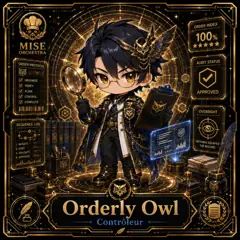

<!-- generated by tools/player-cards/scripts/build-character-pages.mjs from data/characters/orderly-owl.json; do not edit by hand -->
# Orderly Owl

**Card-defined chef (catalogue: visual reference only)** · Implementation: **Designed (not yet implemented in code)** · Detail record: [`data/characters/orderly-owl.json`](../../data/characters/orderly-owl.json)

Every field shows where its value comes from (`source:`). Repo-sourced values cite the repository or source-library file they were read from; values marked `authored: card design` were written for this card by [`enrich-characters.py`](../../tools/player-cards/scripts/enrich-characters.py), derived from the printed card text, role and kitchen theme, and are not claims about existing code.

## Identity

| Field | Value |
|---|---|
| Name | Orderly Owl source: `data/imports/photo-alignment.csv` |
| Aliases / printed variants | Review Ren (canon crosswalk, provisional) source: `docs/source-library/icloud/Catalogue/All images/Mise/MiseOS Bible/MiseOS-Canon-Bible-v1.0-package.zip/miseos_canon_bible_v1_0/registry/asset-registry.csv` |
| Role / title | Controleur source: `data/player-cards-ocr.json (subtitle printed under the name)` |
| Kitchen / department | Reliability Kitchen source: `docs/source-library/icloud/Catalogue/All images/Mise/MiseOS Bible/MiseOS-Canon-Bible-v1.0-package.zip/miseos_canon_bible_v1_0/registry/asset-registry.csv → data/characters/review-ren.json` |
| Department mission | Observe. Measure. Improve. source: `data/imports/miseos_character_master_inventory_001_300.csv (mission of Reliability Kitchen)` |
| Registry rarity | Common source: `docs/source-library/icloud/Catalogue/All images/Mise/MiseOS Bible/MiseOS-Canon-Bible-v1.0-package.zip/miseos_canon_bible_v1_0/registry/asset-registry.csv → data/characters/review-ren.json` |
| Collections | 1×1 Chefs source: `data/player-cards.json` |
| Cards linked | 1 source: `data/player-cards.json` |
| Catalogue status | visual_reference_only source: `data/imports/photo-alignment.csv` |

## Player cards

| Card | Collection | Printed title | Match method | Full size |
|---|---|---|---|---|
| `orderly-owl.webp` | 1×1 Chefs | Orderly Owl | title | [open](../../assets/player-cards/1by1-chefs/orderly-owl.webp) |

## Card metadata (as printed)

| Field | Value |
|---|---|
| Printed rarity | Not printed on the card source: `data/player-cards-ocr.json (no rarity word in OCR)` |
| Printed stars | 5 source: `data/player-cards-ocr.json` |
| Printed meters | Not printed on the card source: `data/player-cards-ocr.json (no % meters in OCR)` |
| Roster stats | power 83 · precision 89 · speed 87 · resilience 86 · intelligence 84 · teamwork 87 source: `authored: card design (6-axis roster scale; baseline from stars + theme "time")` |
| Abilities | Order Index, Order Protocol, Audit Status, Organize, Verify, Align source: `data/player-cards-ocr.json (printed card labels, glued OCR words segmented)` |
| Lore | Picture the ticket rail at full stretch, every slip in order: that is where Orderly Owl is happiest. As Reliability Kitchen's specialist for controleur, Orderly Owl holds the rhythm of service: sequencing tickets, staffing and timing so every station fires at the right moment. The card calls out Order Index, Order Protocol, Audit Status: the checks Orderly Owl runs before calling anything ready. In the canon crosswalk this card is a provisional match for Review Ren. source: `authored: card design (derived from printed card text/role)` |
| Signature phrase | Every ticket, on time. source: `authored: card design (derived from printed card text/role)` |

Full printed card text (OCR)

**`orderly-owl.webp`**: ORDERINDEX · 100 · MISE · ★★★★★ · ORCHESTRA · ORDERPROTOCOL · AUDIT STATUS · ORGANIZE · VERIFY · ALIGN · APPROVED · CONTROL · COMPLETE · OVERSIGHT · SEQUENCELOG · NOTHING ESCAPES · 1.INITIATE · THE RECORD. · 2.SORT · 3. VALIDATE · 4.APPROVE · Orderly · Owl · Controleur

## Workflow

| Step | Value |
|---|---|
| Summary | Orderly Owl holds the rhythm of service: sequencing tickets, staffing and timing so every station fires at the right moment. source: `authored: card design (theme "time")` |
| Inputs | open tickets, station capacity, shift roster, service timeline source: `authored: card design (theme "time")` |
| Outputs | fire order / run sheet, shift handoff note, bottleneck alert source: `authored: card design (theme "time")` |
| Proof gate | Expo check: a course is fired only when every component reports ready; handoffs require a written note. source: `authored: card design (theme "time")` |

## Actions / commands

- command: `mise roster run orderly-owl --dept reliability-kitchen --solo --emit report` · status: `proposed` source: `authored: follows data/imports/master-roster-cards.csv (mise roster run command convention)`
- command: `mise orderly-owl fire` · reads: `open tickets` · emits: `fire order / run sheet` · status: `proposed` source: `authored: card design (theme "time")`
- command: `mise orderly-owl handoff` · reads: `station capacity` · emits: `shift handoff note` · status: `proposed` source: `authored: card design (theme "time")`
- command: `mise orderly-owl rebalance` · reads: `shift roster` · emits: `bottleneck alert` · status: `proposed` source: `authored: card design (theme "time")`

## Implementation

**Status:** Designed (not yet implemented in code)

- Proposed handler: `orderlyOwl` (not written yet)
- Proposed command: `mise roster run orderly-owl --dept reliability-kitchen --solo --emit report`
- Contract: inputs: open tickets, station capacity, shift roster, service timeline → outputs: fire order / run sheet, shift handoff note, bottleneck alert; refuses to emit 'ready' unless the proof gate passes

source: `git ls-files grep + repo (no code found) + authored: proposed handler spec`

implemented_in_code = a dedicated capability handler or tool directory exists; referenced_in_app_code = the entity is used by application source (e.g. repo-pet sprites, CLI) but has no dedicated handler. code_refs are files that reference this entity by name/slug/handler (grep), not a guarantee of a dedicated runtime; registry handler links point at the actual capability function.

## Where and how it helps

| Aspect | Value |
|---|---|
| Station / stage | Controleur source: `data/player-cards-ocr.json (subtitle printed under the name)` |
| Mission | Observe. Measure. Improve. source: `data/imports/miseos_character_master_inventory_001_300.csv (mission of Reliability Kitchen)` |
| Problem it addresses | Without a conductor, stations fire out of sequence and work arrives cold or late. source: `authored: card design (theme "time")` |
| Safety gate | Expo check: a course is fired only when every component reports ready; handoffs require a written note. source: `authored: card design (theme "time")` |

## Agents and repo pets

Agents: [Conductor](../agents/conductor.md) · [Scheduler](../agents/scheduler.md) · [Tensho](../agents/tensho.md) source: `authored: card design (closest agents for theme "time")`

Repo pets: [Orderly Owl](../repo-pets/orderly-owl.md) source: `data/repo-pets.json`

## Related characters

[Review Ren](./review-ren.md) · [Energy Keeper](./energy-keeper.md) · [Kitchen Conductor](./kitchen-conductor.md) · [Pulse Captain](./pulse-captain.md) · [Reliability Sensei](./reliability-sensei.md) · [Trace Sensei](./trace-sensei.md) source: `docs/source-library/icloud/Catalogue/All images/Mise/MiseOS Bible/MiseOS-Canon-Bible-v1.0-package.zip/miseos_canon_bible_v1_0/registry/asset-registry.csv (canon counterpart) + authored: card design (same theme "time" / same department)`

## Sources

| Field | Source |
|---|---|
| name | `data/imports/photo-alignment.csv` |
| cards | `data/player-cards.json` |
| card_text | `data/player-cards-ocr.json (OCR of the card image)` |
| card_stars_printed | `data/player-cards-ocr.json` |
| role | `data/player-cards-ocr.json (subtitle printed under the name)` |
| catalogue_status | `data/imports/photo-alignment.csv` |
| implementation | `git ls-files grep + repo (no code found) + authored: proposed handler spec` |
| helps.station | `data/player-cards-ocr.json (subtitle printed under the name)` |
| repo_pets | `data/repo-pets.json` |
| aliases | `docs/source-library/icloud/Catalogue/All images/Mise/MiseOS Bible/MiseOS-Canon-Bible-v1.0-package.zip/miseos_canon_bible_v1_0/registry/asset-registry.csv` |
| department | `docs/source-library/icloud/Catalogue/All images/Mise/MiseOS Bible/MiseOS-Canon-Bible-v1.0-package.zip/miseos_canon_bible_v1_0/registry/asset-registry.csv → data/characters/review-ren.json` |
| department_mission | `data/imports/miseos_character_master_inventory_001_300.csv (mission of Reliability Kitchen)` |
| card_rarity_printed | `data/player-cards-ocr.json (no rarity word in OCR)` |
| card_meters_printed | `data/player-cards-ocr.json (no % meters in OCR)` |
| rarity | `docs/source-library/icloud/Catalogue/All images/Mise/MiseOS Bible/MiseOS-Canon-Bible-v1.0-package.zip/miseos_canon_bible_v1_0/registry/asset-registry.csv → data/characters/review-ren.json` |
| stats | `authored: card design (6-axis roster scale; baseline from stars + theme "time")` |
| abilities | `data/player-cards-ocr.json (printed card labels, glued OCR words segmented)` |
| lore | `authored: card design (derived from printed card text/role)` |
| signature_phrase | `authored: card design (derived from printed card text/role)` |
| workflow.summary | `authored: card design (theme "time")` |
| workflow.inputs | `authored: card design (theme "time")` |
| workflow.outputs | `authored: card design (theme "time")` |
| workflow.proof_gate | `authored: card design (theme "time")` |
| actions | `authored: follows data/imports/master-roster-cards.csv (mise roster run command convention)` |
| helps.mission | `data/imports/miseos_character_master_inventory_001_300.csv (mission of Reliability Kitchen)` |
| helps.problem | `authored: card design (theme "time")` |
| helps.proof_gate | `authored: card design (theme "time")` |
| agents | `authored: card design (closest agents for theme "time")` |
| related | `docs/source-library/icloud/Catalogue/All images/Mise/MiseOS Bible/MiseOS-Canon-Bible-v1.0-package.zip/miseos_canon_bible_v1_0/registry/asset-registry.csv (canon counterpart) + authored: card design (same theme "time" / same department)` |
| theme | `authored: card design (keyword theme used for authored fields)` |

[← All characters](./README.md)
