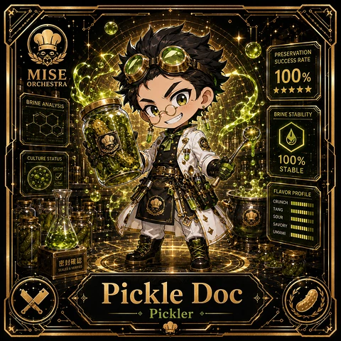

<!-- generated by tools/player-cards/scripts/build-character-pages.mjs from data/characters/pickle-doc.json; do not edit by hand -->
# Pickle Doc

**Card-defined chef (catalogue: visual reference only)** · Implementation: **Designed (not yet implemented in code)** · Detail record: [`data/characters/pickle-doc.json`](../../data/characters/pickle-doc.json)

Every field shows where its value comes from (`source:`). Repo-sourced values cite the repository or source-library file they were read from; values marked `authored: card design` were written for this card by [`enrich-characters.py`](../../tools/player-cards/scripts/enrich-characters.py), derived from the printed card text, role and kitchen theme, and are not claims about existing code.

## Identity

| Field | Value |
|---|---|
| Name | Pickle Doc source: `data/imports/photo-alignment.csv` |
| Aliases / printed variants | Reserve Rune (canon crosswalk, provisional) source: `docs/source-library/icloud/Catalogue/All images/Mise/MiseOS Bible/MiseOS-Canon-Bible-v1.0-package.zip/miseos_canon_bible_v1_0/registry/asset-registry.csv` |
| Role / title | Pickler source: `data/player-cards-ocr.json (subtitle printed under the name)` |
| Kitchen / department | Operations Kitchen source: `docs/source-library/icloud/Catalogue/All images/Mise/MiseOS Bible/MiseOS-Canon-Bible-v1.0-package.zip/miseos_canon_bible_v1_0/registry/asset-registry.csv → data/characters/reserve-rune.json` |
| Department mission | Keep the kitchen running smoothly. source: `data/imports/miseos_character_master_inventory_001_300.csv (mission of Operations Kitchen)` |
| Registry rarity | Epic source: `docs/source-library/icloud/Catalogue/All images/Mise/MiseOS Bible/MiseOS-Canon-Bible-v1.0-package.zip/miseos_canon_bible_v1_0/registry/asset-registry.csv → data/characters/reserve-rune.json` |
| Collections | 1×1 Chefs source: `data/player-cards.json` |
| Cards linked | 1 source: `data/player-cards.json` |
| Catalogue status | visual_reference_only source: `data/imports/photo-alignment.csv` |

## Player cards

| Card | Collection | Printed title | Match method | Full size |
|---|---|---|---|---|
| `pickle-doc.webp` | 1×1 Chefs | Pickle Doc | title | [open](../../assets/player-cards/1by1-chefs/pickle-doc.webp) |

## Card metadata (as printed)

| Field | Value |
|---|---|
| Printed rarity | Not printed on the card source: `data/player-cards-ocr.json (no rarity word in OCR)` |
| Printed stars | 5 source: `data/player-cards-ocr.json` |
| Printed meters | 100% source: `data/player-cards-ocr.json` |
| Roster stats | power 81 · precision 82 · speed 86 · resilience 87 · intelligence 99 · teamwork 83 source: `authored: card design (6-axis roster scale; baseline from stars + theme "ferment")` |
| Abilities | Preservation, Success Rate, Brine Analysis, Brine Stability, Culture Status, Cultive source: `data/player-cards-ocr.json (printed card labels, glued OCR words segmented)` |
| Lore | Most of the brigade only notices Pickle Doc when something is missing, which is exactly the point. Pickle Doc manages slow processes (ferments, cures, brines) by tracking time, salinity and cultures until they are proven ready; the image the crew uses for it is a shelf of labelled jars that each tell a story. The card calls out Preservation, Success Rate, Brine Analysis: the checks Pickle Doc runs before calling anything ready. In the canon crosswalk this card is a provisional match for Reserve Rune. source: `authored: card design (derived from printed card text/role)` |
| Signature phrase | Time is an ingredient. source: `authored: card design (derived from printed card text/role)` |

Full printed card text (OCR)

**`pickle-doc.webp`**: PRESERVATION · SUCCESS RATE · MISE · 100% · ORCHESTRA · ★★★★★ · BRINE ANALYSIS · BRINE STABILITY · CULTURE STATUS · 100% · CULTIVE · STABLE · ACTIVE · FLAVOR PROFILE · CRUNCH · TANG · SOUR · SAVORY · UMAMI · 密封碓懿 · SEALED&VERIFIED · Pickle Doc · Pickler

## Workflow

| Step | Value |
|---|---|
| Summary | Pickle Doc manages slow processes (ferments, cures, brines) by tracking time, salinity and cultures until they are proven ready. source: `authored: card design (theme "ferment")` |
| Inputs | batch start date, salinity / pH readings, culture lineage, target profile source: `authored: card design (theme "ferment")` |
| Outputs | batch readiness verdict, culture log, shelf-life label source: `authored: card design (theme "ferment")` |
| Proof gate | Readiness gate: a batch is released only when pH/salinity readings and elapsed time both meet the recipe; lineage must be recorded. source: `authored: card design (theme "ferment")` |

## Actions / commands

- command: `mise roster run pickle-doc --dept operations-kitchen --solo --emit report` · status: `proposed` source: `authored: follows data/imports/master-roster-cards.csv (mise roster run command convention)`
- command: `mise pickle-doc start-batch` · reads: `batch start date` · emits: `batch readiness verdict` · status: `proposed` source: `authored: card design (theme "ferment")`
- command: `mise pickle-doc measure` · reads: `salinity / pH readings` · emits: `culture log` · status: `proposed` source: `authored: card design (theme "ferment")`
- command: `mise pickle-doc release-batch` · reads: `culture lineage` · emits: `shelf-life label` · status: `proposed` source: `authored: card design (theme "ferment")`

## Implementation

**Status:** Designed (not yet implemented in code)

- Proposed handler: `pickleDoc` (not written yet)
- Proposed command: `mise roster run pickle-doc --dept operations-kitchen --solo --emit report`
- Contract: inputs: batch start date, salinity / pH readings, culture lineage, target profile → outputs: batch readiness verdict, culture log, shelf-life label; refuses to emit 'ready' unless the proof gate passes

source: `git ls-files grep + repo (no code found) + authored: proposed handler spec`

implemented_in_code = a dedicated capability handler or tool directory exists; referenced_in_app_code = the entity is used by application source (e.g. repo-pet sprites, CLI) but has no dedicated handler. code_refs are files that reference this entity by name/slug/handler (grep), not a guarantee of a dedicated runtime; registry handler links point at the actual capability function.

## Where and how it helps

| Aspect | Value |
|---|---|
| Station / stage | Pickler source: `data/player-cards-ocr.json (subtitle printed under the name)` |
| Mission | Keep the kitchen running smoothly. source: `data/imports/miseos_character_master_inventory_001_300.csv (mission of Operations Kitchen)` |
| Problem it addresses | Long-running work (experiments, data jobs) gets released before it has actually finished maturing. source: `authored: card design (theme "ferment")` |
| Safety gate | Readiness gate: a batch is released only when pH/salinity readings and elapsed time both meet the recipe; lineage must be recorded. source: `authored: card design (theme "ferment")` |

## Agents and repo pets

Agents: [Database](../agents/database.md) · [Logger](../agents/logger.md) · [Observatory](../agents/observatory.md) source: `authored: card design (closest agents for theme "ferment")`

Repo pets: [Mise Apprentice](../repo-pets/mise-apprentice.md) · [Mise Lattice](../repo-pets/mise-lattice.md) source: `authored: card design (closest repo pets for theme "ferment")`

## Related characters

[Reserve Rune](./reserve-rune.md) · [Miso Maven](./miso-maven.md) · [Fermenta](./fermenta.md) · [Brine Baron](./brine-baron.md) · [Recipe Ranger](./recipe-ranger.md) · [Pantry Paladin](./pantry-paladin.md) source: `docs/source-library/icloud/Catalogue/All images/Mise/MiseOS Bible/MiseOS-Canon-Bible-v1.0-package.zip/miseos_canon_bible_v1_0/registry/asset-registry.csv (canon counterpart) + authored: card design (same theme "ferment" / same department)`

## Sources

| Field | Source |
|---|---|
| name | `data/imports/photo-alignment.csv` |
| cards | `data/player-cards.json` |
| card_text | `data/player-cards-ocr.json (OCR of the card image)` |
| card_stars_printed | `data/player-cards-ocr.json` |
| card_meters_printed | `data/player-cards-ocr.json` |
| role | `data/player-cards-ocr.json (subtitle printed under the name)` |
| catalogue_status | `data/imports/photo-alignment.csv` |
| implementation | `git ls-files grep + repo (no code found) + authored: proposed handler spec` |
| helps.station | `data/player-cards-ocr.json (subtitle printed under the name)` |
| aliases | `docs/source-library/icloud/Catalogue/All images/Mise/MiseOS Bible/MiseOS-Canon-Bible-v1.0-package.zip/miseos_canon_bible_v1_0/registry/asset-registry.csv` |
| department | `docs/source-library/icloud/Catalogue/All images/Mise/MiseOS Bible/MiseOS-Canon-Bible-v1.0-package.zip/miseos_canon_bible_v1_0/registry/asset-registry.csv → data/characters/reserve-rune.json` |
| department_mission | `data/imports/miseos_character_master_inventory_001_300.csv (mission of Operations Kitchen)` |
| card_rarity_printed | `data/player-cards-ocr.json (no rarity word in OCR)` |
| rarity | `docs/source-library/icloud/Catalogue/All images/Mise/MiseOS Bible/MiseOS-Canon-Bible-v1.0-package.zip/miseos_canon_bible_v1_0/registry/asset-registry.csv → data/characters/reserve-rune.json` |
| stats | `authored: card design (6-axis roster scale; baseline from stars + theme "ferment")` |
| abilities | `data/player-cards-ocr.json (printed card labels, glued OCR words segmented)` |
| lore | `authored: card design (derived from printed card text/role)` |
| signature_phrase | `authored: card design (derived from printed card text/role)` |
| workflow.summary | `authored: card design (theme "ferment")` |
| workflow.inputs | `authored: card design (theme "ferment")` |
| workflow.outputs | `authored: card design (theme "ferment")` |
| workflow.proof_gate | `authored: card design (theme "ferment")` |
| actions | `authored: follows data/imports/master-roster-cards.csv (mise roster run command convention)` |
| helps.mission | `data/imports/miseos_character_master_inventory_001_300.csv (mission of Operations Kitchen)` |
| helps.problem | `authored: card design (theme "ferment")` |
| helps.proof_gate | `authored: card design (theme "ferment")` |
| agents | `authored: card design (closest agents for theme "ferment")` |
| repo_pets | `authored: card design (closest repo pets for theme "ferment")` |
| related | `docs/source-library/icloud/Catalogue/All images/Mise/MiseOS Bible/MiseOS-Canon-Bible-v1.0-package.zip/miseos_canon_bible_v1_0/registry/asset-registry.csv (canon counterpart) + authored: card design (same theme "ferment" / same department)` |
| theme | `authored: card design (keyword theme used for authored fields)` |

[← All characters](./README.md)
