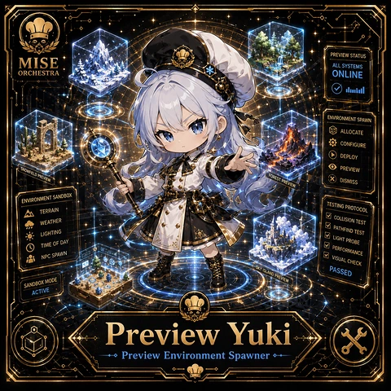

<!-- generated by tools/player-cards/scripts/build-character-pages.mjs from data/characters/preview-yuki.json; do not edit by hand -->
# Preview Yuki

**Registry character agent** · Implementation: **Described in docs only** · Detail record: [`data/characters/preview-yuki.json`](../../data/characters/preview-yuki.json)

Every field below comes from a repository source (shown as `source:`). Where no source exists the page says _Not yet defined in the source material_.

## Identity

| Field | Value |
|---|---|
| Name | Preview Yuki source: `data/characters.json` |
| Aliases / printed variants | Preview source: `card titles / OCR in data/player-cards-ocr.json` |
| Role / title | Preview Environment Spawner source: `characters/preview-yuki/metadata.json` |
| Kitchen / department | Platform Kitchen source: `characters/preview-yuki/metadata.json` |
| Department mission | Provide golden paths and stable service foundations. source: `data/imports/miseos_character_master_inventory_001_300.csv` |
| Registry rarity | Common source: `characters/preview-yuki/metadata.json` |
| Level | 21 source: `data/imports/miseos_character_master_inventory_001_300.csv` |
| ID: registry_id | MISE-027 source: `characters/preview-yuki/metadata.json` |
| ID: character_id | miseos.character.027 source: `data/imports/miseos_character_master_inventory_001_300.csv` |
| ID: card_id | MISE-027 source: `data/imports/miseos_character_master_inventory_001_300.csv` |
| ID: codename | PREVIEW_YUKI source: `data/imports/miseos_character_master_inventory_001_300.csv` |
| Collections | 1×1 Chefs source: `data/player-cards.json` |
| Cards linked | 1 source: `data/player-cards.json` |
| Role category | delivery source: `data/imports/merged_roster.json` |

## Player cards

| Card | Collection | Printed title | Match method | Full size |
|---|---|---|---|---|
| `preview.webp` | 1×1 Chefs | Preview | title | [open](../../assets/player-cards/1by1-chefs/preview.webp) |

## Card metadata (as printed)

| Field | Value |
|---|---|
| Printed rarity | Not yet defined in the source material |
| Printed stars | Not yet defined in the source material |
| Printed meters | Not yet defined in the source material |
| Roster stats | power 62 · precision 78 · speed 62 · resilience 63 · intelligence 70 · teamwork 68 source: `data/imports/miseos_character_master_inventory_001_300.csv (roster stats, not OCR)` |
| Abilities | Not yet defined in the source material |
| Lore | Not yet defined in the source material |
| Signature phrase | Preview Environment Spawner done cleanly, safely, and in rhythm. source: `data/imports/merged_roster.json` |
| Unique trait | Specializes in preview environment spawner so the Platform Kitchen can operate as a precise, repo-safe DevOps station. source: `data/imports/merged_roster.json` |

Full printed card text (OCR)

**`preview.webp`**: PREVIEWSTATUS · MISE · ALLSYSTEMS · ORCHESTRA · ONLINE · ENVIRONMENTSPAWN · ALLOCATE · CONFIGURE · DEPLOY · PREVIEW · DISMISS · ENVIRONMENTSANDBOX · TESTINGPROTOCOL · TERRAIN · COLLISIONTEST · WEATHER · PATHFINDTEST · LIGHTING · LIGHT PROBE · TIMEOFDAY · PERFORMANCE · NPCSPAWN · VISUAL CHECK · PASSED · SANDBOX MODE · ACTIVE · Preview · Yuki · → Preview Environment Spawner

## Workflow

| Step | Value |
|---|---|
| Summary | Preview Yuki performs preview environment spawner within the Platform Kitchen. source: `characters/preview-yuki/metadata.json` |
| Inputs | repository context, task request, policy constraints, current evidence source: `characters/preview-yuki/metadata.json` |
| Outputs | validated result, evidence record, handoff packet source: `characters/preview-yuki/metadata.json` |
| Proof gate | No merge, deployment, publication, billing action, or mint without evidence. source: `characters/preview-yuki/metadata.json` |

## Actions / commands

- command: `MISE PREVIEW ENVIRONMENT SPAWNER` source: `data/imports/miseos_character_master_inventory_001_300.csv`
- command: `Preview Environment Spawner` · mise_name: `Mise PreviewEnvironmentSpawner` source: `data/imports/merged_roster.json`

## Implementation

**Status:** Described in docs only

Roster data / types / tests in code that list this entry (not an implementation):
- [`apps/bootstrap-registry/apps/registry-console/src/data/master-roster.generated.ts:421`](../../apps/bootstrap-registry/apps/registry-console/src/data/master-roster.generated.ts#L421)
- [`apps/brigade-gallery/src/data/master-roster.ts:354`](../../apps/brigade-gallery/src/data/master-roster.ts#L354)

Data files that reference it:
- [`apps/bootstrap-registry/registry/cards/master-roster-cards.json:373`](../../apps/bootstrap-registry/registry/cards/master-roster-cards.json#L373)
- [`apps/gridops-platform/data/miseos-ecosystem-135.json:1478`](../../apps/gridops-platform/data/miseos-ecosystem-135.json#L1478)
- [`apps/voxel-world/src/data/miseos-ecosystem-135.json:1478`](../../apps/voxel-world/src/data/miseos-ecosystem-135.json#L1478)
- [`tools/art-factory/input/characters.generated.json:684`](../../tools/art-factory/input/characters.generated.json#L684)
- [`tools/art-factory/output/manifests/krikey_animation_prompts.json:441`](../../tools/art-factory/output/manifests/krikey_animation_prompts.json#L441)
- [`tools/art-factory/output/manifests/mangaboom_comic_prompts.json:441`](../../tools/art-factory/output/manifests/mangaboom_comic_prompts.json#L441)
- [`tools/art-factory/output/merged_roster.json:721`](../../tools/art-factory/output/merged_roster.json#L721)

Docs that describe it (docs only, not code):
- [`characters/preview-yuki/README.md`](../../characters/preview-yuki/README.md)
- [`apps/brigade-gallery/prototype/holo-card-roster.html:76`](../../apps/brigade-gallery/prototype/holo-card-roster.html#L76)
- [`apps/developer-platform/docs/characters/CHARACTER_REGISTRY_001_300.md:15`](../../apps/developer-platform/docs/characters/CHARACTER_REGISTRY_001_300.md#L15)

implemented_in_code = a dedicated capability handler or tool directory exists; referenced_in_app_code = the entity is used by application source (e.g. repo-pet sprites, CLI) but has no dedicated handler. code_refs are files that reference this entity by name/slug/handler (grep), not a guarantee of a dedicated runtime; registry handler links point at the actual capability function.

## Where and how it helps

| Aspect | Value |
|---|---|
| Station / stage | Platform Kitchen source: `characters/preview-yuki/metadata.json` |
| Mission | Provide golden paths and stable service foundations. source: `data/imports/miseos_character_master_inventory_001_300.csv` |
| Problem it addresses | Preview Yuki performs preview environment spawner within the Platform Kitchen. source: `characters/preview-yuki/metadata.json` |
| Safety gate | No merge, deployment, publication, billing action, or mint without evidence. source: `characters/preview-yuki/metadata.json` |

## Related characters

[Portal Rei](./portal-rei.md) · [Guardrail Goro](./guardrail-goro.md) · [Platform Sensei](./platform-sensei.md) · [Streama](./streama.md) · [Tariq Notesmith](./tariq-notesmith.md) · [Forecast Fuji](./forecast-fuji.md) source: `data/imports/miseos_character_master_inventory_001_300.csv data/imports/merged_roster.json data/imports/merged_roster.json data/imports/merged_roster.json`

## Canon Bible

Mentioned in [`docs/canon/MiseOS-Canon-Bible-v1.0.pdf`](../../docs/canon/MiseOS-Canon-Bible-v1.0.pdf):

- line 543: `MISE-G2-P038 Preview Yuki Mise Orchestra canonical-candidate 1E3334AB-3111- 38`

## Sources

| Field | Source |
|---|---|
| name | `data/characters.json` |
| aliases | `card titles / OCR in data/player-cards-ocr.json` |
| cards | `data/player-cards.json` |
| card_text | `data/player-cards-ocr.json (OCR of the card image)` |
| ids.registry_id | `characters/preview-yuki/metadata.json` |
| role | `characters/preview-yuki/metadata.json` |
| department | `characters/preview-yuki/metadata.json` |
| rarity | `characters/preview-yuki/metadata.json` |
| workflow.summary | `characters/preview-yuki/metadata.json` |
| workflow.inputs | `characters/preview-yuki/metadata.json` |
| workflow.outputs | `characters/preview-yuki/metadata.json` |
| workflow.proof_gate | `characters/preview-yuki/metadata.json` |
| department_mission | `data/imports/miseos_character_master_inventory_001_300.csv` |
| ids.character_id | `data/imports/miseos_character_master_inventory_001_300.csv` |
| ids.card_id | `data/imports/miseos_character_master_inventory_001_300.csv` |
| ids.codename | `data/imports/miseos_character_master_inventory_001_300.csv` |
| stats | `data/imports/miseos_character_master_inventory_001_300.csv (roster stats, not OCR)` |
| level | `data/imports/miseos_character_master_inventory_001_300.csv` |
| related | `data/imports/miseos_character_master_inventory_001_300.csv data/imports/merged_roster.json data/imports/merged_roster.json data/imports/merged_roster.json` |
| signature_phrase | `data/imports/merged_roster.json` |
| unique_trait | `data/imports/merged_roster.json` |
| role_category | `data/imports/merged_roster.json` |
| canon_bible | `docs/canon/MiseOS-Canon-Bible-v1.0.pdf (pdftotext)` |
| implementation | `git ls-files grep + repo` |
| helps.station | `characters/preview-yuki/metadata.json` |

[← All characters](./README.md)
