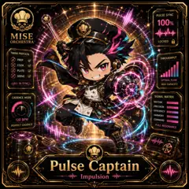

<!-- generated by tools/player-cards/scripts/build-character-pages.mjs from data/characters/pulse-captain.json; do not edit by hand -->
# Pulse Captain

**Card-defined chef (catalogue: visual reference only)** · Implementation: **Designed (not yet implemented in code)** · Detail record: [`data/characters/pulse-captain.json`](../../data/characters/pulse-captain.json)

Every field shows where its value comes from (`source:`). Repo-sourced values cite the repository or source-library file they were read from; values marked `authored: card design` were written for this card by [`enrich-characters.py`](../../tools/player-cards/scripts/enrich-characters.py), derived from the printed card text, role and kitchen theme, and are not claims about existing code.

## Identity

| Field | Value |
|---|---|
| Name | Pulse Captain source: `data/imports/photo-alignment.csv` |
| Aliases / printed variants | Prep Pulse (canon crosswalk, provisional) source: `docs/source-library/icloud/Catalogue/All images/Mise/MiseOS Bible/MiseOS-Canon-Bible-v1.0-package.zip/miseos_canon_bible_v1_0/registry/asset-registry.csv` |
| Role / title | Impulsion source: `data/player-cards-ocr.json (subtitle printed under the name)` |
| Kitchen / department | Operations Kitchen source: `docs/source-library/icloud/Catalogue/All images/Mise/MiseOS Bible/MiseOS-Canon-Bible-v1.0-package.zip/miseos_canon_bible_v1_0/registry/asset-registry.csv → data/characters/prep-pulse.json` |
| Department mission | Keep the kitchen running smoothly. source: `data/imports/miseos_character_master_inventory_001_300.csv (mission of Operations Kitchen)` |
| Registry rarity | Rare source: `docs/source-library/icloud/Catalogue/All images/Mise/MiseOS Bible/MiseOS-Canon-Bible-v1.0-package.zip/miseos_canon_bible_v1_0/registry/asset-registry.csv → data/characters/prep-pulse.json` |
| Collections | 1×1 Chefs source: `data/player-cards.json` |
| Cards linked | 1 source: `data/player-cards.json` |
| Catalogue status | visual_reference_only source: `data/imports/photo-alignment.csv` |

## Player cards

| Card | Collection | Printed title | Match method | Full size |
|---|---|---|---|---|
| `pulse-captain.webp` | 1×1 Chefs | Pulse Captain | title | [open](../../assets/player-cards/1by1-chefs/pulse-captain.webp) |

## Card metadata (as printed)

| Field | Value |
|---|---|
| Printed rarity | Not printed on the card source: `data/player-cards-ocr.json (no rarity word in OCR)` |
| Printed stars | Not printed on the card source: `data/player-cards-ocr.json (no stars in OCR)` |
| Printed meters | 100% source: `data/player-cards-ocr.json` |
| Roster stats | power 81 · precision 79 · speed 73 · resilience 70 · intelligence 73 · teamwork 81 source: `authored: card design (6-axis roster scale; baseline from stars + theme "time")` |
| Abilities | Pulse Sync, Locked, Timing Protocol, Prep, Throughput, Cook source: `data/player-cards-ocr.json (printed card labels, glued OCR words segmented)` |
| Lore | Ask the brigade about Pulse Captain and they describe the ticket rail at full stretch, every slip in order. As Operations Kitchen's specialist for impulsion, Pulse Captain holds the rhythm of service: sequencing tickets, staffing and timing so every station fires at the right moment, and the rest of the kitchen plans service around that rhythm. The card calls out Pulse Sync, Locked, Timing Protocol: the checks Pulse Captain runs before calling anything ready. In the canon crosswalk this card is a provisional match for Prep Pulse. source: `authored: card design (derived from printed card text/role)` |
| Signature phrase | Fire first, then service. source: `authored: card design (derived from printed card text/role)` |

Full printed card text (OCR)

**`pulse-captain.webp`**: PULSE SYNC · 100% · MISE · ORCHESTRA · LOCKED · TIMING PROTOCOL · PREP · THROUGHPUT · COOK · PLATE · SERVE · OPTIMALFLOW · ALLINSYNC · MAX CAPACITY · CADENCE MODE · SIGNAL MATRIX · RHYTHM · PRECISION · EFFICIENCY · HARMONY · 120BPM · COMMAND · PERFECTCADENCE · FULL RESONANCE · Pulse Captain · Impulsion

## Workflow

| Step | Value |
|---|---|
| Summary | Pulse Captain holds the rhythm of service: sequencing tickets, staffing and timing so every station fires at the right moment. source: `authored: card design (theme "time")` |
| Inputs | open tickets, station capacity, shift roster, service timeline source: `authored: card design (theme "time")` |
| Outputs | fire order / run sheet, shift handoff note, bottleneck alert source: `authored: card design (theme "time")` |
| Proof gate | Expo check: a course is fired only when every component reports ready; handoffs require a written note. source: `authored: card design (theme "time")` |

## Actions / commands

- command: `mise roster run pulse-captain --dept operations-kitchen --solo --emit report` · status: `proposed` source: `authored: follows data/imports/master-roster-cards.csv (mise roster run command convention)`
- command: `mise pulse-captain fire` · reads: `open tickets` · emits: `fire order / run sheet` · status: `proposed` source: `authored: card design (theme "time")`
- command: `mise pulse-captain handoff` · reads: `station capacity` · emits: `shift handoff note` · status: `proposed` source: `authored: card design (theme "time")`
- command: `mise pulse-captain rebalance` · reads: `shift roster` · emits: `bottleneck alert` · status: `proposed` source: `authored: card design (theme "time")`

## Implementation

**Status:** Designed (not yet implemented in code)

- Proposed handler: `pulseCaptain` (not written yet)
- Proposed command: `mise roster run pulse-captain --dept operations-kitchen --solo --emit report`
- Contract: inputs: open tickets, station capacity, shift roster, service timeline → outputs: fire order / run sheet, shift handoff note, bottleneck alert; refuses to emit 'ready' unless the proof gate passes

source: `git ls-files grep + repo (no code found) + authored: proposed handler spec`

implemented_in_code = a dedicated capability handler or tool directory exists; referenced_in_app_code = the entity is used by application source (e.g. repo-pet sprites, CLI) but has no dedicated handler. code_refs are files that reference this entity by name/slug/handler (grep), not a guarantee of a dedicated runtime; registry handler links point at the actual capability function.

## Where and how it helps

| Aspect | Value |
|---|---|
| Station / stage | Impulsion source: `data/player-cards-ocr.json (subtitle printed under the name)` |
| Mission | Keep the kitchen running smoothly. source: `data/imports/miseos_character_master_inventory_001_300.csv (mission of Operations Kitchen)` |
| Problem it addresses | Without a conductor, stations fire out of sequence and work arrives cold or late. source: `authored: card design (theme "time")` |
| Safety gate | Expo check: a course is fired only when every component reports ready; handoffs require a written note. source: `authored: card design (theme "time")` |

## Agents and repo pets

Agents: [Dispatcher](../agents/dispatcher.md) · [Automator](../agents/automator.md) · [Iron Hashi](../agents/iron-hashi.md) source: `docs/source-library/icloud/Catalogue/All images/Mise/MiseOS Bible/MiseOS-Canon-Bible-v1.0-package.zip/miseos_canon_bible_v1_0/registry/asset-registry.csv → data/characters/prep-pulse.json`

Repo pets: [Tensho](../repo-pets/tensho.md) · [Mise Maestro](../repo-pets/mise-maestro.md) source: `authored: card design (closest repo pets for theme "time")`

## Related characters

[Prep Pulse](./prep-pulse.md) · [Kitchen Conductor](./kitchen-conductor.md) · [Energy Keeper](./energy-keeper.md) · [Orderly Owl](./orderly-owl.md) · [Crate Courier](./crate-courier.md) · [Portion Paladin](./portion-paladin.md) source: `docs/source-library/icloud/Catalogue/All images/Mise/MiseOS Bible/MiseOS-Canon-Bible-v1.0-package.zip/miseos_canon_bible_v1_0/registry/asset-registry.csv (canon counterpart) + authored: card design (same theme "time" / same department)`

## Sources

| Field | Source |
|---|---|
| name | `data/imports/photo-alignment.csv` |
| cards | `data/player-cards.json` |
| card_text | `data/player-cards-ocr.json (OCR of the card image)` |
| card_meters_printed | `data/player-cards-ocr.json` |
| role | `data/player-cards-ocr.json (subtitle printed under the name)` |
| catalogue_status | `data/imports/photo-alignment.csv` |
| implementation | `git ls-files grep + repo (no code found) + authored: proposed handler spec` |
| helps.station | `data/player-cards-ocr.json (subtitle printed under the name)` |
| aliases | `docs/source-library/icloud/Catalogue/All images/Mise/MiseOS Bible/MiseOS-Canon-Bible-v1.0-package.zip/miseos_canon_bible_v1_0/registry/asset-registry.csv` |
| department | `docs/source-library/icloud/Catalogue/All images/Mise/MiseOS Bible/MiseOS-Canon-Bible-v1.0-package.zip/miseos_canon_bible_v1_0/registry/asset-registry.csv → data/characters/prep-pulse.json` |
| department_mission | `data/imports/miseos_character_master_inventory_001_300.csv (mission of Operations Kitchen)` |
| card_rarity_printed | `data/player-cards-ocr.json (no rarity word in OCR)` |
| card_stars_printed | `data/player-cards-ocr.json (no stars in OCR)` |
| rarity | `docs/source-library/icloud/Catalogue/All images/Mise/MiseOS Bible/MiseOS-Canon-Bible-v1.0-package.zip/miseos_canon_bible_v1_0/registry/asset-registry.csv → data/characters/prep-pulse.json` |
| stats | `authored: card design (6-axis roster scale; baseline from stars + theme "time")` |
| abilities | `data/player-cards-ocr.json (printed card labels, glued OCR words segmented)` |
| lore | `authored: card design (derived from printed card text/role)` |
| signature_phrase | `authored: card design (derived from printed card text/role)` |
| workflow.summary | `authored: card design (theme "time")` |
| workflow.inputs | `authored: card design (theme "time")` |
| workflow.outputs | `authored: card design (theme "time")` |
| workflow.proof_gate | `authored: card design (theme "time")` |
| actions | `authored: follows data/imports/master-roster-cards.csv (mise roster run command convention)` |
| helps.mission | `data/imports/miseos_character_master_inventory_001_300.csv (mission of Operations Kitchen)` |
| helps.problem | `authored: card design (theme "time")` |
| helps.proof_gate | `authored: card design (theme "time")` |
| agents | `docs/source-library/icloud/Catalogue/All images/Mise/MiseOS Bible/MiseOS-Canon-Bible-v1.0-package.zip/miseos_canon_bible_v1_0/registry/asset-registry.csv → data/characters/prep-pulse.json` |
| repo_pets | `authored: card design (closest repo pets for theme "time")` |
| related | `docs/source-library/icloud/Catalogue/All images/Mise/MiseOS Bible/MiseOS-Canon-Bible-v1.0-package.zip/miseos_canon_bible_v1_0/registry/asset-registry.csv (canon counterpart) + authored: card design (same theme "time" / same department)` |
| theme | `authored: card design (keyword theme used for authored fields)` |

[← All characters](./README.md)
