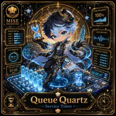

<!-- generated by tools/player-cards/scripts/build-character-pages.mjs from data/characters/queue-quartz.json; do not edit by hand -->
# Queue Quartz

**Registry character agent** · Implementation: **Described in docs only** · Detail record: [`data/characters/queue-quartz.json`](../../data/characters/queue-quartz.json)

Every field shows where its value comes from (`source:`). Repo-sourced values cite the repository or source-library file they were read from; values marked `authored: card design` were written for this card by [`enrich-characters.py`](../../tools/player-cards/scripts/enrich-characters.py), derived from the printed card text, role and kitchen theme, and are not claims about existing code.

## Identity

| Field | Value |
|---|---|
| Name | Queue Quartz source: `data/characters.json` |
| Aliases / printed variants | Queue source: `card titles / OCR in data/player-cards-ocr.json` |
| Role / title | Service Timer source: `characters/queue-quartz/metadata.json` |
| Kitchen / department | Operations Kitchen source: `characters/queue-quartz/metadata.json` |
| Department mission | Keep the kitchen running smoothly. source: `data/imports/miseos_character_master_inventory_001_300.csv` |
| Registry rarity | Epic source: `characters/queue-quartz/metadata.json` |
| Level | 20 source: `data/imports/miseos_character_master_inventory_001_300.csv` |
| ID: registry_id | MISE-103 source: `characters/queue-quartz/metadata.json` |
| ID: character_id | miseos.character.103 source: `data/imports/miseos_character_master_inventory_001_300.csv` |
| ID: card_id | MISE-103 source: `data/imports/miseos_character_master_inventory_001_300.csv` |
| ID: codename | QUEUE_QUARTZ source: `data/imports/miseos_character_master_inventory_001_300.csv` |
| Collections | 1×1 Chefs source: `data/player-cards.json` |
| Cards linked | 1 source: `data/player-cards.json` |

## Player cards

| Card | Collection | Printed title | Match method | Full size |
|---|---|---|---|---|
| `queue.webp` | 1×1 Chefs | Queue | title | [open](../../assets/player-cards/1by1-chefs/queue.webp) |

## Card metadata (as printed)

| Field | Value |
|---|---|
| Printed rarity | Not printed on the card source: `data/player-cards-ocr.json (no rarity word in OCR)` |
| Printed stars | Not printed on the card source: `data/player-cards-ocr.json (no stars in OCR)` |
| Printed meters | 100%, 98.6% source: `data/player-cards-ocr.json` |
| Roster stats | power 83 · precision 86 · speed 56 · resilience 76 · intelligence 80 · teamwork 83 source: `data/imports/miseos_character_master_inventory_001_300.csv (roster stats, not OCR)` |
| Abilities | Flow Efficiency, Queue Status, Rhythm Sync, Lane1, Lane2, Lane3 source: `data/player-cards-ocr.json (printed card labels, glued OCR words segmented)` |
| Lore | Most of the brigade only notices Queue Quartz when something is missing, which is exactly the point. Queue Quartz holds the rhythm of service: sequencing tickets, staffing and timing so every station fires at the right moment; the image the crew uses for it is the ticket rail at full stretch, every slip in order. The card calls out Flow Efficiency, Queue Status, Rhythm Sync: the checks Queue Quartz runs before calling anything ready. source: `authored: card design (derived from printed card text/role)` |
| Signature phrase | On my count. source: `authored: card design (derived from printed card text/role)` |

Full printed card text (OCR)

**`queue.webp`**: FLOWEFFICIENCY · 100% · MISE · ORCHESTRA · OPTIMAL · QUEUESTATUS · RHYTHM SYNC · LANE1 · LANE2 · LANE3 · LANE4 · LANE5 · 120 BPM · SLA MONITOR · SERVICETIMING · PREPARE: · COOK · 98.6% · PLATE · ONTIME · SERVE · CLEAN · EST.WAITTIME · 01:32 · NEXT SERVICE · 00:00:47 · MIN · Queue · Quartz · Service Timer

## Workflow

| Step | Value |
|---|---|
| Summary | Queue Quartz performs service timer within the Operations Kitchen. source: `characters/queue-quartz/metadata.json` |
| Inputs | repository context, task request, policy constraints, current evidence source: `characters/queue-quartz/metadata.json` |
| Outputs | validated result, evidence record, handoff packet source: `characters/queue-quartz/metadata.json` |
| Proof gate | No merge, deployment, publication, billing action, or mint without evidence. source: `characters/queue-quartz/metadata.json` |

## Actions / commands

- command: `MISE SERVICE TIMER` source: `data/imports/miseos_character_master_inventory_001_300.csv`

## Implementation

**Status:** Described in docs only

Data files that reference it:
- [`apps/gridops-platform/data/miseos-ecosystem-135.json:6190`](../../apps/gridops-platform/data/miseos-ecosystem-135.json#L6190)
- [`apps/voxel-world/src/data/miseos-ecosystem-135.json:6190`](../../apps/voxel-world/src/data/miseos-ecosystem-135.json#L6190)
- [`tools/devops-foundry/catalog/devops-assets.csv:41`](../../tools/devops-foundry/catalog/devops-assets.csv#L41)
- [`tools/devops-foundry/catalog/devops-assets.json:619`](../../tools/devops-foundry/catalog/devops-assets.json#L619)
- [`tools/devops-foundry/catalog/unique-assets.json:619`](../../tools/devops-foundry/catalog/unique-assets.json#L619)

Docs that describe it (docs only, not code):
- [`characters/queue-quartz/README.md`](../../characters/queue-quartz/README.md)
- [`apps/developer-platform/docs/characters/CHARACTER_REGISTRY_001_300.md:31`](../../apps/developer-platform/docs/characters/CHARACTER_REGISTRY_001_300.md#L31)

implemented_in_code = a dedicated capability handler or tool directory exists; referenced_in_app_code = the entity is used by application source (e.g. repo-pet sprites, CLI) but has no dedicated handler. code_refs are files that reference this entity by name/slug/handler (grep), not a guarantee of a dedicated runtime; registry handler links point at the actual capability function.

## Where and how it helps

| Aspect | Value |
|---|---|
| Station / stage | Operations Kitchen source: `characters/queue-quartz/metadata.json` |
| Mission | Keep the kitchen running smoothly. source: `data/imports/miseos_character_master_inventory_001_300.csv` |
| Problem it addresses | Queue Quartz performs service timer within the Operations Kitchen. source: `characters/queue-quartz/metadata.json` |
| Safety gate | No merge, deployment, publication, billing action, or mint without evidence. source: `characters/queue-quartz/metadata.json` |

## Agents and repo pets

Agents: [Conductor](../agents/conductor.md) · [Scheduler](../agents/scheduler.md) · [Tensho](../agents/tensho.md) source: `authored: card design (closest agents for theme "time")`

Repo pets: [Tensho](../repo-pets/tensho.md) · [Mise Maestro](../repo-pets/mise-maestro.md) source: `authored: card design (closest repo pets for theme "time")`

## Related characters

[Harvest Hex](./harvest-hex.md) · [Garnish Ghost](./garnish-ghost.md) · [Pantry Paladin](./pantry-paladin.md) source: `data/imports/miseos_character_master_inventory_001_300.csv`

## Canon Bible

Mentioned in [`docs/canon/MiseOS-Canon-Bible-v1.0.pdf`](../../docs/canon/MiseOS-Canon-Bible-v1.0.pdf):

- line 515: `MISE-G2-P024 Queue Quartz Mise Orchestra canonical-candidate 1E3334AB-3111- 24`

## Sources

| Field | Source |
|---|---|
| name | `data/characters.json` |
| aliases | `card titles / OCR in data/player-cards-ocr.json` |
| cards | `data/player-cards.json` |
| card_text | `data/player-cards-ocr.json (OCR of the card image)` |
| card_meters_printed | `data/player-cards-ocr.json` |
| ids.registry_id | `characters/queue-quartz/metadata.json` |
| role | `characters/queue-quartz/metadata.json` |
| department | `characters/queue-quartz/metadata.json` |
| rarity | `characters/queue-quartz/metadata.json` |
| workflow.summary | `characters/queue-quartz/metadata.json` |
| workflow.inputs | `characters/queue-quartz/metadata.json` |
| workflow.outputs | `characters/queue-quartz/metadata.json` |
| workflow.proof_gate | `characters/queue-quartz/metadata.json` |
| department_mission | `data/imports/miseos_character_master_inventory_001_300.csv` |
| ids.character_id | `data/imports/miseos_character_master_inventory_001_300.csv` |
| ids.card_id | `data/imports/miseos_character_master_inventory_001_300.csv` |
| ids.codename | `data/imports/miseos_character_master_inventory_001_300.csv` |
| stats | `data/imports/miseos_character_master_inventory_001_300.csv (roster stats, not OCR)` |
| level | `data/imports/miseos_character_master_inventory_001_300.csv` |
| related | `data/imports/miseos_character_master_inventory_001_300.csv` |
| canon_bible | `docs/canon/MiseOS-Canon-Bible-v1.0.pdf (pdftotext)` |
| implementation | `git ls-files grep + repo` |
| helps.station | `characters/queue-quartz/metadata.json` |
| card_rarity_printed | `data/player-cards-ocr.json (no rarity word in OCR)` |
| card_stars_printed | `data/player-cards-ocr.json (no stars in OCR)` |
| abilities | `data/player-cards-ocr.json (printed card labels, glued OCR words segmented)` |
| lore | `authored: card design (derived from printed card text/role)` |
| signature_phrase | `authored: card design (derived from printed card text/role)` |
| agents | `authored: card design (closest agents for theme "time")` |
| repo_pets | `authored: card design (closest repo pets for theme "time")` |
| theme | `authored: card design (keyword theme used for authored fields)` |

[← All characters](./README.md)
