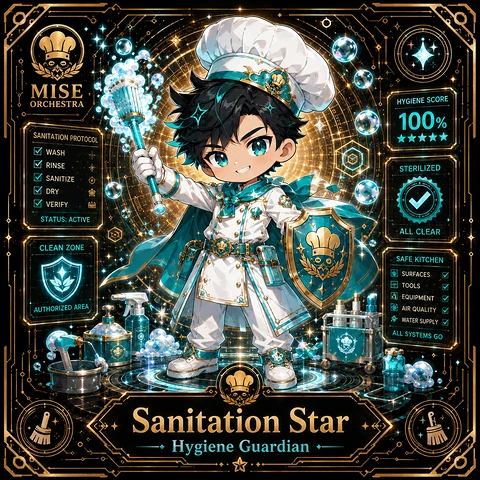

<!-- generated by tools/player-cards/scripts/build-character-pages.mjs from data/characters/sanitation-star.json; do not edit by hand -->
# Sanitation Star

**Card-defined chef (catalogue: visual reference only)** · Implementation: **Designed (not yet implemented in code)** · Detail record: [`data/characters/sanitation-star.json`](../../data/characters/sanitation-star.json)

Every field shows where its value comes from (`source:`). Repo-sourced values cite the repository or source-library file they were read from; values marked `authored: card design` were written for this card by [`enrich-characters.py`](../../tools/player-cards/scripts/enrich-characters.py), derived from the printed card text, role and kitchen theme, and are not claims about existing code.

## Identity

| Field | Value |
|---|---|
| Name | Sanitation Star source: `data/imports/photo-alignment.csv` |
| Aliases / printed variants | Secure Sakura (canon crosswalk, provisional) source: `docs/source-library/icloud/Catalogue/All images/Mise/MiseOS Bible/MiseOS-Canon-Bible-v1.0-package.zip/miseos_canon_bible_v1_0/registry/asset-registry.csv` |
| Role / title | Hygiene Guardian source: `data/player-cards-ocr.json (subtitle printed under the name)` |
| Kitchen / department | Security Kitchen source: `docs/source-library/icloud/Catalogue/All images/Mise/MiseOS Bible/MiseOS-Canon-Bible-v1.0-package.zip/miseos_canon_bible_v1_0/registry/asset-registry.csv → data/characters/secure-sakura.json` |
| Department mission | Guard. Audit. Comply. source: `data/imports/miseos_character_master_inventory_001_300.csv (mission of Security Kitchen)` |
| Registry rarity | Common source: `docs/source-library/icloud/Catalogue/All images/Mise/MiseOS Bible/MiseOS-Canon-Bible-v1.0-package.zip/miseos_canon_bible_v1_0/registry/asset-registry.csv → data/characters/secure-sakura.json` |
| Collections | 1×1 Chefs source: `data/player-cards.json` |
| Cards linked | 1 source: `data/player-cards.json` |
| Catalogue status | visual_reference_only source: `data/imports/photo-alignment.csv` |

## Player cards

| Card | Collection | Printed title | Match method | Full size |
|---|---|---|---|---|
| `sanitation-star.webp` | 1×1 Chefs | Sanitation Star | title | [open](../../assets/player-cards/1by1-chefs/sanitation-star.webp) |

## Card metadata (as printed)

| Field | Value |
|---|---|
| Printed rarity | Not printed on the card source: `data/player-cards-ocr.json (no rarity word in OCR)` |
| Printed stars | 5 source: `data/player-cards-ocr.json` |
| Printed meters | 100% source: `data/player-cards-ocr.json` |
| Roster stats | power 95 · precision 95 · speed 94 · resilience 90 · intelligence 92 · teamwork 83 source: `authored: card design (6-axis roster scale; baseline from stars + theme "clean")` |
| Abilities | Hygiene Score, Sanitation Protocol, Wash, Rinse, Sterilized, Sanitize source: `data/player-cards-ocr.json (printed card labels, glued OCR words segmented)` |
| Lore | Most of the brigade only notices Sanitation Star when something is missing, which is exactly the point. Sanitation Star keeps the kitchen clean and the waste stream honest: sanitising surfaces, logging waste and closing contamination risks; the image the crew uses for it is a steel counter wiped until it reflects the ceiling lights. The card calls out Hygiene Score, Sanitation Protocol, Wash: the checks Sanitation Star runs before calling anything ready. In the canon crosswalk this card is a provisional match for Secure Sakura. source: `authored: card design (derived from printed card text/role)` |
| Signature phrase | Clean is a habit, not an event. source: `authored: card design (derived from printed card text/role)` |

Full printed card text (OCR)

**`sanitation-star.webp`**: MISE · ORCHESTRA · HYGIENESCORE · 100% · SANITATION PROTOCOL · ★★★★★ · WASH · RINSE · STERILIZED · SANITIZE · DRY · VERIFY · STATUS: ACTIVE · ALL CLEAR · CLEAN ZONE · SAFE KITCHEN · SURFACES · TOOLS · EQUIPMENT · AUTHORIZED AREA · AIR QUALITY · WATERSUPPLY · ALL SYSTEMS GO · Sanitation Star · Hygiene Guardian

## Workflow

| Step | Value |
|---|---|
| Summary | Sanitation Star keeps the kitchen clean and the waste stream honest: sanitising surfaces, logging waste and closing contamination risks. source: `authored: card design (theme "clean")` |
| Inputs | station checklist, waste log, sanitiser concentration readings, incident reports source: `authored: card design (theme "clean")` |
| Outputs | sanitation sign-off, waste report, contamination alert source: `authored: card design (theme "clean")` |
| Proof gate | Sanitation sign-off: a station reopens only after its checklist is complete and readings are in range; any contamination opens an incident. source: `authored: card design (theme "clean")` |

## Actions / commands

- command: `mise roster run sanitation-star --dept security-kitchen --solo --emit report` · status: `proposed` source: `authored: follows data/imports/master-roster-cards.csv (mise roster run command convention)`
- command: `mise sanitation-star sanitize` · reads: `station checklist` · emits: `sanitation sign-off` · status: `proposed` source: `authored: card design (theme "clean")`
- command: `mise sanitation-star audit-waste` · reads: `waste log` · emits: `waste report` · status: `proposed` source: `authored: card design (theme "clean")`
- command: `mise sanitation-star sign-off` · reads: `sanitiser concentration readings` · emits: `contamination alert` · status: `proposed` source: `authored: card design (theme "clean")`

## Implementation

**Status:** Designed (not yet implemented in code)

- Proposed handler: `sanitationStar` (not written yet)
- Proposed command: `mise roster run sanitation-star --dept security-kitchen --solo --emit report`
- Contract: inputs: station checklist, waste log, sanitiser concentration readings, incident reports → outputs: sanitation sign-off, waste report, contamination alert; refuses to emit 'ready' unless the proof gate passes

source: `git ls-files grep + repo (no code found) + authored: proposed handler spec`

implemented_in_code = a dedicated capability handler or tool directory exists; referenced_in_app_code = the entity is used by application source (e.g. repo-pet sprites, CLI) but has no dedicated handler. code_refs are files that reference this entity by name/slug/handler (grep), not a guarantee of a dedicated runtime; registry handler links point at the actual capability function.

## Where and how it helps

| Aspect | Value |
|---|---|
| Station / stage | Hygiene Guardian source: `data/player-cards-ocr.json (subtitle printed under the name)` |
| Mission | Guard. Audit. Comply. source: `data/imports/miseos_character_master_inventory_001_300.csv (mission of Security Kitchen)` |
| Problem it addresses | Residue (stale secrets, dead code, waste) quietly contaminates everything it touches. source: `authored: card design (theme "clean")` |
| Safety gate | Sanitation sign-off: a station reopens only after its checklist is complete and readings are in range; any contamination opens an incident. source: `authored: card design (theme "clean")` |

## Agents and repo pets

Agents: [Compliance](../agents/compliance.md) · [Scanner](../agents/scanner.md) · [Token Monk](../agents/token-monk.md) source: `authored: card design (closest agents for theme "clean")`

Repo pets: [Mise Locker](../repo-pets/mise-locker.md) · [Kuro Guard](../repo-pets/kuro-guard.md) source: `authored: card design (closest repo pets for theme "clean")`

## Related characters

[Secure Sakura](./secure-sakura.md) · [No-Waste Ninja](./no-waste-ninja.md) · [Byte](./byte.md) · [Threat Taro](./threat-taro.md) · [Nudge Neko](./nudge-neko.md) · [Red Oni](./red-oni.md) source: `docs/source-library/icloud/Catalogue/All images/Mise/MiseOS Bible/MiseOS-Canon-Bible-v1.0-package.zip/miseos_canon_bible_v1_0/registry/asset-registry.csv (canon counterpart) + authored: card design (same theme "clean" / same department)`

## Sources

| Field | Source |
|---|---|
| name | `data/imports/photo-alignment.csv` |
| cards | `data/player-cards.json` |
| card_text | `data/player-cards-ocr.json (OCR of the card image)` |
| card_stars_printed | `data/player-cards-ocr.json` |
| card_meters_printed | `data/player-cards-ocr.json` |
| role | `data/player-cards-ocr.json (subtitle printed under the name)` |
| catalogue_status | `data/imports/photo-alignment.csv` |
| implementation | `git ls-files grep + repo (no code found) + authored: proposed handler spec` |
| helps.station | `data/player-cards-ocr.json (subtitle printed under the name)` |
| aliases | `docs/source-library/icloud/Catalogue/All images/Mise/MiseOS Bible/MiseOS-Canon-Bible-v1.0-package.zip/miseos_canon_bible_v1_0/registry/asset-registry.csv` |
| department | `docs/source-library/icloud/Catalogue/All images/Mise/MiseOS Bible/MiseOS-Canon-Bible-v1.0-package.zip/miseos_canon_bible_v1_0/registry/asset-registry.csv → data/characters/secure-sakura.json` |
| department_mission | `data/imports/miseos_character_master_inventory_001_300.csv (mission of Security Kitchen)` |
| card_rarity_printed | `data/player-cards-ocr.json (no rarity word in OCR)` |
| rarity | `docs/source-library/icloud/Catalogue/All images/Mise/MiseOS Bible/MiseOS-Canon-Bible-v1.0-package.zip/miseos_canon_bible_v1_0/registry/asset-registry.csv → data/characters/secure-sakura.json` |
| stats | `authored: card design (6-axis roster scale; baseline from stars + theme "clean")` |
| abilities | `data/player-cards-ocr.json (printed card labels, glued OCR words segmented)` |
| lore | `authored: card design (derived from printed card text/role)` |
| signature_phrase | `authored: card design (derived from printed card text/role)` |
| workflow.summary | `authored: card design (theme "clean")` |
| workflow.inputs | `authored: card design (theme "clean")` |
| workflow.outputs | `authored: card design (theme "clean")` |
| workflow.proof_gate | `authored: card design (theme "clean")` |
| actions | `authored: follows data/imports/master-roster-cards.csv (mise roster run command convention)` |
| helps.mission | `data/imports/miseos_character_master_inventory_001_300.csv (mission of Security Kitchen)` |
| helps.problem | `authored: card design (theme "clean")` |
| helps.proof_gate | `authored: card design (theme "clean")` |
| agents | `authored: card design (closest agents for theme "clean")` |
| repo_pets | `authored: card design (closest repo pets for theme "clean")` |
| related | `docs/source-library/icloud/Catalogue/All images/Mise/MiseOS Bible/MiseOS-Canon-Bible-v1.0-package.zip/miseos_canon_bible_v1_0/registry/asset-registry.csv (canon counterpart) + authored: card design (same theme "clean" / same department)` |
| theme | `authored: card design (keyword theme used for authored fields)` |

[← All characters](./README.md)
