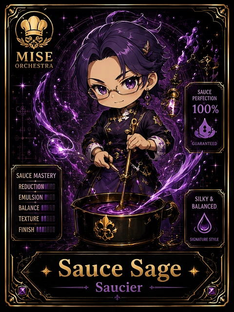

<!-- generated by tools/player-cards/scripts/build-character-pages.mjs from data/characters/sauce-sage.json; do not edit by hand -->
# Sauce Sage

**Card-defined chef (catalogue: visual reference only)** · Implementation: **Designed (not yet implemented in code)** · Detail record: [`data/characters/sauce-sage.json`](../../data/characters/sauce-sage.json)

Every field shows where its value comes from (`source:`). Repo-sourced values cite the repository or source-library file they were read from; values marked `authored: card design` were written for this card by [`enrich-characters.py`](../../tools/player-cards/scripts/enrich-characters.py), derived from the printed card text, role and kitchen theme, and are not claims about existing code.

## Identity

| Field | Value |
|---|---|
| Name | Sauce Sage source: `data/imports/photo-alignment.csv` |
| Aliases / printed variants | None recorded (no alternate title in the canon crosswalk or agents.json) source: `data/player-cards.json + canon crosswalk (no alternate title found)` |
| Role / title | Saucier source: `data/player-cards-ocr.json (subtitle printed under the name)` |
| Kitchen / department | Platform Kitchen source: `authored: card design (kitchen chosen from role/printed text, theme "sauce")` |
| Department mission | Provide golden paths and stable service foundations. source: `data/imports/miseos_character_master_inventory_001_300.csv (mission of Platform Kitchen)` |
| Registry rarity | Common source: `authored: card design (default tier; no stars printed)` |
| Collections | Long Cards source: `data/player-cards.json` |
| Cards linked | 1 source: `data/player-cards.json` |
| Catalogue status | visual_reference_only source: `data/imports/photo-alignment.csv` |

## Player cards

| Card | Collection | Printed title | Match method | Full size |
|---|---|---|---|---|
| `sauce-sage.webp` | Long Cards | Sauce Sage | title | [open](../../assets/player-cards/long-cards/sauce-sage.webp) |

## Card metadata (as printed)

| Field | Value |
|---|---|
| Printed rarity | Not printed on the card source: `data/player-cards-ocr.json (no rarity word in OCR)` |
| Printed stars | Not printed on the card source: `data/player-cards-ocr.json (no stars in OCR)` |
| Printed meters | 100% source: `data/player-cards-ocr.json` |
| Roster stats | power 75 · precision 89 · speed 73 · resilience 79 · intelligence 71 · teamwork 75 source: `authored: card design (6-axis roster scale; baseline from stars + theme "sauce")` |
| Abilities | Sauce, Perfection, Guaranteed, Sauce Mastery, Redu, Emulsion source: `data/player-cards-ocr.json (printed card labels, glued OCR words segmented)` |
| Lore | Picture the back burner where the stockpots never go cold: that is where Sauce Sage is happiest. As Platform Kitchen's Saucier, Sauce Sage builds the base flavours other stations depend on: reductions, stocks and mother sauces that must taste the same every time. The card calls out Sauce, Perfection, Guaranteed: the checks Sauce Sage runs before calling anything ready. source: `authored: card design (derived from printed card text/role)` |
| Signature phrase | Reduce first, then service. source: `authored: card design (derived from printed card text/role)` |

Full printed card text (OCR)

**`sauce-sage.webp`**: MISE · ORCHESTRA · SAUCE · PERFECTION · 100% · GUARANTEED · SAUCE MASTERY · REDU · EMULSION · SILKY & · BALANCE · BALANCED · TEXTURE · FINISH · SIGNATURE STYLE · Sauce · Sage · Saucier

## Workflow

| Step | Value |
|---|---|
| Summary | Sauce Sage builds the base flavours other stations depend on: reductions, stocks and mother sauces that must taste the same every time. source: `authored: card design (theme "sauce")` |
| Inputs | base recipe / spec, ingredient batch, taste targets (salt, acid, umami), station order source: `authored: card design (theme "sauce")` |
| Outputs | finished base batch, tasting note, batch label with date and allergens source: `authored: card design (theme "sauce")` |
| Proof gate | Taste-and-label check: a batch only ships to stations after it matches the spec on taste and carries a dated allergen label. source: `authored: card design (theme "sauce")` |

## Actions / commands

- command: `mise roster run sauce-sage --dept platform-kitchen --solo --emit report` · status: `proposed` source: `authored: follows data/imports/master-roster-cards.csv (mise roster run command convention)`
- command: `mise sauce-sage reduce` · reads: `base recipe / spec` · emits: `finished base batch` · status: `proposed` source: `authored: card design (theme "sauce")`
- command: `mise sauce-sage taste` · reads: `ingredient batch` · emits: `tasting note` · status: `proposed` source: `authored: card design (theme "sauce")`
- command: `mise sauce-sage label` · reads: `taste targets (salt, acid, umami)` · emits: `batch label with date and allergens` · status: `proposed` source: `authored: card design (theme "sauce")`

## Implementation

**Status:** Designed (not yet implemented in code)

- Proposed handler: `sauceSage` (not written yet)
- Proposed command: `mise roster run sauce-sage --dept platform-kitchen --solo --emit report`
- Contract: inputs: base recipe / spec, ingredient batch, taste targets (salt, acid, umami), station order → outputs: finished base batch, tasting note, batch label with date and allergens; refuses to emit 'ready' unless the proof gate passes

source: `git ls-files grep + repo (no code found) + authored: proposed handler spec`

implemented_in_code = a dedicated capability handler or tool directory exists; referenced_in_app_code = the entity is used by application source (e.g. repo-pet sprites, CLI) but has no dedicated handler. code_refs are files that reference this entity by name/slug/handler (grep), not a guarantee of a dedicated runtime; registry handler links point at the actual capability function.

## Where and how it helps

| Aspect | Value |
|---|---|
| Station / stage | Saucier source: `data/player-cards-ocr.json (subtitle printed under the name)` |
| Mission | Provide golden paths and stable service foundations. source: `data/imports/miseos_character_master_inventory_001_300.csv (mission of Platform Kitchen)` |
| Problem it addresses | Every dish downstream drifts when the shared base (or shared library) changes without anyone tasting it. source: `authored: card design (theme "sauce")` |
| Safety gate | Taste-and-label check: a batch only ships to stations after it matches the spec on taste and carries a dated allergen label. source: `authored: card design (theme "sauce")` |

## Agents and repo pets

Agents: [Umami Code](../agents/umami-code.md) · [API Gateway](../agents/api-gateway.md) · [Architect](../agents/architect.md) source: `authored: card design (closest agents for theme "sauce")`

Repo pets: [Umami Code](../repo-pets/umami-code.md) · [Mise Sauce](../repo-pets/mise-sauce.md) source: `authored: card design (closest repo pets for theme "sauce")`

## Related characters

[Glaze Whisperer](./glaze-whisperer.md) · [Kombu Keeper](./kombu-keeper.md) · [Umami Seeker](./umami-seeker.md) · [Runtime Riku](./runtime-riku.md) · [Guardrail Goro](./guardrail-goro.md) · [Streama](./streama.md) source: `authored: card design (same theme "sauce" / same department)`

## Sources

| Field | Source |
|---|---|
| name | `data/imports/photo-alignment.csv` |
| cards | `data/player-cards.json` |
| card_text | `data/player-cards-ocr.json (OCR of the card image)` |
| card_meters_printed | `data/player-cards-ocr.json` |
| role | `data/player-cards-ocr.json (subtitle printed under the name)` |
| catalogue_status | `data/imports/photo-alignment.csv` |
| implementation | `git ls-files grep + repo (no code found) + authored: proposed handler spec` |
| helps.station | `data/player-cards-ocr.json (subtitle printed under the name)` |
| aliases | `data/player-cards.json + canon crosswalk (no alternate title found)` |
| department | `authored: card design (kitchen chosen from role/printed text, theme "sauce")` |
| department_mission | `data/imports/miseos_character_master_inventory_001_300.csv (mission of Platform Kitchen)` |
| card_rarity_printed | `data/player-cards-ocr.json (no rarity word in OCR)` |
| card_stars_printed | `data/player-cards-ocr.json (no stars in OCR)` |
| rarity | `authored: card design (default tier; no stars printed)` |
| stats | `authored: card design (6-axis roster scale; baseline from stars + theme "sauce")` |
| abilities | `data/player-cards-ocr.json (printed card labels, glued OCR words segmented)` |
| lore | `authored: card design (derived from printed card text/role)` |
| signature_phrase | `authored: card design (derived from printed card text/role)` |
| workflow.summary | `authored: card design (theme "sauce")` |
| workflow.inputs | `authored: card design (theme "sauce")` |
| workflow.outputs | `authored: card design (theme "sauce")` |
| workflow.proof_gate | `authored: card design (theme "sauce")` |
| actions | `authored: follows data/imports/master-roster-cards.csv (mise roster run command convention)` |
| helps.mission | `data/imports/miseos_character_master_inventory_001_300.csv (mission of Platform Kitchen)` |
| helps.problem | `authored: card design (theme "sauce")` |
| helps.proof_gate | `authored: card design (theme "sauce")` |
| agents | `authored: card design (closest agents for theme "sauce")` |
| repo_pets | `authored: card design (closest repo pets for theme "sauce")` |
| related | `authored: card design (same theme "sauce" / same department)` |
| theme | `authored: card design (keyword theme used for authored fields)` |

[← All characters](./README.md)
