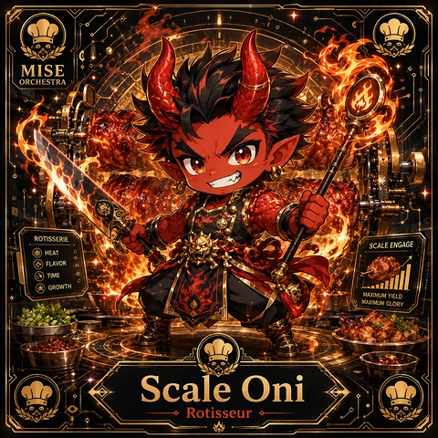
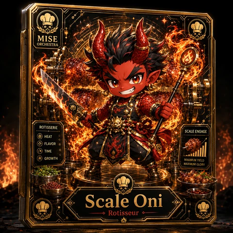
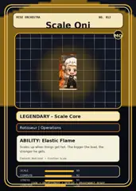

<!-- generated by tools/player-cards/scripts/build-character-pages.mjs from data/characters/scale-oni.json; do not edit by hand -->
# Scale Oni

**Registry character agent** · Implementation: **Referenced in app code (no dedicated handler)** · Detail record: [`data/characters/scale-oni.json`](../../data/characters/scale-oni.json)

Every field below comes from a repository source (shown as `source:`). Where no source exists the page says _Not yet defined in the source material_.

## Identity

| Field | Value |
|---|---|
| Name | Scale Oni source: `data/characters.json` |
| Aliases / printed variants | Not yet defined in the source material |
| Role / title | Scale source: `characters/scale-oni/metadata.json` |
| Kitchen / department | Operations Kitchen source: `characters/scale-oni/metadata.json` |
| Department mission | Keep the kitchen running smoothly. source: `data/imports/miseos_character_master_inventory_001_300.csv` |
| Registry rarity | Legendary source: `characters/scale-oni/metadata.json` |
| Level | 26 source: `data/imports/miseos_character_master_inventory_001_300.csv` |
| ID: registry_id | MISE-085 source: `characters/scale-oni/metadata.json` |
| ID: character_id | miseos.character.085 source: `data/imports/miseos_character_master_inventory_001_300.csv` |
| ID: card_id | MISE-085 source: `data/imports/miseos_character_master_inventory_001_300.csv` |
| ID: codename | SCALE_ONI source: `data/imports/miseos_character_master_inventory_001_300.csv` |
| Collections | 1×1 Chefs, Mise Orchestra Trading Cards (Season 1) source: `data/player-cards.json` |
| Cards linked | 3 source: `data/player-cards.json` |

## Player cards

| Card | Collection | Printed title | Match method | Full size |
|---|---|---|---|---|
| `scale-oni.webp` | 1×1 Chefs | Scale Oni | existing-index | [open](../../assets/player-cards/1by1-chefs/scale-oni.webp) |
| `scale-oni-2.webp` | 1×1 Chefs | Scale Oni | existing-index | [open](../../assets/player-cards/1by1-chefs/scale-oni-2.webp) |
| `scale-oni.webp` | Mise Orchestra Trading Cards (Season 1) | Scale Oni | existing-index | [open](../../assets/player-cards/orchestra-trading-cards/scale-oni.webp) |

## Card metadata (as printed)

| Field | Value |
|---|---|
| Printed rarity | Legendary source: `data/player-cards-ocr.json` |
| Printed stars | Not yet defined in the source material |
| Printed meters | Not yet defined in the source material |
| Roster stats | power 81 · precision 67 · speed 68 · resilience 80 · intelligence 68 · teamwork 90 source: `data/imports/miseos_character_master_inventory_001_300.csv (roster stats, not OCR)` |
| Abilities | Elastic Flame source: `data/imports/mise_orchestra_cards.csv` |
| Mise Orchestra card | role: Rotisseur · department: Operations · function: Scale · rarity: Legendary · tier: Scale Core · element: Red Heat · ability: Elastic Flame · lore: Scales up when things get hot. The bigger the load, the stronger he gets. source: `data/imports/mise_orchestra_cards.csv` |
| Lore | Scale Oni belongs to the Kitchen Chaos DevOps Universe, where every technical workflow becomes a coordinated brigade station. source: `data/imports/merged_roster.json` |
| Signature phrase | Not yet defined in the source material |

Full printed card text (OCR)

**`scale-oni.webp`**: MISE · ORCHESTRA · ROTISSERIE · SCALE ENGAGE · HEAT · FLAVOR · TIME · GROWTH · MAXIMUMYIELD · MAXIMUM GLORY · Scale Oni · Rotisseur

**`scale-oni-2.webp`**: MISE · ORCHESTRA · ROTISSERIE · SCALE ENGAGE · HEAT · FLAVOR · TIME · GROWTH · MAXIMUM YIELD · MAXIMUMGLORY · Scale Oni · Rotisseur

**`scale-oni.webp`**: MISE ORCHESTRA · NO.012 · Scale_Oni · MO · LEGENDARY-Scale Core · Rotisseur\|Operations · ABILITY:ElasticFlame · Scales up when things get hot. The bigger the load, the · stronger he gets. · Element:RedHeatFunction:Scale · SCALE · 99 · COMPUTE · 92 · STRESS · 95 · ORCHESTRATE·DEPLOY · PROVENANCE-READY · CONROL

## Workflow

| Step | Value |
|---|---|
| Summary | Scale Oni performs scale within the Operations Kitchen. source: `characters/scale-oni/metadata.json` |
| Inputs | repository context, task request, policy constraints, current evidence source: `characters/scale-oni/metadata.json` |
| Outputs | validated result, evidence record, handoff packet source: `characters/scale-oni/metadata.json` |
| Proof gate | No merge, deployment, publication, billing action, or mint without evidence. source: `characters/scale-oni/metadata.json` |

## Actions / commands

- command: `MISE SCALE` source: `data/imports/miseos_character_master_inventory_001_300.csv`

## Implementation

**Status:** Referenced in app code (no dedicated handler)

Application code that uses this entry:
- [`apps/miseos-platform/packages/miseos-repo-pet/src/characters.js:343`](../../apps/miseos-platform/packages/miseos-repo-pet/src/characters.js#L343)

Roster data / types / tests in code that list this entry (not an implementation):
- [`apps/brigade-gallery/src/data/brigade-roster.ts:200`](../../apps/brigade-gallery/src/data/brigade-roster.ts#L200)
- [`apps/brigade-gallery/src/data/master-roster.ts:96`](../../apps/brigade-gallery/src/data/master-roster.ts#L96)
- [`apps/brigade-gallery/src/types/master-roster.ts:80`](../../apps/brigade-gallery/src/types/master-roster.ts#L80)

Data files that reference it:
- [`apps/gridops-platform/data/miseos-ecosystem-135.json:4702`](../../apps/gridops-platform/data/miseos-ecosystem-135.json#L4702)
- [`apps/miseos-platform/config/3d-card-showcase.json:108`](../../apps/miseos-platform/config/3d-card-showcase.json#L108)
- [`apps/registry-atrium/collection-manifest.json:111`](../../apps/registry-atrium/collection-manifest.json#L111)
- [`apps/registry-atrium/metadata/erc721/012-scale-oni.json:2`](../../apps/registry-atrium/metadata/erc721/012-scale-oni.json#L2)
- [`apps/voxel-world/src/data/miseos-ecosystem-135.json:4702`](../../apps/voxel-world/src/data/miseos-ecosystem-135.json#L4702)
- [`tools/art-factory/input/mise_orchestra_cards.csv:13`](../../tools/art-factory/input/mise_orchestra_cards.csv#L13)
- [`tools/art-factory/input/mise_orchestra_collection_manifest.json:111`](../../tools/art-factory/input/mise_orchestra_collection_manifest.json#L111)
- [`tools/art-factory/output/manifests/krikey_animation_prompts.json:117`](../../tools/art-factory/output/manifests/krikey_animation_prompts.json#L117)
- [`tools/art-factory/output/manifests/mangaboom_comic_prompts.json:117`](../../tools/art-factory/output/manifests/mangaboom_comic_prompts.json#L117)
- [`tools/art-factory/output/merged_roster.json:1160`](../../tools/art-factory/output/merged_roster.json#L1160)

Docs that describe it (docs only, not code):
- [`characters/scale-oni/README.md`](../../characters/scale-oni/README.md)
- [`apps/brigade-gallery/prototype/holo-card-roster.html:76`](../../apps/brigade-gallery/prototype/holo-card-roster.html#L76)
- [`apps/brigade-gallery/prototype/registry-atrium-gallery.html:342`](../../apps/brigade-gallery/prototype/registry-atrium-gallery.html#L342)
- [`apps/developer-platform/docs/characters/CHARACTER_REGISTRY_001_300.md:31`](../../apps/developer-platform/docs/characters/CHARACTER_REGISTRY_001_300.md#L31)
- [`apps/miseos-platform/docs/3D_CHARACTER_COLLECTIBLE_CAROUSEL.md:111`](../../apps/miseos-platform/docs/3D_CHARACTER_COLLECTIBLE_CAROUSEL.md#L111)
- [`apps/miseos-platform/packages/miseos-repo-pet/README.md:67`](../../apps/miseos-platform/packages/miseos-repo-pet/README.md#L67)
- [`apps/miseos-platform/packages/miseos-repo-pet/docs/MASCOT_REFERENCE.md:25`](../../apps/miseos-platform/packages/miseos-repo-pet/docs/MASCOT_REFERENCE.md#L25)
- [`apps/registry-atrium/index.html:342`](../../apps/registry-atrium/index.html#L342)

implemented_in_code = a dedicated capability handler or tool directory exists; referenced_in_app_code = the entity is used by application source (e.g. repo-pet sprites, CLI) but has no dedicated handler. code_refs are files that reference this entity by name/slug/handler (grep), not a guarantee of a dedicated runtime; registry handler links point at the actual capability function.

## Where and how it helps

| Aspect | Value |
|---|---|
| Station / stage | Operations Kitchen source: `characters/scale-oni/metadata.json` |
| Mission | Keep the kitchen running smoothly. source: `data/imports/miseos_character_master_inventory_001_300.csv` |
| Problem it addresses | Scale Oni performs scale within the Operations Kitchen. source: `characters/scale-oni/metadata.json` |
| Safety gate | No merge, deployment, publication, billing action, or mint without evidence. source: `characters/scale-oni/metadata.json` |

## Related characters

[Velvet Vesper](./velvet-vesper.md) · [Flavor Forager](./flavor-forager.md) · [Crate Courier](./crate-courier.md) source: `data/imports/miseos_character_master_inventory_001_300.csv`

## Canon Bible

Mentioned in [`docs/canon/MiseOS-Canon-Bible-v1.0.pdf`](../../docs/canon/MiseOS-Canon-Bible-v1.0.pdf):

- line 559: `MISE-G2-P045 Scale Oni Mise Orchestra canonical-candidate 1E3334AB-3111- 45`
- line 671: `MISE-G2-P092 Scale Oni Mise Orchestra canonical-candidate 1E3334AB-3111- 92`

## Sources

| Field | Source |
|---|---|
| name | `data/characters.json` |
| cards | `data/player-cards.json` |
| card_text | `data/player-cards-ocr.json (OCR of the card image)` |
| card_rarity_printed | `data/player-cards-ocr.json` |
| ids.registry_id | `characters/scale-oni/metadata.json` |
| role | `characters/scale-oni/metadata.json` |
| department | `characters/scale-oni/metadata.json` |
| rarity | `characters/scale-oni/metadata.json` |
| workflow.summary | `characters/scale-oni/metadata.json` |
| workflow.inputs | `characters/scale-oni/metadata.json` |
| workflow.outputs | `characters/scale-oni/metadata.json` |
| workflow.proof_gate | `characters/scale-oni/metadata.json` |
| department_mission | `data/imports/miseos_character_master_inventory_001_300.csv` |
| ids.character_id | `data/imports/miseos_character_master_inventory_001_300.csv` |
| ids.card_id | `data/imports/miseos_character_master_inventory_001_300.csv` |
| ids.codename | `data/imports/miseos_character_master_inventory_001_300.csv` |
| stats | `data/imports/miseos_character_master_inventory_001_300.csv (roster stats, not OCR)` |
| level | `data/imports/miseos_character_master_inventory_001_300.csv` |
| related | `data/imports/miseos_character_master_inventory_001_300.csv` |
| lore | `data/imports/merged_roster.json` |
| orchestra_card | `data/imports/mise_orchestra_cards.csv` |
| abilities | `data/imports/mise_orchestra_cards.csv` |
| canon_bible | `docs/canon/MiseOS-Canon-Bible-v1.0.pdf (pdftotext)` |
| implementation | `git ls-files grep + repo` |
| helps.station | `characters/scale-oni/metadata.json` |

[← All characters](./README.md)
