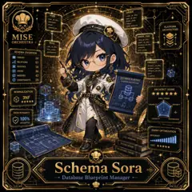

<!-- generated by tools/player-cards/scripts/build-character-pages.mjs from data/characters/schema-sora.json; do not edit by hand -->
# Schema Sora

**Registry character agent** · Implementation: **Described in docs only** · Detail record: [`data/characters/schema-sora.json`](../../data/characters/schema-sora.json)

Every field shows where its value comes from (`source:`). Repo-sourced values cite the repository or source-library file they were read from; values marked `authored: card design` were written for this card by [`enrich-characters.py`](../../tools/player-cards/scripts/enrich-characters.py), derived from the printed card text, role and kitchen theme, and are not claims about existing code.

## Identity

| Field | Value |
|---|---|
| Name | Schema Sora source: `data/characters.json` |
| Aliases / printed variants | None recorded (no alternate title in the canon crosswalk or agents.json) source: `data/player-cards.json + canon crosswalk (no alternate title found)` |
| Role / title | Schema Steward source: `characters/schema-sora/metadata.json` |
| Kitchen / department | Platform Kitchen source: `characters/schema-sora/metadata.json` |
| Department mission | Provide golden paths and stable service foundations. source: `data/imports/miseos_character_master_inventory_001_300.csv` |
| Registry rarity | Rare source: `characters/schema-sora/metadata.json` |
| Level | 23 source: `data/imports/miseos_character_master_inventory_001_300.csv` |
| ID: registry_id | MISE-023 source: `characters/schema-sora/metadata.json` |
| ID: character_id | miseos.character.019 source: `data/imports/miseos_character_master_inventory_001_300.csv` |
| ID: card_id | MISE-019 source: `data/imports/miseos_character_master_inventory_001_300.csv` |
| ID: codename | SCHEMA_SORA source: `data/imports/miseos_character_master_inventory_001_300.csv` |
| Collections | 1×1 Chefs source: `data/player-cards.json` |
| Cards linked | 1 source: `data/player-cards.json` |
| Role category | delivery source: `data/imports/merged_roster.json` |

## Player cards

| Card | Collection | Printed title | Match method | Full size |
|---|---|---|---|---|
| `schema-sora.webp` | 1×1 Chefs | Schema Sora | existing-index | [open](../../assets/player-cards/1by1-chefs/schema-sora.webp) |

## Card metadata (as printed)

| Field | Value |
|---|---|
| Printed rarity | Not printed on the card source: `data/player-cards-ocr.json (no rarity word in OCR)` |
| Printed stars | Not printed on the card source: `data/player-cards-ocr.json (no stars in OCR)` |
| Printed meters | 100% source: `data/player-cards-ocr.json` |
| Roster stats | power 61 · precision 82 · speed 53 · resilience 82 · intelligence 62 · teamwork 71 source: `data/imports/miseos_character_master_inventory_001_300.csv (roster stats, not OCR)` |
| Abilities | Order, User, User Name, Order_Date, Email, Total_Amount source: `data/player-cards-ocr.json (printed card labels, glued OCR words segmented)` |
| Lore | Most of the brigade only notices Schema Sora when something is missing, which is exactly the point. Schema Sora reads the numbers behind service (covers, waste, timings) and turns them into the next improvement; the image the crew uses for it is a clipboard of tally marks that becomes a chart by morning. The card calls out Order, User, User Name: the checks Schema Sora runs before calling anything ready. source: `authored: card design (derived from printed card text/role)` |
| Signature phrase | Database Blueprint Manager done cleanly, safely, and in rhythm. source: `data/imports/merged_roster.json` |
| Unique trait | Specializes in database blueprint manager so the Platform Kitchen can operate as a precise, repo-safe DevOps station. source: `data/imports/merged_roster.json` |

Full printed card text (OCR)

**`schema-sora.webp`**: ORDER · USER · order_id (PK) · user_id (PK) · user_id (FK) · username · order_date · email · status · total_amount · created_at · PLATFORM · ARCHITECTURE · MISE · ORDER_ITEM · item_id (PK) · ORCHESTRA · ROLE · order_id (FK) · role_id (PK) · product_id (FK) · role_name · quantity · SCHEMAOVERVIEW · unit_price · permissions · TABLES · 24 · RELATIONS · 57 · PRODUCT · ENTITIES · 18 · product_id(PK) · product_name · VIEWS · 36 · category_id (FK) · 42 · price · INDEXES · DATABASEBLUEPRINT · is_active · CONSTRAINTS · 29 · PLATFORMARCHITECTURE · ARCHITECTSCORE · NORMALIZATION · 3NF · MODELDESIGN · SCALABILTY · INTEGRITY · DATAINTEGRITY · 100% · FLEXIBILITY · PERFORMANCE · VALIDATED · QUERYOPTIMIZATION · DATA MODELING · EFFICIENCY · SYSTEM DESIGN · COST · RELATIONALTHEORY · Schema · Sora · Database Blueprint Manager

## Workflow

| Step | Value |
|---|---|
| Summary | Schema Sora performs schema steward within the Platform Kitchen. source: `characters/schema-sora/metadata.json` |
| Inputs | repository context, task request, policy constraints, current evidence source: `characters/schema-sora/metadata.json` |
| Outputs | validated result, evidence record, handoff packet source: `characters/schema-sora/metadata.json` |
| Proof gate | No merge, deployment, publication, billing action, or mint without evidence. source: `characters/schema-sora/metadata.json` |

## Actions / commands

- command: `MISE DATABASE BLUEPRINT MANAGER` source: `data/imports/miseos_character_master_inventory_001_300.csv`
- command: `Database Blueprint Manager` · mise_name: `Mise DatabaseBlueprintManager` source: `data/imports/merged_roster.json`

## Implementation

**Status:** Described in docs only

Roster data / types / tests in code that list this entry (not an implementation):
- [`apps/bootstrap-registry/apps/registry-console/src/data/master-roster.generated.ts:309`](../../apps/bootstrap-registry/apps/registry-console/src/data/master-roster.generated.ts#L309)
- [`apps/brigade-gallery/src/data/master-roster.ts:282`](../../apps/brigade-gallery/src/data/master-roster.ts#L282)

Data files that reference it:
- [`apps/bootstrap-registry/registry/cards/master-roster-cards.json:261`](../../apps/bootstrap-registry/registry/cards/master-roster-cards.json#L261)
- [`apps/gridops-platform/data/miseos-ecosystem-135.json:982`](../../apps/gridops-platform/data/miseos-ecosystem-135.json#L982)
- [`apps/voxel-world/src/data/agents.json:605`](../../apps/voxel-world/src/data/agents.json#L605)
- [`apps/voxel-world/src/data/miseos-ecosystem-135.json:982`](../../apps/voxel-world/src/data/miseos-ecosystem-135.json#L982)
- [`tools/art-factory/input/characters.generated.json:220`](../../tools/art-factory/input/characters.generated.json#L220)
- [`tools/art-factory/output/manifests/krikey_animation_prompts.json:453`](../../tools/art-factory/output/manifests/krikey_animation_prompts.json#L453)
- [`tools/art-factory/output/manifests/mangaboom_comic_prompts.json:453`](../../tools/art-factory/output/manifests/mangaboom_comic_prompts.json#L453)
- [`tools/art-factory/output/merged_roster.json:420`](../../tools/art-factory/output/merged_roster.json#L420)

Docs that describe it (docs only, not code):
- [`characters/schema-sora/README.md`](../../characters/schema-sora/README.md)
- [`apps/brigade-gallery/prototype/holo-card-roster.html:76`](../../apps/brigade-gallery/prototype/holo-card-roster.html#L76)
- [`apps/developer-platform/docs/characters/CHARACTER_REGISTRY_001_300.md:15`](../../apps/developer-platform/docs/characters/CHARACTER_REGISTRY_001_300.md#L15)

implemented_in_code = a dedicated capability handler or tool directory exists; referenced_in_app_code = the entity is used by application source (e.g. repo-pet sprites, CLI) but has no dedicated handler. code_refs are files that reference this entity by name/slug/handler (grep), not a guarantee of a dedicated runtime; registry handler links point at the actual capability function.

## Where and how it helps

| Aspect | Value |
|---|---|
| Station / stage | Platform Kitchen source: `characters/schema-sora/metadata.json` |
| Mission | Provide golden paths and stable service foundations. source: `data/imports/miseos_character_master_inventory_001_300.csv` |
| Problem it addresses | Schema Sora performs schema steward within the Platform Kitchen. source: `characters/schema-sora/metadata.json` |
| Safety gate | No merge, deployment, publication, billing action, or mint without evidence. source: `characters/schema-sora/metadata.json` |

## Agents and repo pets

Agents: [Observatory](../agents/observatory.md) · [Prometheus](../agents/prometheus.md) · [Risk Oracle](../agents/risk-oracle.md) source: `authored: card design (closest agents for theme "data")`

Repo pets: [Flag Fox](../repo-pets/flag-fox.md) · [Mise Lattice](../repo-pets/mise-lattice.md) source: `authored: card design (closest repo pets for theme "data")`

## Related characters

[Runtime Riku](./runtime-riku.md) · [Vault Hana](./vault-hana.md) · [Policy Kenji](./policy-kenji.md) · [Terra Forge](./terra-forge.md) · [Omar Reviewer](./omar-reviewer.md) · [Capacity Kanna](./capacity-kanna.md) source: `data/imports/miseos_character_master_inventory_001_300.csv data/imports/merged_roster.json data/imports/merged_roster.json data/imports/merged_roster.json`

## Canon Bible

Mentioned in [`docs/canon/MiseOS-Canon-Bible-v1.0.pdf`](../../docs/canon/MiseOS-Canon-Bible-v1.0.pdf):

- line 571: `MISE-G2-P051 Schema Sora Mise Orchestra canonical-candidate 1E3334AB-3111- 51`

## Sources

| Field | Source |
|---|---|
| name | `data/characters.json` |
| cards | `data/player-cards.json` |
| card_text | `data/player-cards-ocr.json (OCR of the card image)` |
| card_meters_printed | `data/player-cards-ocr.json` |
| ids.registry_id | `characters/schema-sora/metadata.json` |
| role | `characters/schema-sora/metadata.json` |
| department | `characters/schema-sora/metadata.json` |
| rarity | `characters/schema-sora/metadata.json` |
| workflow.summary | `characters/schema-sora/metadata.json` |
| workflow.inputs | `characters/schema-sora/metadata.json` |
| workflow.outputs | `characters/schema-sora/metadata.json` |
| workflow.proof_gate | `characters/schema-sora/metadata.json` |
| department_mission | `data/imports/miseos_character_master_inventory_001_300.csv` |
| ids.character_id | `data/imports/miseos_character_master_inventory_001_300.csv` |
| ids.card_id | `data/imports/miseos_character_master_inventory_001_300.csv` |
| ids.codename | `data/imports/miseos_character_master_inventory_001_300.csv` |
| stats | `data/imports/miseos_character_master_inventory_001_300.csv (roster stats, not OCR)` |
| level | `data/imports/miseos_character_master_inventory_001_300.csv` |
| related | `data/imports/miseos_character_master_inventory_001_300.csv data/imports/merged_roster.json data/imports/merged_roster.json data/imports/merged_roster.json` |
| signature_phrase | `data/imports/merged_roster.json` |
| unique_trait | `data/imports/merged_roster.json` |
| role_category | `data/imports/merged_roster.json` |
| canon_bible | `docs/canon/MiseOS-Canon-Bible-v1.0.pdf (pdftotext)` |
| implementation | `git ls-files grep + repo` |
| helps.station | `characters/schema-sora/metadata.json` |
| aliases | `data/player-cards.json + canon crosswalk (no alternate title found)` |
| card_rarity_printed | `data/player-cards-ocr.json (no rarity word in OCR)` |
| card_stars_printed | `data/player-cards-ocr.json (no stars in OCR)` |
| abilities | `data/player-cards-ocr.json (printed card labels, glued OCR words segmented)` |
| lore | `authored: card design (derived from printed card text/role)` |
| agents | `authored: card design (closest agents for theme "data")` |
| repo_pets | `authored: card design (closest repo pets for theme "data")` |
| theme | `authored: card design (keyword theme used for authored fields)` |

[← All characters](./README.md)
