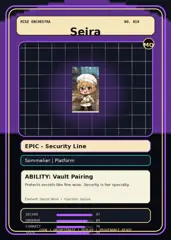

<!-- generated by tools/player-cards/scripts/build-character-pages.mjs from data/characters/seira.json; do not edit by hand -->
# Seira

**Registry character agent** · Implementation: **Referenced in app code (no dedicated handler)** · Detail record: [`data/characters/seira.json`](../../data/characters/seira.json)

Every field shows where its value comes from (`source:`). Repo-sourced values cite the repository or source-library file they were read from; values marked `authored: card design` were written for this card by [`enrich-characters.py`](../../tools/player-cards/scripts/enrich-characters.py), derived from the printed card text, role and kitchen theme, and are not claims about existing code.

## Identity

| Field | Value |
|---|---|
| Name | Seira source: `data/characters.json` |
| Aliases / printed variants | None recorded (no alternate title in the canon crosswalk or agents.json) source: `data/player-cards.json + canon crosswalk (no alternate title found)` |
| Role / title | Secure source: `characters/seira/metadata.json` |
| Kitchen / department | Platform Kitchen source: `characters/seira/metadata.json` |
| Department mission | Provide golden paths and stable service foundations. source: `data/imports/miseos_character_master_inventory_001_300.csv` |
| Registry rarity | Epic source: `characters/seira/metadata.json` |
| Level | 23 source: `data/imports/miseos_character_master_inventory_001_300.csv` |
| ID: registry_id | MISE-083 source: `characters/seira/metadata.json` |
| ID: character_id | miseos.character.083 source: `data/imports/miseos_character_master_inventory_001_300.csv` |
| ID: card_id | MISE-083 source: `data/imports/miseos_character_master_inventory_001_300.csv` |
| ID: codename | SEIRA source: `data/imports/miseos_character_master_inventory_001_300.csv` |
| Collections | 1×1 Chefs, Character Building Theme, Mise Orchestra Trading Cards (Season 1) source: `data/player-cards.json` |
| Cards linked | 3 source: `data/player-cards.json` |

## Player cards

| Card | Collection | Printed title | Match method | Full size |
|---|---|---|---|---|
| `seira.webp` | 1×1 Chefs | Seira | existing-index | [open](../../assets/player-cards/1by1-chefs/seira.webp) |
| `seira.webp` | Character Building Theme | SEIRA | existing-index | [open](../../assets/player-cards/character-building/seira.webp) |
| `seira.webp` | Mise Orchestra Trading Cards (Season 1) | Seira | existing-index | [open](../../assets/player-cards/orchestra-trading-cards/seira.webp) |

## Card metadata (as printed)

| Field | Value |
|---|---|
| Printed rarity | Epic source: `data/player-cards-ocr.json` |
| Printed stars | Not printed on the card source: `data/player-cards-ocr.json (no stars in OCR)` |
| Printed meters | Not printed on the card source: `data/player-cards-ocr.json (no % meters in OCR)` |
| Roster stats | power 68 · precision 86 · speed 81 · resilience 83 · intelligence 83 · teamwork 70 source: `data/imports/miseos_character_master_inventory_001_300.csv (roster stats, not OCR)` |
| Abilities | Vault Pairing source: `data/imports/mise_orchestra_cards.csv` |
| Mise Orchestra card | role: Sommelier · department: Platform · function: Secure · rarity: Epic · tier: Security Line · element: Secret Wine · ability: Vault Pairing · lore: Protects secrets like fine wine. Security is her specialty. source: `data/imports/mise_orchestra_cards.csv` |
| Lore | Seira belongs to the Kitchen Chaos DevOps Universe, where every technical workflow becomes a coordinated brigade station. source: `data/imports/merged_roster.json` |
| Signature phrase | Guard. Audit. Comply. source: `authored: card design (derived from printed card text/role)` |

Full printed card text (OCR)

**`seira.webp`**: MISE · ORCHESTRA · SECRETS · ARCHIVE · AGEDTO · PERFECTION. · VINTAGEMEMORIES · LOCKED&SEALED · UNTIL THE RIGHT · PALATE APPEARS. · SOMMELIER'SART · PALATE INSIGHT · AROMA · ·OBSERVE · ·DECANT · BODY · BALANCE · ·HARMONIZE · FINESSE · +REVEAL · SECRETS · Seira · Sommelier

**`seira.webp`**: TAGLINEOPTIONS · BRIGADE · THEKITCHENOSTHATTURNS · DEVELOPERFOCUSED · AICHAOSINTOCOORDINATEDSERVICE · Everything In Its Place. · SYSTEMS · Orchestrate Everything. · The Operating SystemFor · Every agent becomes a chef. · Autonomous Development. · Cook, Orchestrate. Deploy. · Every Role. One Symphony. · .Infrastructure · MISEOS · Every repository becomes a kitchen. · AI AGENTFOCUSED · Military organization · The Kitchen Where Agents Work. · ·Operations consulting · Every deployment becomes a service. · The OS For Multi-Agent Teams. · Enterprise tooling · Autonomous Development, · THEOPERATINGSYSTEMFOR · Properly Organized. · Where Human Intent Meets · Every workflow becomes an orchestra. · AUTONOMOUSDEVELOPMENT · Agent Execution. · ENTERPRISEFOCUSED · COOK · DEPLOY · ORCHESTRATE · Operational Iintelligence, · Perfectly Placed. · Infrastructure With Discipline, · MISEOSPLATFORMARCHITECTURE · Systems Thinking For · AutonomousTeams. · MISEOS · MISEOS · MISEOS · MISEOS · MISEOS · MISEOS · CORE · BRIGADE · KITCHEN · ORCHESTRA · VAULT · OBSERVATORY · MISEOSLOGOMARK · Multi-agent coordination · The platform. · Agent workforce · Developer · Observability layer. · The operating · layer, · - Repositories · system. · - HashiCorp Vault · - Tasks · • Agent Delegation · - Ephemeral Tokens · ·Performance · - Actions · m Execution · - Knov · -Credential Isolation · - MCP Connections · •Costs · - Deployments · • Tester · - Token Usage · • Security · MASCOT:SEIRA · MASCOT: STREAMA · LADLE.BATONCIRCUIT.STAFF · MISEOSMASCOTHIERARCHY · ORCHESTRATING INTELLIGENCE · COLORPALETTE · TIER1-EXECUTIVECHEFS · TIER 2  KITCHEN OPERATIONS · TIER3-SERVICE LAYER · PRIMARY · Umami Black · Geld Ladie · B060F10 · D4AF37 · Broth Cream · WF6F1E7 · SECONDARY · ORCHESTRA · KUROGAMI · KURO GUARD · TENSHO · BUILD-KUN · SCALEONI · FLASH RIKU · IRON HASHI · NULL-CHAN · SEIRA · MIZU · STREAMA · UMAMICODE · KAJI · Flame Orarnge · Matcha Green · (cleanup) · Ink Blue · (deployment) · YUME · (agent dinector) · (becrets) · (scaling) · (validation) · (streams) · (APis) · CORE · (security) · (containers) · (routing) · (queueing) · (compute) · 1824 · 897822 · 925684E · (artifacts) · ELEVATORPITCH · WEBSITE STRUCTURE · BUILTFORDEVELOPERS.DESIGNEDFORAGENTS.DRIVENBYORCHESTRATION. · MiseOS is the operating system for autonomous software development, Built around the principles · miseos.dev · of mise en place, it transforms Al agents, repositories, worklows, and infrastructure into a · 883 · coordinated kitchen where every role has a purpose, every action is observable, and every · AI-NATIVE · OPEN ECOSYSTEM · SECURE BY DESIGN · FULLY OBSERVABLE · Kitchen · Vault · Observatory · Docs · deployment is orchestrated with precision. · Platfor · Orchestra · Brigade · Mascots · Pricing

**`seira.webp`**: MISEORCHESTRA · NO.010 · Seira · MO · EPIC-Security Line · Sommelier\|Platform · ABILITY: Vault Pairing · Protects secrets like fine wine. Security is her specialty. · Element:SecretWineFunction:Secure · SECURE · 97 · OBSERVE · 85 · CONNECT · 78 · ORCHESTRATE·DEPLOY · COOK · PROVENANCE-READY · ASE · 90

## Workflow

| Step | Value |
|---|---|
| Summary | Seira performs secure within the Platform Kitchen. source: `characters/seira/metadata.json` |
| Inputs | repository context, task request, policy constraints, current evidence source: `characters/seira/metadata.json` |
| Outputs | validated result, evidence record, handoff packet source: `characters/seira/metadata.json` |
| Proof gate | No merge, deployment, publication, billing action, or mint without evidence. source: `characters/seira/metadata.json` |

## Actions / commands

- command: `MISE SECURE` source: `data/imports/miseos_character_master_inventory_001_300.csv`

## Implementation

**Status:** Referenced in app code (no dedicated handler)

Application code that uses this entry:
- [`apps/miseos-platform/packages/miseos-repo-pet/src/characters.js:291`](../../apps/miseos-platform/packages/miseos-repo-pet/src/characters.js#L291)
- [`tools/repo-pet/src/characters.js:15`](../../tools/repo-pet/src/characters.js#L15)

Roster data / types / tests in code that list this entry (not an implementation):
- [`apps/bootstrap-registry/apps/registry-console/src/data/master-roster.generated.ts:127`](../../apps/bootstrap-registry/apps/registry-console/src/data/master-roster.generated.ts#L127)
- [`apps/brigade-gallery/src/data/brigade-roster.ts:57`](../../apps/brigade-gallery/src/data/brigade-roster.ts#L57)
- [`apps/brigade-gallery/src/data/master-roster.ts:59`](../../apps/brigade-gallery/src/data/master-roster.ts#L59)
- [`tools/repo-pet/test/smoke.mjs:19`](../../tools/repo-pet/test/smoke.mjs#L19)

Data files that reference it:
- [`apps/bootstrap-registry/registry/cards/master-roster-cards.json:79`](../../apps/bootstrap-registry/registry/cards/master-roster-cards.json#L79)
- [`apps/gridops-platform/data/miseos-ecosystem-135.json:176`](../../apps/gridops-platform/data/miseos-ecosystem-135.json#L176)
- [`apps/registry-atrium/collection-manifest.json:93`](../../apps/registry-atrium/collection-manifest.json#L93)
- [`apps/registry-atrium/metadata/erc721/010-seira.json:2`](../../apps/registry-atrium/metadata/erc721/010-seira.json#L2)
- [`apps/voxel-world/src/data/agents.json:111`](../../apps/voxel-world/src/data/agents.json#L111)
- [`apps/voxel-world/src/data/miseos-ecosystem-135.json:176`](../../apps/voxel-world/src/data/miseos-ecosystem-135.json#L176)
- [`tools/art-factory/input/characters.generated.json:277`](../../tools/art-factory/input/characters.generated.json#L277)
- [`tools/art-factory/input/mise_orchestra_cards.csv:11`](../../tools/art-factory/input/mise_orchestra_cards.csv#L11)
- [`tools/art-factory/input/mise_orchestra_collection_manifest.json:93`](../../tools/art-factory/input/mise_orchestra_collection_manifest.json#L93)
- [`tools/art-factory/output/manifests/krikey_animation_prompts.json:99`](../../tools/art-factory/output/manifests/krikey_animation_prompts.json#L99)

Docs that describe it (docs only, not code):
- [`characters/seira/README.md`](../../characters/seira/README.md)
- [`apps/brigade-gallery/prototype/holo-card-roster.html:76`](../../apps/brigade-gallery/prototype/holo-card-roster.html#L76)
- [`apps/brigade-gallery/prototype/registry-atrium-gallery.html:342`](../../apps/brigade-gallery/prototype/registry-atrium-gallery.html#L342)
- [`apps/developer-platform/docs/characters/CHARACTER_REGISTRY_001_300.md:11`](../../apps/developer-platform/docs/characters/CHARACTER_REGISTRY_001_300.md#L11)
- [`apps/miseos-platform/packages/miseos-repo-pet/README.md:5`](../../apps/miseos-platform/packages/miseos-repo-pet/README.md#L5)
- [`apps/miseos-platform/packages/miseos-repo-pet/docs/MASCOT_REFERENCE.md:23`](../../apps/miseos-platform/packages/miseos-repo-pet/docs/MASCOT_REFERENCE.md#L23)
- [`apps/registry-atrium/index.html:342`](../../apps/registry-atrium/index.html#L342)
- [`tools/repo-pet/README.md:116`](../../tools/repo-pet/README.md#L116)
- [`tools/repo-pet/docs/MASCOT_REFERENCE.md:10`](../../tools/repo-pet/docs/MASCOT_REFERENCE.md#L10)

implemented_in_code = a dedicated capability handler or tool directory exists; referenced_in_app_code = the entity is used by application source (e.g. repo-pet sprites, CLI) but has no dedicated handler. code_refs are files that reference this entity by name/slug/handler (grep), not a guarantee of a dedicated runtime; registry handler links point at the actual capability function.

## Where and how it helps

| Aspect | Value |
|---|---|
| Station / stage | Platform Kitchen source: `characters/seira/metadata.json` |
| Mission | Provide golden paths and stable service foundations. source: `data/imports/miseos_character_master_inventory_001_300.csv` |
| Problem it addresses | Seira performs secure within the Platform Kitchen. source: `characters/seira/metadata.json` |
| Safety gate | No merge, deployment, publication, billing action, or mint without evidence. source: `characters/seira/metadata.json` |

## Agents and repo pets

Agents: [Seira](../agents/seira.md) source: `data/agents.json`

Repo pets: [Seira](../repo-pets/seira.md) source: `data/repo-pets.json`

## Related characters

[Kuro Guard](./kuro-guard.md) · [Orchestra Core](./orchestra-core.md) · [Template Tanaka](./template-tanaka.md) source: `data/imports/miseos_character_master_inventory_001_300.csv`

## Sources

| Field | Source |
|---|---|
| name | `data/characters.json` |
| cards | `data/player-cards.json` |
| card_text | `data/player-cards-ocr.json (OCR of the card image)` |
| card_rarity_printed | `data/player-cards-ocr.json` |
| ids.registry_id | `characters/seira/metadata.json` |
| role | `characters/seira/metadata.json` |
| department | `characters/seira/metadata.json` |
| rarity | `characters/seira/metadata.json` |
| workflow.summary | `characters/seira/metadata.json` |
| workflow.inputs | `characters/seira/metadata.json` |
| workflow.outputs | `characters/seira/metadata.json` |
| workflow.proof_gate | `characters/seira/metadata.json` |
| department_mission | `data/imports/miseos_character_master_inventory_001_300.csv` |
| ids.character_id | `data/imports/miseos_character_master_inventory_001_300.csv` |
| ids.card_id | `data/imports/miseos_character_master_inventory_001_300.csv` |
| ids.codename | `data/imports/miseos_character_master_inventory_001_300.csv` |
| stats | `data/imports/miseos_character_master_inventory_001_300.csv (roster stats, not OCR)` |
| level | `data/imports/miseos_character_master_inventory_001_300.csv` |
| related | `data/imports/miseos_character_master_inventory_001_300.csv` |
| lore | `data/imports/merged_roster.json` |
| orchestra_card | `data/imports/mise_orchestra_cards.csv` |
| abilities | `data/imports/mise_orchestra_cards.csv` |
| implementation | `git ls-files grep + repo` |
| helps.station | `characters/seira/metadata.json` |
| agents | `data/agents.json` |
| repo_pets | `data/repo-pets.json` |
| aliases | `data/player-cards.json + canon crosswalk (no alternate title found)` |
| card_stars_printed | `data/player-cards-ocr.json (no stars in OCR)` |
| card_meters_printed | `data/player-cards-ocr.json (no % meters in OCR)` |
| signature_phrase | `authored: card design (derived from printed card text/role)` |
| theme | `authored: card design (keyword theme used for authored fields)` |

[← All characters](./README.md)
