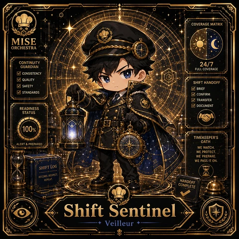
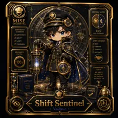

<!-- generated by tools/player-cards/scripts/build-character-pages.mjs from data/characters/shift-sentinel.json; do not edit by hand -->
# Shift Sentinel

**Card-defined chef (catalogue: visual reference only)** · Implementation: **Described in docs only** · Detail record: [`data/characters/shift-sentinel.json`](../../data/characters/shift-sentinel.json)

Every field below comes from a repository source (shown as `source:`). Where no source exists the page says _Not yet defined in the source material_.

## Identity

| Field | Value |
|---|---|
| Name | Shift Sentinel source: `data/imports/photo-alignment.csv` |
| Aliases / printed variants | Not yet defined in the source material |
| Role / title | Veilleur source: `data/player-cards-ocr.json (subtitle printed under the name)` |
| Kitchen / department | Not yet defined in the source material |
| Department mission | Not yet defined in the source material |
| Registry rarity | Not yet defined in the source material |
| Collections | 1×1 Chefs source: `data/player-cards.json` |
| Cards linked | 2 source: `data/player-cards.json` |
| Catalogue status | visual_reference_only source: `data/imports/photo-alignment.csv` |

## Player cards

| Card | Collection | Printed title | Match method | Full size |
|---|---|---|---|---|
| `shift-sentinel.webp` | 1×1 Chefs | Shift Sentinel | title | [open](../../assets/player-cards/1by1-chefs/shift-sentinel.webp) |
| `shift-sentinel-2.webp` | 1×1 Chefs | Shift Sentinel | title | [open](../../assets/player-cards/1by1-chefs/shift-sentinel-2.webp) |

## Card metadata (as printed)

| Field | Value |
|---|---|
| Printed rarity | Not yet defined in the source material |
| Printed stars | Not yet defined in the source material |
| Printed meters | 100% source: `data/player-cards-ocr.json` |
| Roster stats | Not yet defined in the source material |
| Abilities | Not yet defined in the source material |
| Lore | Not yet defined in the source material |
| Signature phrase | Not yet defined in the source material |

Full printed card text (OCR)

**`shift-sentinel.webp`**: COVERAGEMATRIX · MISE · ORCHESTRA · CONTINUITY · 24/7 · GUARDIAN · FULL COVERAGE · CONSISTENCY · QUALITY · SHIFT HANDOFF · SAFETY · BRIEF · STANDARDS ·  CONFIRM · TRANSFER · DOCUMENT · READINESS · STATUS · 100% · TIMEKEEPER'S · OATH · ALERT&PREPARED · WE WATCH. · WE PROTECT. · WEPREPARE. · WEPASSITON · SHIFT LOG · RECORD.RESPECT. · REPEAT. · HANDOFF · COMPLETE · Shift · Sentinel · Veilleur

**`shift-sentinel-2.webp`**: COVERAGEMATRIX · MISE · ORCHESTRA · CONTINUITY · 24/7 · GUARDIAN · FULLCOVERAGE · CONSISTENCY · QUALITY · ?SAFETY · SHIFT HANDOFF · MSTANDARDS ·  BRIEF · CONFIRM ·  TRANSFER · READINESS · DOCUMENT · STATUS · 100% · TIMEKEEPER'S · ALERT&PREPARED · OATH · WE WATCH. · WE PROTECT. · WE PREPARE. · WEPASSITON. · SHIFT LOG · RECORD. · RESPECT. · HANDOFF · REPEAT. · COMPLETE · Shift Sentinel · Veilleur

## Workflow

| Step | Value |
|---|---|
| Summary | Not yet defined in the source material |
| Inputs | Not yet defined in the source material |
| Outputs | Not yet defined in the source material |
| Proof gate | Not yet defined in the source material |

## Actions / commands

_Not yet defined in the source material_

## Implementation

**Status:** Described in docs only

Data files that reference it:
- [`apps/miseos-platform/config/3d-card-showcase.json:41`](../../apps/miseos-platform/config/3d-card-showcase.json#L41)

Docs that describe it (docs only, not code):
- [`apps/miseos-platform/docs/3D_CHARACTER_COLLECTIBLE_CAROUSEL.md:32`](../../apps/miseos-platform/docs/3D_CHARACTER_COLLECTIBLE_CAROUSEL.md#L32)

implemented_in_code = a dedicated capability handler or tool directory exists; referenced_in_app_code = the entity is used by application source (e.g. repo-pet sprites, CLI) but has no dedicated handler. code_refs are files that reference this entity by name/slug/handler (grep), not a guarantee of a dedicated runtime; registry handler links point at the actual capability function.

## Where and how it helps

| Aspect | Value |
|---|---|
| Station / stage | Veilleur source: `data/player-cards-ocr.json (subtitle printed under the name)` |
| Mission | Not yet defined in the source material |
| Problem it addresses | Not yet defined in the source material |
| Safety gate | Not yet defined in the source material |

## Agents and repo pets

_Not yet defined in the source material_

## Related characters

_Not yet defined in the source material_

## Sources

| Field | Source |
|---|---|
| name | `data/imports/photo-alignment.csv` |
| cards | `data/player-cards.json` |
| card_text | `data/player-cards-ocr.json (OCR of the card image)` |
| card_meters_printed | `data/player-cards-ocr.json` |
| role | `data/player-cards-ocr.json (subtitle printed under the name)` |
| catalogue_status | `data/imports/photo-alignment.csv` |
| implementation | `git ls-files grep + repo` |
| helps.station | `data/player-cards-ocr.json (subtitle printed under the name)` |

[← All characters](./README.md)
