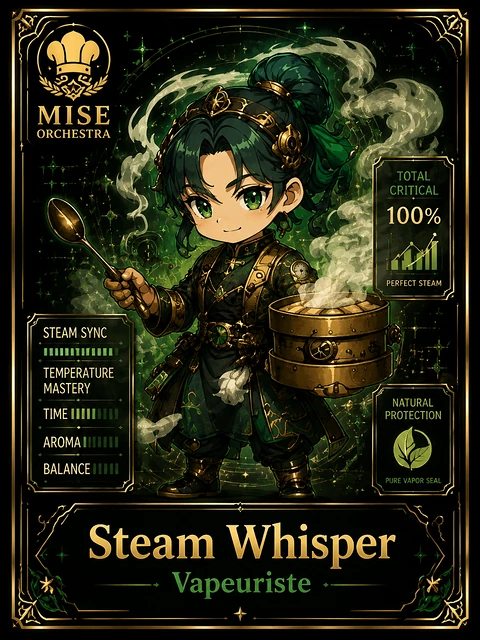

<!-- generated by tools/player-cards/scripts/build-character-pages.mjs from data/characters/steam-whisper.json; do not edit by hand -->
# Steam Whisper

**Card-defined chef (catalogue: visual reference only)** · Implementation: **Designed (not yet implemented in code)** · Detail record: [`data/characters/steam-whisper.json`](../../data/characters/steam-whisper.json)

Every field shows where its value comes from (`source:`). Repo-sourced values cite the repository or source-library file they were read from; values marked `authored: card design` were written for this card by [`enrich-characters.py`](../../tools/player-cards/scripts/enrich-characters.py), derived from the printed card text, role and kitchen theme, and are not claims about existing code.

## Identity

| Field | Value |
|---|---|
| Name | Steam Whisper source: `data/imports/photo-alignment.csv` |
| Aliases / printed variants | Whisper, Whisper Steam source: `card titles / OCR in data/player-cards-ocr.json` |
| Role / title | Steam source: `data/player-cards-ocr.json (subtitle printed under the name)` |
| Kitchen / department | Reliability Kitchen source: `authored: card design (kitchen chosen from role/printed text, theme "cold")` |
| Department mission | Observe. Measure. Improve. source: `data/imports/miseos_character_master_inventory_001_300.csv (mission of Reliability Kitchen)` |
| Registry rarity | Common source: `authored: card design (default tier; no stars printed)` |
| Collections | Long Cards source: `data/player-cards.json` |
| Cards linked | 1 source: `data/player-cards.json` |
| Catalogue status | visual_reference_only source: `data/imports/photo-alignment.csv` |

## Player cards

| Card | Collection | Printed title | Match method | Full size |
|---|---|---|---|---|
| `whisper.webp` | Long Cards | Whisper | title | [open](../../assets/player-cards/long-cards/whisper.webp) |

## Card metadata (as printed)

| Field | Value |
|---|---|
| Printed rarity | Not printed on the card source: `data/player-cards-ocr.json (no rarity word in OCR)` |
| Printed stars | Not printed on the card source: `data/player-cards-ocr.json (no stars in OCR)` |
| Printed meters | 100% source: `data/player-cards-ocr.json` |
| Roster stats | power 77 · precision 66 · speed 68 · resilience 77 · intelligence 66 · teamwork 80 source: `authored: card design (6-axis roster scale; baseline from stars + theme "cold")` |
| Abilities | Total, Critical, Perfect Steam, Steam Sync, Temperature, Mastery source: `data/player-cards-ocr.json (printed card labels, glued OCR words segmented)` |
| Lore | Ask the brigade about Steam Whisper and they describe the walk-in, humming at three degrees. As Reliability Kitchen's specialist for steam, Steam Whisper keeps every item inside its safe temperature band and flags drift before it becomes spoilage, and the rest of the kitchen plans service around that rhythm. The card calls out Total, Critical, Perfect Steam: the checks Steam Whisper runs before calling anything ready. source: `authored: card design (derived from printed card text/role)` |
| Signature phrase | Cold logic, safe food. source: `authored: card design (derived from printed card text/role)` |

Full printed card text (OCR)

**`whisper.webp`**: MISE · ORCHESTRA · TOTAL · CRITICAL · 100% · PERFECTSTEAM · STEAM SYNC · TEMPERATURE · MASTERY · NATURAL · TIME II · PROTECTION · AROMAIII · BALANCEIII · PUREVAPOR SEAL · Whisper · Steam · Vapeuriste

## Workflow

| Step | Value |
|---|---|
| Summary | Steam Whisper keeps every item inside its safe temperature band and flags drift before it becomes spoilage. source: `authored: card design (theme "cold")` |
| Inputs | probe / sensor readings, storage map, HACCP limits, hold times source: `authored: card design (theme "cold")` |
| Outputs | temperature log, drift alert, discard / re-chill decision source: `authored: card design (theme "cold")` |
| Proof gate | Temperature gate: readings outside the safe band for longer than the hold limit force a discard or re-chill; no override without a logged reason. source: `authored: card design (theme "cold")` |

## Actions / commands

- command: `mise roster run steam-whisper --dept reliability-kitchen --solo --emit report` · status: `proposed` source: `authored: follows data/imports/master-roster-cards.csv (mise roster run command convention)`
- command: `mise steam-whisper probe` · reads: `probe / sensor readings` · emits: `temperature log` · status: `proposed` source: `authored: card design (theme "cold")`
- command: `mise steam-whisper chill` · reads: `storage map` · emits: `drift alert` · status: `proposed` source: `authored: card design (theme "cold")`
- command: `mise steam-whisper log-temp` · reads: `HACCP limits` · emits: `discard / re-chill decision` · status: `proposed` source: `authored: card design (theme "cold")`

## Implementation

**Status:** Designed (not yet implemented in code)

- Proposed handler: `steamWhisper` (not written yet)
- Proposed command: `mise roster run steam-whisper --dept reliability-kitchen --solo --emit report`
- Contract: inputs: probe / sensor readings, storage map, HACCP limits, hold times → outputs: temperature log, drift alert, discard / re-chill decision; refuses to emit 'ready' unless the proof gate passes

source: `git ls-files grep + repo (no code found) + authored: proposed handler spec`

implemented_in_code = a dedicated capability handler or tool directory exists; referenced_in_app_code = the entity is used by application source (e.g. repo-pet sprites, CLI) but has no dedicated handler. code_refs are files that reference this entity by name/slug/handler (grep), not a guarantee of a dedicated runtime; registry handler links point at the actual capability function.

## Where and how it helps

| Aspect | Value |
|---|---|
| Station / stage | Steam source: `data/player-cards-ocr.json (subtitle printed under the name)` |
| Mission | Observe. Measure. Improve. source: `data/imports/miseos_character_master_inventory_001_300.csv (mission of Reliability Kitchen)` |
| Problem it addresses | Silent drift (heat, latency, resource pressure) spoils work long before anyone notices. source: `authored: card design (theme "cold")` |
| Safety gate | Temperature gate: readings outside the safe band for longer than the hold limit force a discard or re-chill; no override without a logged reason. source: `authored: card design (theme "cold")` |

## Agents and repo pets

Agents: [Observatory](../agents/observatory.md) · [Alarmer](../agents/alarmer.md) · [SRE Chef](../agents/sre-chef.md) source: `authored: card design (closest agents for theme "cold")`

Repo pets: [Mise Runtime](../repo-pets/mise-runtime.md) · [Null-chan](../repo-pets/null-chan.md) source: `authored: card design (closest repo pets for theme "cold")`

## Related characters

[Cold Zero](./cold-zero.md) · [Temp Tamer](./temp-tamer.md) · [Canary Judge](./canary-judge.md) · [Pager Hiro](./pager-hiro.md) · [OnCall Naomi](./oncall-naomi.md) source: `authored: card design (same theme "cold" / same department)`

## Sources

| Field | Source |
|---|---|
| name | `data/imports/photo-alignment.csv` |
| aliases | `card titles / OCR in data/player-cards-ocr.json` |
| cards | `data/player-cards.json` |
| card_text | `data/player-cards-ocr.json (OCR of the card image)` |
| card_meters_printed | `data/player-cards-ocr.json` |
| role | `data/player-cards-ocr.json (subtitle printed under the name)` |
| catalogue_status | `data/imports/photo-alignment.csv` |
| implementation | `git ls-files grep + repo (no code found) + authored: proposed handler spec` |
| helps.station | `data/player-cards-ocr.json (subtitle printed under the name)` |
| department | `authored: card design (kitchen chosen from role/printed text, theme "cold")` |
| department_mission | `data/imports/miseos_character_master_inventory_001_300.csv (mission of Reliability Kitchen)` |
| card_rarity_printed | `data/player-cards-ocr.json (no rarity word in OCR)` |
| card_stars_printed | `data/player-cards-ocr.json (no stars in OCR)` |
| rarity | `authored: card design (default tier; no stars printed)` |
| stats | `authored: card design (6-axis roster scale; baseline from stars + theme "cold")` |
| abilities | `data/player-cards-ocr.json (printed card labels, glued OCR words segmented)` |
| lore | `authored: card design (derived from printed card text/role)` |
| signature_phrase | `authored: card design (derived from printed card text/role)` |
| workflow.summary | `authored: card design (theme "cold")` |
| workflow.inputs | `authored: card design (theme "cold")` |
| workflow.outputs | `authored: card design (theme "cold")` |
| workflow.proof_gate | `authored: card design (theme "cold")` |
| actions | `authored: follows data/imports/master-roster-cards.csv (mise roster run command convention)` |
| helps.mission | `data/imports/miseos_character_master_inventory_001_300.csv (mission of Reliability Kitchen)` |
| helps.problem | `authored: card design (theme "cold")` |
| helps.proof_gate | `authored: card design (theme "cold")` |
| agents | `authored: card design (closest agents for theme "cold")` |
| repo_pets | `authored: card design (closest repo pets for theme "cold")` |
| related | `authored: card design (same theme "cold" / same department)` |
| theme | `authored: card design (keyword theme used for authored fields)` |

[← All characters](./README.md)
