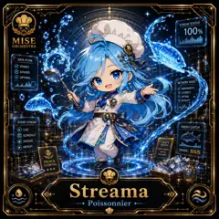

<!-- generated by tools/player-cards/scripts/build-character-pages.mjs from data/characters/streama.json; do not edit by hand -->
# Streama

**Registry character agent** · Implementation: **Referenced in app code (no dedicated handler)** · Detail record: [`data/characters/streama.json`](../../data/characters/streama.json)

Every field shows where its value comes from (`source:`). Repo-sourced values cite the repository or source-library file they were read from; values marked `authored: card design` were written for this card by [`enrich-characters.py`](../../tools/player-cards/scripts/enrich-characters.py), derived from the printed card text, role and kitchen theme, and are not claims about existing code.

## Identity

| Field | Value |
|---|---|
| Name | Streama source: `data/characters.json` |
| Aliases / printed variants | None recorded (no alternate title in the canon crosswalk or agents.json) source: `data/player-cards.json + canon crosswalk (no alternate title found)` |
| Role / title | Data Streaming Profiles source: `characters/streama/metadata.json` |
| Kitchen / department | Platform Kitchen source: `characters/streama/metadata.json` |
| Department mission | Provide golden paths and stable service foundations. source: `data/imports/miseos_character_master_inventory_001_300.csv` |
| Registry rarity | Genesis source: `characters/streama/metadata.json` |
| Level | 32 source: `data/imports/miseos_character_master_inventory_001_300.csv` |
| ID: registry_id | MISE-026 source: `characters/streama/metadata.json` |
| ID: character_id | miseos.character.026 source: `data/imports/miseos_character_master_inventory_001_300.csv` |
| ID: card_id | MISE-026 source: `data/imports/miseos_character_master_inventory_001_300.csv` |
| ID: codename | STREAMA source: `data/imports/miseos_character_master_inventory_001_300.csv` |
| Collections | 1×1 Chefs, Mise Orchestra Trading Cards (Season 1) source: `data/player-cards.json` |
| Cards linked | 2 source: `data/player-cards.json` |
| Role category | delivery source: `data/imports/merged_roster.json` |

## Player cards

| Card | Collection | Printed title | Match method | Full size |
|---|---|---|---|---|
| `streama.webp` | 1×1 Chefs | Streama | existing-index | [open](../../assets/player-cards/1by1-chefs/streama.webp) |
| `streama.webp` | Mise Orchestra Trading Cards (Season 1) | Streama | existing-index | [open](../../assets/player-cards/orchestra-trading-cards/streama.webp) |

## Card metadata (as printed)

| Field | Value |
|---|---|
| Printed rarity | Rare source: `data/player-cards-ocr.json` |
| Printed stars | Not printed on the card source: `data/player-cards-ocr.json (no stars in OCR)` |
| Printed meters | 100% source: `data/player-cards-ocr.json` |
| Roster stats | power 86 · precision 82 · speed 66 · resilience 71 · intelligence 82 · teamwork 88 source: `data/imports/miseos_character_master_inventory_001_300.csv (roster stats, not OCR)` |
| Abilities | Smooth Flow source: `data/imports/mise_orchestra_cards.csv` |
| Mise Orchestra card | role: Poissonnier · department: Operations · function: Stream · rarity: Rare · tier: Event Line · element: Live Water · ability: Smooth Flow · lore: Streams data like water. Smooth, continuous, and always flowing. source: `data/imports/mise_orchestra_cards.csv` |
| Lore | Streama belongs to the Kitchen Chaos DevOps Universe, where every technical workflow becomes a coordinated brigade station. source: `data/imports/merged_roster.json` |
| Signature phrase | Data Streaming Profiles done cleanly, safely, and in rhythm. source: `data/imports/merged_roster.json` |
| Unique trait | Specializes in data streaming profiles so the Platform Kitchen can operate as a precise, repo-safe DevOps station. source: `data/imports/merged_roster.json` |

Full printed card text (OCR)

**`streama.webp`**: STREAMSTATUS · 100% · MISE · ORCHESTRA · DATAFLOW · STABLE · SYNCED · OPTIMAL · NETWORK WAVE · ①BANDWIDTH · LATENCY · ?UPTIME · ?QUALITY · EVENTSTREAM · FRESH CATCH · LIVE · SCHEDULE · ENGAGE · TODAY'S · SPECIAL · REPEAT · DATA-FRESH · GRADE: SSS · OCEAN · DELIVERY · FRESH& · FLOWING · Streama ·  Poissonnier

**`streama.webp`**: MISEORCHESTRA · NO.014 · Streama · MO · RARE-EventLine · Poissonnier\|Operations · ABILITY:SmoothFlow · Streams data like water. Smooth, continuous, and always · flowing. · Element:LiveWater.Function:Stream · STREAM · 96 · FLOW · 91 · OBSERVE · 80 · ·ORCHESTRATE·DEPLOY · COOK · LPROVENANCE-READY · SCALE

## Workflow

| Step | Value |
|---|---|
| Summary | Streama performs data streaming profiles within the Platform Kitchen. source: `characters/streama/metadata.json` |
| Inputs | repository context, task request, policy constraints, current evidence source: `characters/streama/metadata.json` |
| Outputs | validated result, evidence record, handoff packet source: `characters/streama/metadata.json` |
| Proof gate | No merge, deployment, publication, billing action, or mint without evidence. source: `characters/streama/metadata.json` |

## Actions / commands

- command: `MISE DATA STREAMING PROFILES` source: `data/imports/miseos_character_master_inventory_001_300.csv`
- command: `Data Streaming Profiles` · mise_name: `Mise DataStreamingProfiles` source: `data/imports/merged_roster.json`

## Implementation

**Status:** Referenced in app code (no dedicated handler)

Application code that uses this entry:
- [`apps/miseos-platform/packages/miseos-repo-pet/src/characters.js:395`](../../apps/miseos-platform/packages/miseos-repo-pet/src/characters.js#L395)

Roster data / types / tests in code that list this entry (not an implementation):
- [`apps/bootstrap-registry/apps/registry-console/src/data/master-roster.generated.ts:407`](../../apps/bootstrap-registry/apps/registry-console/src/data/master-roster.generated.ts#L407)
- [`apps/brigade-gallery/src/data/brigade-roster.ts:310`](../../apps/brigade-gallery/src/data/brigade-roster.ts#L310)
- [`apps/brigade-gallery/src/data/master-roster.ts:345`](../../apps/brigade-gallery/src/data/master-roster.ts#L345)

Data files that reference it:
- [`apps/bootstrap-registry/registry/cards/master-roster-cards.json:359`](../../apps/bootstrap-registry/registry/cards/master-roster-cards.json#L359)
- [`apps/gridops-platform/data/miseos-ecosystem-135.json:1416`](../../apps/gridops-platform/data/miseos-ecosystem-135.json#L1416)
- [`apps/registry-atrium/collection-manifest.json:129`](../../apps/registry-atrium/collection-manifest.json#L129)
- [`apps/registry-atrium/metadata/erc721/014-streama.json:2`](../../apps/registry-atrium/metadata/erc721/014-streama.json#L2)
- [`apps/voxel-world/src/data/miseos-ecosystem-135.json:1416`](../../apps/voxel-world/src/data/miseos-ecosystem-135.json#L1416)
- [`tools/art-factory/input/characters.generated.json:626`](../../tools/art-factory/input/characters.generated.json#L626)
- [`tools/art-factory/input/mise_orchestra_cards.csv:15`](../../tools/art-factory/input/mise_orchestra_cards.csv#L15)
- [`tools/art-factory/input/mise_orchestra_collection_manifest.json:129`](../../tools/art-factory/input/mise_orchestra_collection_manifest.json#L129)
- [`tools/art-factory/output/manifests/krikey_animation_prompts.json:69`](../../tools/art-factory/output/manifests/krikey_animation_prompts.json#L69)
- [`tools/art-factory/output/manifests/mangaboom_comic_prompts.json:69`](../../tools/art-factory/output/manifests/mangaboom_comic_prompts.json#L69)

Docs that describe it (docs only, not code):
- [`characters/streama/README.md`](../../characters/streama/README.md)
- [`apps/brigade-gallery/prototype/holo-card-roster.html:76`](../../apps/brigade-gallery/prototype/holo-card-roster.html#L76)
- [`apps/brigade-gallery/prototype/registry-atrium-gallery.html:342`](../../apps/brigade-gallery/prototype/registry-atrium-gallery.html#L342)
- [`apps/developer-platform/docs/characters/CHARACTER_REGISTRY_001_300.md:15`](../../apps/developer-platform/docs/characters/CHARACTER_REGISTRY_001_300.md#L15)
- [`apps/miseos-platform/packages/miseos-repo-pet/README.md:5`](../../apps/miseos-platform/packages/miseos-repo-pet/README.md#L5)
- [`apps/miseos-platform/packages/miseos-repo-pet/docs/MASCOT_REFERENCE.md:27`](../../apps/miseos-platform/packages/miseos-repo-pet/docs/MASCOT_REFERENCE.md#L27)
- [`apps/registry-atrium/index.html:342`](../../apps/registry-atrium/index.html#L342)

implemented_in_code = a dedicated capability handler or tool directory exists; referenced_in_app_code = the entity is used by application source (e.g. repo-pet sprites, CLI) but has no dedicated handler. code_refs are files that reference this entity by name/slug/handler (grep), not a guarantee of a dedicated runtime; registry handler links point at the actual capability function.

## Where and how it helps

| Aspect | Value |
|---|---|
| Station / stage | Platform Kitchen source: `characters/streama/metadata.json` |
| Mission | Provide golden paths and stable service foundations. source: `data/imports/miseos_character_master_inventory_001_300.csv` |
| Problem it addresses | Streama performs data streaming profiles within the Platform Kitchen. source: `characters/streama/metadata.json` |
| Safety gate | No merge, deployment, publication, billing action, or mint without evidence. source: `characters/streama/metadata.json` |

## Agents and repo pets

Agents: [Streama](../agents/streama.md) source: `data/agents.json`

Repo pets: [Streama](../repo-pets/streama.md) source: `data/repo-pets.json`

## Related characters

[Preview Yuki](./preview-yuki.md) · [Portal Rei](./portal-rei.md) · [Guardrail Goro](./guardrail-goro.md) · [Queue Mizu](./queue-mizu.md) · [Felix Rollback](./felix-rollback.md) · [Metrics Miko](./metrics-miko.md) source: `data/imports/miseos_character_master_inventory_001_300.csv data/imports/merged_roster.json data/imports/merged_roster.json data/imports/merged_roster.json`

## Canon Bible

Mentioned in [`docs/canon/MiseOS-Canon-Bible-v1.0.pdf`](../../docs/canon/MiseOS-Canon-Bible-v1.0.pdf):

- line 591: `MISE-G2-P061 Streama Mise Orchestra canonical-candidate 1E3334AB-3111- 61`

## Sources

| Field | Source |
|---|---|
| name | `data/characters.json` |
| cards | `data/player-cards.json` |
| card_text | `data/player-cards-ocr.json (OCR of the card image)` |
| card_rarity_printed | `data/player-cards-ocr.json` |
| card_meters_printed | `data/player-cards-ocr.json` |
| ids.registry_id | `characters/streama/metadata.json` |
| role | `characters/streama/metadata.json` |
| department | `characters/streama/metadata.json` |
| rarity | `characters/streama/metadata.json` |
| workflow.summary | `characters/streama/metadata.json` |
| workflow.inputs | `characters/streama/metadata.json` |
| workflow.outputs | `characters/streama/metadata.json` |
| workflow.proof_gate | `characters/streama/metadata.json` |
| department_mission | `data/imports/miseos_character_master_inventory_001_300.csv` |
| ids.character_id | `data/imports/miseos_character_master_inventory_001_300.csv` |
| ids.card_id | `data/imports/miseos_character_master_inventory_001_300.csv` |
| ids.codename | `data/imports/miseos_character_master_inventory_001_300.csv` |
| stats | `data/imports/miseos_character_master_inventory_001_300.csv (roster stats, not OCR)` |
| level | `data/imports/miseos_character_master_inventory_001_300.csv` |
| related | `data/imports/miseos_character_master_inventory_001_300.csv data/imports/merged_roster.json data/imports/merged_roster.json data/imports/merged_roster.json` |
| lore | `data/imports/merged_roster.json` |
| signature_phrase | `data/imports/merged_roster.json` |
| unique_trait | `data/imports/merged_roster.json` |
| role_category | `data/imports/merged_roster.json` |
| orchestra_card | `data/imports/mise_orchestra_cards.csv` |
| abilities | `data/imports/mise_orchestra_cards.csv` |
| canon_bible | `docs/canon/MiseOS-Canon-Bible-v1.0.pdf (pdftotext)` |
| implementation | `git ls-files grep + repo` |
| helps.station | `characters/streama/metadata.json` |
| agents | `data/agents.json` |
| repo_pets | `data/repo-pets.json` |
| aliases | `data/player-cards.json + canon crosswalk (no alternate title found)` |
| card_stars_printed | `data/player-cards-ocr.json (no stars in OCR)` |
| theme | `authored: card design (keyword theme used for authored fields)` |

[← All characters](./README.md)
